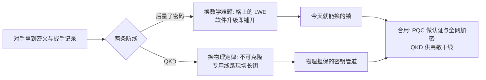

# $\rm Chapter \, 8$ 后量子与收束

> **本章假设你已经会**
>
> 1. 公钥密码的两块基石：Diffie–Hellman 靠离散对数、RSA 靠大数分解，两者的「难」都是对经典计算机说的，见[密码学册第 5 章](../24-密码学/05-公钥与DH.md)的 §5.3 与[第 6 章](../24-密码学/06-RSA与签名.md)的 §6.2。
> 2. 不可克隆定理与测量留痕：量子比特不能复印、想知道态就必须测量、测量就可能出错，见 §1.3。
> 3. BB84 的指纹与安全率：截听比例 $s$ 给出 QBER $s/4$，每筛选比特安全率 ${r=1-2h(q)}$，见 §2.3 与 §2.6。
> 4. 现实 QKD 的账：诱骗态把多光子漏洞从猜变成量、密钥率随距离衰减到截止距离，见 §6.3 与 §6.4。
> 5. 距离的出路：量子中继与纠缠纯化为什么是分段蒸馏而不是复制转发，见第 7 章。

前七章都在回答「怎么做到不可偷、不可仿」：不可克隆定理给了物理根据，BB84 与 E91 把它做成逐轮可对的账，诱骗态与中继把账从理想器材延伸到现实线路。本章换一个问题：**对手有了量子计算机会怎样？** 这不是一个远期话题，因为先存储后解密（harvest now, decrypt later）的对手今天就在收集数据。本章做四件事：把 Shor 算法的威胁面推导完整并实测一遍（小数字 $N=15$、$N=21$ 的周期查找线路模拟）；把对称密码那半边的 Grover 账与迁移时间账算清；给出量子通信与后量子密码的分工对照（接[安全册第 7 章](../76-计算机安全/07-网络安全与TLS.md)与密码学册）；最后把全册收束成一张表，并指出量子学部的下一站。

## $\rm \S \, 8.1$ 今天的锁不靠量子，怕的偏偏是量子

先看现状。你今天访问一个网站，TLS 在防安全册 §7.1 列的三个动词：被偷读、被篡改、被冒充。「防偷读」靠握手时用公钥密码协商会话密钥：DH 压在离散对数难题上（密码学册 §5.3），RSA 压在整数分解难题上（§6.2），证书链的每一段签名同样如此（安全册 §7.4 实测过验证流程）。这些难题的「难」从来不是数学定理，而是经验事实：几十年来没人找到经典计算机上的有效算法。

1994 年 Shor 给出了逆转：量子计算机可以在多项式时间内解分解与离散对数。这一击的落点非常集中，本节先把「打在哪里」说清，§8.2 再完整推导。落点是**周期结构**：分解与离散对数背后都是「求一个函数的周期」，而量子傅里叶变换恰好是找周期的天然工具；对称密码（AES）与哈希背后没有这种代数周期结构，量子算法只能给平方级加速。威胁面因此不对称：公钥积木整栋报废，对称积木强度减半（密码学册 §10.1 第 5 条已给过结论，本章把账算出来）。

于是有两条防线。后量子密码（Post-Quantum Cryptography，PQC）解决「量子机存在的前提下还有没有难解的题」：换数学，把 RSA/DH 换成格上的难题（格与密码册 §6.2 的 LWE），纯软件升级。量子密钥分发（QKD）解决另一件事：「密钥从信道现场长出来」这个动作本身不留截听空间：换物理，安全性由不可克隆与测量扰动担保（§1.3、§2.3），需要专用线路。两条防线不是竞争关系，§8.5 用一张表把分工钉死。先解决「对手是谁」，因为时间账（§8.4）完全取决于威胁面的形状。

> 本节小结：今天的保密压在分解与离散对数两个经典难题上；Shor 对这两个是多项式时间、对对称密码只有平方加速；应对分两路，PQC 换数学、QKD 换物理。

## $\rm \S \, 8.2$ Shor 的威胁面：周期查找完整推导

Shor 算法（Shor's algorithm）的主体不是量子的，是三段式：把分解化归为求阶（order），量子线路只负责求阶中最贵的那一步，其余是经典后处理。逐段推导。

**第一步：分解化归为求阶。** 设 $N$ 是奇合数。随机取 $a$（$1<a<N$），先算 ${\gcd(a,N)}$：万一带出公因子就直接捡到分解，概率极小，忽略。求最小的 $r$ 使

$$
a^{r}\equiv1\pmod{N}
$$

读法：$r$ 叫 $a$ 模 $N$ 的阶，即幂序列第一次绕回 1 的步长。$r$ 必存在：$a$ 与 $N$ 互素时各次幂都落在 ${\{1,\dots,N-1\}}$ 里，最多 $N-1$ 个不同取值，序列比取值多就必有两项相同 ${a^{i}\equiv a^{j}}$，两边乘 $a^{i}$ 的逆元得 ${a^{j-i}\equiv1}$。

**引理（因子公式）。** 若 $r$ 是偶数且 ${a^{r/2}\not\equiv-1\pmod{N}}$，则 ${\gcd(a^{r/2}-1,\,N)}$ 是 $N$ 的非平凡因子。证明三步。记 ${m=a^{r/2}}$，则

$$
m^{2}=a^{r}\equiv1\pmod{N}\;\Longrightarrow\;N\mid(m-1)(m+1)
$$

读法：平方同余 1 意味着 $N$ 整除两个相邻因子的乘积。其一，${m\not\equiv1\pmod{N}}$：否则 ${a^{r/2}\equiv1}$ 而 $r/2<r$，与 $r$ 的最小性矛盾，故 $N\nmid(m-1)$。其二，${m\not\equiv-1}$ 是引理条件，故 $N\nmid(m+1)$。其三，若 ${\gcd(m-1,N)=1}$，则 $N$ 的全部素因子都得落在 $m+1$ 里，即 $N\mid(m+1)$，矛盾；而 $N\nmid(m-1)$ 已给 ${\gcd(m-1,N)<N}$。两头都卡住，gcd 只能落在 1 与 $N$ 之间：非平凡。随机取 $a$ 时两个条件同时成立的概率至少 ${1/2}$（这是 Shor 1994 论文证明的公开结果，可以拿小 $N$ 手验：$N=15$ 时与 $N$ 互素的 7 个 $a$ 里 6 个合格，只有 ${a=14\equiv-1}$ 被第二个条件挡住）。于是期望两次尝试之内拿到因子。

**第二步：量子部分求 $r$。** 用两组寄存器：计数寄存器 $t$ 位、$Q=2^{t}$ 个基态；工作寄存器 $m$ 位、${M=2^{m}\ge N}$ 个基态。参数条件是 ${N^{2}\le Q<2N^{2}}$（第三步会用到 ${Q\ge r^{2}}$，由 ${r<N}$ 与此条件保证）。线路三拍。第一拍对计数寄存器打一层 Hadamard，得均匀叠加；第二拍施加模乘幺正

$$
U_{f}:\ \lvert x\rangle\lvert y\rangle\mapsto\lvert x\rangle\lvert y\oplus(a^{x}\bmod N)\rangle
$$

读法：模乘可以做成可逆经典线路，可逆经典计算都能量子化，所以这个幺正存在；工作寄存器初值取 0，就把每个 $x$ 配上了 ${a^{x}\bmod N}$。第三拍对计数寄存器做量子傅里叶变换（Quantum Fourier Transform，QFT）${F[c,x]=e^{2\pi icx/Q}/\sqrt{Q}}$，然后测量。走完前两拍的状态是

$$
\lvert\psi\rangle=\frac{1}{\sqrt{Q}}\sum_{x=0}^{Q-1}\lvert x\rangle\lvert a^{x}\bmod N\rangle=\frac{1}{\sqrt{Q}}\sum_{k=0}^{r-1}\lvert a^{k}\bmod N\rangle\sum_{j=0}^{J-1}\lvert k+jr\rangle
$$

读法：关键结构在第二个等号。${a^{r}\equiv1}$ 让幂只依赖 ${x\bmod r}$：把 $x$ 写成 ${x=k+jr}$（$k$ 是余数、$J=Q/r$ 是每类的项数），同一类里工作寄存器取同一个值 ${a^{k}\bmod N}$，于是叠加态按余数类分了组。

**第三步：QFT 的峰。** 测得 $c$ 的幅值是各余数类贡献之和：

$$
\alpha_{c}=\frac{1}{Q}\sum_{k=0}^{r-1}e^{2\pi ick/Q}\sum_{j=0}^{J-1}e^{2\pi icjr/Q}
$$

读法：外层求和对 $k$、内层对 $j$；第二重求和是几何级数，部分和公式给出模长

$$
\Bigl|\sum_{j=0}^{J-1}e^{2\pi icjr/Q}\Bigr|=\Bigl|\frac{\sin(\pi cJr/Q)}{\sin(\pi cr/Q)}\Bigr|
$$

读法：分子是 $J$ 个单位向量首尾相接后离原点的距离。当 $r$ 整除 $Q$ 且 ${c=\ell Q/r}$（$\ell$ 整数）时，内层每一项 ${e^{2\pi i\ell j}=1}$，$J$ 项完全相干地叠加，幅值模长恰为 $J$；外层的 $r$ 个 $k$ 类彼此正交不相干，概率相加：

$$
p(c)=\frac{1}{Q^{2}}\cdot r\cdot\Bigl(\frac{Q}{r}\Bigr)^{2}=\frac{1}{r}
$$

读法：每个类贡献 ${\bigl(1/Q\bigr)^{2}\bigl(Q/r\bigr)^{2}}$，$r$ 个类合计 ${1/r}$。峰恰好落在 ${Q/r}$ 的倍数上，每个概率 ${1/r}$，其余 $c$ 的分子分母都小、概率近零。$r$ 不整除 $Q$ 时峰散在最近格点附近，同一套 sin 比公式放缩（${\lvert\sin u\rvert\le\lvert u\rvert}$）给出公开结果：离某个峰不超过半个格点的 $c$ 满足 ${p(c)\ge 4/(\pi^{2}r)}$；峰形长什么样，§8.3 的 E2 会实测给你看。

**第四步：经典后处理，连续分数。** 测到的 $c$ 满足 ${\lvert c-sQ/r\rvert\le1/2}$（某个 $\ell=s$ 的峰附近），除以 $Q$：

$$
\Bigl|\frac{c}{Q}-\frac{s}{r}\Bigr|\le\frac{1}{2Q}\le\frac{1}{2r^{2}}
$$

读法：第二个不等号就是 ${Q\ge r^{2}}$。数论里的连续分数（continued fraction）定理说：任何满足 ${\lvert x-p/q\rvert<1/(2q^{2})}$ 的分数 $p/q$ 必是 $x$ 的连续分数展开中的一个渐近分数（辗转相除逐层展开、逐层截断即得），所以 ${s/r}$（约分后）一定能在候选里找到。算法：对 $c/Q$ 做辗转相除展开，扫过分母不超过 $N$ 的渐近分数作候选 $r$（约分丢掉的公因子用 2 倍、4 倍分母兜底），逐个用一次经典模幂验证 ${a^{r}\equiv1}$，合格且偶数就按引理取因子。验证步不是多余的：§8.3 会看到它当场挡下一次错猜。

**威胁面收口。** 全线路的门数是 ${\mathrm{poly}(\log N)}$：模乘的可逆电路与 QFT 的 ${O(t^{2})}$ 门都只随比特数多项式增长。经典一侧，最好的通用分解算法（数域筛）运行时间是次指数的 ${\exp\bigl(O((\log N)^{1/3}(\log\log N)^{2/3})\bigr)}$；离散对数同类。RSA（§6.2）、DH 与 ElGamal（密码学册 §5.4）、ECC（密码学册第 7 章）全部站在这族周期问题上，一并出局。这就是威胁面的形状：不是「量子计算机算得快」这么笼统，是「周期结构可被 QFT 相干放大」这一条特定通道。

> 本节小结：分解化归为求阶，${m^{2}\equiv1}$ 加两个「不同余」条件把因子从 gcd 里挤出来；量子线路用 QFT 把周期变成 ${Q/r}$ 倍数处的概率峰，连续分数从峰位恢复 $r$，全部门数多项式级。

## $\rm \S \, 8.3$ 实测：$N=15$ 与 $N=21$ 的周期查找线路

上面的每一步都可以在小数字上真跑。脚本对两个 $N$ 做了完整的态矢量幺正模拟：${\lvert0\rangle}$ 初态、Hadamard 层、以索引置换实现的 $U_{f}$（真幺正，不是抽样捷径）、以 ${Q\times Q}$ 矩阵直乘实现的 QFT，最后按 Born 规则对计数寄存器抽样两万发。环境为 WSL 里的 python3 加 numpy（2.5.4），脚本与全部输出存于 `26Fall/_uni5_work/expQI08/`，种子固定 ${20261109}$，总耗时约 2.4 秒。复现命令：

```bash
# 环境: WSL 的 Bash; 前置: python3 与 numpy; 脚本只读自身代码, 输出走标准输出
cd /mnt/c/Users/20811/Desktop/26Fall/_uni5_work/expQI08
python3 expQI08.py    # stdout 即随附 result.txt; 种子固定, 重跑逐位一致
```

成功验证：末行打印「断言全部通过」，E0 至 E4 五段齐全；每段的概率账都先过归一化断言再进表。

E1a 是 $N=15$、$a=7$ 的账。$7$ 的阶是 $r=4$（${7,4,1}$ 循环），取 ${Q=256\ge15^{2}}$ 且 ${4\mid256}$，理论预言峰精确落在 ${Q/r=64}$ 的倍数上、每峰概率 ${1/4}$。实测峰位与后处理：

| $c$ | 概率 | 连续分数 | 结局 |
| --- | --- | --- | --- |
| ${0}$ | ${0.250000}$ | 0 | 作废，无信息 |
| ${64}$ | ${0.250000}$ | ${1/4}$ | $r=4$，因子 ${\gcd(7^{2}-1,15)=3}$ |
| ${128}$ | ${0.250000}$ | ${1/2}$ | 约分丢了信息，翻倍兜底恢复 $r=4$，因子 3 |
| ${192}$ | ${0.250000}$ | ${3/4}$ | $r=4$，因子 3 |

四个峰的概率实测与理论值 ${0.25}$ 逐位一致。逐 $c$ 判定的确定性单发成功率是 ${0.7500}$（只有 $c=0$ 作废），两万发抽样得 ${0.7506}$，标准误 ${0.0031}$，贴住；期望发射数 ${1.33}$ 发。E1b 换 $a=11$：阶 $r=2$，峰只有 ${0}$ 与 ${128}$ 两个、各 ${0.500000}$，单发成功率 ${0.5000}$（抽样 ${0.4981}$），期望 ${2.00}$ 发，因子是 ${\gcd(11-1,15)=5}$。

E2 是本章的主菜：$N=21$、$a=2$，阶 ${r=6}$，${Q=512\ge21^{2}}$ 但 ${6\nmid512}$，${Q/r=85.33}$ 不是整数，峰不可能精确落格。实测峰形：

| $c$ | 概率 | 连续分数 | 结局 |
| --- | --- | --- | --- |
| ${0}$ | ${0.166672}$ | 0 | 作废 |
| ${85}$ | ${0.113989}$ | ${1/6}$ | $r=6$，因子 ${\gcd(2^{3}-1,21)=7}$ |
| ${171}$ | ${0.113989}$ | ${1/3}$ | 约分丢信息，翻倍兜底得 $r=6$，因子 7 |
| ${256}$ | ${0.166672}$ | ${1/2}$ | 验证步拒绝：${2^{2}=4\not\equiv1\pmod{21}}$ |
| ${341}$ | ${0.113989}$ | ${2/3}$ | 翻倍兜底得 $r=6$，因子 7 |
| ${427}$ | ${0.113989}$ | ${5/6}$ | $r=6$，因子 7 |

三个看点。其一，峰不再整齐：主峰概率从 ${1/6}$ 掉到 ${0.114}$，且概率漏到峰旁的「泄漏箱」里；但连续分数不管泄漏，只要峰位离 ${sQ/r}$ 足够近就能恢复。四个主峰格点的成功概率质量合计 ${0.4560}$，峰外泄漏箱还额外贡献 ${0.1738}$，占全部成功概率的 ${27.6\%}$：算法对脏峰比直觉鲁棒。逐 $c$ 判定的确定性成功率 ${0.6297}$，抽样 ${0.6273}$ 贴住，期望 ${1.59}$ 发。其二，${c=256}$ 是活教材：它的连续分数给 ${1/2}$，看似 $r=2$，但验证步 ${a^{r}\equiv1}$ 一查便知 ${2^{2}=4\not\equiv1}$，错猜被挡下。没有这一步的 Shor 实现会把三分之一概率花在错周期上。其三，约分是常态而非例外：${s}$ 与 $r$ 有公因子时，最简分数的分母只剩 $r$ 的因子，靠翻倍（或更多倍）分母兜底找回；公因子超过 2 时兜底还得再翻（$c=256$ 恰好演示了翻一倍不够的情形），多试几发即可。

顺带一个真踩过的坑，作为证据式排查的样品。初版脚本把 Hadamard 层写成了对整个 ${Q\times M}$ 空间铺均匀叠加（相当于工作寄存器也被打了一层 H），归一化断言当场报错：概率和是 $16$ 不是 $1$，恰等于 $M$。定位只需一步：Hadamard 只作用在计数寄存器上，均匀叠加只该铺在 ${j=0}$ 一列。修正后全部断言通过。教训落在结构上：态矢量模拟里每一拍作用在哪个寄存器上，比经典代码里「循环到哪个变量」更容易顺手写错，逐拍断言归一化是最便宜的保险。

> 本节小结：峰概形与理论逐位对上（精确 ${1/r}$ 与脏峰两态都有）；单发成功率 ${0.7500/0.5000/0.6297}$，期望 ${1.33/2.00/1.59}$ 发；验证步挡下 ${c=256}$ 的错周期，约分靠倍数分母兜底。

## $\rm \S \, 8.4$ Grover 的一半，与先存储后解密的时间账

威胁面的另一半是对称密码。AES 的密钥是 ${2^{k}}$ 个等可能取值，没有周期结构可放大，量子算法能给的是搜索的平方加速。Grover 算法（Grover's algorithm）的推导两行就够：把初态均匀叠加 ${\lvert s\rangle}$ 分解到标记态 ${\lvert x^{*}\rangle}$ 与其余态的均匀叠加 ${\lvert\bar{s}\rangle}$ 张成的二维平面上，

$$
\lvert s\rangle=\sin\theta\,\lvert x^{*}\rangle+\cos\theta\,\lvert\bar{s}\rangle,\qquad\theta=\arcsin\frac{1}{\sqrt{N}}
$$

读法：标记态的幅值份额是 ${1/\sqrt{N}}$，取 arcsin 就是它与 ${\lvert\bar{s}\rangle}$ 轴的夹角。每轮迭代 = 对 ${\lvert x^{*}\rangle}$ 的相位翻转（oracle）接一次关于 ${\lvert s\rangle}$ 的反射（扩散），两个反射之积是转过 ${2\theta}$ 角的旋转；$k$ 轮后标记态幅值是 ${\sin\bigl((2k+1)\theta\bigr)}$，成功概率是其平方。取 ${k\approx\pi/(4\theta)-1/2\approx\frac{\pi}{4}\sqrt{N}}$ 就把概率推近 1：搜索 ${2^{k}}$ 位的密钥空间只需 ${2^{k/2}}$ 量级次 oracle 调用，AES-128 的有效强度降到 64 位、AES-256 降到 128 位（与密码学册 §10.1 的口径一致）。两条公开结果给这半边封顶：Bennett 等 1997 年证明黑盒搜索没有低于 ${\Omega(\sqrt{N})}$ 的量子算法（减半已是极限，不是还能再压）；Grover 的并行化只随机器数线性增长（Zalka 1999），堆机器省不了多少时间。

E3 在小空间实测这套旋转账（${n=8,10,12}$ 位、态矢量迭代到概率峰值）：

| $n$ | $\theta$ | 实测最优 $k$ | 峰值概率 | ${\frac{\pi}{4}\sqrt{N}}$ |
| --- | --- | --- | --- | --- |
| ${8}$ | ${0.062541}$ | ${12}$ | ${0.999947}$ | ${12.57}$ |
| ${10}$ | ${0.031255}$ | ${25}$ | ${0.999461}$ | ${25.13}$ |
| ${12}$ | ${0.015626}$ | ${50}$ | ${0.999945}$ | ${50.27}$ |

实测最优迭代数与解析式 ${\frac{\pi}{4}\sqrt{N}}$ 逐档对上，峰值概率与 ${\sin^{2}\bigl((2k+1)\theta\bigr)}$ 的解析值逐位一致（脚本断言容差 ${10^{-9}}$ 内）。

真正的账在时间上。E4a 把迭代数外推成墙钟时间，oracle 速率是**假设口径**（标注：量子 oracle 的单次成本远高于经典哈希一次，这里只演示「迭代数怎么变成年」的算法本身）：

| 目标 | Grover 迭代数 | ${10^{6}}$ 次/秒 | ${10^{9}}$ 次/秒 | ${10^{12}}$ 次/秒 |
| --- | --- | --- | --- | --- |
| AES-128 等价 | ${2^{64}}$ | ${5.85\times10^{5}}$ 年 | ${585}$ 年 | ${0.585}$ 年 |
| AES-256 等价 | ${2^{128}}$ | ${1.08\times10^{25}}$ 年 | ${1.08\times10^{22}}$ 年 | ${1.08\times10^{19}}$ 年 |

读法：就算 oracle 快到每秒一万亿次，AES-128 也只要大半年，AES-256 却要 ${10^{19}}$ 年量级。结论与密码学册一致：对称这半边的应对是一句话，密钥与哈希输出翻倍，不用推翻架构。

公钥那半边没有这种从容，因为对手可以**先存储后解密**：今天录下的 RSA 握手与密文，在量子机成熟后回溯解开，而数据的保密需求不会因此过期。Mosca 不等式把这笔账写成一行：设 $X$ 为数据必须保密的年数、$Y$ 为完成密码迁移的年数、$Z$ 为量子机具备破解能力的剩余年数，则 ${X+Y>Z}$ 时必然有一段窗口期数据裸奔。E4b 用公开讨论中常见的量级假设值（标注：$X$/$Y$/$Z$ 均为假设，不是任何机构的实测）演算四类数据：

| 数据类别 | $X$（年） | $Y$（年） | ${X+Y}$ | ${Z=15}$ | ${Z=25}$ |
| --- | --- | --- | --- | --- | --- |
| 医疗影像档案 | ${30}$ | ${10}$ | ${40}$ | 破 | 破 |
| 国家机密档案 | ${50}$ | ${10}$ | ${60}$ | 破 | 破 |
| 企业人事与合同 | ${15}$ | ${10}$ | ${25}$ | 破 | 守 |
| 浏览会话密钥 | ${0}$ | ${10}$ | ${10}$ | 守 | 守 |

公开锚点给时间轴定标：NIST 已于 2024 年 8 月定稿后量子标准 FIPS 203/204/205（ML-KEM、ML-DSA、SLH-DSA，与格与密码册 §6.1 的口径一致），其配套的过渡路线图公开草案建议 112 位经典安全强度的算法（RSA-2048、ECDH P-256 一类）2030 年后弃用、2035 年后禁用。这些日期是否精确并不重要，重要的是方向：**迁移期的存在本身**决定了「等量子机出来了再换」不是一个可选项，因为 $Z$ 的不确定性只影响判断的松紧，不影响 ${X+Y>Z}$ 的结构。

> 本节小结：对称半边被 Grover 砍半且砍不动更多（${2^{64}}$ 次迭代在假设速率下也要 ${585}$ 年，AES-256 是 ${10^{19}}$ 年量级）；公钥半边被 Shor 清零且有先存储后解密的回溯风险；Mosca 的 ${X+Y>Z}$ 说明迁移现在就得启动。

## $\rm \S \, 8.5$ 两条防线的分工对照

比较前先把两个对象与共同维度定义清楚。后量子密码（PQC）：在经典图灵机上运行、安全压在新数学难题上的密码学，主力是格上的带误差学习（Learning With Errors，LWE）问题及其解法，完整定义与 Regev 加密见格与密码册 §6.2 与 §6.3；它的「抗量子」是一条经验陈述（至今没有量子多项式算法，连可靠的超多项式候选都没有），不是定理。QKD：物理线路上的密钥分发，安全性由不可克隆与测量扰动担保，本册 §1 至 §7 是它的账本。共同维度取五个：信任锚、保护对象、失效方式、部署条件、认证依赖。

| 维度 | 后量子密码 | QKD |
| --- | --- | --- |
| 信任锚 | 数学难题的经验难度（LWE 无已知量子解法） | 物理定律（不可克隆、测量塌缩） |
| 保护对象 | 密钥、身份、可加密的存量数据 | 现场生成的对称密钥 |
| 失效方式 | 难题被新算法或新硬件攻破，全线换锁 | 设备偏离安全模型（侧信道），账本失效 |
| 部署条件 | 软件与协议升级，互联网现有链路即可 | 专用光纤/设备，距离受损耗与暗计数限制（§6.4、第 7 章） |
| 认证依赖 | 自带（签名与 KEM 就是它自己，§6.4） | 需要预先认证的经典信道，初始密钥另有来源 |



表里最值得展开的是认证依赖，它是 QKD 的鸡生蛋问题。QKD 防的是「偷」：窃听必留痕。但安全册 §7.1 的三个动词里还有「改」与「冒充」：经典后处理信道（§2.6 的纠错与验证）若不认证，中间人可以两头各跑一个假协议；而认证本身需要密钥或签名。签名从哪来？今天唯一切实的来源是 PQC（或人工预共享的少量密钥）。所以现实部署里 QKD 站在 PQC 的地基上，反过来不成立。这也解释了分工的形状：安全册与密码学册关心的全套动词里，QKD 只直接封「读」这一项（密钥不被偷），「改」与「冒充」仍归认证与完整性机制管。

由此得全章的分工结论。PQC 是主干：今天就能全网铺开、保护存量与身份、失效时是算法问题而不是硬件问题。QKD 是高敏干线与特定场景的物理管道：信任锚更硬（物理定律不会像数学难题那样被一篇论文推翻），但距离、成本与认证依赖使它在中短期内的角色是补充而非替代。两者共同对标的是同一个对手（§8.2 的周期通道），谁也不等谁：PQC 的迁移账在 §8.4 已经到期，QKD 的工程账在第 6、7 章已经算过。

> 本节小结：五个维度上两条防线互补而非竞争；PQC 自带认证、QKD 依赖认证；现实路线是 PQC 做全网主干、QKD 守高敏干线。

## $\rm \S \, 8.6$ 全册收束：八个章节各解决了哪一维

全册的心智模型一句话：**量子通信的任务不是传得快，而是传得不可偷、不可仿。** 现在可以把这句话拆成一张账，每章贡献一维：

| 章 | 装备 | 解决的一维 | 交给下一棒什么 |
| --- | --- | --- | --- |
| 第 1 章 | 不可克隆定理 | 「不可偷」的物理根据：窃听必留痕 | 指纹的存在性 |
| 第 2 章 | BB84 | 把留痕变成可算的账：${s/4}$ 错码率与安全率 | 第一台完整协议 |
| 第 3 章 | E91 与 CHSH | 把信任从仪器挪到纠缠本身（设备无关） | 对器材作证的手段 |
| 第 4 章 | 隐形传态 | 态的搬运：纠缠预分发加经典比特，超光速封死 | 中继的基本动作 |
| 第 5 章 | 超密编码与 Holevo 界 | 容量上限：一颗量子比特至多换两个经典比特 | 网络资源的记账法 |
| 第 6 章 | 诱骗态 | 理想单光子枪换成现实激光，堵住分光攻击 | 工程化的密钥率 |
| 第 7 章 | 中继与纠缠纯化 | 距离极限的出路：分段蒸馏而非复制转发 | 量子互联网的骨架 |
| 本章 | Shor 实测与时间账 | 对手是谁、两条防线怎么分工 | 全站接口 |

这张表还有一个回读角度：不可克隆定理在全册里是双面角色。它是盾（第 1、2 章：窃听者复制不了态，只能测量，测量就留痕），也是墙（第 7 章：中继不能靠复制态来放大信号，只能纠缠纯化这种更费劲的路线）。同一个定理决定了安全从哪来、也决定了扩展为什么难，这是本册最值得带走的一条结构性认识。

量子学部的接口。其一，[量子力学册第 11 章](../14-量子力学/11-边界与QCS路口.md)的 §11.5 列了 QCS 路口的四个方向（超密编码、隐形传态、量子密码、纠错与容错）：前两个在第 4、5 章兑现并算清了经典比特账，第三个是全册本体，第四个（纠错与容错）是第 7 章中继存储器现状背后的深层原因。其二，[量子机器学习册第 5、6 章](../72-量子机器学习/06-QML的真实定位.md)从另一侧给「量子机什么时候到货」记账：§5.1 把量子优势分成三个强度并指出演示陷阱，§6.1 的 NISQ 硬件现实与 §5.5 的诚实判决书共同说明为什么 §8.4 的 $Z$ 有这么大的不确定性。其三，密码与安全一侧的接口在密码学册 §10.1（量子威胁的工程结论）与安全册 §7（TLS 的动词清单），§8.5 的分工表是对它们的后量子补全。

> 本节小结：八章合成一条链，物理根据、协议、账本、搬运、容量、工程、距离、对手；不可克隆定理一肩挑起「安全从哪来」与「扩展为什么难」。

## $\rm \S \, 8.7$ 适用条件与限制

1. 模拟口径。$U_{f}$ 以索引置换实现、QFT 以矩阵直乘实现，是寄存器级的幺正模拟；真实电路要把模乘分解成受控门网络，资源账是另一门课（公开估计：分解 RSA-2048 需要千万量级的噪声物理量子比特与容错协议，Gidney 与 Ekerå 2019 的估计常被引用）。
2. 期望发射数 ${1.33/2.00/1.59}$ 只对这三个小 $N$ 成立。大 $N$ 的一般结论是公开结果：单发成功概率有常数级下界，换一个 $a$ 重跑整体期望仍是常数次发射加多项式后处理。
3. Grover 时间账的 oracle 速率是假设口径。真实量子 oracle 的每次调用要付出可逆电路与纠错代价，表只演示迭代数到墙钟的换算机制，不构成对硬件的预言。
4. Mosca 表的 $X$、$Y$、$Z$ 全是假设值。$Z$ 没有学界共识，表的价值在机制（${X+Y>Z}$ 必有窗口期），不在任何具体日期。
5. 全部实测是纯态矢量模拟，无噪声。噪声下 QFT 峰形退化、成功率下降，那属于量子纠错与容错的账（量子力学册 §11.5 第 2 条的「纠缠即退相干」）。

## $\rm \S \, 8.8$ 关键概念回顾

1. 把「${m^{2}\equiv1\pmod{N}}$ 推出 ${\gcd(m-1,N)}$ 非平凡」的三步论证写全，并指出「${m\not\equiv1}$」与「${m\not\equiv-1}$」两个条件各挡住了哪种退化情形。
2. $r$ 整除 $Q$ 时，峰为什么恰好落在 ${Q/r}$ 的倍数上、每个概率恰为 ${1/r}$？用相干叠加的语言复述，再说明 $r$ 不整除 $Q$ 时 E2 的峰形如何变化。
3. E2 里 ${c=256}$ 的连续分数给 ${1/2}$，算法为什么没有上当？这道验证步挡掉了总概率的多少？
4. Grover 为什么只把密钥强度砍半而不是清零？用 ${\sin^{2}\bigl((2k+1)\theta\bigr)}$ 与黑盒下界各说一句。
5. Mosca 不等式 ${X+Y>Z}$ 的三个量各是什么？用 E4b 的表说明哪些数据类别最先出问题、为什么「会话密钥」最安全。

## $\rm \S \, 8.9$ 应用与辨析

1. 同事说：「等量子通信普及了，量子计算机就偷不走任何东西了。」指出这句话至少混淆的三个维度，并用 §8.5 的表逐条纠正。
2. E1a 里 ${c=128}$ 的连续分数是 ${1/2}$、恢复的 $r$ 却是 4；E2 里 ${c=171}$ 是 ${1/3}$、$r$ 却是 6。两者的共同机制是什么？这个兜底在什么情况下会失手，失手了怎么办？
3. 你的机构有需保密 ${20}$ 年的档案，迁移预算两年。按 E4b 的口径判断是否现在启动迁移，并指出这个判断里最脆弱的假设是哪一个。

## $\rm \S \, 8.10$ 本章自测答案

概念回顾答案：

1. 三步：${m^{2}\equiv1}$ 给 ${N\mid(m-1)(m+1)}$（§8.2）；若 ${\gcd(m-1,N)=1}$ 则 $N$ 的素因子全落在 $m+1$ 里、$N$ 整除 $m+1$，与 ${m\not\equiv-1}$ 矛盾，故 gcd 大于 1；${N\nmid(m-1)}$（来自 ${m\not\equiv1}$，而后者由 $r$ 的最小性保证）给 gcd 小于 $N$（§8.2）。
2. ${r\mid Q}$ 且 ${c=\ell Q/r}$ 时，内层几何级数每项 ${e^{2\pi i\ell j}=1}$，$J=Q/r$ 项完全相干，幅值模长恰为 $J$，$r$ 个互不相干的余数类概率相加得 ${1/r}$（§8.2）。${r\nmid Q}$ 时相干条件只在最近格点上近似成立，峰高从 ${1/r}$ 掉到约 ${0.11}$ 并向邻格泄漏，但连续分数只要求峰位足够近，故恢复不受阻（§8.3 的 E2 表）。
3. 验证步要求候选 $r$ 满足 ${a^{r}\equiv1\pmod{N}}$，而 ${2^{2}=4\not\equiv1\pmod{21}}$，错猜被拒（§8.3）。它挡掉的是 ${c=256}$ 的概率质量 ${0.1667}$，约占总概率的六分之一。
4. 平方加速：${k\approx\frac{\pi}{4}\sqrt{N}}$ 次迭代把成功概率推近 1，${2^{k}}$ 的密钥空间降到 ${2^{k/2}}$ 量级调用，强度减半（§8.4）；黑盒模型下 ${\Omega(\sqrt{N})}$ 是下界（Bennett 等 1997），所以减半就是全部，不存在把对称密码同样清零的量子算法（§8.4）。
5. $X$ 是数据保密寿命、$Y$ 是迁移耗时、$Z$ 是量子机具备破解能力的剩余年数；${X+Y>Z}$ 即有裸奔窗口（§8.4）。$X$ 越大越先出事：机密档案（${60}$）与医疗档案（${40}$）在两种 $Z$ 下都破；会话密钥 ${X=0}$，用完即废，回溯解密对它无利可图（§8.4）。

应用与辨析答案：

1. 三个维度。其一，保护对象：QKD 保护的是现场分发的密钥，不保护存量数据；今天用 RSA 握手的流量照样可以被先存储后解密（§8.4、§8.5）。其二，动词覆盖：QKD 只封「读」，「改」与「冒充」仍要认证机制，而 QKD 自身的认证还依赖 PQC（§8.5）。其三，可达范围：QKD 受距离与专用线路限制，全网覆盖在中短期不现实（§6.4、第 7 章）；PQC 才是全网主干（§8.5）。
2. 共同机制：测得的 ${s/r}$ 在连续分数里被约去公因子 ${g=\gcd(s,r)}$，最简分数的分母只剩 ${r/g}$，用倍数分母兜底扫回 $r$（§8.3）。$g=2$ 时翻一倍必救回（E1a 的 ${2/4}$ 与 E2 的 ${2/6}$ 都是）；$g\ge3$ 时翻一倍不够（E2 的 ${c=256}$，${g=3}$，扫到 $4$ 仍不是 6），失手就重抽一发，期望多花常数次发射（§8.3）。
3. ${X=20}$、${Y=2}$、${X+Y=22}$：只要 $Z$ 不超过 ${22}$ 年就破，而公开估计的 $Z$ 大多远小于此，结论是现在启动（§8.4）。最脆弱的假设是 $Z$：它没有共识、只能区间估计；其次是 $X$（档案寿命被低估只会更破，被高估则可能白迁移），$Y$ 相对可控（§8.7 第 4 条）。

> 你现在能：完整复述 Shor 三段式（化归求阶、QFT 成峰、连续分数恢复）并用 $N=15/21$ 的实测账向别人演示；用 Grover 的旋转账解释为什么对称强度只减半；用 Mosca 不等式给一份「哪些数据必须现在动」的判断；用五个维度说清 PQC 与 QKD 的分工。

全册到本章收口。前七章与本章的装备清单、账目口径与实测数字，正是下一站要你闭卷取出的东西：12-复习总结/R1 会用提取练习把八章重新过一遍，别翻书，先自己把上面那张收束表默出来，再去对答案。

---

实验记录：本章 §8.3 与 §8.4 全部实测数字来自脚本 `expQI08.py`（E0 环境自检；E1a/E1b $N=15$ 两个 $a$ 的周期查找态矢量模拟与两万发抽样账；E2 $N=21$ 脏峰情形的主峰、泄漏箱与确定性成功率账；E3 Grover 三档小空间的旋转账与解析对账；E4a/E4b 标注口径的 Grover 外推时间表与 Mosca 场景表；python3 加 numpy 2.5.4，种子 ${20261109}$，WSL 运行，总耗时约 2.4 秒）。其中 E1/E2/E3 为蒙特卡洛与态矢量实测，E4 为标注假设的算术推演。原始输出存于写作工作目录 `26Fall/_uni5_work/expQI08/result.txt`，重跑可逐位复现表中数字。
