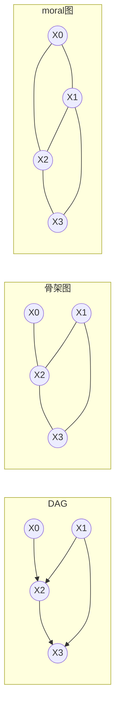

# $\rm Chapter \, 2$ 马尔可夫随机场

> **本章前置自检**（先勾选再进入；勾不上的项先回读）：
>
> 1. 贝叶斯网把联合分布拆成条件分布之积 ${p(\mathbf{x}) = \prod_i p\big(x_i \mid \mathrm{Pa}(x_i)\big)}$，并记得局部与成对马尔可夫性质在贝叶斯网里的说法（第 1 章；概率论册 $\rm \S \, 8.3$、$\rm \S \, 8.6$）。
> 2. 会跑 d-分离：链与分叉看中间点，对撞点不看则断、看了（或看了其后代）则通（第 1 章）。
> 3. 记得团、势函数、配分函数 ${Z}$ 的定义，以及「势不是概率、只表达相对偏好、可以大于 1」（概率论册 $\rm \S \, 9.2$）。
> 4. 见过 Hammersley–Clifford 定理的白话陈述与证明骨架（概率论册 $\rm \S \, 9.3$）。
> 5. 知道变量消元把大求和拆成一串小表（概率论册 $\rm \S \, 9.6$）：本章只借它算一次 ${Z}$，第 3 章才正面展开。

第 1 章的有向语言靠箭头干活：箭头既编码条件独立，又顺手排出一条生成次序。可有一大类依赖天生对称，图像相邻像素互相平滑、格点上自旋互相耦合、软约束里几个量互相牵制，硬造方向要么写出环，要么塞进原模型没有的「解释掉」断言（概率论册 $\rm \S \, 9.1$ 用像素的例子讲过这一遍）。本章把无向模型正式化，并补上概率论册第 9 章一笔带过的三件事：三种马尔可夫性质的等级与相互推出关系；Hammersley–Clifford 定理里正性条件到底堵住了哪个口子（用一个整个写得进正文的反例回答）；有向与无向互化时各损失什么、为什么。全册心智模型是把不确定写成图、结构编码独立性；本章是把「对称」写进图的那一页。

## $\rm \S \, 2.1$ 分离：无向图的独立性判据

**马尔可夫随机场（Markov random field, MRF）**是一对对象：一张无向图 ${G=(V,E)}$，每个节点挂一个随机变量；以及一个满足本节判据的分布。判据叫**全局马尔可夫性质（global Markov property）**，用**分离（separation）**陈述。设 ${\mathbf{A},\mathbf{B},\mathbf{S}}$ 是两两不交的节点集合：从图中删去 ${\mathbf{S}}$ 里的节点及其全部边之后，若 ${\mathbf{A}}$ 与 ${\mathbf{B}}$ 之间不再有任何路径，就说 ${\mathbf{S}}$ 分离 ${\mathbf{A}}$ 与 ${\mathbf{B}}$，记 ${\mathbf{A} \perp_G \mathbf{B} \mid \mathbf{S}}$。分布 ${p}$ 关于 ${G}$ 满足全局马尔可夫性质，若

$$
\mathbf{A} \perp_G \mathbf{B} \mid \mathbf{S}
\;\Longrightarrow\;
X_{\mathbf{A}} \perp X_{\mathbf{B}} \mid X_{\mathbf{S}}
$$

对一切这样的三元组成立，其中 ${X_{\mathbf{A}} = \{X_i : i \in \mathbf{A}\}}$。注意这是两个世界的条件句：左边是图上的可判属性，右边是分布上的概率性质；图的判据每声称一条独立，分布就要真的兑现一条。

拿它和第 1 章的 d-分离对个账。d-分离要逐条通路检查活动性：链与分叉的中间点在条件集里则阻断，对撞点却相反，不看则断、看了则通。分离只做一件事：删点、看连通。便宜的原因在图的结构里：无向通路被阻断当且仅当至少一个中间点被删，删掉的点就是全部阻断方式，没有「看则通」这回事。于是分离对条件集是单调的，${\mathbf{S}}$ 能分离则更大的集合更能分离；d-分离没有这种单调性，往条件集里加一个对撞点反而会把断了的通路接活。代价在 $\rm \S \, 2.5$ 结账：省掉对撞结构的同时，也失去了表示「无条件独立、给定后相关」的能力。

## $\rm \S \, 2.2$ 势函数乘积与全局分布

分布这一侧，概率论册 $\rm \S \, 9.2$ 已给出写法：在图的每个团 ${C}$ 上放一个非负**势函数（potential）**${\psi_C}$，联合分布是团势之积除以**配分函数（partition function）**${Z}$：

$$
p(\mathbf{x}) = \frac{1}{Z} \prod_{C \in \mathcal{C}} \psi_C(\mathbf{x}_C),
\qquad
Z = \sum_{\mathbf{x}} \prod_{C \in \mathcal{C}} \psi_C(\mathbf{x}_C)
$$

本章统一取 ${\mathcal{C}}$ 为全部**最大团（maximal clique）**。这样取不损失表达力：若某个模型把势放在小团（比如单条边）上，把每条边的势乘进任意一个包含它的最大团势里、单点势乘进含它的最大团势里，乘积逐状态不变，只是换了记账单位。本章的贯穿例子是四环：节点 ${0,1,2,3}$ 连成圈 ${0\!-\!1\!-\!2\!-\!3\!-\!0}$，最大团就是四条边；边上放同值偏好势 ${\psi_{ij}(x_i,x_j) = e^{\beta}}$（同值）或 ${e^{-\beta}}$（异值），点上放外场势 ${\phi_i(x_i) = e^{h}}$ 或 ${e^{-h}}$，这正是概率论册 $\rm \S \, 9.4$ 的 Ising 形状，本章取 ${\beta = 0.8}$、${h = 0.3}$。

知道全部势不等于拿到分布：中间横着一个 ${Z}$。把全局分布从局部势里**重构**出来有两条路。一是全枚举，对 ${2^n}$ 个状态逐个算乘积再求和；二是变量消元，按概率论册 $\rm \S \, 9.6$ 的办法把求和重排成一串小表。两条路算的是同一个 ${Z}$，但走的账本不同：枚举要摊开整张 ${2^4 = 16}$ 项的联合表，消元在四环上按序消去 ${0,1,2}$ 三个节点，最大的中间表只有 ${2^3 = 8}$ 项。$\rm \S \, 2.6$ 的实测让两条路当面对账，确认「局部势加一次全局归一得到整张联合表」这条通道本身不走样。

还有一处记账自由值得先说破：势函数远非唯一。把任意一个团势除以常数 ${c}$、另一个除以 ${1/c}$，乘积逐状态不变，全被 ${Z}$ 吸收；更一般地，落在子团上的因子可以随意在包含它的团之间搬移。所以「这个模型的势是多少」没有唯一答案，可辨识的是乘积整体给出的分布，第 7 章学参数时还要回到这一点。

## $\rm \S \, 2.3$ 全局、局部、成对：三种马尔可夫性质

全局性质的条件集是任意的，用起来常嫌重。两个降档版本：

1. **局部马尔可夫性质（local Markov property）**：每个变量给定自己的邻居后与非邻居独立，
   ${X_i \perp X_{V \setminus (\{i\} \cup \mathrm{Nb}(i))} \mid X_{\mathrm{Nb}(i)}}$，其中 ${\mathrm{Nb}(i)}$ 是 ${i}$ 的邻居集。
2. **成对马尔可夫性质（pairwise Markov property）**：每对不相邻的变量给定其余全部变量后独立，
   ${X_i \perp X_j \mid X_{V \setminus \{i,j\}}}$。

| 性质 | 陈述 | 条件集 |
| --- | --- | --- |
| 全局 | ${\mathbf{S}}$ 分离 ${\mathbf{A},\mathbf{B}}$ 则 ${X_{\mathbf{A}} \perp X_{\mathbf{B}} \mid X_{\mathbf{S}}}$ | 任意 ${\mathbf{S}}$ |
| 局部 | ${X_i \perp}$ 非邻居全体 ${\mid X_{\mathrm{Nb}(i)}}$ | 邻居 |
| 成对 | 不相邻 ${i,j}$：${X_i \perp X_j \mid}$ 其余全体 | 其余全部变量 |

**定理 1**：全局 ${\Rightarrow}$ 局部 ${\Rightarrow}$ 成对，对一切分布成立，不需要任何正性。

证明。先看全局推局部。固定 ${i}$，取 ${\mathbf{S} = \mathrm{Nb}(i)}$、${\mathbf{B} = V \setminus (\{i\} \cup \mathrm{Nb}(i))}$：在图里删去 ${\mathrm{Nb}(i)}$ 后，${i}$ 的全部边都断了，它与 ${\mathbf{B}}$ 之间没有任何路径，分离成立；全局性质直接给出局部陈述。

再看局部推成对，这一步要用条件独立自身的三条运算规则。它们是概率恒等式，对一切分布成立，按联合分布展开两边即可逐条验证：

1. **分解**：${X \perp (Y,W) \mid Z \Rightarrow X \perp Y \mid Z}$ 且 ${X \perp W \mid Z}$。
2. **弱并**：${X \perp (Y,W) \mid Z \Rightarrow X \perp W \mid (Y,Z)}$。
3. **收缩**：${X \perp Y \mid Z}$ 且 ${X \perp W \mid (Y,Z) \Rightarrow X \perp (Y,W) \mid Z}$。

设 ${j}$ 与 ${i}$ 不相邻。记 ${\mathrm{Nb} = \mathrm{Nb}(i)}$，${U = V \setminus (\{i\} \cup \mathrm{Nb})}$（${j \in U}$），${R = U \setminus \{j\}}$，于是待证的条件集恰是 ${V \setminus \{i,j\} = \mathrm{Nb} \cup R}$。局部性质给出

$$
X_i \perp X_U \mid X_{\mathrm{Nb}}
$$

用分解（把 ${X_U}$ 拆成 ${X_j}$ 与 ${X_R}$）得到两条：${X_i \perp X_j \mid X_{\mathrm{Nb}}}$ 与 ${X_i \perp X_R \mid X_{\mathrm{Nb}}}$。对第一条用弱并，得 ${X_i \perp X_R \mid (X_j, X_{\mathrm{Nb}})}$；与第二条一起用收缩，得 ${X_i \perp (X_j, X_R) \mid X_{\mathrm{Nb}}}$；再用一次弱并，得

$$
X_i \perp X_j \mid (X_R, X_{\mathrm{Nb}}) = X_i \perp X_j \mid X_{V \setminus \{i,j\}}
$$

正是成对陈述。∎

等级的另一头就没这么便宜了：成对推全局需要条件，概率论册 $\rm \S \, 9.3$ 预告过这一点。在正分布上，这条路经 Hammersley–Clifford 定理接通（$\rm \S \, 2.4$）；分布带零点时，这条路当真会断，$\rm \S \, 2.6$ 的反例会把它断在哪里演给你看。

在四环这个具体图上，三种性质暂时看不出差别：局部性质说的是 ${X_0 \perp X_2 \mid \{X_1, X_3\}}$，成对性质说的也是这一条，全局陈述里成立的同样只有对角两对。实验一穷举出的 ${4}$ 条成立陈述，按哪一档性质去读都是同一批。差别要到邻居变大才会显形：图的连通越密，局部的条件集（只有邻居）与成对的条件集（其余全体）差距越大，而不带正性时，三者之间的每一道桥都可能断，$\rm \S \, 2.6$ 的反例就是桥断的现场。

## $\rm \S \, 2.4$ Hammersley–Clifford：正性换因子分解

先证容易的方向，它连正性都不需要。

**定理 2**：若 ${p}$ 能写成 ${G}$ 的最大团上势函数之积除以 ${Z}$（势只要求非负），则 ${p}$ 关于 ${G}$ 满足全局马尔可夫性质。

证明。设 ${\mathbf{S}}$ 分离 ${\mathbf{A}}$ 与 ${\mathbf{B}}$。断言：每个最大团 ${C}$ 要么整体落在 ${\mathbf{A} \cup \mathbf{S}}$ 里，要么整体落在 ${\mathbf{B} \cup \mathbf{S}}$ 里。因为若 ${C}$ 同时含 ${a \in \mathbf{A}}$ 与 ${b \in \mathbf{B}}$，团内两两相邻要求 ${a,b}$ 之间有边，而这条边本身就是一条避开 ${\mathbf{S}}$ 的路径，与分离矛盾。于是乘积按团劈成两半：

$$
p(\mathbf{a},\mathbf{b},\mathbf{s})
= \frac{1}{Z} \Big( \prod_{C \subseteq \mathbf{A} \cup \mathbf{S}} \psi_C \Big) \Big( \prod_{C \subseteq \mathbf{B} \cup \mathbf{S}} \psi_C \Big)
= \frac{1}{Z} f(\mathbf{a},\mathbf{s})\, g(\mathbf{b},\mathbf{s})
$$

对给定的 ${\mathbf{s}}$（${p(\mathbf{s}) > 0}$ 时条件分布才有定义，否则陈述自动成立）归一化：

$$
p(\mathbf{a},\mathbf{b} \mid \mathbf{s})
= \frac{f(\mathbf{a},\mathbf{s})\, g(\mathbf{b},\mathbf{s})}{\sum_{\mathbf{a}',\mathbf{b}'} f(\mathbf{a}',\mathbf{s})\, g(\mathbf{b}',\mathbf{s})}
= \frac{f(\mathbf{a},\mathbf{s})}{\sum_{\mathbf{a}'} f(\mathbf{a}',\mathbf{s})} \cdot \frac{g(\mathbf{b},\mathbf{s})}{\sum_{\mathbf{b}'} g(\mathbf{b}',\mathbf{s})}
$$

两个因子各自非负且和为一，恰好是 ${p(\mathbf{a} \mid \mathbf{s})}$ 与 ${p(\mathbf{b} \mid \mathbf{s})}$，独立性到手。∎

整场证明里 ${\mathbf{S}}$ 分离只干了一件事：保证没有任何团同时碰到 ${\mathbf{A}}$ 与 ${\mathbf{B}}$，乘积才能干净地劈开。这也是「分离」配得上当判据的原因：它拦的正是团这个乘积单元的跨界。

**定理 3（Hammersley–Clifford）**：设 ${p}$ 满足**正性（positivity）**，即 ${p(\mathbf{x}) > 0}$ 对一切取值成立；若 ${p}$ 关于 ${G}$ 满足成对马尔可夫性质，则 ${p}$ 可写成 ${G}$ 的最大团上严格正的势函数之积除以 ${Z}$。

与定理 2 合起来，正分布的世界里四个说法闭成一个等价类：全局、局部、成对马尔可夫性质与团分解互相推出。成对推全局这条 $\rm \S \, 2.3$ 欠着的路，就是「成对 ${\xrightarrow{\text{定理 3}}}$ 团分解 ${\xrightarrow{\text{定理 2}}}$ 全局」。定理 3 的假设故意取三档里最弱的成对：你只验证到成对这一层，定理就肯把你送到因子分解；不少教材把它陈述在局部假设上，那只是措辞的宽紧，正分布里两层反正等价。假设取到最弱，正性承担的责任就看得最清楚。

定理 3 的证明思想记在这里，完整细节可看 Besag (1974) 或 Lauritzen (1996) 的系统处理（Hammersley 与 Clifford 的原始手稿写于 1971 年，未正式发表）。

1. 取一个参考取值 ${\mathbf{x}^0}$，对每个子集 ${T \subseteq V}$ 定义 ${h(T) = \log p(\mathbf{x}_T, \mathbf{x}^0_{V \setminus T})}$。正性唯一的用场在这第一步：它保证处处 ${p > 0}$，对数有定义。
2. 在子集格上做 Möbius 反演（等价地，对 ${h}$ 逐坐标做交错差分）：${\phi_T = \sum_{S \subseteq T} (-1)^{|T \setminus S|} h(S)}$，反演回去得 ${\log p = \sum_{T \subseteq V} \phi_T(\mathbf{x}_T)}$。每个 ${\phi_T}$ 是「只属于 ${T}$ 整体」的交互项，坐标换成什么取值它就跟着变。
3. 关键一步：若 ${T}$ 不是团（${T}$ 里有不相邻的 ${i,j}$），则 ${\phi_T \equiv 0}$。理由是 ${\phi_T}$ 恰好度数「固定其余坐标后 ${p}$ 对 ${(\mathbf{x}_i, \mathbf{x}_j)}$ 的不可乘积性」：成对性质说给定 ${V \setminus \{i,j\}}$（参考值补齐）后 ${p(x_i, x_j \mid \cdot) = p(x_i \mid \cdot)\, p(x_j \mid \cdot)}$，可乘，差分为零。
4. 剩下的项只落在团上；把非最大团的项乘进包含它的最大团，指回去就是 ${p = \frac{1}{Z} \prod_C \psi_C}$，且每个 ${\psi_C = e^{\phi_C}}$ 严格正。

回头看，正性的作用半径其实只有一步：让对数有定义、让每个条件事件都发生、让每个条件分布都不退化。可少了这一步，全链条塌方，而且塌得悄无声息，这正是下一节要演示的。

## $\rm \S \, 2.5$ 有向与无向互化：moralization 与完美映射

两种语言各有对方表示不了的东西，互化就要记账。比较的尺度是**独立陈述集合**：图 ${G}$ 的陈述集 ${I(G)}$ 是它蕴含的全部独立式（无向图取分离、有向图取 d-分离），分布 ${p}$ 的陈述集 ${I(p)}$ 是它真拥有的全部独立式。若 ${I(G) \subseteq I(p)}$，称 ${G}$ 是 ${p}$ 的 **I-映射（I-map）**：图开的每张支票分布都兑现，但分布可能还有图上看不出的富余。若 ${I(G) = I(p)}$，称 ${G}$ 是 **完美映射（perfect map）**。

有向转无向的构造是：保留骨架，再把每个节点的所有父节点两两连边（**联姻**），得到的无向图叫 **moral 图（moral graph）**，这一步叫**道德化（moralization）**。只去箭头不联姻的图叫骨架图。

**定理 4**：moral 图是原 DAG 的 I-映射，即凡 moral 图分离的，d-分离也成立。

证明（逆否）。设 DAG 中存在给定 ${\mathbf{S}}$ 的活动迹 ${v_1, \ldots, v_k}$（${v_1 \in \mathbf{A}}$，${v_k \in \mathbf{B}}$，内部节点都不在 ${\mathbf{S}}$ 中）。逐段把它翻译成 moral 图里的路：

1. 若 ${v_i}$ 是迹上的对撞点（${v_{i-1} \to v_i \leftarrow v_{i+1}}$）：活动性要求 ${v_i}$ 或它的某个后代在 ${\mathbf{S}}$ 中。moral 图里 ${v_{i-1}}$ 与 ${v_{i+1}}$ 是同一节点的父母，联姻边 ${v_{i-1} - v_{i+1}}$ 存在，这一段在 moral 图里一步跨过 ${v_i}$。
2. 若 ${v_i}$ 不是对撞点：活动性要求 ${v_i \notin \mathbf{S}}$，骨架边 ${v_{i-1} - v_i - v_{i+1}}$ 原样保留。

替换完得到 moral 图中一条从 ${v_1}$ 到 ${v_k}$ 的途径，其内部节点要么是 ${\notin \mathbf{S}}$ 的非对撞点，要么是被联姻边跨过去的对撞点，总之都避开 ${\mathbf{S}}$。所以删去 ${\mathbf{S}}$ 后 ${\mathbf{A}}$ 与 ${\mathbf{B}}$ 在 moral 图中仍连通，moral 图没有分离它们。∎

联姻买的是「不撒谎」，代价是漏报。对撞点「${X_0 \perp X_1}$ 无条件成立」这条独立，在联姻之后被一条新边抹掉。反方向，只去箭头不联姻的骨架图则会撒谎：对撞结构被观测后两端明明相关，骨架却照旧分离。$\rm \S \, 2.6$ 的实测把两边各数的账摆在一起：一张图三条独立里 moral 图剩一条、骨架图多出三条假的。

无向转有向更挑剔。四环 MRF 的陈述集是两条：${X_0 \perp X_2 \mid \{X_1, X_3\}}$ 与 ${X_1 \perp X_3 \mid \{X_0, X_2\}}$，条件集不能缩小（删掉 ${X_1}$ 或 ${X_3}$ 中任一个，${X_0}$ 到 ${X_2}$ 就有半条圈可走）。要在四个节点上找一张 DAG 恰好开出这两条支票、又不多开，实测（$\rm \S \, 2.6$）把全部 ${2^{12} = 4096}$ 张有向图翻了一遍：无环的 543 张里没有一张完美，最好的也差一条陈述。卡脖子的结构是圈上没有弦：弦图（chordal graph，每个 ${\geq 4}$ 节点的圈都有捷径边）的独立结构才能被某个 DAG 完整复刻，这是图模型的标准结果（Lauritzen, 1996；Koller 与 Friedman, 2009）。给四环补一条弦能换来临界性，但补弦同时改了陈述集：${X_1 \perp X_3 \mid \{X_0, X_2\}}$ 那条支票作废了。无损互化的门槛，比「能画出来」高得多。

moralization 也不只是翻译练习。有向模型的推断走无向算法时，第一道工序就是把 DAG 道德化：概率论册 $\rm \S \, 9.6$ 的变量消元按消元序隐式地做了联姻（消掉一个节点，它的邻居在剩余图里两两相连，正是给父母办户口），第 3 章的团树传播则把它当成显式的开工步骤。本章把 moral 图的保真账算清，是给那两章预付的地基。

## $\rm \S \, 2.6$ 实测：三组对账

实验环境与口径：Windows 侧 WSL，Python 3.12.3、numpy 2.5.4，随机种子 20261109；全部实验由单个幂等脚本一次生成（脚本与完整输出在本册配套实验目录的 `run_exp.py` 与 `result.txt`），总耗时 4.35 秒。以下每个数字都来自该次输出。

**实验一，全局分布重构。**四环 Ising（${\beta = 0.8}$，${h = 0.3}$）上，两条路算 ${Z}$：全枚举 ${16}$ 个状态得 ${Z = 102.4051709178}$；变量消元（消元序 ${0,1,2}$，最大中间表 ${8}$ 项）得 ${Z = 102.4051709178}$，逐位相同。用消元的 ${Z}$ 归一化重构整张联合表，与枚举真值逐状态对账，最大绝对误差 ${3.3 \times 10^{-16}}$，机器精度级。接着在重构出的分布上把「每个变量恰归入 ${\mathbf{A},\mathbf{B},\mathbf{S}}$ 之一、${\mathbf{A},\mathbf{B}}$ 非空」的全部 ${3^4 - 16 - 16 + 1 = 50}$ 个有序划分穷举一遍：图分离成立 ${4}$ 条（两对对角变量的有序计法），条件独立恰好也是这 ${4}$ 条，不一致 ${0}$ 条。微观处对得上：对角变量对 ${X_0, X_2}$ 的互信息 ${I(X_0;X_2) = 0.1275}$，两条半圈路径的合力实打实；给定 ${\{X_1, X_3\}}$ 后条件互信息掉到 ${1.8 \times 10^{-17}}$。一正一零，全局性质在数字上兑现。

**实验二，正性条件的必要性。**在链 ${0-1-2-3}$ 上穷举全部 ${\binom{16}{2} + \cdots + \binom{16}{6} = 14876}$ 个规模 ${2}$ 到 ${6}$ 的均匀支撑集，找「三条成对性质全过、全局性质 ${X_0 \perp X_2 \mid X_1}$ 违反」的反例，命中 ${428}$ 个。最简单的一个只用两个状态，各 ${0.5}$：${(0,0,0,0)}$ 与 ${(1,0,1,1)}$，说白了就是 ${X_1 \equiv 0}$、${X_0 = X_2 = X_3}$。三条成对检验全部通过，但每个条件取值下条件分布都只剩单点，${428}$ 个反例竟没有一个有实质性检验：硬约束世界里「给定其余全部变量」几乎总能把条件压成一点，成对性质是靠退化条件白拿的。全局性质躲不掉：${X_1 = 0}$ 是概率 ${1.00}$ 的必然事件，

$$
p(x_0, x_2 \mid x_1 = 0) =
\begin{pmatrix} 0.5 & 0 \\ 0 & 0.5 \end{pmatrix},
\qquad
p(x_0{=}1 \mid x_1{=}0)\, p(x_2{=}1 \mid x_1{=}0) = 0.5 \times 0.5 = 0.25 \neq 0.5
$$

独立性要求左下与右上各摊 ${0.25}$，实际是 ${0}$：给定 ${X_1}$ 后 ${X_0}$ 与 ${X_2}$ 完美同值，陈述失败。同一个反例还给出分解不可能的数值证据：若能写成链上的势函数乘积，则 ${p(x_0 \mid x_1, x_2, x_3)}$ 只能依赖 ${x_1}$（定理 2 的证明原样倒过来用，不需要正性）；实测 ${p(x_0{=}1 \mid 0,0,0) = 0}$ 而 ${p(x_0{=}1 \mid 0,1,1) = 1}$，同为 ${x_1 = 0}$ 取值却差满格，矛盾。对照组是同一条链上用正势函数搭出的分布，三条对应陈述全部成立。正分布里最小分隔集就够用，非正反例里连全条件化都是白给的，两相对照就是正性条件的价格标签。

**实验三，互化的损失账。**取 DAG：${X_0 \to X_2 \leftarrow X_1}$（对撞），另有 ${X_1 \to X_3}$、${X_2 \to X_3}$；用随机正条件概率表装配联合分布。在 ${24}$ 个成对陈述（${6}$ 个无序点对 ${\times}$ ${4}$ 个条件子集）上：d-分离成立 ${2}$ 条，判定结果与数值条件独立逐条一致（${24/24}$）；moral 图分离只剩 ${1}$ 条，恰好多出的那条 ${X_0 \perp X_1}$ 被联姻边抹掉，且「moral 分离但非 d-分离」的越权为 ${0}$ 条，定理 4 的方向在数字上兑现。只去箭头的骨架图则分离出 ${4}$ 条，其中 ${3}$ 条不是 d-分离，数值上这 ${3}$ 条全都是假的。最直白的一处：给定对撞点后 ${p(x_0, x_1 \mid x_2{=}0)}$ 的 ${2 \times 2}$ 表行列式为 ${0.0759}$，远非独立，骨架图却说独立。最后是完美映射搜索：四节点有向图共 ${4096}$ 张，无环 ${543}$ 张，d-分离陈述集与四环条件独立集完全一致的有 ${0}$ 张，最小对称差 ${1}$ 条陈述（${20}$ 张达到）；而四环无向图自己的分离集与条件独立集分毫不差。

三组实验都可以一分钟复现：在本册配套的实验目录里执行 `python3 run_exp.py > result.txt`（WSL 的 Python 3，需 numpy），核对输出末尾三行 `[Exp* 自检]` 全为 `True`、最后一行是 `ALL CHECKS PASSED`。种子固定，重跑的每个数字都与本节一致；任何一个自检失败，脚本会当场拒绝通过，这种「先自证再说话」的口径值得搬进你自己的数值实验。

## $\rm \S \, 2.7$ 两个典型错误与证据式排查

**错误一：把成对性质当全局性质用。**在硬约束或带零点的模型上（能量模型训练到饱和、确定性网络、被截断的状态空间都会出现），成对检验通过不代表图的独立结构成立。实验二里 ${428}$ 个反例全部成对通过、全部全局违反，而且没有一个成对检验是实质性的。排查流程固定两步：先审计支撑集，列出概率为零的状态；再对每条成对陈述做条件取值成色统计，把条件取值分成「只剩单点、某侧退化为常量、实质性检验」三档，实质性检验为零时成对通过没有任何证据价值。这两步在实验二的脚本里就是逐取值核对 ${p(x_i, x_j \mid \mathbf{v})}$ 与边缘乘积，几行代码的事。

**错误二：有向转无向只去箭头。**骨架图保住了所有边，却把对撞点父母之间的空档当成独立卖出去。实验三里骨架图开出 ${4}$ 条支票，${3}$ 条兑现不了，其中最刺眼的一条就发生在最经典的 v-结构上。排查靠一个机械动作：枚举每个节点的父节点对，凡是有共同孩子的父母对，moral 图里必须有那条联姻边；数出来的每一对，都对应一条「骨架会错报、moral 不会」的陈述。两个错误是同一课的两面：图语言的每条保证都朝「分离 ${\Rightarrow}$ 独立」这个方向签字，用图之前先问清楚自己站在这条承诺的哪一边、正性在不在场。

## $\rm \S \, 2.8$ 关键概念回顾

1. 全局、局部、成对三种马尔可夫性质各怎么陈述？定理 1 证明了哪些方向、用了哪三条概率恒等式？（答案见 $\rm \S \, 2.10$）
2. 定理 2 的证明里，「${\mathbf{S}}$ 分离」具体用在哪一步？它保证了什么关于团的事实？
3. Hammersley–Clifford 定理中正性恰好在哪一步出场？实验二的反例里，成对检验为什么全部退化？
4. moral 图怎么构造？只去箭头的骨架图与联姻的 moral 图各在哪一边出错（多报独立还是漏报独立）？
5. 四环 MRF 为什么找不到完美映射的 DAG？实测给出的最好结果差多少？补一条弦的代价是什么？

## $\rm \S \, 2.9$ 应用与辨析

1. 把四环 Ising 的 ${\beta}$ 调大，分布越来越集中在全同值两个状态上；${\beta \to \infty}$ 的极限分布还满足正性吗？这时图上的哪些马尔可夫陈述还可靠？引用实验二的证据支持你的判断。
2. 同学说：「moralization 会丢独立，所以我转无向图时用骨架图，一条独立都不丢。」指出这句话混淆的两件事，并用实验三的数字说明骨架图实际多报了多少。
3. 给四环外挂一片叶子（节点 ${4}$ 只与 ${0}$ 相连），新的五节点图是弦图吗？它有没有完美映射的 DAG？先用弦的定义判断，再说明你预计完美映射搜索会返回什么。

## $\rm \S \, 2.10$ 答案

1. 全局：${\mathbf{S}}$ 分离 ${\mathbf{A},\mathbf{B}}$ 则 ${X_{\mathbf{A}} \perp X_{\mathbf{B}} \mid X_{\mathbf{S}}}$；局部：给定邻居与非邻居独立；成对：不相邻变量给定其余全体独立（$\rm \S \, 2.3$）。定理 1 证明了全局 ${\Rightarrow}$ 局部（删邻居后无路径，直接套全局）与局部 ${\Rightarrow}$ 成对（分解、弱并、收缩三步，$\rm \S \, 2.3$）；两条都对一切分布成立。
2. 用在乘积的劈分上：分离保证没有任何团同时含 ${\mathbf{A}}$ 与 ${\mathbf{B}}$ 的节点（团内两两相邻，跨界即得一条避开 ${\mathbf{S}}$ 的边），于是乘积分成 ${f(\mathbf{a},\mathbf{s}) g(\mathbf{b},\mathbf{s})}$，归一化后因子化成 ${p(\mathbf{a} \mid \mathbf{s})\, p(\mathbf{b} \mid \mathbf{s})}$（$\rm \S \, 2.4$）。
3. 在证明第 1 步：对数 ${\log p}$ 要处处有定义（$\rm \S \, 2.4$）。反例 ${X_1 \equiv 0}$、${X_0 = X_2 = X_3}$：三个条件取值下条件分布都只剩单点，成对陈述自动成立；全局陈述 ${X_0 \perp X_2 \mid X_1}$ 的条件事件是概率 ${1}$ 的必然事件躲不开，实际分布偏离独立乘积 ${0.25}$ 对 ${0.5}$（$\rm \S \, 2.6$ 实验二）。
4. 构造：保留骨架，把每个节点的所有父节点两两连边（$\rm \S \, 2.5$）。骨架图多报：实验三中 ${4}$ 条分离里 ${3}$ 条是假的；moral 图漏报：d-分离 ${2}$ 条只剩 ${1}$ 条，丢的恰是对撞结构带来的无条件独立 ${X_0 \perp X_1}$。moral 图不越权：越权数为 ${0}$。
5. 四环无弦，而弦图才可能有完美映射的 DAG（$\rm \S \, 2.5$）；实测 ${543}$ 张无环有向图无一完美，最小对称差 ${1}$ 条。补弦之后图形变成弦图、完美映射存在，但陈述集已经变了：${X_1 \perp X_3 \mid \{X_0, X_2\}}$ 那条支票作废，等于用丢一条独立换来了可表示性。

**你现在能做什么**：随手画一个四节点无向图，半分钟内写出它的最大团、各写一条它蕴含的全局与成对陈述，并指出哪些成对陈述的条件集可以缩小成更小的分离集。

下一章，图上写好了独立结构，该付推断的钱了：给定证据算后验，配分函数横在路上。变量消元在概率论册 $\rm \S \, 9.6$ 露过一面，本章实验一也用它对过账；第 3 章把它变成系统的方法，算清「消元序」与树宽这笔复杂度的总账，推断为什么在树上是廉价的、在稠密图上是破产的。
