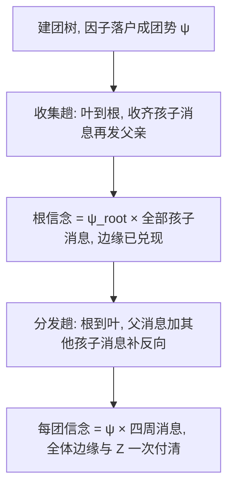

# $\rm Chapter \, 3$ 精确推断

> **本章前置自检**（先勾选再进入；勾不上的项先回读）：
>
> 1. 势函数乘积、配分函数 ${Z}$ 与「局部势加一次全局归一」的通道，回读本册 $\rm \S \, 2.2$、$\rm \S \, 2.6$（四环 Ising 的 ${Z = 102.4051709178}$ 那笔对账）。
> 2. 变量消元的四步循环与三节点链手算，回读《19-概率论》$\rm \S \, 9.6$。那边给了算法速通，本章管正确性定理的完整证明（$\rm \S \, 3.1$）。
> 3. 因子的限制、乘、消元三操作与乘法/加法记账口径，回读《84-人工智能导论》$\rm \S \, 6.3$、$\rm \S \, 6.5$。那边用分配律给了单步恒等式并断言「连起来就是」，本章把这句话证成定理。
> 4. moralization 为什么是消元的隐式联姻，回读本册 $\rm \S \, 2.5$。
> 5. 分离保证两侧独立所用的乘积劈分论证，回读本册 $\rm \S \, 2.4$ 定理 2。$\rm \S \, 3.3$ 的传播正确性是同一件事在树上的代数兑现。

全册心智模型：把不确定写成图，结构编码独立性，推断就是在这个图上做代数。前两章把结构存好了，本章付推断的钱。与《84-人工智能导论》第 6 章的分工要说清：那边在贝叶斯网上建立了枚举与消元两套算法、钉死了记账口径、实测了十三个消元序三百倍的价差；本章做三件那边没做的事。其一，把「消元等于枚举」从单步恒等式升级为对任意消元序都成立的定理，归纳补全（$\rm \S \, 3.1$）。其二，给每次消元扔掉的中间因子上一个户口：它们组成一棵消元团树（clique tree），在树上做两趟消息（message）传播，一次付清全部变量的边缘，而消元每答一个问题都要从头算（$\rm \S \, 3.2$、$\rm \S \, 3.3$）。其三，把树宽与耗时的关系从推算变成实测曲线（$\rm \S \, 3.5$）。84 册的报警网不再出现，实验另起炉灶。

## $\rm \S \, 3.1$ 消元的正确性：一条分配律的归纳闭合

模型口径沿用本册第 2 章：因子（factor）${\phi}$ 是一张定义在变量集 ${\mathrm{vars}(\phi)}$ 上的非负表，联合分布由因子池 ${\Phi = \{\phi_1, \ldots, \phi_m\}}$ 加归一化给出：

$$
p(x) \;=\; \frac{1}{Z} \prod_{i=1}^{m} \phi_i\bigl(x_{\mathrm{vars}(\phi_i)}\bigr)
$$

读法：${Z}$ 是配分函数，全取值空间上连乘再求和；贝叶斯网的 CPT 是 ${Z = 1}$ 的特例（84 册 §6.3 的因子定义与此一致），所以本章的定理对两种模型同时成立。查询取标准形状：证据 ${e}$ 是一部分变量的观测值，查询变量记 ${Q}$，其余为隐变量，赋值记 ${h}$，要算的是

$$
p(x_{Q} \mid e) \;=\; \frac{1}{P(e)} \sum_{h} \prod_{i=1}^{m} \phi_i\bigl(x_{\mathrm{vars}(\phi_i)}\bigr)
$$

证据按 84 册 §6.3 的口径在建因子时做限制（restrict）：把证据变量的取值固定进每张表，这一步是查表代换，不动任何别的变量。消元的流程也是那边的四步循环：选隐变量 ${v}$，把含 ${v}$ 的因子全部乘起，对 ${v}$ 求和，新因子放回池子。至于「消元与枚举同答」那句话，84 册用单步恒等式带过，这里是它的定理化。

**定理 1（消元正确性）**：设因子池 ${\Phi}$、消元序 ${O}$、查询 ${Q}$ 给定。消元流程结束时池中因子之积等于「按定义对全部隐变量求和」的未归一化结果，与序 ${O}$ 无关；归一化后即后验。

证明。对被消变量个数 ${k}$ 归纳。${k = 0}$ 时池子原封不动，积就是定义式，成立。设结论对 ${k}$ 个消元成立，考察 ${k + 1}$ 个：第一个被消的是 ${v}$，把池子按是否含 ${v}$ 劈成 ${\Phi_{v}}$ 与 ${\Phi_{\setminus v}}$。定义级的求和可以先把含 ${v}$ 的部分归拢：

$$
\sum_{h} \prod_{\phi \in \Phi} \phi \;=\; \sum_{x_{v}} \Bigl( \prod_{\phi \in \Phi_{v}} \phi \Bigr) \cdot \Bigl( \prod_{\psi \in \Phi_{\setminus v}} \psi \Bigr) \;=\; \Bigl( \prod_{\psi \in \Phi_{\setminus v}} \psi \Bigr) \cdot \sum_{x_{v}} \prod_{\phi \in \Phi_{v}} \phi
$$

读法：第一个等号是把「对全部隐变量求和」的次序换到 ${x_{v}}$ 最先，有限求和可交换；第二个等号是分配律，${\Phi_{\setminus v}}$ 的每个因子都不含 ${v}$，整块提出求和号，这正是 84 册 §6.3 的单步恒等式。恒等式右边就是消元一步之后的状态：${\Phi_{v}}$ 整体换成新因子 ${\tau = \sum_{x_{v}} \prod_{\phi \in \Phi_{v}} \phi}$，池子缩成 ${\Phi' = \{\tau\} \cup \Phi_{\setminus v}}$。对缩小的池子用归纳假设：剩余流程的输出等于「对 ${\Phi'}$ 的积按剩余隐变量求和」，而上面第二个等号说这个量等于对原池子 ${\Phi}$ 的定义级求和。归纳闭合，且全程没有用到序 ${O}$ 的任何性质，所以答案与序无关。∎

定理 1 只担保「同答」，不担保「同价」：价由中间因子的规模决定，这笔账在 $\rm \S \, 3.4$ 用树宽收拢。正确性与代价分离，是精确推断全部设计的支点：序可以随便选着省钱，答案分毫不动。

还有两笔附带的账要记清。其一，证据限制不破坏定理 1：限制后的池子之积等于原池子之积在证据取值上的截面（每个因子固定证据变量的取值，乘积逐因子截面），对截面用定理 1 再归一化，恰是条件概率定义里的分子与分母，所以带证据的后验与无证据的边缘走同一条定理。其二，多个查询变量不需要新算法：把查询变量全部留到最后不消，剩下的因子之积就是它们的未归一化联合边缘，归一化后一起到手；本章实验仍取单查询，为的是账目干净。

真正值得盯上的是消元的一个隐含前提：消元集合由查询决定，查询一换，「哪些变量不消」就变，整个流程和它的中间因子跟着重排。答一个查询一遍流程，是消元在结构上的天花板；拆掉它的办法藏在 $\rm \S \, 3.2$：团树上的消息与查询无关。

白话：枚举是把每个科目的账全摊在一张桌上加总，消元是按科目一摞一摞结，每结一摞只留一张小纸条。定理 1 说的是不管按什么顺序结，最后总数一样；差别只在桌上有多少张纸条。

> 本节小结：因子池加归一化统一了有向与无向两种口径；消元的每一步都是一次分配律，归纳起来就是定理 1，序改价不改答。

## $\rm \S \, 3.2$ 消元团树：给中间因子上户口

定理 1 的证明里每一步都造出一个新因子 ${\tau}$，用完即弃。消元答一个问题就要扔一遍全部中间结果，答 ${n}$ 个问题就重算 ${n}$ 遍。这些中间因子其实有一张全局地图：把每一步的「谁和谁会师」记下来，得到一棵树。

**定义（消元团树）**：连通图上按序 ${O}$ 消元。消 ${v}$ 时它当时的邻居集记 ${N(v)}$，称 ${C_{v} = \{v\} \cup N(v)}$ 为 ${v}$ 的团（clique）；给 ${v}$ 挂一个父节点：取 ${N(v)}$ 中消元时间戳最小的那个，记 ${u^{*} = \arg\min_{u \in N(v)} \mathrm{pos}(u)}$，其中 ${\mathrm{pos}}$ 是消元时间戳；父指针从 ${C_{v}}$ 指向 ${C_{u^{*}}}$。全部节点的团加父指针构成一棵树（连通图上根是最后消元的变量，它被消时已无活着的邻居）。若原图不连通，每个连通分量各得一棵。

父指针为什么挑「第一个后被消的邻居」而不是任意一个，证明里会看到理由。先把树本身的两个性质证下来。

**观察（连通性保持）**：连通图的诱导图中删去任一已消变量，剩余图仍连通。消 ${v}$ 时 ${N(v)}$ 在剩余图里两两连边成一张团网，剩余图的任何一条原本经过 ${v}$ 的路径都能从 ${N(v)}$ 的团网里绕过去，不过 ${v}$ 的路径原样保留。于是每个尚未消元的变量到最后一刻都有活着的邻居，根唯一，就是最后消元的变量。

**定理 2（运行相交性质，running intersection property, RIP）**：对任一变量 ${x}$，包含 ${x}$ 的团全体构成团树的一个连通子树。

证明分三步。第一步，含 ${x}$ 的团必有头目：${x}$ 自己被消时产生 ${C_{x} \ni x}$，这是一员；任何别的团 ${C_{u} \ni x}$（${u \neq x}$）意味着 ${x}$ 在 ${u}$ 被消时还活着且与 ${u}$ 诱导相邻。第二步，parent 链不丢人：设 ${u \neq x}$ 且 ${x \in C_{u}}$，按上面第二种情形 ${x \in N(u)}$。父指针的选取规则给出 ${u^{*} = \arg\min_{u' \in N(u)} \mathrm{pos}(u')}$，于是 ${\mathrm{pos}(u^{*}) \le \mathrm{pos}(x)}$。两个都活着且都是 ${u}$ 的邻居的变量，在 ${u}$ 被消时被填充边（fill edge）连了起来（84 册 §6.4 的「连邻居」），所以 ${x}$ 与 ${u^{*}}$ 诱导相邻；又 ${\mathrm{pos}(x) \ge \mathrm{pos}(u^{*})}$，故 ${u^{*}}$ 被消时 ${x}$ 还活着，于是 ${x \in C_{u^{*}}}$。链条每上一级，头目的时间戳严格增大而 ${x}$ 始终在团里。第三步，链条止于头目：链上任何团 ${C_{t} \ni x}$ 且 ${t \neq x}$，由第二步它的父团也含 ${x}$，链条继续；若某团 ${C_{t} \ni x}$ 且 ${t}$ 在 ${x}$ 之后被消，则 ${t}$ 被消时 ${x}$ 已死，矛盾，所以链上时间戳不能越过 ${\mathrm{pos}(x)}$，链条恰好终止于 ${C_{x}}$。于是每个含 ${x}$ 的团都能沿 parent 链不离开 ${T_{x}}$ 地走到 ${C_{x}}$，连通。∎

RIP 在后面两节各出场一次，都是同一句话：若某变量同属两团，则它属于两团之间路径上的每一个团。这是树宽世界的「过路费全收」。父指针的选取规则也不是随意的：证明第二步需要「${x}$ 活到父团被消之时」，也就是父的时间戳不超过 ${x}$ 自己的，在 ${N(u)}$ 里挑时间戳最小者恰好保证这一点；若改挑更晚的邻居，${x}$ 可能死在父团之前，链就断在半路。规则与定理是一体的，动规则就得重证。

因子也要落户。每个原始因子的 scope 在诱导图里两两相邻（无向模型的势定义在团上，本册 §2.2；有向模型道德化后同样如此，本册 §2.5），取 scope 中消元最早的成员 ${u}$，其余成员当时都活着且与 ${u}$ 诱导相邻，于是整个 scope 落在 ${C_{u}}$ 里。把每个因子乘进覆盖它的团的势里，记团 ${i}$ 的势为 ${\psi_{i}}$，这棵带势的树就是本章的推断引擎。

白话：消元像整理摊在桌上的文件（84 册 §6.4 的比喻），每合并一摞就产生一张汇总表，用完就扔。团树是把每一张汇总表贴上标签挂到墙上：哪张表跟哪张表打过交道，墙上有一棵树记着。后面两节会看到，挂上墙的表不仅能查，还能顺着树传话。

> 本节小结：消元过程自带一棵团树，父指针取「第一个后被消的邻居」；RIP 说任一变量的团连通，证明靠填充边补相邻加时间戳单调；每个因子都有团可落户。

## $\rm \S \, 3.3$ 两趟传播：一次付清全体边缘

树的每条边 ${(i, j)}$ 有分离集 ${S_{ij} = C_{i} \cap C_{j}}$。消息是定义在分离集上的表：

$$
\mu_{i \to j}(x_{S_{ij}}) \;=\; \sum_{C_{i} \setminus S_{ij}} \Bigl( \psi_{i} \cdot \prod_{k \in \mathrm{nbr}(i) \setminus \{j\}} \mu_{k \to i} \Bigr)
$$

读法：${\mathrm{nbr}(i)}$ 是团 ${i}$ 在树上的邻居团；求和遍历 ${C_{i}}$ 中不属于分离集的取值；进入乘积的只有「别人发给 ${i}$、且不是从 ${j}$ 方向来的」消息。注意消息的 scope 天然就是分离集：乘积各项的 scope 都落在 ${C_{i}}$ 里（进来的消息定义在 ${C_{i}}$ 与发送团的交集上），加掉 ${C_{i} \setminus S_{ij}}$ 后只剩 ${S_{ij}}$。收集（collect）趟按深度优先后序向根发送，每个团收齐孩子消息后发给自己父亲；分发（distribute）趟从根前序往下，用「父亲来的消息加其他孩子来的消息」补出反方向消息。两趟之后，每个团的信念（belief）定义为

$$
b_{i} \;=\; \psi_{i} \cdot \prod_{k \in \mathrm{nbr}(i)} \mu_{k \to i}
$$

两趟的流程一图带走：



**定理 3（两趟精确性）**：连通图、团树满足 RIP、每个因子恰好落户一个团。两趟之后，对每个团有 ${b_{i}(x_{C_{i}}) = \sum_{V \setminus C_{i}} \prod_{\phi \in \Phi} \phi}$，即未归一化的团边缘；特别地，任一变量 ${x}$ 的后验由含 ${x}$ 的任一团信念加掉其余变量再归一化给出，且各团的 ${\sum b_{i}}$ 相同，都等于 ${P(e)}$。

证明三步。第一步（收集消息等于子树汇总）：断言收集趟结束时，${\mu_{i \to j}}$ 等于「以 ${j}$ 为外侧、${i}$ 一侧子树的全部因子之积对 ${U_{i} \setminus S_{ij}}$ 求和」，其中 ${U_{i}}$ 是子树中全部团的变量并集。对子树大小归纳：叶子团没有入向消息，定义式直接就是断言；一般团 ${i}$ 把每个孩子 ${k}$ 的消息按归纳假设换成子树聚合 ${g_{k} = \prod_{\phi \in \Phi(\text{subtree } k)} \phi}$ 对 ${U_{k} \setminus S_{ki}}$ 的求和，再把全部求和合并成一个大求和。合并的合法性靠 RIP 验收两条：其一，${U_{k} \setminus S_{ki}}$ 与 ${C_{i}}$ 不相交，因为落在两者之交的变量按 RIP 属于路径上每个团，落进 ${S_{ki}}$，不在被求和的集合里；其二，不同孩子的求和域互不相交，理由相同。于是合并域恰是 ${(C_{i} \setminus S_{ij})}$ 与各 ${U_{k} \setminus S_{ki}}$ 的无交并，而它正是 ${U_{i} \setminus S_{ij}}$：一侧，${C_{i} \setminus S_{ij}}$ 与各 ${U_{k} \setminus S_{ki}}$ 都在 ${U_{i}}$ 里且避开 ${S_{ij}}$；另一侧，${U_{i}}$ 的变量要么在 ${C_{i}}$（不在 ${S_{ij}}$ 则落在第一块），要么在某孩子的 ${U_{k}}$ 而不在 ${C_{i}}$（于是不在 ${S_{ki}}$，落在第 ${k}$ 块）。合并后被积函数就是全部子树因子之积 ${\psi_{i} \cdot \prod_{k} g_{k}}$：

$$
\mu_{i \to j} \;=\; \sum_{x_{C_{i} \setminus S_{ij}}} \; \sum_{U_{k_{1}} \setminus S_{k_{1} i}} \cdots \sum_{U_{k_{r}} \setminus S_{k_{r} i}} \; \psi_{i} \cdot \prod_{t=1}^{r} g_{k_{t}} \;=\; \sum_{U_{i} \setminus S_{ij}} \; \prod_{\phi \in \Phi(\text{subtree } i)} \phi
$$

读法：中间那个表达式是合并后的形状，求和域无交并为 ${U_{i} \setminus S_{ij}}$，被积函数按因子落户逐团拼回，最后那个等号只是换了一套记法；归纳在「子树大小」上闭合。第二步（根上先兑现）：根的信念按定义是 ${\psi_{\mathrm{root}}}$ 乘全部孩子消息，由第一步每个孩子消息是子树聚合，而全部子树加根恰好瓜分了全部因子（每个因子落户一次），合并域由 RIP 验收为 ${V \setminus C_{\mathrm{root}}}$（每个根外变量都活在某个子树的团里且不在分离集上），所以 ${b_{\mathrm{root}}}$ 就是全体因子之积对根外变量的求和，未归一化边缘到手。第三步（分发对称补全）：分发趟在第 ${d}$ 跳计算的消息，其形式与收集趟的定义逐字相同，只是树的重挂方式换成以接收方为根；把第一步的归纳对象从「子树大小」换成「离根跳数」，同一论证逐字照抄，得到分发结束后每条有向边上 ${\mu_{i \to j}}$ 都是「${i}$ 侧聚合」。于是团 ${i}$ 的信念是 ${\psi_{i}}$ 乘上四周每个方向的聚合，合并域按同一套验收恰是 ${V \setminus C_{i}}$，被积函数按落户拼回全体因子，乘起来恰是对 ${V \setminus C_{i}}$ 的求和。∎

定理 3 的结构值得停一下：本册 §2.4 用劈分论证证明「分离推出独立」，那里是分布层面的陈述；这里同一形状出现在代数层面，树上一条边把图分成两侧，给定分离集，两侧的私有变量求和各自塌缩成一张分离集上的小表。图结构的稀疏性在这个塌缩里变成了钱：树网里团就是边，分离集只有一个变量，消息表只有两格；图稠密起来，塌缩后的表按 ${2^{w+1}}$ 涨价，这正是 $\rm \S \, 3.4$ 的主题。

代价也顺手续完。设团数为 ${M}$、诱导宽为 ${w}$（最大团变量数减一），每条消息是 ${2^{|S_{ij}|} \le 2^{w+1}}$ 格的表，两趟共 ${2(M - 1)}$ 条消息，全部团的未归一化边缘一次付清，总账 ${O(M \cdot 2^{w+1})}$。对比定理 1 的消元：答一个查询一遍 ${O(n \cdot 2^{w+1})}$，答 ${n}$ 个查询要跑 ${n}$ 遍。树网 ${M = n}$，两趟便宜约一半再乘一个常数，$\rm \S \, 3.5$ 实测是 ${3.55}$ 倍的实价。

还有一个附赠推论值得点名：定理 3 第一步的断言里没有查询变量的位置，消息只由子树里的因子决定，所以两趟算完的消息与查询无关。换查询不用重跑传播，只需在含查询变量的团里读信念、加掉、归一化。$\rm \S \, 3.1$ 结尾那句「团树上的消息与查询无关」在此兑现，这也是团树相对朴素消元在结构上的全部优势所在。

白话：消元是每次去银行重新排队办一笔业务；团树传播是先把所有业务按支行归档，上行一趟把各支行的汇总表交齐，下行一趟把总行的批文发下去，之后每个柜台的抽屉里都躺着现成的答案。

> 本节小结：消息＝子树聚合，收集趟用归纳法兑现为定理 3 前两步，分发趟同一论证对称补全；RIP 保证求和域不相交，是两处拆和的唯一理由；两趟 ${O(M \cdot 2^{w+1})}$ 付清全体边缘。

## $\rm \S \, 3.4$ 树宽与复杂度的总账

**定理 4（开销上界）**：诱导宽 ${w}$ 的消元序下，消元总乘法不超过 ${(n - 1) \cdot 2^{w + 1}}$；团树传播算出全部 ${M}$ 个团边缘的总乘法不超过 ${(2M + n) \cdot 2^{w + 1}}$ 的量级。

术语先钉死：消元序的诱导宽（induced width）是消元全程各变量的活邻居数的最大值，也即过程中最大团的变量数减一；树宽（treewidth）是所有序里最小的那种诱导宽。定理 3 的消息表至多 ${2^{w+1}}$ 格，理由一句话：分离集 ${S_{ij}}$ 含在 ${C_{i}}$ 与 ${C_{j}}$ 两个团里，变量数至多 ${w + 1}$。

第一句是 84 册 §6.3 的账：每消一个变量把因子乘成至多 ${2^{w+1}}$ 格的表，因子总数从 ${n}$ 降到一，每次消元净减至少一个因子，故乘法总数 ${(n-1) \cdot 2^{w+1}}$ 以内，不重复推导。第二句是新账：两趟每条消息一张至多 ${2^{w+1}}$ 格的表，共 ${2(M-1)}$ 条；每团的信念还要乘一次、读边缘加掉一次，各按 ${2^{w+1}}$ 格计；合起来量级如上。指数的底没换，换的是位置：从变量总数 ${n}$ 搬到树宽 ${w}$，这正是本册 §2.5 moralization 的回报，稀疏结构在推断端兑现成小表。

最优序难找：判定树宽是否不超过 ${k}$ 是 NP 完全问题（Arnborg、Corneil 与 Proskurowski，1987，84 册 §6.4 已引），实战用最小填充（min-fill）贪心。贪心不是定理，本章实验给它记了一笔实价：${m \times m}$ 网格的真树宽是 ${m}$（《19-概率论》§9.6），min-fill 在 ${m \le 6}$ 时精确命中，${m = 7}$ 起开始超出，到 ${m = 13}$ 时给出 ${17}$，超了 ${4}$；树宽每超一，表项翻一倍，这就是贪心的价格。生产级实现会用更好的启发式甚至精确搜索，但「先道德化、再三角化、取最大团建树」的骨架不变，消元构造是它最省事的一种实现：min-fill 消元过程的团恰是某个三角化后的极大团，RIP 由定理 2 兜底，不必另行验证。

白话：树宽是这张图所有消元序里最好的那张桌子宽度，找到它本身是难题；贪心是随手拉一张差不多的桌子，偶尔拉宽了几寸，每宽一寸账单翻倍。

> 本节小结：消元与传播的开销都由 ${2^{w+1}}$ 一句话定死；最优序 NP 完全，min-fill 在网格上实测超出真树宽最多 ${4}$；消元构造的团树免验证 RIP。

## $\rm \S \, 3.5$ 实测：四笔账

实验环境与口径：WSL 的 Python 3.12.3（numpy 2.5.4），随机种子 ${20261110}$，全部实验由单个幂等脚本一次生成，总耗时 ${0.47}$ 秒；脚本与完整输出在本册配套实验目录 `26Fall/_uni5_work/expPM03/` 的 `expPM03.py` 与 `result.txt`。numpy 只用来做表的广播乘法与按轴求和，消元、建树、传播全部是本章自己的实现，不依赖任何推断库。浮点检验统一容差 ${10^{-9}}$；乘法数按标量乘逐次计数（确定性，重跑逐位复现），墙钟时间三次取最快（随机器浮动）。五组自检断言全过，末行 `ALL CHECKS PASSED`。与 84 册 §6.5 的分工：那边在 ${25}$ 节点网格上比消元序的价差，这里换成正确性对账、团树传播对账与树宽-耗时曲线。复现命令：

```bash
# 环境: WSL 的 Bash; 前置: python3 + numpy
cd /mnt/c/Users/20811/Desktop/26Fall/_uni5_work/expPM03
python3 expPM03.py > result.txt    # 幂等; 乘法数逐位一致, 末行 ALL CHECKS PASSED
```

因子乘法是本实验最容易写错的地方，核心操作摘录如下。把后一个因子的轴按目标位置转置后再成形，不能直接 `reshape`：各维长度相等时 reshape 按内存序重排，等价于一次错误的转置。

```python
def mul(a, b):
    vs = list(a.vs) + [v for v in b.vs if v not in a.vs]
    sa = [1] * len(vs)
    for i in range(len(a.vs)):
        sa[i] = a.t.shape[i]          # a 的轴是 vs 的前缀, 直接成形
    perm = [vs.index(v) for v in b.vs]
    order = sorted(range(len(b.vs)), key=lambda k: perm[k])
    bt = np.transpose(b.t, order) if b.vs else b.t
    sb = [1] * len(vs)
    dims = iter(bt.shape)
    for pos in sorted(perm):
        sb[pos] = next(dims)
    return F(vs, a.t.reshape(sa) * bt.reshape(sb))
```

**实验一（E1），消元对枚举，定理 1 的对账。** ${30}$ 张随机无向模型：${6}$ 个二值节点、连边率 ${0.4}$、点势与边势取 ${e^{\theta x}}$、${e^{\beta xy}}$（${\theta, \beta}$ 均匀于 ${[-1, 1]}$）；每张两档证据配置（无证据、两个随机观测）。消元按自然序，查询全部非证据节点，共 ${300}$ 道后验，枚举真值由全联合表（${64}$ 行）直接归一。序取自然序就够了：定理 1 说答案与序无关，对账钉的是「同答」，序的价差 84 册 §6.5 已经实测过，不重复。最大绝对偏差 ${3.331 \times 10^{-16}}$，机器舍入量级，${300}$ 道全部兑现「同答」。

**实验二（E2），团树两趟传播对枚举，定理 3 的对账。** ${20}$ 张随机树网（${n = 10}$，每点挂到随机前驱），点势加边势同上；每张两档证据。消元团树按 $\rm \S \, 3.2$ 构造（父指针取第一个后被消的邻居），两趟传播给出全部后验：与枚举对账 ${360}$ 个，最大绝对偏差 ${1.332 \times 10^{-15}}$。各团信念的 ${Z}$ 估计极差最大 ${1.819 \times 10^{-12}}$，定理 3 推论「所有团读到同一个 ${P(e)}$」在浮点下成立。最后一张树网做了 RIP 抽查：${10}$ 个变量的团全部连通。乘法账：两趟传播合计 ${6424}$ 次标量乘法；逐查询消元跑 ${n}$ 遍合计 ${22798}$ 次，传播省 ${3.55}$ 倍，$\rm \S \, 3.3$ 的口头承诺落了地。量级也合得上：${40}$ 个配置各约 ${18}$ 条消息，平均每条消息 ${9}$ 次上下标量乘，正是二变量团表相乘该有的账。

**实验三（E3），树宽-耗时曲线，定理 4 的对账。** ${m \times m}$ 网格（${m = 2, \ldots, 13}$），Ising 型势，证据固定一角（${x_{(0,0)} = 1}$），查询取 min-fill 消元序的最后一个变量（查询与证据不消元，这样实测最大因子与模拟宽度同口径）。宽度列是 min-fill 序的实测诱导宽，表项列是消元全程最大因子表项数：

| ${m}$ | 实测宽 ${w}$ | 最大表项 | 乘法数 | 耗时 (ms) |
| --- | --- | --- | --- | --- |
| 2 | 2 | 4 | 16 | 0.07 |
| 3 | 3 | 8 | 102 | 0.21 |
| 4 | 4 | 32 | 338 | 0.44 |
| 5 | 5 | 64 | 818 | 0.83 |
| 6 | 6 | 128 | 1798 | 1.32 |
| 7 | 8 | 512 | 4650 | 1.93 |
| 8 | 10 | 2048 | 11458 | 2.67 |
| 9 | 11 | 4096 | 26926 | 3.86 |
| 10 | 13 | 16384 | 70766 | 5.42 |
| 11 | 15 | 65536 | 217874 | 5.55 |
| 12 | 16 | 131072 | 475578 | 12.29 |
| 13 | 17 | 262144 | 1217162 | 17.28 |

三条读数。其一，宽度每加一，表项上限翻倍，乘法数跟着大约翻倍略多：相邻宽度档的乘法比大多落在 ${2.18}$ 到 ${2.56}$ 之间（${w = 2 \to 3}$ 是 ${6.38}$、${w = 3 \to 4}$ 是 ${3.31}$，小图档起步开销占比大，不作数），定理 4 的 ${2^{w+1}}$ 在账面上站住了。其二，墙钟时间大体跟随但浮得多（比值 ${1.41}$ 到 ${2.99}$），numpy 的固定开销在小表档稀释了指数；确定性的乘法账才是这张曲线的主读数，耗时要看尾部：${w = 16 \to 17}$ 时 ${12.29}$ 到 ${17.28}$ 毫秒，翻倍形状回来了。其三，贪心的实价：网格真树宽是 ${m}$，min-fill 在 ${m \le 6}$ 精确命中，${m = 7}$ 起给出 ${8, 10, 11, 13, 15, 16, 17}$，最多超 ${4}$ 档，每超一档账单翻倍，这就是 $\rm \S \, 3.4$ 那句「贪心不是定理」的数字版。表项列另有一处诚实注脚：${w \ge 4}$ 时最大表项恰为 ${2^{w+1}}$（${32, 64, 128}$ 直到 ${262144}$），${w = 2, 3}$ 两档低于上界是因为证据一角把涉及它的团表提前压小了。小网格另配了对账：${m = 2, 3}$ 的消元后验对枚举真值偏差 ${1.110 \times 10^{-16}}$ 与 ${5.551 \times 10^{-17}}$，曲线的起点也是对的。

**实验四（E4），两个错误的数字底片。** 其一，把消息当概率：随机树网上取一条指向根的消息（分离变量 ${0}$ 上的两格表），原始值 ${[101.209, 141.0499]}$，离谱地大于 ${1}$；归一化后 ${[0.4178, 0.5822]}$，看着像回事了，但真后验是 ${[0.342, 0.658]}$，偏差仍有 ${0.0758}$。消息既没归一也不是边缘：它是子树聚合，缺了树另一侧的账，归一化救不回来。其二，把环当树：本册 §2.6 的四环 Ising（${\beta = 0.8}$，${h = 0.3}$），拿环的四个边团当「团树」硬跑两趟 flooding，节点 ${0}$ 的后验得 ${[0.4256, 0.5744]}$，枚举真值 ${[0.1736, 0.8264]}$，偏差 ${0.2519}$。环不是树，两圈相对的消息互相把对方当「外侧」，重复计账；这不是实现失误，是算法用错了图，第 4 章给这类环图上的消息传递（loopy BP）立规矩。

## $\rm \S \, 3.6$ 两个典型错误与证据式排查

错误一：把消息或未归一化信念当后验读。症状：报出的「概率」大于 ${1}$，或两个取值加起来不到 ${1}$ 还差得远。病根：消息是子树聚合，信念是未归一化边缘，二者都只在乘齐、加掉、归一化三步之后才是概率。实测底片是 E4a：原始消息 ${[101.209, 141.0499]}$，归一化后仍与真后验差 ${0.0758}$，说明病不止缺归一化一层。排查办法：输出前断言概率向量加和为一（容差 ${10^{-9}}$）；同一个变量从两个不同团的信念各读一次边缘，对不上就是消息没传齐（E2 的 ${Z}$ 极差检验 ${1.819 \times 10^{-12}}$ 就是这道闸）。

错误二：在带环的图上把两趟传播当精确算法。症状：跑得快、有输出、每个数都规整，但就是错。病根：环上没有「外侧」，双向消息互相引用，一次求和里同一段路径的账被记了两遍。实测底片是 E4b：四环上偏差 ${0.2519}$，而同一张图换正确的团树（消元构造）精确到 ${10^{-15}}$ 量级。排查办法：先数图有没有环，有环就走消元团树（环被填充边拆成团），或者明确改用近似算法并汇报误差；判断「算法精确」之前先核对图是不是弦图（本册 §2.5），别拿树上的担保给环背书。

## $\rm \S \, 3.7$ 关键概念回顾

1. 定理 1 的归纳在什么对象上进行？单步恒等式哪一头是「消元后的池子」？（答案见 $\rm \S \, 3.9$）
2. 团树的父指针为什么取「第一个后被消的邻居」？定理 2 证明的三步各自用了图的什么性质？
3. 定理 3 证明里 RIP 被用了哪几处？合并求和的合法性靠它验收哪两条？
4. 收集趟之后根的信念为什么已经精确？分发趟补的是什么？
5. E3 的乘法账为什么比墙钟时间更配当「主读数」？min-fill 在网格上从哪个规模开始失手？

## $\rm \S \, 3.8$ 应用与辨析

1. 三节点链 ${x_1 - x_2 - x_3}$，以 ${x_2}$ 为根画消元团树，写出收集趟的两条消息与根信念，验证 ${b_{\mathrm{root}}}$ 对 ${x_2}$ 之外的求和给出 ${x_2}$ 的未归一化边缘。
2. 同事说：「既然团树传播一次算出全部边缘，那树宽大的时候也先用它，反正是一趟。」这个结论哪里不对？
3. 一张团树上某条消息的分离集有 ${3}$ 个变量，问：消元序的诱导宽至少是多少？这张消息表至少多少格？

## $\rm \S \, 3.9$ 答案

概念回顾答案：

1. 归纳在被消变量个数（等价地，池子缩小次数）上进行；恒等式右边把 ${\Phi_{v}}$ 换成 ${\tau}$，正是消元一步之后的池子，归纳假设接在它上面（$\rm \S \, 3.1$）。
2. 取「第一个后被消的邻居」使 parent 链的时间戳严格增大，链条才可能终止于 ${C_{x}}$。三步：含 ${x}$ 的团有头目（${x}$ 自己的团）；parent 链不丢 ${x}$（填充边补相邻加时间戳单调）；时间戳不能越过 ${\mathrm{pos}(x)}$（晚于 ${x}$ 被消的团的成员当时都活着）（$\rm \S \, 3.2$）。
3. 两处，验收的都是合并求和域。其一在收集趟归纳：各孩子子树的求和域 ${U_{k} \setminus S_{ki}}$ 互不相交、也与 ${C_{i} \setminus S_{ij}}$ 不相交（相交的变量按 RIP 落在路径上每个团，进分离集），合并域才恰是 ${U_{i} \setminus S_{ij}}$ 且无重复计数；其二在信念合成：团四周各方向的求和域无交并恰为 ${V \setminus C_{i}}$，被积函数才能按落户拼回全体因子之积（$\rm \S \, 3.3$）。
4. 根的信念是根势乘全部子树聚合，子树加根瓜分全部因子，所以它就是全体因子之积对根外变量的求和，一步到位。分发趟补的是「另一侧」的聚合，让每个团的信念都凑齐四周（$\rm \S \, 3.3$）。
5. 乘法数是逐次计数的确定性整数，重跑逐位复现；墙钟时间受 numpy 固定开销与机器状态影响，小表档被稀释（比值低到 ${1.41}$）。min-fill 从 ${m = 7}$ 开始超出真树宽（给 ${8}$，真值 ${7}$），到 ${m = 13}$ 超 ${4}$ 档（$\rm \S \, 3.5$）。

应用与辨析答案：

1. 消元序取 ${x_1, x_3, x_2}$：${C_{x_1} = \{x_1, x_2\}}$、${C_{x_3} = \{x_3, x_2\}}$、${C_{x_2} = \{x_2\}}$。收集趟：${\mu_{x_1 \to x_2}(x_2) = \sum_{x_1} \psi_{x_1}(x_1, x_2)}$ 与 ${\mu_{x_3 \to x_2}(x_2) = \sum_{x_3} \psi_{x_3}(x_3, x_2)}$（《19-概率论》§9.6 手算的两个表正是它们）；${b_{\mathrm{root}} = \psi_{x_2}(x_2)\, \mu_{x_1 \to x_2}(x_2)\, \mu_{x_3 \to x_2}(x_2)}$，对 ${x_2}$ 求和就是 ${Z}$，归一化即 ${p(x_2)}$，与那边逐位可核的 ${13.920142321799}$ 一脉相承（$\rm \S \, 3.3$）。
2. 一趟付清的前提是树宽小：团树传播的总账是 ${O(M \cdot 2^{w+1})}$，树宽大时 ${2^{w+1}}$ 本身爆炸，E3 里 ${w}$ 从 ${13}$ 涨到 ${17}$，乘法从 ${70766}$ 涨到 ${1217162}$（${17}$ 倍）；树宽大到做不动时该换近似推断（第 5 章起），而不是硬跑精确（$\rm \S \, 3.4$、$\rm \S \, 3.5$）。
3. 分离集 ${S_{ij} = C_{i} \cap C_{j}}$ 含 ${3}$ 个变量，则 ${C_{i}}$ 至少 ${3}$ 个变量，诱导宽 ${w \ge 3 - 1 = 2}$；消息表 ${2^{3} = 8}$ 格（$\rm \S \, 3.3$）。

**你现在能做什么**：在纸上画三节点链，按应用题 1 写出两条消息和根信念，全程手算两分钟，再随便挑一个取值用枚举核对，两个数对上，本章的引擎你就摸过了。

本章把精确推断的账结到了团树上：消元的正确性有了定理，中间因子有了户口，树宽有了实测曲线。但团树传播要求图先被拆成树，环一出现担保就失效，E4b 的 ${0.2519}$ 偏差就是一张罚单。下一章把消息直接写到图的边上：和积（sum-product）算法在真树上的精确性证明、环图上 loopy BP 的启发式与它何时骗人，罚单怎么变成方法，是那里的事。

---

实验记录：本章 $\rm \S \, 3.5$ 全部实测数字来自脚本 `expPM03.py`（E1 三十张随机无向模型三百道消元-枚举对账、E2 二十张随机树网三百六十个两趟传播-枚举对账加乘法账与 RIP 抽查、E3 十二档网格的树宽-耗时曲线加小网格对账、E4 消息误读与环图误用两个错误演示；python3 标准库加 numpy 2.5.4，种子 ${20261110}$，WSL 运行，总耗时 ${0.47}$ 秒），原始输出存于写作工作目录 `26Fall/_uni5_work/expPM03/result.txt`；查询数、偏差、乘法数、实测宽度为确定性结果，重跑逐位复现，墙钟耗时随机器浮动（三次取最快）。
