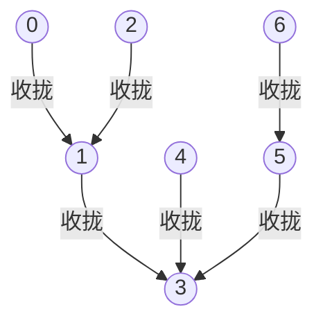

# $\rm Chapter \, 4$ 信念传播

> **本章前置自检**（先勾选再进入；勾不上的项先回读）：
>
> 1. 记得成对马尔可夫随机场的写法：节点势 ${\psi_i}$、边势 ${\psi_{ij}}$、配分函数 ${Z}$，联合分布是全部势之积除以 ${Z}$，且「势不是概率，只表达相对偏好」（第 2 章 $\rm \S \, 2.2$）。
> 2. 会变量消元：把「对哪些变量求和」重排成一串小表的乘加，最大中间表由消元序决定（概率论册 $\rm \S \, 9.6$；第 3 章把它发展成系统方法并算清了树宽账）。
> 3. 见过信念传播的白话版：树上每条边传一条消息，两遍之后全部边缘到手（概率论册 $\rm \S \, 9.7$）。本章补上它欠的账：为什么树上精确、环上失真多少、它在优化谁。
> 4. 会用条件独立的分解与弱并规则（第 2 章 $\rm \S \, 2.3$）；本章的证明不用它们，但要用一条更朴素的「不相交变量集上求和穿过乘积」性质，到时当场验证。
> 5. 见过四环 MRF：节点 ${0,1,2,3}$ 连成圈，边上同值偏好势、点上外场势（第 2 章 $\rm \S \, 2.2$，${\beta = 0.8}$、${h = 0.3}$）；本章在同一个模型上看 BP 失真。

第 3 章的变量消元解决「一次后验算得动」，但每次只服务一个目标变量：要全部 ${n}$ 个节点的边缘，就得换目标再跑，绝大多数中间表原样重算。本章把这笔浪费清掉。消元过程中节点留下的每个中间因子其实只由「它朝哪个方向被消」决定，与目标是谁无关；把这些因子沿边缓存成有方向的**消息（message）**，一遍传话就同时拿到全部边缘。这套流程叫**和积算法（sum-product algorithm）**，通称**信念传播（belief propagation, BP）**。

概率论册 $\rm \S \, 9.7$ 已给出更新式并实测过一条 5 节点链，本章做三件它没做的事：证明树上为什么精确（不是「试出来准」，是「证出来准」）；量化环上照搬的失真（双计数与实测误差）；指出 BP 悄悄优化的目标其实是 Bethe 自由能，不是真实分布。全册心智模型不变：把不确定写成图，推断就是在这张图上做代数。BP 是图上第一次出现「局部传话」的算法形态：每个节点只跟邻居说话，全局答案从局部对话里长出来。

## $\rm \S \, 4.1$ 从消元到消息：一遍传话，全部边缘

先看消元浪费在哪。固定目标 ${t}$ 跑一遍消元：按某个序逐个消去其余节点，每消一个就产出一个中间表。换目标 ${t'}$ 再跑一遍，中间表大多数原样重现，只有朝向新目标那条链上的少数几个在变。树上看得最清楚：以 ${t}$ 为根消元，消掉节点 ${i}$ 产生的表恰好等于「${i}$ 朝远离 ${t}$ 一侧的整棵子树、对边界变量的部分和」，而这棵子树由树结构决定，跟 ${t}$ 是谁无关。每个方向的部分和迟早都要用，那就全部存下来。

形式化。设 ${p}$ 是树 ${G=(V,E)}$ 上的成对马尔可夫随机场，${p(\mathbf{x}) = \frac{1}{Z}\prod_i \psi_i(x_i) \prod_{(u,v) \in E} \psi_{uv}(x_u,x_v)}$。记号两条线合流：节点势 ${\psi_i}$、边势 ${\psi_{ij}}$ 与消息 ${\mu}$ 沿用概率论册 $\rm \S \, 9.7$，邻居集 ${\mathrm{Nb}(i)}$ 沿用第 2 章。对每条有向边 ${i \to j}$（${j \in \mathrm{Nb}(i)}$）维护一张只关于 ${x_j}$ 的表：

$$
\mu_{i\to j}(x_j)
= \sum_{x_i} \psi_i(x_i)\,\psi_{ij}(x_i,x_j) \prod_{k \in \mathrm{Nb}(i) \setminus \{j\}} \mu_{k\to i}(x_i)
$$

读法：${i}$ 把自己一侧的全部证据压缩成一张关于 ${x_j}$ 的表再交给 ${j}$。三项各有分工：${\psi_i}$ 是 ${i}$ 自己的偏好，${\psi_{ij}}$ 是 ${i\!-\!j}$ 这条边的偏好，乘积里的 ${\mu_{k\to i}}$ 是其余邻居转来的「他们那边的消息」。${k \in \mathrm{Nb}(i) \setminus \{j\}}$ 里删掉 ${j}$ 是防回头：树没有环，${i}$ 关于 ${j}$ 的消息只能由其它方向的邻居拼成，把 ${j}$ 自己的消息再乘回去就成了循环。拿到消息之后，节点边缘（称为**信念（belief）**，记 ${b_i}$）由局部信息拼出：

$$
b_i(x_i)
= \frac{1}{Z_i}\, \psi_i(x_i) \prod_{k \in \mathrm{Nb}(i)} \mu_{k\to i}(x_i)
$$

${Z_i}$ 是归一化常数。边的信念也由同样的局部信息拼出，$\rm \S \, 4.4$ 的 Bethe 自由能要用它，归一化常数照旧只是记账：

$$
b_{ij}(x_i,x_j)
= \frac{1}{Z_{ij}}\, \psi_{ij}(x_i,x_j)\,\psi_i(x_i)\,\psi_j(x_j) \prod_{k \in \mathrm{Nb}(i) \setminus \{j\}} \mu_{k\to i}(x_i) \prod_{l \in \mathrm{Nb}(j) \setminus \{i\}} \mu_{l\to j}(x_j)
$$

两条更新式加两个拼装式合起来就是和积算法。打个比方：每个节点是一个部门主管，${\mu_{i\to j}}$ 是 ${i}$ 递给 ${j}$ 的部门汇报，只谈 ${j}$ 关心的事（所以是 ${x_j}$ 的函数），并把 ${j}$ 已经知道的部分（${j}$ 那条边的直接往来）如实计入。

调度很自然：叶子没有别的邻居可等，先发；内部节点收齐其余邻居的汇报后再发；根收齐即得自己的信念，再沿原路反向分发一遍，全树每个节点的信念同时到手。每条有向边方向的消息只算一次，共 ${2(n-1)}$ 条。

值得注意的是计算的局部性：算 ${\mu_{i\to j}}$ 只需要 ${\psi_i}$、${\psi_{ij}}$ 和 ${i}$ 的其它入边消息，节点不需要知道全图长什么样。局部性省的不只是算力，它意味着这套流程可以分布到每个节点各管各的内存，消息就是全部通信量。第 8 章讲现代接口时会回到这一点：注意力机制本质上也是一套沿边传递、按接收者整形的信息。

> **竞赛生迁移提示**：这套两遍传话你在树形 DP 里见过，名字叫换根（rerooting）：第一遍自底向上算「子树内」的答案，第二遍自顶向下把「子树外」的贡献传下去，两遍之后「每个节点当根」的答案全部在手。BP 的消息就是这两遍 DP 里的中间数组，新东西只有两处：数组的值不是数，而是关于邻居变量的小表；组合操作不是加法取 max，而是乘势求和。会换根 DP 的人已经会了 BP 的骨架，剩下的只是把整数运算换成表运算。

调度上有两个自由度，树上是自由的，环上就会分道。方向上，「收拢到根再发散」的两遍式与「每条边两个方向都发」的同步 flood 等效：前者每条消息恰算一次，后者部分消息被多算几轮，但都在直径量级的轮数后精确停止。时间上还可以异步（串行）更新：按任意固定顺序逐条刷新消息，树上同样有限轮精确收敛，因为 $\rm \S \, 4.2$ 的归纳只依赖「叶先于内」的偏序，不依赖轮次的整齐。环上就没有这种宽容：同步更新在对称偶图上会整齐振荡，串行常把振荡搅散换来收敛，代价是结果依赖更新顺序。

（7 节点树，根取 ${3}$：收拢阶段消息沿树向根汇聚，根算完信念后沿反方向发散一遍。每个箭头是一次消息更新式的局部计算。）

## $\rm \S \, 4.2$ 树上精确性：两个恒等式

**定理 1（和积算法在树上精确）**：设 ${G}$ 是树，${p}$ 是 ${G}$ 上可归一化的成对马尔可夫随机场（势非负即可，不需要正性）。消息按 $\rm \S \, 4.1$ 的更新式从全 1 初值同步迭代，则每条消息在有限轮后停止变化，且此后全部信念等于精确边缘：${b_i(x_i) = p(x_i)}$ 对每个 ${i}$ 成立。精确性的载体是消息层面的一个更强恒等式。对每条有向边 ${i \to j}$，记 ${T_{i|j}}$ 为「从 ${i}$ 出发、不经过 ${j}$ 能走到的全部节点」（含 ${i}$，不含 ${j}$），它是以 ${i}$ 为根、${j}$ 为边界的子树；用 ${\hat\mu}$ 记未归一化消息，待证的是：

$$
\hat\mu_{i\to j}(x_j)
= \sum_{\mathbf{x}_{T_{i|j}}} \psi_{ij}(x_i,x_j) \prod_{v \in T_{i|j}} \psi_v(x_v) \prod_{(u,w) \, \subseteq \, T_{i|j}} \psi_{uw}(x_u,x_w)
$$

其中第三个连乘取两端都在 ${T_{i|j}}$ 内的边。读法：${i \to j}$ 方向的消息就是「${j}$ 以外的整片 ${i}$ 侧子树、连同 ${i\!-\!j}$ 这条边」对 ${x_j}$ 的部分和。证明对子树规模 ${|T_{i|j}|}$ 归纳。

1. 规模为 ${1}$（${i}$ 是叶子）：右端只有一个变量 ${x_i}$，就是 ${\sum_{x_i} \psi_i(x_i)\psi_{ij}(x_i,x_j)}$；全 1 初值下第一轮更新原样给出它。
2. 归纳步：更新式里连乘的每个 ${\hat\mu_{k\to i}}$（${k \in \mathrm{Nb}(i) \setminus \{j\}}$）的子树 ${T_{k|i}}$ 规模更小，由归纳假设各等于自己的部分和。树保证诸分支 ${T_{k|i}}$ 两两不交：若某节点同属两个分支，它到 ${i}$ 就有两条路，成环。不相交的变量集上，「各自部分和之积等于并集上的联合部分和」——把联合求和写成嵌套求和，外层变量在每个内层因子里不出现即可逐层提出，这是章首自检第 4 条预告的那条朴素性质。于是乘积等于「全部分支变量联合、对 ${\mathbf{x}_{i}}$ 之外的分支变量」的部分和；再对 ${x_i}$ 求和，把 ${i}$ 与它的 ${\psi_i}$ 并进来，恰好拼出 ${T_{i|j}}$ 整体。

「有限轮停止」的账也在这步归纳里：第 ${t}$ 轮的消息沿「离开 ${j}$」的方向只能看到 ${t}$ 层深度，链触到叶子后更新式不再改变它，所以 ${\mu_{i\to j}}$ 在 ${t}$ 达到 ${T_{i|j}}$ 的深度后精确定型。各方向深度的最大值不超过图的直径，实用调度（叶子先发、逐层收拢再发散）两遍即足；同步实现则在直径轮后全部定型。这条账顺带把初值问题说死：恒等式右端不含任何初值，树上消息一旦定型就与初值无关，全 1、随机都一样；这是树上的又一条免费保证，环上作废（实验二 B 部分的错解正是换初值换出来的）。

再证第二个恒等式。树把节点集劈成不相交的 ${\{i\}}$ 与诸分支 ${T_{k|i}}$（${k \in \mathrm{Nb}(i)}$），边也随之归档：每条边要么两端都在某个分支内，要么恰好是 ${k}$ 与 ${i}$ 之间那条。于是联合分布按分支干净地分解：

$$
p(\mathbf{x})
= \frac{1}{Z}\, \psi_i(x_i) \prod_{k \in \mathrm{Nb}(i)} \Big[ \psi_{ki}(x_k,x_i) \prod_{v \in T_{k|i}} \psi_v(x_v) \prod_{(u,w) \subseteq T_{k|i}} \psi_{uw}(x_u,x_w) \Big]
$$

方括号里正是第一个恒等式右端被求和的对象（${\psi_{ki}}$ 占着 ${\psi_{ij}}$ 的位置）。对 ${\mathbf{x}_{V \setminus \{i\}}}$ 求和时，各分支只通过 ${x_i}$ 耦合，求和穿过乘积分头进行：

$$
p(x_i)
= \frac{1}{Z}\, \psi_i(x_i) \prod_{k \in \mathrm{Nb}(i)} \Big( \sum_{\mathbf{x}_{T_{k|i}}} \psi_{ki}(x_k,x_i) \prod_{v \in T_{k|i}} \psi_v(x_v) \prod_{(u,w) \subseteq T_{k|i}} \psi_{uw}(x_u,x_w) \Big)
= \frac{1}{Z}\, \psi_i(x_i) \prod_{k \in \mathrm{Nb}(i)} \hat\mu_{k\to i}(x_i)
$$

与信念的定义式只差归一化常数的记账：${\hat\mu_{k\to i}}$ 的公共尺度在乘积里只出现一次，除掉它不改变「正比于 ${p(x_i)}$」这件事，归一化一并吸收。故 ${b_i(x_i) = p(x_i)}$。∎

两点余账。其一，消息尺度无害但数值有害：纯乘法的递推会让表随轮数指数膨胀，实现里每轮把消息除以自身之和，证明保证这不碰任何信念（$\rm \S \, 4.6$ 错误二演示不除的下场）。

其二，复杂度：每条消息一张关于单个变量的表，二元变量下算一条消息只要十几次乘法；全部消息 ${2(n-1)}$ 条，对比消元「每个目标跑一遍」的重复开销，实测见 $\rm \S \, 4.5$ 实验一。消息表只关于单个变量不是巧合，是树宽在树上取到最小值 ${1}$ 的另一面（概率论册 $\rm \S \, 9.6$；第 3 章）；把求和换成取最大得最大积算法，处理 MAP（概率论册 $\rm \S \, 9.8$），本章不展开。

> **正性为什么这里不需要**：第 2 章的 Hammersley–Clifford 定理要正性，是因为它做反演，从「分布满足成对性质」倒推「分布能写成势之积」，对数与条件事件都要求处处有定义。定理 1 走正方向：分布本来就写成势之积，精确性只用到求和的重排与劈分，个别势为零最多让某些部分和为零，等式照样逐项成立。方向不同，前提就不同。

链是树的最简单特例，也值得单独点一次名：链上「向一端收拢、再回传」的两遍消息，正是隐马尔可夫模型的前向与后向算法（HMM 的定义见概率论册 $\rm \S \, 8.8$）。序列标注跑了几十年的那套递归，就是本章更新式在最简单图上的形状。图是森林（几棵不相连的树）时结论原样成立，每个连通片各自传话；用第 1 章的语言说，连通片之间没有路径，变量无条件独立，两片的信念各自精确、互不需要。

## $\rm \S \, 4.3$ loopy BP：环上传话的失真

环上没有叶子，调度无处起步。最省事的出路是保留更新式原样，从全 1 或随机初值反复迭代，等消息不再变化（那一天也可能不来）。这就是**环上信念传播（loopy belief propagation, loopy BP）**：一个没有精确性担保、也没有收敛担保的启发式。它为什么仍值得一章？因为便宜、局部、而且经验上常给出可用的近似，编码与视觉里的实用记录都记在它名下；代价要一笔一笔看清。

第一笔是**双计数（double counting）**。树上传话之所以准，靠的是 $\rm \S \, 4.2$ 证明里反复使用的两个事实：分支两两不交，每条证据只走一条路进消息。环上这两个事实同时失效。具体到四环：信念 ${b_0 \propto \psi_0\, \mu_{1\to 0}\, \mu_{3\to 0}}$，不动点处 ${\mu_{1\to 0}}$ 与 ${\mu_{3\to 0}}$ 各自绕整个环一圈，${1,2,3}$ 的证据在两条消息里各出现一次，合计两遍；把环断成链，进入 ${b_0}$ 的消息只剩一条，每个节点的证据恰好一遍。多出来的那一遍就是失真的来源。

比喻：一条八卦沿你的两个朋友圈各转一圈回到你耳朵里，你当两件事听，把它传得比你知道的更满。四环（${\beta = 0.8}$、${h = 0.3}$）上实测（$\rm \S \, 4.5$ 实验三）：${P(x_0 = {+1})}$ 的信念是 ${0.917}$，精确值 ${0.874}$，信念确实更极端，正是证据被数两次的形状。

第二笔是收敛本身没有保证。迭代可能收敛、可能振荡、可能溢出。三条经验规律（标经验规则，逐例检查，不当定理用）：耦合越强失真越大；对称的偶图配同步更新容易整批翻转地振荡；**阻尼（damping）**把新消息与旧消息按比例混合后再写入，常能压住振荡。但 $\rm \S \, 4.5$ 实验二 B 部分会给一条更冷的提醒：阻尼救了收敛，却可能收进一个对称破缺的错解，「收敛了」与「算对了」是两回事。

实践口径随之而定：迭代上限照设，报告结果时把收敛轮数与末轮变化量一起报，只报「收敛了」三个字等于藏了半个结论。

这些失真没有挡住 loopy BP 进工程。turbo 码的迭代译码在 1993 年以逼近香农限的成绩震动编码界，几年后人们才认清它的核心部件是一张带环图上的 loopy BP（McEliece、MacKay 与 Cheng, 1998 的观察）；视觉里的立体匹配与图像去噪也长期把带环网格上的消息传递当主力。两处的共同点是图又大又近似树：网格局部像树，环只在远处闭合，双计数被图的大面积稀释。图离树越远，稠密、短环密布，失真越没有借口，那也是第 6 章变分方法接管的地界。

## $\rm \S \, 4.4$ BP 在优化谁：Bethe 自由能一瞥

loopy BP 的输出不是「带噪声的精确答案」，那它是什么？变分视角给了一个干净的回答。第 6 章会系统讲变分推断，这里只借一层皮：挑一族好算的分布 ${q}$，最小化**变分自由能（variational free energy）**

$$
F(q)
= \sum_{\mathbf{x}} q(\mathbf{x}) \ln \frac{q(\mathbf{x})}{\tilde p(\mathbf{x})},
\qquad
\tilde p(\mathbf{x}) = \prod_i \psi_i(x_i) \prod_{(i,j) \in E} \psi_{ij}(x_i,x_j)
$$

${F}$ 的最小值恰是 ${-\ln Z}$（概率论册 $\rm \S \, 10.5$ 在平均场一档见过同款目标）。**Bethe 拟设（Bethe approximation）**把 ${q}$ 限制成「节点边缘与边边缘拼装」的形状：

$$
q(\mathbf{x})
= \prod_i b_i(x_i) \prod_{(i,j) \in E} \frac{b_{ij}(x_i,x_j)}{b_i(x_i)\,b_j(x_j)}
$$

代入 ${F(q)}$ 化简，得到 **Bethe 自由能（Bethe free energy）**${F_B}$，它是边缘的函数：

$$
F_B
= \sum_{(i,j) \in E} \sum_{x_i,x_j} b_{ij} \ln \frac{b_{ij}}{\psi_{ij}}
+ \sum_i (1 - \deg_i) \sum_{x_i} b_i \ln b_i
- \sum_i \sum_{x_i} b_i \ln \psi_i
$$

熵项系数 ${(1 - \deg_i)}$ 是全式最反直觉的地方，来历恰好是树：把拟设的 ${q}$ 代进 ${F}$ 逐项对账，${\ln q}$ 里每个节点的熵被数了一次，又被每条邻边的 ${\ln b_{ij}}$（内含 ${\ln b_i + \ln b_j}$）各数一次，共 ${1 + \deg_i}$ 遍，减掉每条边里重复的那 ${\deg_i}$ 遍，节点净剩 ${1 - \deg_i}$ 遍。树上这笔账分毫不差；环上 ${\deg_i}$ 还是那个 ${\deg_i}$，但「每条证据只走一条路」已经不成立，账就对不上了，失真从这里进来。

BP 与 ${F_B}$ 的关系是三件陈述（Yedidia、Freeman 与 Weiss, 2005；这里只陈述，第 6 章回到推导）：

1. 树上，${F_B}$ 在精确边缘处取到最小值，且最小值恰为 ${-\ln Z}$。
2. 环上，BP 的不动点恰是 ${F_B}$ 在「归一化且边缘一致」约束下的驻点。
3. 每轮 BP 更新近似于对 ${F_B}$ 的一次下降（同步实现不严格单调，实测本例单调）。

于是 loopy BP 的身份清楚了：它是对另一个目标的优化过程的不动点，不是对真实目标的近似采样。它比真分布更信自己，因为压低能量的过度自信在 ${F_B}$ 里拿高分。

$\rm \S \, 4.5$ 实验三把三个数摆在一起：BP 不动点处 ${F_B = -4.5764}$；把精确边缘代进同一公式得 ${-4.5284}$；真实自由能是 ${-\ln Z = -4.6289}$。BP 的不动点在 Bethe 目标下比真分布还优，低了 ${0.048}$。BP 在替 Bethe 的目标打工，不是替你的目标。

这一档拟设的近亲是平均场：取 ${q = \prod_i b_i}$，连边修正都不要，在「全独立」的分布族里优化（概率论册 $\rm \S \, 10.5$）。两者是一根谱系上的两档：平均场的近似结构是无结构，Bethe 的近似结构是树。真图局部像树时 Bethe 占优，真图接近全连接时两边都不准，第 6 章把这条谱系连同坐标上升的推导排整齐。

补一句为什么精确边缘代进 ${F_B}$ 得不到真自由能：因为拟设在环上不成立。把四环的精确边缘按拟设拼出来的 ${q}$ 并不是四环真实的联合分布，环被强行当成树来组装，能量的账与熵的账一起错位，${-4.5284}$ 与 ${-4.6289}$ 之间那道缺口就是错位的总量。这道缺口也解释了 $\rm \S \, 4.5$ 实验三的全部数字为什么「都在附近、都不相等」：Bethe 目标本身在环上就只是近似，BP 把这个近似做到了自己的最优，两层的误差叠在一起。

## $\rm \S \, 4.5$ 实测：三组对账

实验环境与口径：Windows 侧 WSL，Python 3.12.3、numpy 2.5.4，随机种子 20261110；全部实验由单个幂等脚本一次生成（脚本与完整输出在本册配套实验目录的 `run_exp.py` 与 `result.txt`），总耗时 4.02 秒。以下每个数字都来自该次输出。

另记一句对账的方法论：实验一的三方并非同一件事的三种写法，消元与 BP 共享同一份势的装配代码，枚举的联合表装配与求和路径完全独立；三方逐位一致排除的是「同一处装配错误被三种算法照抄」这种最难缠的错，只对两方没有这个效力。

**实验一，树上三方对账。**随机 7 节点树（边 ${0\!-\!1}$、${1\!-\!2}$、${1\!-\!3}$、${3\!-\!4}$、${3\!-\!5}$、${5\!-\!6}$），外场与耦合由种子生成，二元变量。三条路算全部 7 个节点边缘：全枚举（${2^7 = 128}$ 个状态，顺带得 ${\ln Z = 6.243130234587}$）；变量消元对每个目标各跑一遍；和积 BP 同步 flood。对账结果：消元与枚举最大偏差 ${5.551 \times 10^{-16}}$，BP 信念与枚举最大偏差 ${5.551 \times 10^{-16}}$，三方逐位一致，定理 1 在数字上兑现。中间结果的宽度也差出一个量级：消元过程最大中间表 ${16}$ 项，BP 的每张消息表只有 ${2}$ 项，树宽 ${1}$ 在存储侧的显形。

收敛形状是树上的第二枚指纹：图直径为 ${4}$，第 4 轮消息全部到位，第 5 轮测得消息最大变化精确为 ${0}$——树上 BP 是有限步精确停止，不是渐近逼近。算力账：消元拿全 7 个边缘共 608 次乘法，BP 一遍 flood（5 轮、每轮 12 条消息）共 310 次；小图上优势被收敛判定与多余轮次吃掉一部分，账要在大 ${n}$ 处算，趋势是「每目标一遍」对「每边一遍」的差距。

**实验二，环上的收敛、误差与失稳。**先钉口径：收敛判定统一取「消息最大变化小于 ${10^{-12}}$」，迭代上限 2000 轮；消息每轮归一化；精确解全部来自全枚举（本实验最大的是 ${2^{16} = 65536}$ 个状态）。A 部分：四环、五环与 ${3 \times 2}$ 网格各配弱耦合（${\beta = 0.8}$、${h = 0.3}$）与强耦合（${\beta = 2.5}$、${h = 0.2}$）两档，全 1 初值同步更新。六例全部收敛，逐例收敛轮数与最大边缘误差为：

| 配置 | 弱耦合轮数 | 弱耦合误差 | 强耦合轮数 | 强耦合误差 |
| --- | --- | --- | --- | --- |
| 四环 | ${37}$ | ${4.27 \times 10^{-2}}$ | ${68}$ | ${1.68 \times 10^{-1}}$ |
| 五环 | ${37}$ | ${2.11 \times 10^{-2}}$ | ${68}$ | ${1.19 \times 10^{-1}}$ |
| ${3 \times 2}$ 网格 | ${33}$ | ${3.08 \times 10^{-2}}$ | ${19}$ | ${8.32 \times 10^{-2}}$ |

误差没有小到可忽略，也没有大到不可用，且在同一张图上随耦合增大而增大，与「证据被重复计数、耦合越强重复越贵」的机制一致。

B 部分：${4 \times 4}$ 网格（16 节点）、${\beta = 4}$、${h = 0}$，消息随机初值同步更新。无阻尼不收敛：200 轮后消息最大变化仍停在 ${0.999}$，第 200 轮一对反向消息为 ${[0.0007,\ 0.9993]}$ 与 ${[0.9997,\ 0.0003]}$，整图消息在两个相位间整体翻转，典型的偶图对称振荡。判振荡别只看末轮：本例的变化量每轮都停在 ${0.999}$ 附近且几乎不衰减，这是周期 2 振荡的指纹；正常收敛的变化量序列单调走低。把变化量序列打印出来看形状，比盯着单点省掉很多误判。加阻尼 ${\lambda = 0.5}$ 后 57 轮收敛，但收进的是对称破缺的错解：节点 0 的信念 ${P(x_0 = {+1}) = 1.000000}$，而精确边缘由对称性恰为 ${0.5}$，最大边缘误差 ${0.5000}$。对照组仍是树：同一实例在实验一里误差 ${5.6 \times 10^{-16}}$。

C 部分：消息不归一化的下场。在五环（${\beta = 2.5}$、${h = 0.2}$）上把归一化那行删掉，消息最大绝对值从第 10 轮的 ${5.4 \times 10^{11}}$ 涨到第 200 轮的 ${3.4 \times 10^{234}}$，第 263 轮溢出为 ${\mathrm{inf}}$，此后变化量是 ${\mathrm{nan}}$，信念无从归一化；输出首行还留着 numpy 的溢出警告作证。树上的实验一没炸只是因为 5 轮就停了，运气不是正确性。

**实验三，Bethe 自由能账。**在同一四环（${\beta = 0.8}$、${h = 0.3}$）上算三笔 ${F_B}$。先验恒等在树上：把实验一树的精确边缘代入 ${F_B}$，得 ${-6.243130234587}$，与 ${-\ln Z}$ 逐位相同（偏差 ${1.8 \times 10^{-15}}$），树上 Bethe 拟设无失真，陈述 1 兑现。四环上三个数并列：

| ${F_B}$ 的边缘取值 | 数值 |
| --- | --- |
| 取 BP 不动点的边缘 | ${-4.5764}$ |
| 取精确边缘 | ${-4.5284}$ |
| （对照）真实自由能 ${-\ln Z}$ | ${-4.6289}$ |

BP 的不动点在 Bethe 目标下比真分布更优，低了 ${0.048}$；两个 ${F_B}$ 值都在真自由能上方但不等于它。陈述 3 的下降轨迹看得见：从全 1 初值同步迭代，前 10 轮的 ${F_B}$ 依次为 ${-4.2348}$、${-4.4173}$、${-4.5030}$、${-4.5420}$、${-4.5601}$、${-4.5686}$、${-4.5726}$、${-4.5746}$、${-4.5755}$、${-4.5759}$，逐轮不增，滑向不动点的 ${-4.5764}$。BP 像一颗沿 ${F_B}$ 山谷下滚的球，滚得认真，只是谷底不是真实世界的谷底。陈述 2（不动点即驻点）在本实验里没有独立验证：对消息逐分量做有限差分会破坏边缘一致性，测出的梯度非零不能当反证；它的证据目前只有轨迹收敛后停住这一点，严格的驻点验证要把约束流形参数化，等第 6 章的工具齐了再回来补。

这个身份有个立即可用的推论：loopy BP 换初值会撞上不同的不动点，各算一遍 ${F_B}$、挑最低的当候选，是这条联系最便宜的应用。实验二 B 部分那个对称破缺的错解就欠这样一次检验；候选按 ${F_B}$ 排序再决定信谁，比「信最先收敛的那个」有据得多。

三组实验一分钟内可复现：在本册配套的实验目录里执行 `python3 run_exp.py > result.txt`（WSL 的 Python 3，需 numpy），核对输出末尾各 `[Exp* 自检]` 全为 `True`、最后一行是 `ALL CHECKS PASSED`。种子固定，重跑的每个数字与本节一致；若有自检为 `False`，先核对输出末行的 Python 与 numpy 版本是否与本节口径一致，再回头查改动。

## $\rm \S \, 4.6$ 两个典型错误与证据式排查

**错误一：把 loopy BP 输出当精确值签字。**症状：下游的决策或置信陈述直接以信念为准，误差不明。证据：实验二 A 部分弱耦合档误差已到 ${10^{-2}}$ 量级，强耦合档到 ${10^{-1}}$，这些还不是界，只是这一批实例的实测。排查固定三步：

1. 缩图对账：把关心的图缩到能全枚举的规模（本册实验目录的枚举器几十行就够），逐节点比信念，先知道误差的量级再谈使用。
2. 审耦合：势里 ${\beta}$ 类参数越大，双计数的重复越贵；实验二的误差随 ${\beta}$ 单调上涨，是可照抄的预警模式。
3. 换初值与阻尼重跑：不同初值收敛到明显不同的信念（实验二 B 部分误差 ${0.5}$ 的对称破缺解就是换初值换出来的），说明解不唯一，输出只能当候选清单，不能当答案。

**错误二：消息不归一化，数值溢出。**症状：迭代若干十轮后日志里变化量变成 ${\mathrm{nan}}$，或消息值冲到 ${10^{100}}$ 量级以上。机制：消息递推是纯乘法，每轮把上一轮的表再乘上量级大于 ${1}$ 的势，表值按轮数指数复利，双精度浮点在 ${10^{308}}$ 处见顶。实验二 C 部分把全过程演了一遍：五环（${\beta = 2.5}$、${h = 0.2}$）上第 10 轮消息最大值 ${5.4 \times 10^{11}}$，第 50 轮 ${4.3 \times 10^{58}}$，第 200 轮 ${3.4 \times 10^{234}}$，第 263 轮溢出为 ${\mathrm{inf}}$，此后变化量是 ${\mathrm{nan}}$，信念无从归一化。

修法一行：每轮把消息除以自身之和；$\rm \S \, 4.2$ 的证明保证尺度被归一化吸收，此操作不改变任何信念。大规模实现则整体搬进对数域，乘法变加法，溢出变缓慢漂移。两个错误是同一课的两面：BP 的每一步都很局部，局部正确的叠加快不起来，也不会自己变准，账要靠对照与归一化这两件便宜的事守住。

## $\rm \S \, 4.7$ 关键概念回顾

1. 消息更新式里三项各管什么？「除 ${j}$ 之外的邻居」这个删除防的是什么？（答案见 $\rm \S \, 4.9$）
2. 定理 1 的两个恒等式各靠什么归纳？「分支两两不交」在哪些步骤出场？
3. 双计数的机制是什么？为什么失真方向是「信念更极端」而不是随机偏？
4. Bethe 自由能三项各是什么？熵项系数 ${(1 - \deg_i)}$ 的来历？树上恒等为什么成立？
5. 实验二 B 部分如何证明「收敛了不等于算对了」？阻尼在这里做了什么、没做什么？

## $\rm \S \, 4.8$ 应用与辨析

1. 实验二 A 部分里五环的误差比四环还小（弱耦合档 ${2.11 \times 10^{-2}}$ 对 ${4.27 \times 10^{-2}}$）。这与「环越长失真越大」的直觉相反，试用双计数机制解释：环变长时，同一节点的两条返回路径各自要背的证据发生了什么变化？
2. 同学说：「实验二 B 部分阻尼 ${\lambda = 0.5}$ 收进对称破缺解，那就把 ${\lambda}$ 加大到 ${0.9}$，肯定能收进对称解。」请设计一个两分钟的实验检验这句话，并指出依据 B 部分的证据，哪两种结局都可能出现。
3. 把四环删掉一条边变成链，BP 与变量消元的账各变成什么样？用定理 1 说明 BP 此时给出的信念的性质，并指出这与「第 2 章四环补弦换可表示性」的取舍有何不同。

## $\rm \S \, 4.9$ 答案

1. ${\psi_i}$ 管 ${i}$ 自己的偏好，${\psi_{ij}}$ 管这条边两端的直接偏好，连乘的 ${\mu_{k\to i}}$ 汇总其余方向转来的子树证据（$\rm \S \, 4.1$）。删掉 ${j}$ 防循环计数：${j}$ 想知道的只是「除了你我这边还有什么」，把 ${j}$ 自己那条边的消息乘回去，${j}$ 的证据就开始绕环自我强化。
2. 第一个恒等式对子树规模归纳：叶子的消息一步就是部分和；归纳步用「诸分支 ${T_{k|i}}$ 两两不交，不相交变量集上部分和之积等于并集上的联合部分和」，再对 ${x_i}$ 求和把 ${i}$ 并进来（$\rm \S \, 4.2$）。第二个恒等式靠树的劈分：${V = \{i\}}$ 加互不相交的分支，每条边归入恰一个分支或 ${k\!-\!i}$ 那条，求和穿过乘积分头进行。「不交」在归纳步保证乘积不重不漏，在劈分步保证联合分布按分支干净分解。
3. 机制：环给同一批证据两条进入同一消息的路径，两条消息各背一遍后在信念里相乘（$\rm \S \, 4.3$）。方向不随机：证据被多算意味着支持某个取值的分量被放大，实测四环上 ${P(x_0 = {+1})}$ 信念 ${0.917}$ 对精确 ${0.874}$，系统性偏向更极端，不是无偏噪声（$\rm \S \, 4.5$ 实验三）。
4. 三项依次是边能量项（边缘对势的平均能量）、修正熵项、节点能量项（$\rm \S \, 4.4$）。系数来历：拟设的联合熵里每个节点被数 ${1 + \deg_i}$ 遍，减去每条边里重复的 ${\deg_i}$ 遍，净剩 ${1 - \deg_i}$。树上恒等成立是因为拟设此时不再是拟设，联合分布真的那样分解，精确边缘代入 ${F_B}$ 得 ${-\ln Z}$，逐位兑现（实验三 (a)，偏差 ${1.8 \times 10^{-15}}$）。
5. B 部分里无阻尼振荡不收敛，加阻尼后 57 轮收敛，但收进的解给出 ${P(x_0 = {+1}) = 1.000000}$，而精确值是对称的 ${0.5}$，最大误差 ${0.5000}$（$\rm \S \, 4.5$ 实验二）。阻尼做的是压住相间翻转、让迭代停下来；它没做的是检查停下来的地方对不对，收敛只是轨迹性质，正确性要靠与精确解或独立方法对照。

**你现在能做什么**：拿一张 3 节点链，半分钟内写出叶子发给中间节点的那条消息的两个数（${\mu(x_j{=}0)}$ 与 ${\mu(x_j{=}1)}$），并说出它等于哪个部分和。

树上的账清了：消息传两遍，边缘精确到手，代价是每边一张小表。环上的账也清了：同一套更新照搬就能跑，但证据被重复计数、收敛无保证、它优化的目标是 Bethe 自由能而不是真实分布。这些结论都还站在「代数」这一侧，图足够小、结构足够好时，精确或近似的边缘都请得动。图再大再稠密时，树宽账（第 3 章）先破产，连 Bethe 不动点都难找，就得换一种问法：不把分布摊开算，而从分布里抽样本，用样本的频率代替积不出来的和。下一章蒙特卡洛推断走这条路，Gibbs 采样把「逐节点条件采样」变成图上的又一次局部操作，与本章的局部传话遥遥相对。
