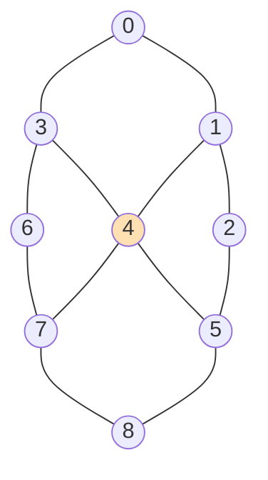

# $\rm Chapter \, 5$ 蒙特卡洛推断

> **本章前置自检**（先勾选再进入；勾不上的项先回读）：
>
> 1. 马尔可夫毯：贝叶斯网里一个节点的条件集是「父、子、子之共父」，毯外变量与它条件独立（第 1 章 $\rm \S \, 1.3$）。本章的无向版毯恰好就是邻域，$\rm \S \, 5.2$ 现场推导。
> 2. 成对马尔可夫随机场的写法：联合分布是节点势与边势之积除以配分函数 ${Z}$，势只表达相对偏好（第 2 章 $\rm \S \, 2.2$）。
> 3. 树宽账：精确推断的总耗时是 ${O(M \cdot 2^{w+1})}$，实测里消元宽度从 ${13}$ 涨到 ${17}$、乘法涨 ${17}$ 倍（第 3 章 $\rm \S \, 3.4$、$\rm \S \, 3.5$）。树宽破产时本章的采样是出口。
> 4. Metropolis–Hastings 的接受概率 ${\min(1, r)}$ 与细致平衡验算，Gibbs 采样是接受率恒为 ${1}$ 的特例（《69-蒙特卡洛》$\rm \S \, 4.2$、$\rm \S \, 4.3$、$\rm \S \, 4.4$；概率论册 $\rm \S \, 11.7$、$\rm \S \, 11.8$）。
> 5. 自相关、积分自相关时间 ${\tau}$、有效样本量 ESS 与 burn-in 的口径（《69-蒙特卡洛》$\rm \S \, 4.6$；概率论册 $\rm \S \, 11.9$）。本章的实测直接沿用那套算法。

第 4 章结尾留了一句话：图再大再稠密时，树宽账先破产，就得换一种问法，不把分布摊开算，而从分布里抽样本，用样本频率代替积不出来的和。本章兑现它。做法是把《69-蒙特卡洛》第 4 章的通用马尔可夫链蒙特卡洛装到图模型上，装的过程会看到图给的两样东西：一件便宜，全条件分布和接受比值都被图砍到局部，每次更新只碰一个节点的邻居；一个坑，耦合一强链就走不动，「跑得够久就准」里的够久可以久到没有意义。所以本章一半篇幅给算法推导，另一半给混合与诊断：一条链自己说了不算，要用自相关和多链对照替它作证。实验在 ${3 \times 3}$ 网格这个能全枚举的试验台上做三组对账：Gibbs 对枚举真值的收敛与自相关（实验一）、MH 的局部比值与接受率-步长曲线（实验二）、burn-in 期的多链诊断（实验三），每个数字先跑后写。

## $\rm \S \, 5.1$ 换一种问法：不求和，抽样

先把换的什么说清楚。推断要的答案是边缘或后验，形状永远是「函数在分布下的平均」：

$$
\mathbb{E}_{p}[f]
= \sum_{\mathbf{x}} f(\mathbf{x})\, p(\mathbf{x})
$$

精确推断（第 3 章）把这个和按结构重排，代价由树宽 ${w}$ 定：中间表 ${2^{w+1}}$ 项。${w}$ 小它是最优解，${w}$ 到三四十时 ${2^{w+1}}$ 超过任何机器的内存与耐心。蒙特卡洛的问法不同：不重排求和，而是从 ${p}$ 里抽 ${N}$ 个样本 ${X^{(1)}, \ldots, X^{(N)}}$，用频率代替概率：

$$
\hat f_N
= \frac{1}{N} \sum_{s=1}^{N} f\bigl(X^{(s)}\bigr)
$$

误差由中心极限定理接管：${N}$ 个独立样本下标准误是 ${\sigma / \sqrt{N}}$，与 ${f}$ 住在多少维无关（《69-蒙特卡洛》$\rm \S \, 1.2$ 的主证）。维度无关这四个字就是本章存在的理由：树宽是结构的税，样本量是时间的税，前者指数后者开方，图越稠密这笔交换越划算。

还有一层常常被低估的收获：样本给的不止一个点估计。同一批样本可以对任何 ${f}$ 复用，换一个查询函数不必重跑；标准误可以从样本自身估出来，答案自带误差棒；后验的形状（分位数、置信区间）也一并到手。精确推断给的是表格，每个查询各算各的；采样给的是一堆「活的」后验样本，查询是事后的事。这个差别在第 7 章学习的语境里还会再值一次钱：贝叶斯参数估计里参数本身就是随机变量，拿到参数的样本就等于拿到参数不确定性的完整刻画。

但「从 ${p}$ 里抽样本」这六个字在图模型上有一道坎：带证据时，采样的目标不是先验 ${p(\mathbf{x})}$ 而是后验 ${p(\mathbf{x}_Q \mid \mathbf{e})}$。概率论册 $\rm \S \, 8.7$ 的祖先采样只对先验有效，证据一来，剩下的隐变量分布整个变形。应急办法是重要性采样（《69-蒙特卡洛》$\rm \S \, 2.2$）：照旧从先验抽，每个样本乘权重 ${p(\mathbf{e} \mid \mathbf{x}_h)}$ 做自归一化。这条路在证据概率大时能用，但权重的有效样本量随证据概率衰减（$\rm \S \, 2.4$ 的权重退化体检表）：每一条证据都在给样本整体乘一次小于 ${1}$ 的期望权重，证据一多、概率一小，绝大多数样本的权重趋近于零，预算被少数幸存者吃光。权重退化的根源是「提议与目标脱节」，而提议分布在高维联合空间里没法跟着每条证据调整。马尔可夫链蒙特卡洛（Markov chain Monte Carlo, MCMC）绕开这道坎的方式换了个思路：不构造直接采样器，而是造一条以目标分布为平稳分布的链，让链自己走到目标上去，证据直接写进每一步的接受判断里，不存在权重的积累。它对目标的全部要求是逐点可算的**未归一化**密度，接受比值里配分函数 ${Z}$ 上下相消（《69-蒙特卡洛》$\rm \S \, 4.3$ 读法第一条）；而图模型的势函数乘积表示（第 2 章 $\rm \S \, 2.2$）天然满足这个要求。于是本章的两个算法都不需要算过 ${Z}$，这在精确推断里恰恰是树宽税的大头。一句边界：时序图模型（隐马尔可夫、状态空间）上的同款问题有沿时间前向传播样本的专门解法——粒子滤波（《69-蒙特卡洛》$\rm \S \, 5.1$；《43-具身智能》$\rm \S \, 2.4$），它管「数据流进来、目标跟着流动」的场合；本章的 MCMC 管静态后验，两者在 69 册的谱系里是并列的两枝。

> 本节小结：推断要的是「函数在分布下的平均」，采样用频率代替求和，误差 ${\sigma/\sqrt{N}}$ 维度无关；带证据时祖先采样失效、重要性采样被权重退化拖垮；MCMC 只要求未归一化密度可逐点计算，势函数乘积表示恰好奉上。

## $\rm \S \, 5.2$ Gibbs 采样：图把全条件缩到毯

Gibbs 采样在图模型上的每一步是：固定其余全部变量，从第 ${i}$ 个变量的**全条件分布（full conditional）**${p(x_i \mid x_{-i})}$ 里采一个新值，逐个节点轮一遍称为一轮扫描（sweep）。这套流程对任意联合分布都有定义，但图模型上它有个别的分布没有的优惠：全条件分布小得可以写下来。看推导。设成对 MRF

$$
p(\mathbf{x})
= \frac{1}{Z}\, \prod_{k} \psi_k(x_k) \prod_{(u,v) \in E} \psi_{uv}(x_u, x_v)
$$

按条件概率定义，${p(x_i \mid x_{-i}) = p(\mathbf{x}) / \sum_{x_i'} p(x_i', \mathbf{x}_{-i})}$。分子分母是同一个乘积，只差 ${x_i}$ 的取值，于是所有不含 ${x_i}$ 的因子（别处的节点势、与 ${i}$ 不相邻的边势）上下相消，剩下的只有 ${i}$ 自己的节点势和 ${i}$ 的每条邻边势：

$$
p(x_i \mid x_{-i})
= \frac{1}{Z_i}\, \psi_i(x_i) \prod_{j \in \mathrm{Nb}(i)} \psi_{ij}(x_i, x_j)
$$

${Z_i = \sum_{x_i} \psi_i(x_i) \prod_{j \in \mathrm{Nb}(i)} \psi_{ij}(x_i, x_j)}$ 只是归一化。读法：全条件分布的条件集恰好是邻域 ${\mathrm{Nb}(i)}$，这正是马尔可夫毯的无向版（第 1 章 $\rm \S \, 1.3$ 的有向版毯是父、子、共父；无向图上毯收缩到一层邻居）。二元变量下这张条件表只有两个数，归一化即得：把 ${x_i = {+1}}$ 与 ${x_i = {-1}}$ 各代入一次，两数之比就是全条件的几率比，除以自身之和完成归一化。若把势写成指数形式 ${p(\mathbf{x}) \propto \exp\bigl(\sum_i h_i x_i + \beta \sum_{(u,v)} J_{uv} x_u x_v\bigr)}$（${x_i \in \{-1, +1\}}$，第 2 章 $\rm \S \, 2.2$ 的 Ising 形状），代入得

$$
p(x_i = {+1} \mid x_{-i})
= \frac{1}{1 + e^{-2a_i}},
\qquad
a_i = h_i + \beta \sum_{j \in \mathrm{Nb}(i)} J_{ij}\, x_j
$$

更新一个节点只要算一个 ${a_i}$：成本 ${O(\deg_i)}$，与全图的 ${2^n}$ 个状态无关。每个节点像个班干部，改主意前只征询直接邻居的意见，隔了两层的人一概不打扰。

（${3 \times 3}$ 网格全图。更新黄色中心节点 ${4}$ 时，全条件分布只看它自己与四个邻居 ${1, 3, 5, 7}$ 的边势；其余四个角节点的当前取值不出现在这张小表里，它们对 ${x_4}$ 的影响已全部被邻居吸收。）

正确性账目在《69-蒙特卡洛》$\rm \S \, 4.4$ 已结清：从全条件分布提议的正反两个提议核重合，MH 比值恒为 ${1}$，每个单点更新核以 ${p}$ 为平稳分布；一轮扫描是这些核的复合，复合核照旧以 ${p}$ 为平稳。两个实现自由度都不碰这条账。其一，扫描顺序：按固定编号、随机抽点、随机重排都行，平稳性只依赖「每个核都不动 ${p}$」，不依赖次序；混合速度则可能差别可观，实务里固定顺序最常见，因为它缓存友好且确定可复现，本章实验就用它。其二，分块：把强耦合的一组变量捆成一块、从联合条件分布整块采样（block Gibbs），正反核同样重合、接受率同样恒为 ${1}$，这是《69-蒙特卡洛》$\rm \S \, 4.4$ 入场券第二条在图上的落点——强相关的坐标要捆，图上「强相关」由稠密的边连接外显出来，看图选块比看协方差矩阵直观。

剩下的收敛前提是不可约与非周期（概率论册 $\rm \S \, 11.3$、$\rm \S \, 11.5$）。非周期是免费的：每个条件分布对原值都给正概率，链在原地停一轮的概率为正。不可约要一个前提：**势处处为正**。此时任意两个状态之间都有「逐点翻转」的路径，每步翻转在新条件分布下概率为正，链可达全空间。这与第 2 章 $\rm \S \, 2.4$ Hammersley–Clifford 定理的正性前提同源，不过用途不同：那边正性换「分布能写成势之积」的反演，这边正性换「链走遍全空间」的通行证。势有零点时这条路会断：给两个变量挂硬约束势 ${\psi(x_1, x_2) = \mathbb{1}[x_1 = x_2]}$，从不一致的初值出发，单点全条件把「保持不一致」之外的选择全压成零概率，链永远出不去。这类硬约束在真实模型里并不罕见（合法性约束、互斥假设），处理办法要么把整块约束变量捆成 block Gibbs 的一个块，要么换 $\rm \S \, 5.3$ 的 MH 并把提议设计成约束内迁移，两条路都绕开了「单点更新必然违规」的死结。

> **竞赛生迁移提示**：一轮 Gibbs 扫描的骨架是「按固定顺序逐个变量，依据邻居重设自己」，这与局部搜索里逐位翻转、与模拟退火里逐点提议是同一副骨架。差别在取新值的规则：局部搜索取最优，退火按能量差以一定概率翻转，Gibbs 直接从条件分布抽签。抽签这条最有意思，它不优化任何东西，只是让每个节点在邻居给定的环境里按后验行事，走多了，全体节点的联合频率自然收敛到目标分布。算法不知道目标是什么，它只是局部地做正确的事。

> 本节小结：全条件分布由「分子分母共享因子相消」砍到毯大小，二元势下每节点 ${O(\deg)}$；Gibbs 是接受率恒 ${1}$ 的 MH，扫描顺序与分块不碰平稳性；不可约要势处处为正，硬约束势会把单点更新锁死。

## $\rm \S \, 5.3$ MH 与步长：提议怎么花

Gibbs 的入场券是全条件可采。采不了的时候退回通用 MH：提议一个改动，按 ${\min(1, r)}$ 接受（《69-蒙特卡洛》$\rm \S \, 4.3$）。图模型在这里又给一笔便宜：接受比也只要局部。取对称提议「翻转节点集 ${S}$」，记 ${S}$ 的边界边 ${\partial S = \{(u,v) \in E : \text{恰一端} \in S\}}$。翻转只动两类因子：${S}$ 内节点势变号，边界边势的 ${x_u x_v}$ 变号；两端都在 ${S}$ 内或都不在的边，乘积 ${x_u x_v}$ 原样不动。代入指数形式，对数接受比是

$$
\ln \frac{p(\mathbf{x}')}{p(\mathbf{x})}
= -2 \Bigl( \sum_{i \in S} h_i x_i + \beta \sum_{(u,v) \in \partial S} J_{uv}\, x_u x_v \Bigr)
$$

算这笔账只要 ${O(|S| \cdot \deg)}$ 次乘加，不用碰全图，也不用算 ${Z}$。${\rm \S \, 5.5}$ 实验二 A 会把这笔局部账与全量比值逐提议对账。对称性也成立：翻转是自身的逆，从 ${\mathbf{x}}$ 提议到 ${\mathbf{x}'}$ 与反向的提议概率相同，比值里 ${q}$ 的部分约掉，退化为纯 Metropolis 情形。取对称提议不是偷懒，是把复杂度从算法侧挪到数据侧的交换：非对称提议（如朝低能量方向偏置的提议）也合法，只要把 ${q(x \mid x')/q(x' \mid x)}$ 计入比值，但那要求为每个提议维护反向概率，图模型上容易出错，而对称提议用结构换取免维护——细致平衡这个局部验算（《69-蒙特卡洛》$\rm \S \, 4.2$）在代码里就退化成一行比值。

「步长（step size）」在这个框架里是提议宽度的统称。离散情形是一次翻几个点（${|S|}$）；连续情形是随机游走 Metropolis（random-walk Metropolis）的 ${\mathbf{x}' = \mathbf{x} + s\,\boldsymbol{\varepsilon}}$。步长两头受气：步子太小，提议离现状太近，几乎每次都接受，接受率冲向 ${1}$，但每步位移也小，链在原地蹭；步子太大，提议常落在低概率区，接受率砸向 ${0}$，链长时间粘住不动。两头浪费的形态不同，结局相同：有效样本量上不去。衡量的硬通货不是接受率，是 ESS（《69-蒙特卡洛》$\rm \S \, 4.6$），${\rm \S \, 5.5}$ 实验二 B 的曲线会给出实测的峰值位置。

每步成本也值得入账。Gibbs 一个节点更新是 ${O(\deg)}$ 次乘加加一次抽签；MH 一次提议是 ${O(|S| \cdot \deg)}$ 次乘加加一次均匀抽签。单步价格同量级，差价在有效位移上：MH 被拒的提议零位移但照收成本，Gibbs 的每次更新必然换值。所以「每计算量买到多少独立样本」的账，要在 ESS 对耗时的比上结，${\rm \S \, 5.5}$ 实验二 A 给了同一目标下两种采样器的这笔账。Gibbs 与 MH 的分工也就清楚了：Gibbs 不付拒绝税、无步长可调，但方向被条件分布锁死，变量强相关时逐坐标更新在山谷里横向蹭（命题的原始出处是《69-蒙特卡洛》$\rm \S \, 4.4$ 读法第二条）；MH 自由定向，但要交税并调参。

> 本节小结：对称翻块提议下接受比只由场项与边界边项组成，代价 ${O(|S| \cdot \deg)}$；步长是提议宽度的统称，接受率与位移互相牵制，质量的裁判是 ESS；全条件好采选 Gibbs，只可求值选 MH。

## $\rm \S \, 5.4$ 混合、burn-in 与诊断

遍历定理（概率论册 $\rm \S \, 11.5$；《69-蒙特卡洛》$\rm \S \, 4.2$）担保的是「跑得够久，样本频率趋于 ${p}$」，担保不了「够久」是多久，那是混合时间的事。图模型上慢混合的机制值得看清：以铁磁型耦合（同值偏好）为例，链若从多数派状态出发，把单个少数派节点翻成多数派降低能量、畅通无阻，把多数派节点翻成少数派提高能量，全条件给这个选择的概率随能量差指数缩小（$\rm \S \, 5.2$ 的 ${e^{-2 a_i}}$ 里 ${a_i}$ 被邻居的多数票推大）。于是链在「接近全 ${+1}$」与「接近全 ${-1}$」两个盆地之间迁移要靠多次不利翻转的接力，盆地越深接力越长，耦合 ${\beta}$ 越大迁移越稀罕。这不是实现 bug，是目标分布的几何给链设的关卡。

诊断从这条机制反推。

先把规模问题挑明：盆地的深度随系统规模增长，同一套机制搬到 ${10 \times 10}$ 的网格上，从全 ${+1}$ 搬到接近全 ${-1}$ 需要的不利翻转接力更长，${\tau}$ 随 ${n}$ 的增长在统计物理里有指数型行为的记录（临界耦合附近尤甚）。这意味着「跑 ${N}$ 轮就够」没有普适答案，预算必须按 ${\tau}$ 的实测值倒推，而 ${\tau}$ 必须诊断而不是假设。

单链诊断看自相关：记每轮扫描后的观测序列 ${m^{(1)}, m^{(2)}, \ldots}$（如磁化 ${m = \frac{1}{n}\sum_i x_i}$），积分自相关时间 ${\tau}$ 按《69-蒙特卡洛》$\rm \S \, 4.6$ 的口径计算：算各滞后 ${l}$ 的自相关 ${\rho_l}$，从 ${l = 1}$ 起累加 ${1 + 2\sum_l \rho_l}$，遇首个非正的 ${\rho_l}$ 截断（初始正序列约定，防长滞后处噪声把和拖成发散），有效样本量 ${\mathrm{ESS} = N / \tau}$。两点注意。其一，${\tau}$ 本身是估计量，短链上噪声不小，报数时心里留一个量级而不是当成精确值。其二，观测量的选法影响结论：翻转型提议可能让磁化这类近对称的量出现负自相关，截断约定会把 ${\tau}$ 压到 ${1}$ 附近，貌似独立实则不然，选观测量要挑「能代表链走得远不远」的量。${\tau = 30}$ 意味着两万轮样本只顶六百多个独立样本，标准误要按 ESS 报而不是按 ${N}$ 报。burn-in 照概率论册 $\rm \S \, 11.9$ 的口径丢掉前段，但丢多少不该拍脑袋，下面的多链诊断就是给这个决定供证据的。

多链诊断用**Gelman–Rubin 统计（Gelman–Rubin statistic）**${\hat R}$ 的简化版：跑 ${M}$ 条初值过度离散的链，各 ${n}$ 轮，算链内方差的平均 ${W = \frac{1}{M}\sum_{c} \mathrm{var}_c}$ 与链间方差 ${B/n = \mathrm{var}(\bar m_c)}$（对链均值取方差），则

$$
\hat R
= \sqrt{\frac{(n-1)\,W/n + B/n}{W}}
$$

直觉是一句话：${M}$ 条链若都到达了同一个分布，链均值的分散（${B}$）应当与链内波动（${W}$）同量级，${\hat R \approx 1}$；若有的链还在 burn-in 路上，链均值彼此拉开，${\hat R}$ 明显大于 ${1}$。经验阈值取 ${1.1}$（经验规则，非定理）。设计里有一个容易省掉的细节要强调：初值必须**过度离散（overdispersed）**，比目标分布散得更开，典型做法是取极端状态（全 ${+1}$、全 ${-1}$）加上随机初值。省掉它、让四条链挤在同一处出发，等于一开始就伪造了「链间一致」，${\hat R}$ 的检验力全部报废。这个简化版还有两条诚实的边界。其一，${W}$ 的收缩因子让 ${\hat R}$ 可以略低于 ${1}$，本册实验里弱耦合在 ${n = 1000}$ 处测得 ${0.9996}$，低于 ${1}$ 不是「比平稳还平稳」，是分母的小样本抖动。其二，${\hat R}$ 只查链间一致，不查对真值一致：四条链一起卡进同一个错误盆地时 ${\hat R}$ 看不出异样。所以它与小图上的枚举对照（第 3 章）是互补关系，不是替代关系。

> 本节小结：慢混合的机制是能垒下的盆地迁移，耦合越强接力越长；单链看 ${\tau}$ 与 ESS，标准误按 ESS 报；多链 ${\hat R}$ 要过度离散初值才有效，阈值 ${1.1}$ 是经验值，且它查不出「一起错」，枚举对照不可省。

> **类比说明**：把 burn-in 想成甩掉起跑姿势。四名运动员从看台不同角落出发（过度离散初值），跑一段时间后都汇入同一条跑道并排前进（到达平稳分布），队形的分散才反映跑道的宽度而不是出发点的差异。${\hat R}$ 量的正是「还在各跑各的」与「已经同频」之间的差距；它的失效边界是四个人一开始就撞进同一条死胡同，队形整齐地停错地方，此时只有拿地图（枚举真值）才能识破。

## $\rm \S \, 5.5$ 实测：三组对账

实验环境与口径：Windows 侧 WSL，Python 3.12.3、numpy 2.5.4，随机种子 20261110；全部实验由单个幂等脚本一次生成（脚本与完整输出在本册配套实验目录的 `run_exp.py` 与 `result.txt`），总耗时 27.57 秒。以下每个数字都来自该次输出。试验台是 ${3 \times 3}$ 网格上的成对 MRF：${9}$ 个二元节点、${12}$ 条边，${p(\mathbf{x}) \propto \exp\bigl(\sum_i h_i x_i + \beta \sum_{(u,v)} J_{uv} x_u x_v\bigr)}$，外场 ${h}$ 与基础耦合 ${J}$ 由种子生成，耦合标度 ${\beta}$ 取 ${0.4}$（弱）与 ${1.6}$（强）两档；枚举 ${2^9 = 512}$ 个状态给出全部真值（弱耦合 ${\ln Z = 7.039998}$，强耦合 ${\ln Z = 11.855148}$）。

**实验一，Gibbs 对枚举真值的收敛与自相关。**Gibbs 按 $\rm \S \, 5.2$ 的全条件式逐节点更新，burn-in ${500}$ 轮后保留 ${20000}$ 轮。弱耦合：全部 ${9}$ 个节点边缘的最大偏差 ${0.0065}$（节点 ${0}$ 估计 ${0.6319}$ 对精确 ${0.6307}$），磁化的 ${\tau = 1.0}$ 轮、ESS 是满额的 ${20000}$，样本在这档耦合下近似独立。强耦合换同一采样器：链 A 最大偏差 ${0.0369}$，${\tau = 30.0}$、ESS ${666}$；换一个随机初值的链 B，全节点最大偏差 ${0.0460}$，${\tau = 39.3}$、ESS ${508}$。两笔对照读出同一件事：耦合从 ${0.4}$ 到 ${1.6}$，采样器一字未改，${\tau}$ 涨了三十倍，误差涨了近七倍，两万轮预算的有效购买力从百分之百掉到百分之三。

算力对账放在同一张桌上才公平。枚举一次付清：${2^9 = 512}$ 个状态各算一遍势之积，之后任何节点的边缘都是现成的查表；Gibbs 要 ${20000}$ 轮、每轮 ${9}$ 个节点、每节点 ${O(\deg)}$ 次乘加，比枚举贵两个量级。这笔账在 ${9}$ 个节点上枚举全胜，但它按 ${2^n}$ 增长而 Gibbs 按 ${n \cdot \deg \cdot N}$ 线性增长：图到几十个节点、树宽同时爆炸时，胜者换人。采样不是小图上的便宜货，是做大图时唯一还付得起的账，代价是答案从「精确值」降格为「带误差棒的估计」，误差棒的宽度由实验一后半段的 ${\tau}$ 决定。

收敛形状看得更细。链 B 从随机初值出发，节点 ${0}$ 边缘的累计均值在保留 ${1000}$、${5000}$、${20000}$ 轮时依次为 ${0.7370}$、${0.7520}$、${0.7345}$，对精确值 ${0.7281}$ 的偏差 ${0.0089}$、${0.0239}$、${0.0064}$：不是单调滑向真值，而是带着 ${\tau = 39}$ 的低频摆动徘徊，估计量何时「看起来收敛」带运气成分。

这正是 $\rm \S \, 5.4$ 说的「单链说了不算」的第一份证据：同一条链，${5000}$ 轮时比 ${1000}$ 轮时更偏离真值，谁盯着一条轨迹都会误判。多链诊断在实验三接着说。

**实验二，MH：局部比值对账与接受率-步长曲线。**A 部分，同一强耦合网格上跑单点翻转 MH（对称提议，burn-in ${2000}$ 步加 ${20000}$ 步）：接受率 ${0.166}$，磁化 ${\tau = 309.2}$、ESS ${65}$，节点 ${0}$ 边缘估计 ${0.6852}$ 对精确 ${0.7281}$（偏差 ${0.0429}$）。两个结论。其一，$\rm \S \, 5.3$ 的局部比值是真的：前 ${100}$ 次提议里局部账与全量重算的最大差 ${8.53 \times 10^{-14}}$，纯浮点误差。其二，同目标同预算下 MH 的 ${\tau}$ 是 Gibbs 的十倍（${309}$ 对 ${30}$）：单点翻转在强耦合下 ${83.4\%}$ 的提议被拒，链大量时间原地踏步；Gibbs 每次从条件分布直接抽签，零拒绝。代价是 Gibbs 只在这个全条件好采的二元网格上占优，两者分界在 $\rm \S \, 5.3$ 已述。

B 部分，接受率-步长曲线放在二维高斯上（相关系数 ${\rho = 0.9}$、边际方差 ${1}$，随机游走提议 ${\mathbf{x}' = \mathbf{x} + s\,\boldsymbol{\varepsilon}}$，burn-in ${3000}$ 加 ${30000}$ 步；曲线要连续步长，二元网格只有「翻几个点」的粗档）：

| 步长 ${s}$ | 接受率 | ${\tau(x_0)}$ | ESS |
| --- | --- | --- | --- |
| ${0.05}$ | ${0.947}$ | ${1740}$ | ${17}$ |
| ${0.25}$ | ${0.748}$ | ${159}$ | ${188}$ |
| ${0.5}$ | ${0.544}$ | ${59.5}$ | ${504}$ |
| ${1.0}$ | ${0.318}$ | ${29.2}$ | ${1028}$ |
| ${2.0}$ | ${0.140}$ | ${23.3}$ | ${1289}$ |
| ${4.0}$ | ${0.044}$ | ${53.8}$ | ${557}$ |
| ${8.0}$ | ${0.013}$ | ${120.6}$ | ${249}$ |

（${s = 0.1}$ 测得接受率 ${0.895}$、ESS ${53}$，为省篇幅未列。）接受率从 ${0.947}$ 单调砸到 ${0.013}$，ESS 却在 ${s = 2.0}$、接受率约 ${0.14}$ 处封顶：最高接受率处的 ESS 只剩峰值的约百分之一点三。相关目标的最优接受率比经典文献的 ${0.234}$ 还要低一截（那是对近独立目标的无量纲基准，本例 ${\rho = 0.9}$ 的山谷几何把最优推得更保守），数字因目标而异，「接受率高低不是质量指标」这个定性结论不因目标而异。

**实验三，burn-in 诊断：简化 Gelman–Rubin 与轨迹对比。**同一网格、同一 Gibbs 采样器，${4}$ 条过度离散初值链（全 ${+1}$、全 ${-1}$、两条随机），各 ${5000}$ 轮，不丢 burn-in，从第 ${1}$ 轮起按 $\rm \S \, 5.4$ 公式算磁化的 ${\hat R}$：

| 累计轮数 ${n}$ | 强耦合 ${\hat R}$ | 弱耦合 ${\hat R}$ |
| --- | --- | --- |
| ${50}$ | ${1.2015}$ | ${1.0284}$ |
| ${200}$ | ${1.0426}$ | ${1.0042}$ |
| ${1000}$ | ${1.0149}$ | ${0.9996}$ |
| ${5000}$ | ${1.0006}$ | ${1.0000}$ |

弱耦合的 ${\hat R}$ 从第 ${50}$ 轮起就在 ${1.03}$ 以内，链几乎不需要 burn-in；强耦合在第 ${50}$ 轮 ${\hat R = 1.20}$，超过 ${1.1}$ 阈值，到 ${200}$ 轮才降到 ${1.04}$ 以下。轨迹对比给出 ${\hat R}$ 数字的画面版：全 ${+1}$ 起步的链前 ${500}$ 轮里磁化有 ${78.2\%}$ 的时间在正半边，全 ${-1}$ 起步的链有 ${30.2\%}$ 的时间在负半边，两条链「住」的盆地不同；首次穿越零线分别在第 ${2}$ 轮与第 ${14}$ 轮，说明单点穿越频繁，但穿越后仍大幅回摆，链均值需要几百轮才彼此靠拢。按实验一的 ${\tau}$ 账，强耦合稳妥的 burn-in 取若干个 ${\tau}$（这里 ${30}$ 到 ${40}$ 轮一个），与 ${\hat R}$ 曲线走平的位置一致；两种诊断一个看链内时间相关、一个看链间空间分散，结论互不依赖而彼此印证。

这套诊断的结果怎么进报告，给一个可照抄的口径：

1. 采样器与扫描顺序（Gibbs 的固定顺序、MH 的提议分布与步长）。
2. 目标分布与证据，连同未归一化势的形状。
3. 随机种子与初值（多链时列出各链初值）。
4. burn-in 长度及其依据：${\hat R}$ 曲线走平的位置加若干个 ${\tau}$。
5. 保留样本数与 ESS，估计量连同按 ESS 折算的标准误。

少了哪一项，读的人就要在哪一项上猜；实验报告里「${N = 20000}$」单独出现而 ESS 缺席，等价于测量报告里只写刻度不写误差。

三组实验半分钟内可复现：在本册配套的实验目录里执行 `python3 run_exp.py > result.txt`（WSL 的 Python 3，需 numpy），核对输出末尾各 `[Exp* 自检]` 全为 `True`、最后一行是 `ALL CHECKS PASSED`。种子固定，重跑的每个数字与本节一致。自检项本身的选法也交代一下：实验一查「估计偏差落在预算对应的合理范围」与「强慢弱快的排序」，实验二 A 查「局部比值与全量比值逐提议相等」、B 查「接受率单调、ESS 峰值在内部步长」，实验三查「强耦合的诊断信号强于弱耦合且随轮数缓解」。这些断言都写进脚本随每次运行自动复核，正文引用的数字若被改动，自检会先红。

## $\rm \S \, 5.6$ 两个典型错误与证据式排查

**错误一：单链跑完就签字，不查混合。**症状：报告后验估计时只给样本数「${N = 20000}$，结果如何如何」，不报 ${\tau}$、ESS 或多链对照。机制：MCMC 的标准误由 ESS 而非 ${N}$ 决定，链混不开时名义样本大量重复计数。实验一里强耦合链 A 的 ESS 是 ${666}$，名义样本的有效率 ${3.3\%}$；若不诊断，报告里的「两万样本」虚增三十倍。

更隐蔽的是实验一的链 B：累计均值在 ${5000}$ 轮处偏差 ${0.0239}$、到 ${20000}$ 轮才缩回 ${0.0064}$，中途任何一刻停下，误差都超出弱耦合链一个量级且无从察觉。排查固定三步：

1. 算 ${\tau}$ 与 ESS，标准误按 ESS 报（实验一口径）。
2. 多链 ${\hat R}$：几条过度离散初值链的 ${\hat R}$ 曲线走平且低于经验阈值再谈结论（实验三口径）。
3. 缩图对账：图缩到能枚举的规模，样本估计对枚举真值（实验一口径）；这是唯一能查「链间一致但一起错」的手段。

**错误二：把接受率当质量指标，把步长调向高接受率。**症状：跑随机游走 MH 时看到接受率 ${0.9}$ 以上觉得「链很健康」，接受率掉到 ${0.2}$ 觉得「链坏了」，于是调小步长。机制在 $\rm \S \, 5.3$ 已述：接受率高只说明提议保守，每步位移小，链在局部打转。实验二 B 的曲线是对症的药：${s = 0.05}$ 接受率 ${0.947}$、ESS ${17}$；${s = 2.0}$ 接受率 ${0.140}$、ESS ${1289}$，接受率砍掉八成半，有效样本反涨七十六倍。

排查与修法：接受率只当「提议宽度」的仪表，链质量看 ESS；调步长的目标是 ESS 峰值附近（经验上接受率落在零点二到零点五区间再按 ESS 细调），每次调参后用实验一、三的口径重新诊断。两个错误合起来是同一课：采样器的输出自带噪声与相关，不经诊断的样本数和接受率都是装饰品。

## $\rm \S \, 5.7$ 关键概念回顾

1. 全条件分布的推导里，「不含 ${x_i}$ 的因子上下相消」依赖条件概率定义的哪一步？条件集为什么恰好是邻域？（答案见 $\rm \S \, 5.9$）
2. 势处处为正在本章用了两次，各担保什么？与第 2 章 Hammersley–Clifford 定理的正性用途有何不同？
3. 单点翻转 MH 的对数接受比只含哪些项？「两端同在 ${S}$ 或都不在」的边为什么不出场？
4. 简化 Gelman–Rubin 的 ${\hat R}$ 在查什么？它查不出哪种失败，靠什么补？
5. 实验二 B 里 ${s = 0.05}$ 与 ${s = 2.0}$ 的接受率与 ESS 各是多少？这个对照推翻了哪种常见的调参直觉？

## $\rm \S \, 5.8$ 应用与辨析

1. 实验一中弱耦合的 ${\tau = 1.0}$、强耦合的 ${\tau = 30}$。若把网格从 ${3 \times 3}$ 换成 ${10 \times 10}$、耦合维持 ${1.6}$，凭 $\rm \S \, 5.4$ 的盆地机制判断 ${\tau}$ 的变化方向，并按标准误 ${\propto \sqrt{\tau/N}}$ 的账说明固定预算下误差与 ESS 各按什么速度恶化。
2. 同学说：「Gibbs 接受率恒为 ${1}$、零拒绝，MH 接受率只有 ${0.166}$，所以任何图模型上都该无脑选 Gibbs。」用实验二 A 与 $\rm \S \, 5.3$ 的分界说明这句话错在哪两处。
3. 把实验三的 ${4}$ 条强耦合链全部换成「从同一个随机初值出发、不同种子」的 ${4}$ 条链，${\hat R}$ 在 ${n = 50}$ 处还会是 ${1.20}$ 的量级吗？用过度离散初值的设计意图说明你的答案，并指出这时该改用哪个诊断补位。

## $\rm \S \, 5.9$ 答案

1. 依赖的是 ${p(x_i \mid x_{-i}) = p(\mathbf{x}) / \sum_{x_i'} p(x_i', \mathbf{x}_{-i})}$ 里分子分母共享同一批与 ${x_i}$ 无关的因子，比值中逐项相消（$\rm \S \, 5.2$）。相消后剩下的只有含 ${x_i}$ 的因子：${i}$ 的节点势与 ${i}$ 的邻边势，而邻边势的另一端恰是 ${\mathrm{Nb}(i)}$，所以条件集是邻域；这也是马尔可夫毯的无向版（第 1 章 $\rm \S \, 1.3$）。
2. 第一处在 $\rm \S \, 5.2$ 的不可约性：正势保证逐点翻转路径每步概率为正，链可达全空间；第二处在条件分布本身：${\psi_i}$ 与邻边势为正，全条件的两个取值概率都为正，非周期性由此免费。Hammersley–Clifford（第 2 章 $\rm \S \, 2.4$）的正性用于反演，从分布的成对性质倒推势分解，需要对数处处有定义；本章两处都是正向的采样性质，前提同源、用途无关。
3. 只含 ${S}$ 内节点的场项与 ${S}$ 的边界边项：${-2\bigl(\sum_{i \in S} h_i x_i + \beta \sum_{(u,v) \in \partial S} J_{uv} x_u x_v\bigr)}$（$\rm \S \, 5.3$）。两端同在 ${S}$ 内（都翻转）或都不在（都不翻）的边，乘积 ${x_u x_v}$ 在 ${\mathbf{x}}$ 与 ${\mathbf{x}'}$ 中相同，进比值后约掉；实验二 A 用全量重算验证了这个局部账（最大差 ${8.53 \times 10^{-14}}$）。
4. 查「多条初值不同的链是否到达同一个分布」：链均值分散对链内波动之比（$\rm \S \, 5.4$）。查不出「全部链一起卡进同一个错误区域」，那需要与独立方法对账，小图上就是枚举（第 3 章、实验一口径）。
5. ${s = 0.05}$：接受率 ${0.947}$、ESS ${17}$；${s = 2.0}$：接受率 ${0.140}$、ESS ${1289}$（$\rm \S \, 5.5$ 实验二 B）。被推翻的直觉是「接受率高等于链好」：接受率只度量提议宽度是否保守，有效信息量由 ESS 决定，此例里高接受率把效率压到峰值的约百分之一点三。

应用与辨析答案：

1. 方向：${\tau}$ 增大。盆地的深度与宽度都随规模增长，${10 \times 10}$ 网格上从多数派盆地迁到对面需要的不利翻转接力更长（$\rm \S \, 5.4$）。速度：误差按 ${\sqrt{\tau/N}}$ 恶化（比 ${\tau}$ 本身慢一档开方），ESS 按 ${N/\tau}$ 塌缩（比误差更快）。固定预算下真正先破产的是 ESS 与按它折算的标准误，这正是报告必须按 ESS 而非名义 ${N}$ 交割的原因（$\rm \S \, 5.5$ 实验一、$\rm \S \, 5.6$ 错误一）。
2. 两处错。其一，入场券：Gibbs 要求全条件分布可采，全条件不好采或含硬约束的模型上 MH 是唯一选择，$\rm \S \, 5.2$ 的硬约束例子与 $\rm \S \, 5.3$ 的分界句都在说这件事。其二，效率不由接受率决定：实验二 A 里 Gibbs 的 ${\tau}$ 确实只有 MH 的十分之一，但那是在二元网格、单点条件方向可用的场合；强相关的连续目标上逐坐标 Gibbs 在山谷里横向蹭，$\rm \S \, 5.3$ 明说这类目标该换 MH（配调好的步长）或捆块更新。「零拒绝」是平稳性的免费，不是混合速度的保证。
3. 不会。四条链从同一点出发，链均值的差异只剩采样噪声，与单链内部波动同量级，${\hat R}$ 从第 ${50}$ 轮起就在 ${1}$ 附近，即使四条链全体远未收敛也看不出来——这正是过度离散初值要防的伪造一致（$\rm \S \, 5.4$）。补位手段：多链 ${\hat R}$ 废了，改用单链 ${\tau}$ 与 ESS（实验一口径）加缩图对枚举真值（唯一能查「一起错」的手段，$\rm \S \, 5.6$ 排查第 3 步）。

**你现在能做什么**：拿一条二元链 ${x_1 - x_2}$、同值偏好边势，写出 ${p(x_1 = {+1} \mid x_2 = {-1})}$ 的两个数，并指出它为什么只用了这一条边势。

本章把采样装进了图模型：Gibbs 的全条件缩到毯，MH 的接受比缩到边界，两次局部化与第 4 章的消息传话同出一门，推断的「代数」换成了「频率」。但采样给的答案自带误差棒，误差棒的宽度由混合决定，强耦合的图能把链困在盆地几十上百轮，诊断（${\tau}$、ESS、${\hat R}$）因此不是可选项而是交割手续。下一章换一条近似路线：变分推断不抽签、不做长时间游走，而是挑一族好算的分布去逼近后验，把推断写成另一个优化问题。两条路线的误差形态不同，一个随机、一个系统，第 6 章会把它们放到同一个玩具后验上当场比武。
