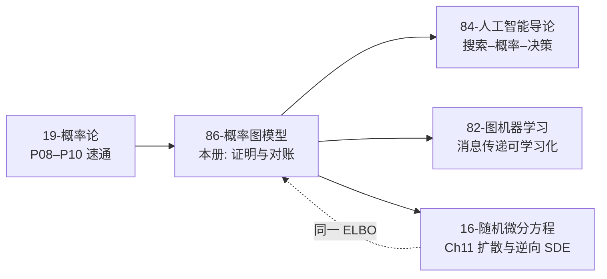

# $\rm Chapter \, 8$ 现代接口与收束

> **本章前置自检**（先勾选再进入；勾不上的项先回读）：
>
> 1. 成对马尔可夫随机场的写法：节点势、边势、配分函数 ${Z}$，以及贯穿全册的四环 Ising 模型（第 2 章 $\rm \S \, 2.2$、$\rm \S \, 2.6$）。本章全部实验仍在它身上做。
> 2. 消息更新式与树上精确性定理，以及 loopy BP 在环上的失真实测（第 4 章 $\rm \S \, 4.1$、$\rm \S \, 4.2$、$\rm \S \, 4.3$、$\rm \S \, 4.5$）。$\rm \S \, 4.1$ 末尾许下的「注意力接口」承诺，本章 $\rm \S \, 8.1$ 兑现。
> 3. 平均场的 tanh 更新式与族误差的实测（第 6 章 $\rm \S \, 6.3$、$\rm \S \, 6.4$）。本章把它重新读成「固定权重的一层传播」。
> 4. ELBO 恒等式 $\ln {Z} = \text{ELBO} + \mathrm{KL}$ 的推导与两个读法（第 6 章 $\rm \S \, 6.2$）。扩散模型那节是它的第三次出场。
> 5. Gibbs 采样与全条件更新（第 5 章 $\rm \S \, 5.2$）；极大似然、EM 与「势从数据里来」的口径（第 7 章）。本章实验的训练数据由 Gibbs 生成，参数由拟合更新。

全册心智模型：把不确定写成图，结构编码独立性，推断就是在这个图上做代数。到上一章为止，这张图的三个部件都有了出处：结构从独立性来，势从数据来（第 7 章），答案从推断来（第 3 至 6 章）。剩最后一个问题：这套上世纪八十年代成形的代数，和今天到处都是的神经网络是什么关系？本章搭两座桥再收全册的账。第一座桥：注意力机制就是消息传递的参数化版本，BP 沿边传话的局部姿势原样保留，写死的势函数权重换成数据学出来的权重。第二座桥：扩散模型是一条链结构的有向图模型加一次变分推断，第 6 章的 ELBO 在那里第三次出场，变成了神经网络的训练目标。两座桥都通向同一句话：现代接口没有推翻图模型，它把图模型里「人手写死」的部分逐一换成了「数据学出来」的部分。收束时你会发现，全册八张收据上写的是同一个名字。

## $\rm \S \, 8.1$ 消息传递与注意力：同一种沿边聚合

第 4 章 $\rm \S \, 4.1$ 末尾留了一句伏笔：BP 的消息只需要 ${\psi_i}$、${\psi_{ij}}$ 和其余邻居的来话，节点不必知道全图长什么样，「注意力机制本质上也是一套沿边传递、按接收者整形的信息」。现在把这句话拆成可对的账。和积更新式（$\rm \S \, 4.1$）两边归一化后取对数：

$$
\begin{aligned}
\ln \hat\mu_{i\to j}(x_j)
&= \ln \sum_{x_i} \exp\!\Bigl(\ln \psi_i(x_i) + \ln \psi_{ij}(x_i,x_j) + \sum_{k \ne j} \ln \mu_{k\to i}(x_i)\Bigr) + \text{const} \\
&= \text{logsumexp}_{x_i}\Bigl(\underbrace{\ln \psi_i(x_i) + \ln \psi_{ij}(x_i,x_j)}_{\text{本点与本边的打分}} + \underbrace{\textstyle\sum_{k \ne j} \ln \mu_{k\to i}(x_i)}_{\text{来话的线性组合}}\Bigr) + \text{const}.
\end{aligned}
$$

读法：接收者 ${j}$ 的每个取值 ${x_j}$ 领到一个分数，分数是「邻居侧全部证据的对数」按边组合后的指数归一。注意力的三件套恰好逐项对上：沿边聚合（分数只从邻居来）、按接收者整形（同一个发送者对不同 ${x_j}$ 贡献不同的分数）、指数归一（logsumexp 之外那一步就是 softmax 的对数）。Transformer 里 ${\text{softmax}(QK^{\top}/\sqrt{d})V}$ 的打分矩阵，形状上就是上式括号里那串线性组合；《82-图机器学习》$\rm \S \, 8.5$ 把这一点讲成了「完全图视角」，$\rm \S \, 8.2$ 的 GAT 则是它的图上版本：把对称归一化矩阵 ${\hat A}$ 的每一格换成参数。

第二条对照线在第 6 章内部。平均场更新式 ${m_i \leftarrow \tanh(h_i + \beta \sum_{j \in \mathrm{Nb}(i)} m_j)}$（$\rm \S \, 6.3$）本身就是一个单层传播网络：消息是实向量 ${m}$，边权 ${w_{ij} \equiv \beta}$ 对每条边一视同仁地写死，更新函数取 tanh。把它放进本章的对照表，三种方案的分工一眼可见：

| 方案 | 边权从哪来 | 更新函数 | 有什么担保 |
| --- | --- | --- | --- |
| 和积 BP（第 4 章） | 势函数（模型给定） | 表上乘势求和 | 树上精确（$\rm \S \, 4.2$ 定理 1） |
| 平均场（第 6 章） | 势函数，且一律取 ${w_{ij} = \beta}$ | tanh | ELBO 单调（$\rm \S \, 6.3$） |
| 注意力传播（本章） | 数据拟合 | 可学习 | 无先验担保，误差随数据走 |

差别集中在边权的来源。BP 的权重是势函数派生的：${\ln \psi_{ij}}$ 直接进打分，模型对这条边说什么，消息就传什么，一分不加一分不减，代价是模型必须已知、图最好是树。注意力把 ${w_{ij}}$ 交给梯度：图可以稠密、势可以写不出来，代价是必须付数据与训练，而学出来的权重只对训练分布负责。这就是当代消息传递（图神经网络的一层就是一轮带参数的消息传递，见《82-图机器学习》$\rm \S \, 4.2$）与经典推断的全部区别：一个假设结构已知、按模型代数；一个假设数据足够、按损失下降。

成对 Ising 上还能把对照再压细一层：消息其实只是一个数。任何正的消息表都能参数化成 ${\mu_{i\to j}(x_j) = c\, e^{\lambda_{i\to j} x_j / 2}}$，其中 ${\lambda_{i\to j} := \ln \frac{\mu_{i\to j}(+1)}{\mu_{i\to j}(-1)}}$ 是消息的对数比。代回和积更新式（边势 ${e^{\beta x_i x_j}}$、点势 ${e^{h_i x_i}}$），对 ${x_i}$ 的两个取值求和：

$$
\mu_{i\to j}(x_j) \;\propto\; \sum_{x_i = \pm 1} \exp\!\Bigl(\bigl(h_i + \beta x_j + \tfrac{1}{2} \textstyle\sum_{k \ne j} \lambda_{k \to i}\bigr) x_i\Bigr) \;=\; 2 \cosh\!\Bigl(h_i + \beta x_j + \tfrac{1}{2} \sum_{k \ne j} \lambda_{k \to i}\Bigr).
$$

对 ${x_j = \pm 1}$ 各写一遍再相减，加号与减号的 ${h_i + \frac{1}{2}\sum \lambda}$ 部分对称抵消，得标量递推

$$
\lambda_{i\to j} \;=\; \phi_\beta\!\Bigl(h_i + \tfrac{1}{2} \sum_{k \ne j} \lambda_{k \to i}\Bigr),
\qquad
\phi_\beta(u) := \ln \frac{\cosh(\beta + u)}{\cosh(\beta - u)}.
$$

读法有三。其一，环上 BP 的全部信息装在四个实数里，精确递推是 ${\phi_\beta}$ 的耦合迭代，这个固定的非线性函数是模型给的，一分学不了也一分不用学。其二，${\phi_\beta}$ 在零点的导数是 ${2 \tanh \beta}$，弱耦合极限（各 ${\lambda}$ 与 ${h}$ 都小）下递推线性化成加权和，与平均场 tanh 更新的一阶展开重合（差异从 ${\tanh \beta = \beta + O(\beta^3)}$ 的三阶项才开始）：平均场不是另一个世界的算法，是同一条递推在弱耦合处的一阶近似，强耦合处两者分道（$\rm \S \, 8.3$ 实验一的 ${0.858226}$ 对 ${1.110505}$ 就是分道处）。其三，注意力版把固定的 ${\phi_\beta}$ 换成参数化的 ${\phi_\theta}$，从数据里学。三套算法排成一条谱：同一个标量递推，非线性精确、线性近似、参数化可学。

> **竞赛生迁移提示**：本章实验里的「${K}$ 轮传播」你在图上 BFS 里见过：${K}$ 轮同步更新后，每个节点的取值只受 ${K}$ 跳邻域影响，感受野随层数线性扩张。GNN 说「堆多层扩大感受野」，说的是同一件事；BP 的树上两遍法之所以只要两遍，是因为树形 DP（换根）本来就不靠层数，靠偏序。

白话：BP 是把模型里每条边的偏好抄成权重再传话；注意力是先传话、权重边传边学。前者稳但要求你先写得出模型，后者活但学到的是训练集的口味。

> 本节小结：消息更新式取对数后就是「沿边打分加 softmax」；平均场是固定权重的单层传播；注意力把边权从势函数换成数据。三者的区别不在计算形态，在权重的出处与担保的强弱。

## $\rm \S \, 8.2$ 扩散模型作为图模型一瞥：链上变分的神经网络版

扩散模型（diffusion model）在《16-随机微分方程》第 11 章已经从连续时间一侧讲过：前向加噪、分数与去噪分数匹配（$\rm \S \, 11.3$）、逆向 SDE（$\rm \S \, 11.4$）。那一章反复出现的 ELBO 在这里补上出身：它就是第 6 章 $\rm \S \, 6.2$ 的恒等式，套在一条链结构的有向图模型上。本节把整条推导走完，再看网络坐在哪个位置。

离散时间 VP 口径下，生成模型是一条链：${z_T \sim \mathcal{N}(0,1)}$，${z_{t-1} \mid z_t \sim \mathcal{N}(\sqrt{1-\beta_t}\, z_t,\ \beta_t)}$（${t = T, \dots, 2}$），出口 ${x_0 \mid z_1 \sim \mathcal{N}(\alpha z_1,\ \tau^2)}$。联合分布沿链逐边分解，这正是第 1 章的有向图语义搬到了连续变量上；${\alpha, \tau}$ 是「网络」的参数，真实模型里它们是神经网络的输出，这里用两个标量代表。前向过程是另一个链 ${q}$：${z_t = \sqrt{1-\beta_t}\, z_{t-1} + \sqrt{\beta_t}\, \varepsilon_t}$，它的后验 ${q(z_{1:T} \mid x_0) = q(z_1 \mid x_0) \prod_{t=2}^{T} \mathcal{N}(\sqrt{1-\beta_t}\, z_{t-1},\ \beta_t)}$ 充当变分族。按 $\rm \S \, 6.2$ 的恒等式：

$$
\ln p_\theta(x_0) = \text{ELBO}(q) + \mathrm{KL}\bigl(q(z_{1:T} \mid x_0) \,\|\, p_\theta(z_{1:T} \mid x_0)\bigr),
\qquad
\text{ELBO}(q) = \mathbb{E}_q\!\bigl[\ln p_\theta(x_0 \mid z_1)\bigr] - \mathrm{KL}\bigl(q(z_{1:T} \mid x_0) \,\|\, p(z_{1:T})\bigr).
$$

第二个等号是因为生成联合里隐变量那一段就是先验链。现在做一件本章独有的核算：这两条链的 KL 能一口算尽。先验链的边缘按归纳法全为 ${\mathcal{N}(0,1)}$：${v_{t-1} = (1-\beta_t) v_t + \beta_t = 1}$，均值恒为零。它的正向条件分布用矩算出：由 ${z_{t-1} = \sqrt{1-\beta_t}\, z_t + \eta_t}$ 且 ${\eta_t}$ 与 ${z_t}$ 独立，${\mathrm{Cov}(z_t, z_{t-1}) = \sqrt{1-\beta_t}}$，于是

$$
z_t \mid z_{t-1} \;\sim\; \mathcal{N}\!\left(\sqrt{1-\beta_t}\, z_{t-1},\ 1 - (1-\beta_t)\right) = \mathcal{N}\!\left(\sqrt{1-\beta_t}\, z_{t-1},\ \beta_t\right),
$$

与 ${q}$ 的转移核逐字相同。KL 沿链做逐变量分解，${t \ge 2}$ 的每一项都是「同一个分布和自己比」，逐项为零，整条链的 KL 塌缩成 ${z_1}$ 一端的：

$$
\mathrm{KL}\bigl(q(z_{1:T} \mid x_0) \,\|\, p(z_{1:T})\bigr) = \mathrm{KL}\bigl(q(z_1 \mid x_0) \,\|\, \mathcal{N}(0,1)\bigr) =: \text{KL}_1.
$$

另一头把 ELBO 按 DDPM 的标准动作逐步拆开：${z_T}$ 对先验的失配记 ${L_T}$，每个中间步的后验对生成核的失配记 ${L_{t-1}}$，出口的重构项记 ${L_0 = -\mathbb{E}_q[\ln p_\theta(x_0 \mid z_1)]}$。三个量都是一维高斯之间的KL 或其期望，全部闭式（一维高斯 KL：${\ln \frac{\sigma_2}{\sigma_1} + \frac{\sigma_1^2 + (m_1 - m_2)^2}{2\sigma_2^2} - \frac{1}{2}}$，下面逐个落地）。平方项的期望用「均值平方加方差」拆：${\mathbb{E}_{z_t \sim q}[(A x_0 + C z_t)^2] = (A x_0 + C\sqrt{\bar\alpha_t}\, x_0)^2 + C^2 (1 - \bar\alpha_t)}$，其中 ${\bar\alpha_t = \prod_{s \le t} (1-\beta_s)}$。合起来：

$$
\text{ELBO} = -L_0 - \sum_{t=2}^{T} L_{t-1} - L_T.
$$

三个量逐个落地。端点 ${L_T = \mathrm{KL}\bigl(\mathcal{N}(\sqrt{\bar\alpha_T}\, x_0,\ 1 - \bar\alpha_T) \,\|\, \mathcal{N}(0,1)\bigr)}$，单个高斯 KL 直接代公式。中间步的 ${q}$ 侧后验由贝叶斯两行算出（把 ${q(z_{t-1} \mid x_0) = \mathcal{N}(\sqrt{\bar\alpha_{t-1}}\, x_0,\ 1 - \bar\alpha_{t-1})}$ 与 ${q(z_t \mid z_{t-1})}$ 相乘再归一）：

$$
\tilde\sigma_t^2 = \frac{\beta_t (1 - \bar\alpha_{t-1})}{1 - \bar\alpha_t},
\qquad
\tilde\mu_t = \frac{\sqrt{\bar\alpha_{t-1}}\, \beta_t}{1 - \bar\alpha_t}\, x_0 + \frac{\sqrt{1-\beta_t}\,(1 - \bar\alpha_{t-1})}{1 - \bar\alpha_t}\, z_t,
$$

于是 ${L_{t-1} = \mathbb{E}_{z_t \sim \mathcal{N}(\sqrt{\bar\alpha_t} x_0,\ 1-\bar\alpha_t)}\bigl[\mathrm{KL}\bigl(\mathcal{N}(\tilde\mu_t, \tilde\sigma_t^2) \,\|\, \mathcal{N}(\sqrt{1-\beta_t}\, z_t,\ \beta_t)\bigr)\bigr]}$，期望里唯一的随机项是均差平方 ${(\tilde\mu_t - \sqrt{1-\beta_t}\, z_t)^2}$，它关于 ${z_t}$ 是二次的，按「均值平方加方差」收口。出口 ${L_0 = \frac{1}{2}\ln(2 \pi \tau^2) + \frac{1}{2\tau^2}\,\mathbb{E}_q\bigl[(x_0 - \alpha z_1)^2\bigr]}$，其中 ${z_1 \sim \mathcal{N}(\sqrt{\bar\alpha_1}\, x_0,\ 1 - \bar\alpha_1)}$，期望同样按均值加方差拆开。到这里路线 A 的每一项都是一行可抄的闭式。

两条路必须相加同额：${\sum_t L_{t-1} + L_T = \text{KL}_1}$。这不是巧合，是链上 KL 的守恒律：${T-1}$ 个逐步失配加一个端点失配，总额恰等于链两端一次性的失配。${\rm \S \, 8.3}$ 的实验二会把它对到 ${10^{-13}}$。

最后看网络坐在哪。${L_{t-1}}$ 里的生成核若换成带参数的均值 ${\mu_\theta(z_t, t)}$，一维高斯 KL 的平方项立刻变成

$$
L_{t-1} = \frac{1}{2\tilde\sigma_t^2}\, \mathbb{E}_q\!\bigl[(\tilde\mu_t - \mu_\theta(z_t, t))^2\bigr] + \text{const},
$$

即对「真后验均值」的加权平方回归；而 ${\tilde\mu_t}$ 关于 ${x_0}$ 是线性的，等价地，网络的任务改写成从 ${z_t}$ 回归 ${x_0}$ 或噪声 ${\varepsilon}$，权重由噪声表决定。这就是去噪目标的出身（《16-随机微分方程》$\rm \S \, 11.3$ 的去噪分数匹配在离散口径下的模样；连续极限的对应表见《70-随机微分方程》$\rm \S \, 5.4$）。图模型的成分一个不少：链结构给了逐步分解，变分推断给了 ELBO，图上的「局部」给成了一步一个核。不同的是，这次的势函数是一张神经网络。

白话：扩散模型是「把一张图倒着采样」：图是一条链，推断用变分，损失是逐边的失配求和。训练在调出口与每步的均值，链两端的失配是结构定的，网络再大也摸不到。

> 本节小结：扩散模型 = 链结构有向图模型 + 前向后验当变分族；ELBO 的逐步分解里，全部逐步 KL 守恒成端点的一个 KL，网络能学的只有出口项与各步均值，这就是去噪损失的来历。

## $\rm \S \, 8.3$ 实测：三组对账

实验环境与口径：Windows 侧 WSL，Python 3.12.3、numpy 2.5.4，随机种子 20261110；单个幂等脚本一次生成全部数字（脚本与完整输出在配套实验目录的 `run_exp.py` 与 `result.txt`），总耗时 13.85 秒（计时随机器浮动，其余数字重跑逐位一致）。模型仍是全册的四环 Ising（${\beta}$ 两档，外场 ${h = (0.2017,\ -0.5726,\ 0.2204,\ 0.0394)}$，第 6 章同一模型），另加一条加弦 ${0\!-\!2}$ 的四环；精确均值与精确联合由 ${16}$ 态全枚举给出。

**实验一，BP 与学习权重传播的对照。**固定权重传播就是平均场（${w_{ij} = \beta}$ 写死）；学习权重传播取三层同步更新 ${m \leftarrow \tanh(a h + \textstyle\sum_j w_{ij} m)}$，参数 ${(a, w)}$ 从 ${0.96\text{M}}$ 个 Gibbs 样本的经验均值拟合（有限差分梯度下降）。各方法对精确均值的最大误差：

| 图 / 耦合 | loopy BP | 平均场（固定权重） | 注意力（学习权重） | 训练数据自身误差 |
| --- | --- | --- | --- | --- |
| 四环 ${\beta = 0.8}$ | ${0.084645}$ | ${0.829491}$ | ${0.064725}$ | ${0.001113}$ |
| 四环 ${\beta = 2.5}$ | ${0.858226}$ | ${1.110505}$ | ${0.119154}$ | ${0.016626}$ |
| 加弦 ${\beta = 0.8}$ | ${0.529724}$ | ${1.040309}$ | ${0.050476}$ | ${0.012822}$ |
| 加弦 ${\beta = 2.5}$ | ${0.889412}$ | ${1.110585}$ | ${0.155258}$ | ${0.169160}$ |

四行账四句话。其一，环上 BP 的失真随耦合暴涨（${0.08}$ 到 ${0.86}$）：单环虽不是树，弱耦合时绕环一圈才出现的 ${(\tanh \beta)^4}$ 量级环路项还小，强耦合时 BP 被锁进近极化解，第 4 章的失真账在强耦合档兑现。其二，加弦立刻重罚 BP（${0.085}$ 到 ${0.530}$）：三角形让消息绕圈互喂，双计数从一阶就生效。其三，学习权重在全部四个配置上压过 BP，代价列在右边：注意力方案要付 ${0.96\text{M}}$ 样本加约 ${2}$ 秒训练（BP 只要模型，${1}$ 到 ${25}$ 毫秒出手），而且它的误差踩不到训练数据误差以下。其四，也是最能警惕人的一行：加弦强耦合档训练数据自身误差 ${0.169160}$，学习权重传到 ${0.155258}$，几乎原封不动地把数据的偏置学了进去，那一档的 Gibbs 链被相位卡住，经验均值偏了，权重就跟着偏。学出来的东西不会比数据更准。

学到的权重本身也不许误读。四环弱耦合档学到 ${a = 0.2144}$，${w = (0.9954,\ 0.5134,\ -0.1856,\ 0.3568)}$，而真实耦合是每条边 ${\beta = 0.8}$：有一条边的权重是负的。这些数不是耦合强度，是「单层 tanh 传播想拟合这套边缘」的补偿参数，逐个没有物理含义，合起来才对上目标。这与 $\rm \S \, 6.4$ 平均场「相关性被塞进个体偏置」是同一类现象：近似族的参数在替结构还债。

算力账同机单次记一笔。精确枚举 ${16}$ 态在毫秒以下；loopy BP 每配置 ${1}$ 到 ${25}$ 毫秒，迭代数 ${24}$ 到 ${509}$（确定性数字，随耦合变强与图变密而涨，加弦强耦合档反而只用了 ${24}$ 轮，因为它早早滑进一个近极化的不动点，快而不准）；平均场每配置不到 ${0.2}$ 毫秒；Gibbs 攒 ${0.96\text{M}}$ 样本约 ${0.3}$ 秒（${200}$ 链向量化）；注意力训练最贵，每配置约 ${2}$ 秒的有限差分梯度下降。贵贱对应资源：BP 花的前提是「模型已知」，注意力花的是「数据与梯度轮次」，两个前提在真实任务里常常只有一个成立，这正是两套接口并存的理由。

**实验二，扩散 ELBO 的两路对账与训练。**${T = 50}$，${\beta_t}$ 线性 ${10^{-4}}$ 到 ${0.02}$，${\bar\alpha_T = 0.602952}$；三个数据点 ${x_0 = (1.2362,\ -3.2757,\ -0.0539)}$，出口参数初值 ${\alpha = 0.3}$、${\tau = 1}$。对每个 ${x_0}$ 用两条独立闭式路算 ELBO（路线 A：${-L_0 - \sum L_{t-1} - L_T}$ 逐步分解；路线 B：${-L_0 - \text{KL}_1}$ 守恒式），以 ${x_0 = 1.2362}$ 为例：

$$
\text{ELBO}_A = -6.162605, \quad \text{ELBO}_B = -6.162605, \quad |A - B| = 6.5 \times 10^{-14}.
$$

守恒律逐点兑现：${\sum_{t=2}^{T} L_{t-1} + L_T - \text{KL}_1 = 6.5 \times 10^{-14}}$（三个数据点最大残差 ${6.8 \times 10^{-14}}$）。分量也值得读：这一点的 ${L_0 = 1.293366}$、逐步和 ${4.248154}$、端点 ${L_T = 0.621085}$、${\text{KL}_1 = 4.869239}$，链上失配的大头在 ${z_1}$ 端，因为 ${q(z_1 \mid x_0)}$ 的方差只有 ${\beta_1 = 10^{-4}}$，而先验是 ${\mathcal{N}(0,1)}$，一端几乎确定、另一端全散开，KL 自然大。

训练只动得了出口。对三点的平均 ELBO 做梯度上升，${(\alpha, \tau)}$ 从 ${(0.3,\ 1)}$ 走到 ${(1.0013,\ 0.0103)}$，平均 gap 从 ${5.232048}$ 压到 ${0.034704}$；而链上的 ${\sum L_{t-1} + L_T = 6.148567}$（三点平均）分毫未动，它与出口参数无关，是先验与噪声表定死的族误差。出口方差塌到 ${0.0103}$ 是这套族的理性选择：${q(z_1 \mid x_0)}$ 几乎无噪声，出口网络乐得把方差挤掉，这正是离散扩散 ELBO 出口松隙的一瞥。最后给闭式结果上一道蒙特卡洛的锁：从 ${q}$ 采 ${10^5}$ 条链逐点估算 ${\mathbb{E}_q[\ln p_\theta - \ln q]}$，三点平均得 ${-2.993100 \pm 0.001936}$（${3}$ 倍标准误），闭式值 ${-2.993115}$，在误差棒内闭合。

**实验三，同一玩具模型的全家福。**第 6 章把平均场与 Gibbs 摆上过同一张后验，本章把 BP 与学习权重传播也请上桌，五种推断同台（四环，度量同前；平均场为零初值单跑）：

| 方法 | 需要什么 | 均值最大误差（${\beta = 0.8}$） | 均值最大误差（${\beta = 2.5}$） | 联合 TV（如有显式分布） |
| --- | --- | --- | --- | --- |
| 精确枚举 | 结构与势，${2^n}$ 状态 | ${0}$ | ${0}$ | ${0}$ |
| loopy BP | 结构与势 | ${0.084645}$ | ${0.858226}$ | （信念级，见下） |
| Gibbs（${200}$ 链 ${\times\, 4800}$ 轮） | 条件分布可采样 | ${0.001113}$ | ${0.016626}$ | ${0.000964}$ / ${0.008327}$ |
| 平均场 | 结构与势 | ${0.829491}$ | ${1.110505}$ | ${0.479804}$ / ${0.555360}$ |
| 注意力（学习权重） | 数据 ${0.96\text{M}}$ 样本 | ${0.064725}$ | ${0.119154}$ | （同 BP，见下） |

两个口径补两句。平均场弱耦合档的 TV ${0.479804}$ 与第 6 章 $\rm \S \, 6.4$ 逐位一致（同一模型同一不动点，确定性算法对得上旧账）；强耦合档零初值单跑落在正相（第 6 章实验三的同款解），按 $\rm \S \, 6.4$ 的挑候选手艺可取到 ${0.444748}$。BP 与学习权重传播只给信念不给联合（BP 的联合要边修正项，学习传播是确定性映射），所以表里只比均值误差；要它们的「联合」，还得再付一层 Bethe 或乘积近似，误差只会更大不会更小。白话：这张表是全册的收据夹，五种方法各按各的价钱成交，没有免费的赢家。

> 本节小结：BP 输给环与弦，学习传播输给数据偏置，平均场输给族误差，Gibbs 输给混合时间，精确输给树宽；扩散那头的恒等式闭合到 ${10^{-13}}$，训练只能在出口项上腾挪。

## $\rm \S \, 8.4$ 两个典型错误与证据式排查

**错误一：把学到的权重当耦合强度，把学习传播当推断签字。**症状：看到 ${w_{01} = 0.9954}$ 就说「这条边耦合约等于 ${1}$」，或拿学习传播的输出直接当后验边缘往下游送。证据在 $\rm \S \, 8.3$ 实验一：真实耦合全是 ${0.8}$，学出的权重里却有一条是 ${-0.1856}$，符号都对不上；加弦强耦合档的数据偏置被原样学走（数据误差 ${0.169160}$，输出误差 ${0.155258}$）。排查固定三步：

1. 换个耦合档重训一遍：权重随 ${\beta}$ 的变动方式与 ${\beta}$ 本身对不上号（本章弱档 ${a = 0.2144}$、强档 ${a = 0.0490}$），说明它们是补偿参数不是物理量。
2. 查训练数据的自误差：拿精确解（缩图枚举）对经验均值，数据偏了下游必偏，本章的 ${0.169160}$ 就是那盏红灯。
3. 找独立度量复核：换一组样本或换精确均值当裁判，凡「学出来的量」一律不得自证。

**错误二：把扩散的训练损失当似然用。**症状：拿去噪 MSE 的数值当模型对数据的对数似然报告，或者宣称「训练收敛了所以 bound 缺口是零」。证据在实验二：训练把平均 ELBO 抬到 ${-2.993115}$，对数似然的闭式值是 ${-2.958411}$，缺口 ${0.034704}$ 训不动，因为它等于链上 ${6.148567}$ 的失配加出口端的余量，与出口参数无关；MSE 损失只是 ELBO 的参数化形式（$\rm \S \, 8.2$ 最后一式），量纲和含义都与似然不同。排查两步：一，凡报似然，先用恒等式 ${\ln p_\theta = \text{ELBO} + \mathrm{KL}}$ 对上界（若能算），或至少报 ELBO 并写明是下界；二，凡报「缺口」，先问缺口里哪些项不带参数，带不动的项就是族误差，别记在优化头上。

白话：两个坑同源，把「学出来的或优化出来的数」当成了「模型里事实的数」。出身的账不清，数字就会替你说谎。

> 本节小结：学到的权重不是耦合，损失不是似然；每一类数先验明出身（模型给定、数据估计、优化产物），再决定它能签什么字。

## $\rm \S \, 8.5$ 全册收束：八张收据，一张地图

把八张收据钉在一起。表示（第 1、2 章）：图是独立性的合同，有向靠 d 分离、无向靠分离，互化要走 moralization。推断（第 3 至 6 章）：精确推断付树宽的税，消息传递把消元的中间量缓存成话，采样付混合时间的债，变分付族的租金。学习（第 7 章）：势是计数的账，隐变量让计数失灵、由 EM 兜底。接口（本章）：势可以换成数据学出来的参数，链可以长到 ${T = 50}$ 步，合同条款一条没变。六种推断方法在同一张四环上交出的误差（$\rm \S \, 8.3$ 实验三）就是这本册子的期末账本：每种方法的价钱不同，收据上印着的都是同一个名字，结构。

心智模型最后一次复读：把不确定写成图，结构编码独立性，推断就是在这个图上做代数。这句话的当代读法是：代数里写死的部分（势、边权、核）可以逐步换成学出来的部分，图这份合同本身始终有效。看懂一张新模型，先问三个问题：图是什么、哪些量写死、哪些量在学。三个答案齐了，它在全册地图上的位置就定了。

收束前顺手排一张易混点对照，全册最容易被张冠李戴的三种「权」：

| 名字 | 出身 | 能否单独解释 |
| --- | --- | --- |
| 边势里的 ${\beta}$ | 模型参数（人写，或第 7 章从数据学） | 能：它就是耦合强度本身 |
| BP 消息的对数比 ${\lambda}$ | 模型给定势上的推断产物，随证据变 | 能：它是子树证据的对数比（$\rm \S \, 8.1$） |
| 注意力权重 ${w_{ij}}$ | 优化产物（补偿参数） | 不能：合起来才对上目标（$\rm \S \, 8.3$ 实验一） |

判别口诀只有一句：先问出身（模型给定、推断产物、优化产物），再问这个数被允许解释什么。

## $\rm \S \, 8.6$ 全站接口：从这扇门出去

本册挂数学基础学部，向下压着概率论册的三个图模型章，向旁接着 AI 导论、图机器学习与随机微分方程三册。逐扇门报字号（章节号均已核对原文）：

1. 《19-概率论》：$\rm \S \, 8.5$（d 分离判据）、$\rm \S \, 9.2$（势函数与配分函数）、$\rm \S \, 9.7$（树上 BP 与 loopy BP 速通）、$\rm \S \, 10.5$（平均场速通）、$\rm \S \, 10.6$（三条路分工）。本册是这三章的全面深化：那边的每条更新式，这边都补了证明与对账。
2. 《84-人工智能导论》：$\rm \S \, 5.4$（d 分离的可达性算法，与本册第 1 章同一判定器）、$\rm \S \, 6.3$（变量消元，本册第 3 章的系统版）、$\rm \S \, 7.4$（粒子滤波，采样思想的工程形态）、$\rm \S \, 8.8$（AI 学部接口）。
3. 《82-图机器学习》：$\rm \S \, 4.2$（消息传递的可学习化）、$\rm \S \, 8.2$（GAT 把 ${\hat A}$ 换成参数）、$\rm \S \, 8.5$（Transformer 的完全图视角）。本章 $\rm \S \, 8.1$ 与它们互为印证：那边讲网络怎么搭，这边讲担保怎么丢。
4. 《16-随机微分方程》：第 11 章（$\rm \S \, 11.1$ 生成模型的两种诉求、$\rm \S \, 11.3$ 去噪分数匹配、$\rm \S \, 11.4$ 逆向 SDE）。本章 $\rm \S \, 8.2$ 给了同一套东西的图模型出身；《70-随机微分方程》$\rm \S \, 5.4$ 有 DDPM 与连续 SDE 的逐项对应表。
5. 《69-蒙特卡洛》：$\rm \S \, 4.3$（MH 全推导）、$\rm \S \, 4.4$（Gibbs 是接受率恒一的 MH 特例）。本册第 5 章把这套机器搬上图，条件分布由毯缩窄，混合时间的账两边同一口径。

白话：出本册的门有四个方向，每个方向都只差一层窗户纸：去 AI 导论是把图装进决策，去图机器学习是把消息变成参数，去 SDE 是把链走成连续时间，回概率论与蒙特卡洛册是把证明和采样机器各自再压成一遍速通。

> 本节小结：全册的合同是「结构编码独立性」，四个出口各自把这本合同签到了别的领域。

## $\rm \S \, 8.7$ 关键概念回顾

1. 消息更新式取对数后，哪三件东西与注意力的打分逐项对上？边权的来源差别又在哪里？（答案见 $\rm \S \, 8.9$）
2. 为什么扩散模型的整条链 KL 会塌缩成 ${z_1}$ 一端的一个 KL？这个塌缩依赖哪一步矩计算？
3. 实验二里训练把 gap 从 ${5.232048}$ 压到 ${0.034704}$，为什么说剩下的缺口「训不动」？它由什么决定？
4. 学习权重传播在加弦强耦合档的误差为什么几乎等于训练数据自身的误差？这说明了学习型方法的什么一般性质？
5. 全家福表里五种方法各输在哪一项账上？「没有免费的赢家」的准确含义是什么？

## $\rm \S \, 8.8$ 应用与辨析

1. 同学说：「既然学习权重在四个配置上都赢了 BP，说明图神经网络的传播比信念传播好。」指出这句话混淆了哪些比较维度，再用 $\rm \S \, 8.3$ 表中「需要什么」一列与担保一列反驳或限定它。
2. 把本章实验的传播层数 ${K = 3}$ 改成 ${K = 1}$ 与 ${K = 8}$ 各重训一遍（只改 `att_propagate` 的 `rounds`，两分钟内可跑完），报告四环强耦合档误差怎么变，并用「感受野 ${K}$ 跳」解释单调性是否保证。
3. 扩散一节里，若把先验从 ${\mathcal{N}(0,1)}$ 换成可学参数的 ${\mathcal{N}(0, \sigma_T^2)}$，$\rm \S \, 8.2$ 的守恒律还成立吗？${\text{KL}_1}$ 还「训不动」吗？用链式分解逐步检查哪些项会变。

## $\rm \S \, 8.9$ 答案

1. 对上的三件：沿边聚合（分数只从邻居来）、按接收者整形（同一发送者对不同接收取值给不同分数）、指数归一（logsumexp 对应 softmax 的对数，$\rm \S \, 8.1$ 第一式）。边权差别：BP 的权重由势函数派生、模型说什么传什么；注意力的权重由数据拟合、只对训练分布负责（$\rm \S \, 8.3$ 实验一学到的 ${w}$ 连符号都能与 ${\beta}$ 不符）。
2. 依赖的矩计算：先验链边缘全为 ${\mathcal{N}(0,1)}$（${v_{t-1} = (1-\beta_t) v_t + \beta_t = 1}$），于是 ${\mathrm{Cov}(z_t, z_{t-1}) = \sqrt{1-\beta_t}}$，正向条件分布恰为 ${\mathcal{N}(\sqrt{1-\beta_t}\, z_{t-1}, \beta_t)}$，与 ${q}$ 的核逐字相同（$\rm \S \, 8.2$）。KL 链式分解中 ${t \ge 2}$ 的每项变成分布与自身之比，全为零。
3. 因为 gap 里的链上失配 ${\sum L_{t-1} + L_T = \text{KL}_1 = 6.148567}$ 不含出口参数 ${(a, \tau)}$，先验与噪声表定死了它；训练只通过 ${L_0}$ 与 ${\ln p_\theta}$ 腾挪（$\rm \S \, 8.3$ 实验二）。剩下的缺口是族误差，要减小得改族（学先验、学噪声表），不是改优化。
4. 误差下限是数据质量：学习传播拟合的目标就是经验均值，数据被相位卡住偏了 ${0.169160}$，学出的权重至多把拟合误差做到零，不可能比数据更准（输出 ${0.155258}$）。一般性质：学习型方法的一切担保都继承自训练分布，分布偏了它精确地复现偏置。
5. 精确输树宽、BP 输环与弦的双计数、Gibbs 输混合时间、平均场输族误差、学习传播输数据质量与表达力（$\rm \S \, 8.3$ 实验三）。含义：各方法的误差由不同资源定价，比较必须同时声明给的是什么资源（结构、数据、算力）与要的是什么精度，单口径的「谁好」都是伪问题。

**你现在能做什么**：翻回第 4 章 $\rm \S \, 4.5$ 的环上 BP 对账表，把本章实验一的 BP 数字并排放着看，用一分钟说出哪一档误差是双计数造成的、哪一档是强耦合造成的。

全册到此收束。你带走的不应是八份笔记，而是一副眼镜：拿到任何「概率＋网络」的新模型，先画出它的图，指出哪些数写死、哪些数在学，然后立刻知道该找谁要担保、该为哪笔账付钱。眼镜戴上就不必再想起它，这正是好模型该有的样子。
