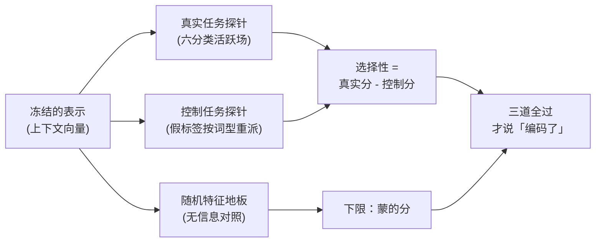

# $\rm Chapter \, 6$ 上下文嵌入与探针

> **本章假设你已经会**
>
> 1. 词向量的一词一向量约束与「多义词的平均失真」实测：苹果的混合向量到两个语义中心两头不靠，见本册 §2.5。
> 2. 本册对词向量的立场：失效是表示约束的极限，不是某个实现的 bug，五条局限清单见本册 §2.6。
> 3. 从标注数据学权重的最小闭环：朴素贝叶斯的训练、平滑与预测，见本册 §4.3。
> 4. 「表示里有的信息，数据才学得到；撕掉的信息多大数据也补不回来」这条 §4.5 的实测结论，本章要把它反过来用。

第 2 章审计词向量时留了一个尾巴：一词一向量的约束把多义词削成了平均脸，而约束的松绑要等上下文嵌入（contextual embedding），同一个词在不同句子里拿不同的向量。本章兑现这个尾巴，回答两个问题。其一，上下文嵌入用什么机制让向量随句子变化，歧义词的两个义项是怎么重新分开的。其二，更要紧的一面：当一个新的表示声称自己「编码了」某种语义信息时，我们怎么核实这句话，而不是听它自我介绍。

第二个问题是本章的主角。表示研究到这一步，判断「里面有没有信息」不能再靠盯着余弦表肉眼判断，需要一件测量仪器：探针（probe）。本章在合成数据上把这台仪器装起来，先测它量得准什么，再实测它会撒什么谎、谎该怎么拆穿。全册的心智模型是把句子变成机器可计算的语义，探针管的是这件事的验收环节：货（向量）交出来了，得有办法验货。

## $\rm \S \, 6.1$ 一个向量伺候不了两个意思

先看任务为什么逼到这里。§2.5 的实验场里，「苹果」的语料一半是水果语境一半是科技语境，训练收敛后它的向量到两个语义中心的余弦只有 0.69 与 0.72，哪个意思都不认领它。这不仅是学术瑕疵：下游任务拿到这条混合向量，就永远分不清眼前这个苹果能不能吃。真实语料中多义词比比皆是，一词一向量等于要求所有任务接受这份系统性失真，§2.6 的局限清单把这条列为第四条，并指出换训练算法改变不了它，因为信息在约束成立的那一刻就丢了。

松绑的方向由此定死：让向量从「词的档案」变成「词在这句话里的临时登记」。静态词向量（static embedding）是查表，向量只由词形决定，$\mathrm{vec}(\text{苹果})$ 无论出现在水果摊还是发布会，查到的是同一行。上下文嵌入把函数换掉，向量由词形与整句共同决定，同一个词形在两个句子里拿到两张不同的卡片。文献里这条路线的代表是 ELMo（Peters 等人 2018，用双向语言模型为每个位置产生上下文向量）与 BERT（Devlin 等人 2019，用掩码语言模型（masked language model）预训练的 Transformer），这些是公开发表的模型结论。本章不在真实模型上做实验，而是造一个机制相同的玩具世界，好处与第 2、4 章相同：每个数字的来路都摆在明面上，探针的每一格读数都能对出机制账。

## $\rm \S \, 6.2$ 上下文嵌入：向量从词的档案变成句子的产物

机制的骨架一句话能说完：静态向量只编码「这个词是谁」，上下文嵌入在这之上叠加「它周围是谁」。本章的合成世界把这层叠加写成显式规则。设语义空间维度为 $D$，共有 $F$ 个语义场（semantic field），每个场 $f$ 有一个单位中心向量 $\mathbf{c}_f$。词 $w$ 的静态底向量为：

$$
\mathrm{base}(w) \;=\; \frac{1}{|\mathrm{S}(w)|} \sum_{f \in \mathrm{S}(w)} \mathbf{c}_f \;+\; \sigma_{\mathrm{id}}\, \mathbf{u}_w
$$

逐符号：$\mathrm{S}(w)$ 是词 $w$ 所属语义场的集合，单义词只有一个场，歧义词有两个，底向量取各场中心的平均，这正是 §2.5 里「按语料占比平均」的玩具版；$\mathbf{u}_w$ 是词 $w$ 专属的随机单位方向，系数 $\sigma_{\mathrm{id}}$ 控制同一语义场内部词与词的可分辨度，相当于词的「身位」。上下文嵌入在此之上加一项牵引：

$$
\mathbf{v}(w, g) \;=\; \mathrm{base}(w) \;+\; \alpha \left( \mathbf{c}_g - \bar{\mathbf{c}}_w \right) \;+\; \boldsymbol{\varepsilon}
$$

逐符号：$g$ 是这句话的活跃语义场，由句中其余词汇所在的场决定；$\bar{\mathbf{c}}_w$ 是 $w$ 各所属场中心的平均；$\alpha$ 是牵引强度，含义是把向量从「平均位置」向活跃场中心拉 $\alpha$ 这么大比例的路程；$\boldsymbol{\varepsilon}$ 是每条实例独立的观测噪声，均值为零。规则里藏着两个可检验的预言。预言一：单义词处于自己的主场，$\mathbf{c}_g$ 与平均位置几乎重合，牵引自然消失，上下文向量退回静态向量。预言二需要把歧义词的账摊开算：设 $w$ 跨两个场 $g$ 与 $h$，把牵引项代入展开，上下文向量其实是三个成分的加权和：

$$
\mathbf{v}(w, g) \;=\; \frac{1 + \alpha}{2}\, \mathbf{c}_g \;+\; \frac{1 - \alpha}{2}\, \mathbf{c}_h \;+\; \sigma_{\mathrm{id}}\, \mathbf{u}_w \;+\; \boldsymbol{\varepsilon}
$$

活跃场 $g$ 的权重是 $\frac{1+\alpha}{2}$，另一侧 $h$ 的权重是 $\frac{1-\alpha}{2}$，代入 $\alpha = 0.85$ 得 ${0.925}$ 与 ${0.075}$：向量大头压在活跃场上，另一侧只剩零头。两个场的中心近于正交，于是到 $\mathbf{c}_g$ 的余弦应当逼近 1，到 $\mathbf{c}_h$ 的余弦应当在零附近晃；等实测对账（§6.4）。静态向量没有这一项拆分，两个场永远各占 $\frac{1}{2}$，这正是「平均脸」的代数形态。

直觉版本：静态词向量是字典里印死的词条卡片，一个人身兼两职，字典只给他一张平均脸工牌；上下文嵌入是按当天的会议室现拍一张照，他在水果摊的照片和发布会的照片各是各的。失效边界也说在前面：拍照技术只会沿着已有的语义场中心拉扯，它不创造新的场；而且本章玩具世界的信息全部由规则显式写进向量，它演示的是「信息在表示里时怎么测出来」，测不了真实模型的信息是怎么学进去的，这条边界 §6.7 展开。

真实模型里的「牵引」从哪来，补一句文献口径的对照（文献结论，非本章实测）：BERT 的每一层都用注意力机制把同句其他词的向量按相关性混合进当前位置，牵引的方向与强度不是人定的，是预训练从海量句子里学出来的；玩具世界把学出来的结果固定成一条显式规则，相当于把一台训练好的上下文嵌入拆开，只看它「向语境中心靠拢」的这一条通路。通路是真实的，简化在于我们把噪声、词序与长距离依赖全部省掉了。

## $\rm \S \, 6.3$ 实验场：六个语义场的合成世界

实验场沿用本册第 2、4 章的理由：合成任务的真值是我们亲手写进去的，错一步都能定位到机制。世界由 6 个语义场组成，每场 8 个单义词，另有 3 个歧义词各跨两场：

| 语义场 | 单义词（每场 8 个） | 歧义词 |
| --- | --- | --- |
| 水果 | 香蕉、葡萄、橙子、西瓜、柠檬、桃子、荔枝、芒果 | 苹果（兼科技） |
| 科技 | 芯片、软件、算法、服务器、代码、内存、带宽、像素 | （苹果兼此场） |
| 天气 | 暴雨、晴朗、霜冻、湿度、降温、雷电、风速、云层 | 台风（兼音乐） |
| 运动 | 联赛、犯规、夺冠、比分、教练、助攻、晋级、热身 | 跑道（兼交通） |
| 音乐 | 旋律、和弦、歌词、编曲、音准、节拍、副歌、音色 | （台风兼此场） |
| 交通 | 高铁、航班、拥堵、隧道、换乘、路况、班次、站台 | （跑道兼此场） |

参数：$D$ 取 32，$F$ 取 6，$\sigma_{\mathrm{id}}$ 取 0.15，噪声幅度取 0.03，$\alpha$ 取 0.85。六个场中心各由一段高斯向量归一化而来，随机方向在高维里近于正交，这是 §6.4 余弦读数里「场间近于不相关」的来源。每条实例按以下规则生成：

1. 抽目标词与活跃场：单义词的活跃场恒为所属场；歧义词两侧等概率各半，两侧实例数相同。
2. 拼句子：目标词后接 4 个从活跃场抽出的上下文词，不与目标词重复。
3. 算特征：静态特征与上下文特征按 §6.2 两条公式生成，两份噪声各抽各的，互不共享。
4. 定标签：活跃场的编号就是六分类标签。

实例规模：每个单义词 40 条，每个歧义词每侧 60 条，共 2280 条。种子固定为 ${20261106}$，划分按标签分层，训练 1596 条、测试 684 条，全部数字逐位可复现。上下文怎么长在句子上，拿脚本生成的两条走查例句看：

1. 「苹果 橙子 香蕉 柠檬 西瓜」：上下文词全部来自水果场，苹果拿水果侧向量。
2. 「苹果 带宽 内存 软件 芯片」：上下文词全部来自科技场，同一词形拿科技侧向量。

运行环境与命令：WSL（Linux）下进入实验目录 `26Fall/_uni5_work/expNU06/`，前置条件为 python3 与 numpy：

```bash
python3 expNU06.py > result.txt   # 成功标志：退出码 0，result.txt 非空；实测总耗时约 42 秒
```

脚本最后一步按第 4 章立下的规矩做对账，共三笔：实例计数逐类相加核对训练加测试等于总数；整体准确率与逐类准确率的加权均值逐位核对；控制标签（§6.5）的词型一致性逐词型断言，每个词型名下有且只有一个假类。任何一格数字对不上账，后面所有结论作废。

> 本节小结：世界不大，变量齐全，歧义与否、场别、语境侧全部受控且真值已知；种子与对账保证后面每张表的每一格都能退回生成规则对账。

## $\rm \S \, 6.4$ 实测一：苹果拿回了两个意思

先验预言二：歧义词的两个义项在上下文嵌入里是否分开。对苹果的静态底向量与两侧语境的上下文向量均值，分别算到水果、科技两个场中心的余弦：

| 向量 | 到水果中心 | 到科技中心 |
| --- | --- | --- |
| 静态底向量 | ${0.6222}$ | ${0.5839}$ |
| 上下文均值（水果语境） | **${0.9832}$** | ${-0.1360}$ |
| 上下文均值（科技语境） | ${-0.1136}$ | **${0.9795}$** |

静态一行是 §2.5 实测（${0.6872}$ 与 ${0.7249}$）的玩具重演：混合向量两头不靠，两个中心都不认领。上下文两行与 §6.2 的加权和预言对上了：水果语境下的苹果贴住水果中心（0.9832），到科技中心的余弦不但小还转成负值，原因是向量的零头成分来自科技中心而大头来自与之近于正交的水果中心，归一化后科技方向落在负侧；科技语境完全对称。同一个词形，两张卡片，各归各的档案。口径上说明一句：表里算的是「每侧语境先求均值向量，再算一次余弦」，均值把逐条噪声 $\boldsymbol{\varepsilon}$ 抵掉，读数反映表示本身的位置；若改成逐条算余弦再平均，噪声会把稳定性拉低，数字反而难解释。预言一也顺带验讫：单义词的上下文向量与静态向量同分布，后面 §6.6 的探针在无歧义子集上两列成绩同为满分，正是这条预言的读数。

分开之后能不能用？把苹果的测试实例交给最近中心判定器：训练侧按真实义项分别求平均向量当中心，测试侧的向量离哪个中心近判哪个义项。静态特征上准确率 ${0.463}$（测试 41 条），这个数字不是「差」，是本来就不可能有信息：静态特征等于 $\mathrm{base}(\text{苹果})$ 加一段与义项无关的噪声，两个类的特征分布完全重合，任何判据的期望成绩都是掷硬币，0.463 就落在掷硬币的采样涨落里。上下文特征上同一个判定器拿到 ${1.000}$。这份对比是本章的地基：**词义信息能否被下游用上，取决于表示生成时有没有给它留位置，而不是取决于下游判据的聪明程度**。

> 本节小结：两条预言双双兑现，静态行重演 §2.5 的平均失真，上下文行按加权和预言贴住活跃场中心；最近中心判定把「表示里有没有」翻成一句话的可用性账：静态 0.463 是掷硬币，上下文 1.000 是白送。

## $\rm \S \, 6.5$ 探针：把「表示里有信息」变成可测量的命题

实测一的判定之所以干净，是因为我们亲手写的生成规则。面对一个真实模型，没有人给我们规则表，能做的只有反向操作：冻结表示，在它上面训练一个小判读器去猜某个语言学性质，判读器的准确率当作「表示编码了该性质」的读数。这台仪器就是探针。探针的体量刻意取小：最简单的是线性探针，给每个类配一组线性打分，按 softmax 归一成概率：

$$
P(y = k \mid \mathbf{x}) \;=\; \frac{\exp(\mathbf{w}_k^{\top} \mathbf{x} + b_k)}{\sum_{k'} \exp(\mathbf{w}_{k'}^{\top} \mathbf{x} + b_{k'})}
$$

逐符号：$\mathbf{x}$ 是被测向量，$(\mathbf{w}_k, b_k)$ 是第 $k$ 类的权重与偏置，全部参数就是一张线性打分表，用梯度下降拟合。本章对照的高容量探针是单隐层的多层感知机（multi-layer perceptron，MLP），隐层 128 单元，容量比线性大几个量级。

§4.5 的结论「表示里有的信息，数据才学得到」在探针这里反向使用：下游学得到，就反推表示里有。但这一步推理有个窟窿：学得到的可能不是表示里的信息，而是判读器自己的记忆容量。裸准确率一个数区分不了这两种情形，把窟窿堵上要三道校准，合起来构成本章的探针方法论。这套流水线的全貌先挂在这里，三道校准各节展开：



### $\rm \S \, 6.5.1$ 第一道：先对下限

在明知无信息的特征上跑同一个探针，得到的准确率就是「蒙」的分，真实读数必须显著高于它才算数。本章的无信息特征取随机高斯向量：与真实特征同维度同规模，但与任何标签无关。它还有一个孪生参照是多数类比例：标签不平衡时，全猜多数类就有白送的分，读数低于多数类比例的探针连蒙都不如。下限账的意义在于给「显著」一个数：读数减去地板，剩下的是探针从特征里真的读出来的东西。

### $\rm \S \, 6.5.2$ 第二道：控制任务定选择性

这是 Hewitt 与 Liang 2019 提出的口径（公开发表的文献方法，非本章原创）。地板堵不住一种更隐蔽的作弊：表示里确实有信息，但不是被测的语言学信息，而是词的「身份」。探针可以把每个词型（type，词表里的一个词）认下来，背下「这个词出现在这，标签该是这个」的对应表，成绩照样漂亮，而表示里有没有目标信息无人知晓。控制任务把这条作弊通道单独量出来：把真实标签换成一组按词型随机重派的假标签，每个词型固定一个假类，再用同样容量的探针去学。假任务与表示里任何语言学信息无关，探针若仍拿高分，唯一的解释是它背了词型。定义选择性（selectivity）为真实任务准确率减控制任务准确率：**选择性高的读数才配得上「编码了信息」这句话**。

> 竞赛生迁移提示：三件套对你是老熟人。判断一位选手是「会构造」还是「背过题」，靠的也是对照组：随机特征地板像看「蒙题得分率」，控制任务像换一组同构数据再交一次，容量对照像收紧时限与常数，别让暴力枚举掩盖构造能力的缺席。评测里防作弊的手段，与表示研究里防探针作弊的手段，是同一门学问。

### $\rm \S \, 6.5.3$ 第三道：容量要报，线性优先

同一个表示，线性探针与 MLP 探针的读数可能都到 1.000，但含义不同。线性探针够用，说明信息线性可读：下游用一层映射就能取走，取用代价与出错面都小，这是最值钱的形态。只有高容量探针才读得到的信息，不但取用代价高，还更容易混进记忆，因为能背对应表的恰恰是容量。所以报告顺序是先线性，线性不够再上容量，且每次上容量都陪着跑控制任务，让「多出来的读数」自己证明不是背出来的。

## $\rm \S \, 6.6$ 实测二与实测三：探针读数的三道校准

### $\rm \S \, 6.6.1$ 实测二：静态对照与理论上限

第一、三道校准用的任务：预测每条实例的活跃语义场，六分类。线性探针（softmax 回归）分别跑在静态与上下文特征上，按「有无歧义」拆开子集报账：

| 特征 | 无歧义子集（576 条） | 歧义子集（108 条） | 整体（684 条） |
| --- | --- | --- | --- |
| 静态 | ${1.000}$ | ${0.500}$ | ${0.921}$ |
| 上下文 | ${1.000}$ | ${1.000}$ | ${1.000}$ |

静态列的读法比表面更有内容。无歧义子集满分：每个词的向量就钉在自己场中心附近，线性边界轻松划开，静态表示并非一无是处，它输的只是歧义。歧义子集恰好 ${0.500}$：歧义词的静态特征与标签无关（§6.4 的机制），探针能做的最优策略是把每个歧义词整体押注到一个义项，对一半。这给静态特征画出了理论上限：

$$
\mathrm{ceiling} \;=\; 1 \;-\; 0.5 \times \frac{n_{\text{歧义}}}{n} \;=\; 1 \;-\; 0.5 \times \frac{108}{684} \;=\; 0.921
$$

线性探针整体 ${0.921}$，恰好顶着上限；换成 MLP 探针得 ${0.914}$，没有超过上限，差的一点是训练噪声。这就是 §4.5 那句话的容量版：**表示里没有的信息，探针容量再大也变不出来**。上下文特征整体 ${1.000}$ 且线性探针已经满分，说明牵引规则写进去的信息是线性可读的。

第二道校准跑在上下文特征上，先立预言再开表。词身分量 $\sigma_{\mathrm{id}} \mathbf{u}_w$ 的幅度（0.15）比场间距离小得多，线性探针应当读不出词型，控制分应贴着地板；MLP 有足够容量圈住每个词型的小簇，控制分应当显著高。

### $\rm \S \, 6.6.2$ 实测三：控制任务与选择性

实测：

| 探针设置 | 真实任务 | 控制任务 | 选择性 |
| --- | --- | --- | --- |
| 线性探针，上下文特征 | ${1.000}$ | ${0.428}$ | **${0.572}$** |
| MLP 探针，上下文特征 | ${1.000}$ | ${0.882}$ | **${0.118}$** |
| 线性探针，随机特征 | ${0.161}$ | （地板参照） | 无 |
| MLP 探针，随机特征 | ${0.167}$ | （地板参照） | 无 |

四行读数，四句话。第一句，随机特征地板 ${0.161}$ 与 ${0.167}$ 贴住随机基线 ${1/6} \approx 0.167$：无信息特征上任何探针都只剩蒙，下限账成立。第二句，真实任务上两种探针都是满分，裸读数完全无法区分「读了信息」与「背了词型」，预言中的不可区分局面如期出现。第三句，控制任务把二者撕开：线性探针控制分 ${0.428}$，比预言的「贴地板」要高，既高于随机基线也高于测试侧多数类比例（${0.244}$，对账步骤实测），说明词身分量给线性探针也留了一点可读的词型线索，线性探针同样会小规模作弊；MLP 的控制分高达 ${0.882}$，它的 ${1.000}$ 里大半是背诵的潜力。第四句是全部实测的收束：选择性 ${0.572}$ 对 ${0.118}$，**同一个表示、同一个真实任务、同样满分的裸准确率，容量一换，「编码了信息」的证据强度塌掉近五倍**。不加控制任务的探针报告，在这个实验场里会得出完全相反的结论。

> 本节小结：探针读数三件套缺一不可，地板定「蒙多少」，控制任务定「背多少」，容量对照定「信息好不好取」。三道都过，剩下的成绩才有资格归给表示。

## $\rm \S \, 6.7$ 适用条件与边界

三场实测合起来，给上下文嵌入与探针各开一张使用说明，条目限定在本章实验场加标注的文献范围内：

1. **上下文嵌入治的是多义，不是万灵药**：它让歧义词的两义项分开（0.463 对 1.000），前提是语境信息在向量生成时真的被读了进去。玩具世界的语境是规则显式注入的；真实模型是否读到了某类语义，恰是探针要去测的问题，不能反过来当前提。
2. **线性低分不等于没编码**：本章的生成规则把信息线性写进向量，线性探针能满分；真实模型的信息可能是非线性的，线性探针低分只说明「不线性可读」。这时上高容量探针必须陪跑控制任务（§6.5.3），否则读数作废。
3. **探针证明可读出，不证明被使用**：表示里编码了词义信息，不等于模型做下游判断时用了它。前者是表示的存货清单，后者要看任务行为，两件事的证据互不替代。
4. **控制任务只堵词型记忆这一个窟窿**：句子长度、词频、标点这类表面统计量同样可能被探针当捷径，真实场景里每种嫌疑都要有对应的对照。控制任务给出的是方法论模板，不是万能豁免。

文献结论（与本章实测分开标注）：控制任务与选择性出自 Hewitt 与 Liang 2019，他们在词性标注探针上系统比较了探针容量，结论与本章实测同向：高容量探针控制分高、选择性低；上下文嵌入的代表模型 ELMo（Peters 等人 2018）与 BERT（Devlin 等人 2019）及其预训练加微调范式见《自然语言处理》§3.7.2；本章未在任何真实预训练模型上复现数字。

下一章语义解析把镜头从「表示里有什么」推回到全册主线最严格的形态：不再满足于向量里含着信息，而是要求句子映射成 SQL 或逻辑式这样的可执行结构。届时第 1 章手工文法的组合式路线与神经 seq2seq 会在同一个玩具文法上重新分账，两条路线的胜负条件与本章的验收方法拼在一起，才是「句子变成机器可计算的语义」的完整答案。

## $\rm \S \, 6.8$ 关键概念回顾

1. 静态词向量与上下文嵌入把「一个词」分别映射成什么？写出本章合成世界里 $\mathrm{base}(w)$ 与 $\mathbf{v}(w, g)$ 的定义，指出哪一项是「词是谁」、哪一项是「周围是谁」。
2. 歧义词的上下文向量展开后三个成分的权重各是多少？据此预言到两个场中心的余弦，并与 §6.4 的实测表对账。
3. 苹果的静态特征上任何判据的期望准确率为什么都是掷硬币？这条论证与 §4.5 的哪句话互为表里？
4. 探针的裸准确率为什么不足以支撑「编码了信息」？写出选择性的定义，说明控制任务的假标签是怎么造的、它把探针的哪种能力单独量了出来。
5. 静态特征六分类的理论上限 ${0.921}$ 是怎么算出来的？线性探针恰好顶到它与 MLP 只到 ${0.914}$，各说明什么？

## $\rm \S \, 6.9$ 应用与辨析

1. 同事用 MLP 探针在你们预训练模型的句向量上测「是否编码了主谓一致」，拿到 ${0.94}$ 就宣布编码成立。给出你要求的补充实验清单：至少包含哪三个对照，每个对照各堵哪个窟窿，判读标准是什么？
2. 某探针报告：句向量上线性探针测语法范畴只到 ${0.35}$（随机基线 ${0.20}$），于是结论「模型没学语法」。这个结论错在哪？给出两种与读数相容的解释，以及分别用什么实验区分。
3. 排障：在本章实验场里把 $\alpha$ 调成 ${0}$（牵引关闭），预测四个读数的变化：歧义子集静态探针、歧义子集上下文探针、上下文特征的控制任务分、选择性。逐条给理由，并指出哪个读数不变、为什么。

## $\rm \S \, 6.10$ 本章自测答案

概念回顾答案：

1. 静态词向量把词映射成与句子无关的固定向量（查表）；上下文嵌入映射成「词形加整句」的函数值，同词形不同句可不同。$\mathrm{base}(w)$ 里的平均项 $\frac{1}{|\mathrm{S}(w)|} \sum \mathbf{c}_f$ 与词身项 $\sigma_{\mathrm{id}} \mathbf{u}_w$ 都只关于词本身；$\mathbf{v}(w, g)$ 里的牵引项 $\alpha (\mathbf{c}_g - \bar{\mathbf{c}}_w)$ 由句子的活跃场 $g$ 决定，是「周围是谁」的载体（§6.2）。
2. 权重是 $\frac{1+\alpha}{2} = 0.925$（活跃场）、$\frac{1-\alpha}{2} = 0.075$（另一场）、词身项幅度 $\sigma_{\mathrm{id}} = 0.15$。预言：到活跃场中心的余弦逼近 1，到另一场在零附近偏负；实测 ${0.9832}$ 与 ${-0.1360}$（水果语境）、${-0.1136}$ 与 ${0.9795}$（科技语境），与预言同向同量级（§6.2、§6.4）。
3. 静态特征 $= \mathrm{base}(\text{苹果}) + \boldsymbol{\varepsilon}$，噪声与义项独立，两个类的特征分布完全重合，任何判据的期望成绩就是先验概率 0.5；§4.5 说「表示里撕掉的信息多大数据也补不回来」，这里把这个断言推到极限：连判据换成探针也一样（§6.4）。
4. 裸准确率分不清「读到表示里的信息」与「探针用自身容量背词型」。选择性 $=$ 真实任务准确率 $-$ 控制任务准确率；控制标签按词型从类集合里均匀随机抽取、词型内固定，与表示中任何语言学信息无关，能学好它的只剩词型记忆（§6.5.2）。
5. 上限来自歧义子集的最优策略：歧义词静态特征与标签无关，最好只能整体押注一个义项对一半，故 $1 - 0.5 \times 108/684 = 0.921$。线性顶到上限说明它在这个特征空间里已把可提取的信息提尽；MLP 的 0.914 低于上限且不超过，说明容量没有变出信息，差的 0.007 是训练噪声（§6.6）。

应用与辨析答案：

1. 三件套：随机向量地板（同一探针跑在与标签无关的特征上，堵「蒙」：读数须显著高于随机基线与多数类比例）；控制任务（标签按句或按词型随机重派、同容量陪跑，堵「背」：选择性要显著为正）；容量阶梯（线性探针先行，逐步加容量且每次都报控制分，堵「容量伪装成信息」，并顺带回答是否线性可读）。判读标准：三道全过才写「编码了」，只过部分就只写对应强度的结论（§6.5、§6.6）。
2. 错在把「线性探针低分」当成了「没编码」。解释一：语法信息编码了但非线性可读，线性探针读不出，需上高容量探针并陪跑控制任务，若高容量真实分高而控制分不高，则编码成立；解释二：探针训练不充分或数据量、维度不够，读数被训练侧封顶，需扫训练轮数与数据量看读数是否仍在爬升。两个解释分别由「容量阶梯加控制任务」与「训练曲线扫描」区分（§6.7）。
3. $\alpha = 0$ 时上下文向量退化为静态向量。歧义子集静态探针不变（仍约 0.5，押注上限）；歧义子集上下文探针从 1.000 塌到 0.5，牵引项是词义信息的唯一载体，关掉它上下文特征与静态特征同分布；控制任务分基本不变（词型记忆靠的是词身项与噪声结构，牵引项与假标签本来无关，线性与 MLP 仍各在 0.43 与 0.88 一带）；选择性显著下降，真实分塌了而控制分不塌。变化全部集中在真实任务上，这正说明选择性量的是「表示里的真信息」，控制任务量的是「探针自己的胃口」（§6.6）。

**你现在能做什么**：打开 `expNU06/result.txt`，把四张表里任何一个数字指给生成它的脚本行，说出它是「蒙的分」「背的分」还是「表示里的信息」；再挑一条真实模型的探针报告，按 §6.5 的三件套逐项打勾，写出它缺哪道校准。

下一章进入全册主线最严格的一段：语义解析要求句子的输出不是向量而是一条可执行的 SQL 或逻辑式，到那里，「输出必须每一步可核对」会从探针的方法论变成任务本身的定义。

---

实验记录：本章全部实测数字来自脚本 `expNU06.py`（合成六语义场世界生成、静态与上下文双特征、最近中心义项判定、线性 softmax 探针、单隐层 MLP 探针、随机特征地板、控制任务与选择性、计数与加权均值对账；python3 加 numpy，单线程 BLAS，种子 ${20261106}$，WSL 运行，总耗时约 ${42}$ 秒），原始输出存于写作工作目录 `26Fall/_uni5_work/expNU06/result.txt`，重跑可逐位复现表中数字。文中标注「文献结论」的条目（Peters 等人 2018 的 ELMo、Devlin 等人 2019 的 BERT、Hewitt 与 Liang 2019 的控制任务与选择性口径）来自公开发表的论文，不产生于上述脚本。
