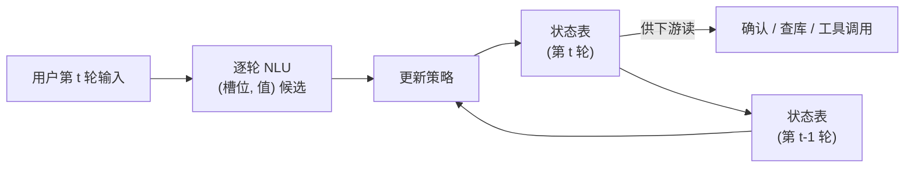

# $\rm Chapter \, 8$ 对话与收束

> **本章假设你已经会**
>
> 1. 句法驱动的语义组合：词项语义按推导树拼成整句逻辑式，小文法组合器实测见本册 §1.5 与 §1.6。
> 2. 探针方法论立的验收规矩：裸读数不作数，地板、控制任务、容量三道校准齐了才下结论，见本册 §6.5。
> 3. agent 是一个 while 循环：感知、思考、行动反复转，工具调用走「解析-执行-回填」协议，见《LLM智能体》§1.2 与 §1.4。
> 4. 上下文即账单：每轮对话都往上下文里堆字，截断策略在丢信息与省钱之间权衡，见《LLM智能体》§2.1 与 §2.3。

前七章的镜头始终对准一句话：进来一句，出去一个表示，逻辑式、向量、三元组、分数、标签、查询，无一例外。可是人和机器说话从来不是一句话的事。用户对订餐厅助理先说「帮我订个位子」，再说「明天晚上7点」，隔了一阵又说「人改成三位」，这三句话单独拿出来哪句都不构成完整的任务，合起来才是一张订单。本章处理这个缺口，做两件事。其一，把「表示」从单句推广到对话，装上本章的核心装置：对话状态跟踪。其二，作为全册收官，把八站地图摊开对一次总账，交代本册与其余各册的接口。

## $\rm \S \, 8.1$ 任务：句子不再一个一个地来

先看单句管线在哪里撞墙。「帮我订个位子」按第 7 章的口径要解析成一条数据库查询，可几位、几点、哪家店全没说，查询拼不完整；缺口不在这一句里能找到，答案在前文还没发生。反过来，缺口补上之后还有更隐蔽的一关：用户先说「时间就六点半不变」，隔几轮又说「时间改到六点半」。两句话字面几乎相同，对状态的作用相反，前者是确认旧值，后者是改写旧值。区分它们靠的不再是句子内部任何东西，而是表里已经记了什么。前七章的每条管线都默认输入自足：词向量从语料统计里来（本册 §2），探针测的是一条表示的存货（本册 §6），语义解析吃进一句吐出一条（第 7 章）。对话打破这个默认，**句子的语义有一部分记在账上，不在句子里**。

这个账就是对话状态（dialogue state）。本册的主线是把句子变成机器可计算的语义，对话给出的最后一版答案：可计算的语义里包括一张持续被改写的表。围绕它有一门专门的任务，对话状态跟踪（dialogue state tracking，DST）：每读一句用户输入，就把该记的记进表、该改的改掉，让表在任何时刻都是「截至目前的全部约定」。表里的一栏叫槽位（slot），如日期、人数、菜系；栏里的内容叫值。槽位还有第三个用途，它决定了机器什么时候可以闭嘴干活、什么时候必须开口反问：日期、时间、人数、地段、菜系齐了，查询才能发出去；缺哪栏，反问就问哪栏。「帮我订个位子」得到的回应「几位、几点、哪家店」不是闲聊，是状态表把缺口念了出来。

## $\rm \S \, 8.2$ 对话状态跟踪：一张持续被改写的表

机制的骨架三步走：逐轮的自然语言理解模块把用户这句话翻成若干「（槽位，值）」候选；更新策略按候选改写状态表；下游随时读表，去查库、去反问、去发起工具调用。整条流水线是一个随对话转动的环：



写覆盖式更新策略的账，先立更新公式。对每个标量槽位 $s$：

$$
\mathrm{state}_t(s) \;=\;
\begin{cases}
v & \text{本轮 NLU 报出候选 } (s, v) \\
\mathrm{state}_{t-1}(s) & \text{本轮没有报出槽位 } s
\end{cases}
$$

逐符号：$\mathrm{state}_t(s)$ 是第 $t$ 轮结束后槽位 $s$ 的值，$\mathrm{state}_{t-1}(s)$ 是上一轮的旧值，$v$ 是本轮 NLU 报出的新候选。公式虽只有两行，四个动作却各有名字，它们构成本章的账本：槽位原先是空的，现在有了值，叫**新填**；槽位有值 $u$，本轮报来不同的值 $v$，叫**改口**；本轮报来的值与旧值相同，叫**重申**；槽位本轮没被提及，旧值原样带进新一轮，叫**继承**。从公式能直接推出两条不看数据就该成立的推论。推论一，继承是默认动作：用户不会反复交代同一件事，一个槽位被提及一次后，此后每轮它都走「没有报出」分支，值的寿命等于提及点到对话结束的距离，所以状态表的大部分工作是「什么都不做」并且要做对。推论二，改口是两种策略唯一的分歧点：新填时覆盖式与首填式都接受候选，重申时二者都维持原值，继承时二者都不动，四种事件里只有改口处一条接受、一条拒绝；于是首填式只要答错，必然错在含改口的对话上，反过来不含改口的对话它必与覆盖式同分。这两条推论等 §8.4 开表验收，读者可以先押个预言。忌口例外，它是集合值槽位，只进不出、按并集累积：

$$
\mathrm{state}_t(\text{忌口}) \;=\; \mathrm{state}_{t-1}(\text{忌口}) \;\cup\; \{\text{本轮新增的排除项}\}
$$

更新策略不止覆盖式一种。对偶的策略叫首填式：槽位只有空的时候才接受候选，已有值一律不动。哪个对，取决于对话里改口多不多，这正是要实测的问题（§8.4）。直觉版本：状态表是服务员的点菜单，客人第三轮才说人数，第一轮说的日期还压在单子上；客人说「还是改回七点吧」，服务员划掉旧时间写新的，而不是把整张单子重抄一遍。失效边界同样来自这个比喻：菜单只记约定，不记语气，客人抱怨「火锅吃腻了」的情绪本身不上单子，单子只收它引起的改口；表外的东西去了哪里，§8.6 的账单账会给数字。

## $\rm \S \, 8.3$ 实验场：十段订餐厅对话与一本事件账

实验场沿用本册第 2、4、6 章的理由：合成任务的真值是亲手写进去的，每个数字能退回规则对账。任务域是订餐厅，六个槽位：日期、时间、人数、地段、菜系、忌口。NLU 是一张词面到规范值的表：词面「两位」「四个人」归一到人数 ${2}$ 与 ${4}$，「晚上7点」「6点半」归一到 19:00 与 18:30；同槽多个词面命中时取句内最靠右的一个，对应「改粤菜吧」这类旧值新值同句的局面。忌口走否定感知规则：命中「辣、香菜、花生、海鲜」之一时，向回看四个字，窗口里出现「不要、别放、不、忌口」任何否定线索、或全句出现「忌口」二字，才记作排除项；朴素 NLU 没有这道窗口，命中即记。两套 NLU、两种更新策略，交叉出四条管线，吃同一份语料：十段脚本对话，每段配金标终态。十段的考点各占一格，防止一个结论只靠一段对话撑着：

| 段 | 轮数 | 考点 |
| --- | --- | --- |
| D1 | 5 | 无改口基线；「不要辣」两种 NLU 都该答对 |
| D2 | 4 | 两次改口（人数、日期）加重申（时间） |
| D3 | 5 | 纯继承：填完后两轮无关闲聊 |
| D4 | 2 | 否定陷阱：「要辣一点的」不是忌口 |
| D5 | 4 | 改口三连（菜系、人数、时间） |
| D6 | 3 | 改口回原值：绕一圈回到起点 |
| D7 | 3 | 「忌口花生」明示加「也不要香菜」追加 |
| D8 | 4 | 闲聊干扰句夹一轮改口 |
| D9 | 3 | 否定（不要海鲜）加人数改口 |
| D10 | 2 | 只填三个槽位即收尾，空槽位要留空 |

运行环境与命令：WSL（Linux）下进入实验目录 `26Fall/_uni5_work/expNU08/`，前置条件仅 python3（无第三方依赖）：

```bash
python3 expNU08.py > result.txt   # 成功标志：退出码 0，result.txt 非空；实测总耗时 0.005 秒
```

脚本最后按本册立下的规矩做对账，断言共七笔：管线 A 十段全对；首填式的失败集落在改口段集之内且非其全部（改口回原值的 D6 是预留的例外）；朴素 NLU 的失败集恰为两套 NLU 结论不同的对话集；首填式与朴素 NLU 的失败集不相交；双错的失败集等于两者失败集之并；伪 LLM 实验中 R0 只对或弃权、从不错答，R1 从不弃权，R2 全对；三种策略判决数之和等于总对话数。任何一格对不上，后面全部结论作废。

## $\rm \S \, 8.4$ 实测一：事件账、走查与 2x2 对账

第一张表是事件账。管线 A（否定感知 NLU 加覆盖式）跑完十段对话，账本合计：

| 事件 | 新填 | 改口 | 重申 | 忌口加入 |
| --- | --- | --- | --- | --- |
| 次数 | ${43}$ | ${9}$ | ${1}$ | ${5}$ |

继承单独记两笔：全部十段累计 ${80}$ 个「轮乘槽位」的格子是旧值原样带过的继承格；最长一次静默继承发生在 D3，用户第 1 轮说「明天中午12点」，此后四轮再没碰过日期，这个值一直活到收尾，其中两轮还是与订餐无关的闲聊。这两笔账说明继承不是边角料：十段对话里带过旧值的格子比新填的格子还多，状态表的大部分工作是不动声色地什么都不做。顺带一提，事件账里「忽略」一栏为 ${0}$，这是覆盖式的指纹：它对每个候选都动手，永远不拒绝；「忽略」只会出现在首填式的账本上，且按推论二只落在改口候选上。

第二张表走查 D5「改口三连」，逐轮看 NLU 报了什么、表改了什么：

| 轮 | 用户说 | NLU 事件 | 轮末状态（变化的槽位） |
| --- | --- | --- | --- |
| 1 | 今晚7点，中关村火锅，六位 | 新填 ×5 | 日期=今天，时间=19:00，人数=6，地段=中关村，菜系=火锅 |
| 2 | 火锅吃腻了，改粤菜吧 | 改口 ×1 | 菜系：火锅→粤菜 |
| 3 | 人数加到八位 | 改口 ×1 | 人数：6→8 |
| 4 | 时间提前到6点 | 改口 ×1 | 时间：19:00→18:00 |

注意第 2 轮：抱怨句「火锅吃腻了」本身没有进表，进表的只有它引起的改口；同句里的旧值「火锅」与新值「粤菜」都被词表命中，按句内最靠右的规则取了粤菜。这就是 §8.2 说的菜单不记情绪。

第三张表是主线对账。四条管线吃同一份十段对话，按金标终态逐段判全对：

| 管线 | NLU | 更新策略 | 全对率 | 输掉的对话 |
| --- | --- | --- | --- | --- |
| A | 否定感知 | 覆盖式 | ${1.000}$ | 无 |
| B | 否定感知 | 首填式 | ${0.600}$ | D2、D5、D8、D9 |
| C | 朴素 | 覆盖式 | ${0.900}$ | D4 |
| D | 朴素 | 首填式 | ${0.500}$ | D2、D4、D5、D8、D9 |

三个读法。第一，§8.2 的推论二先验收：B 输掉的四段 D2、D5、D8、D9 全部含改口，不含改口的 D1、D3、D4、D7、D10 它与 A 同分，预言精确兑现；但推论只说 B 的失败集是改口段的子集，没说全部改口段都输，D6 就是例外。D6 恰是「改口回原值」段，两次改口绕一圈回到起点的值，首填式蒙对了结局，它名下的「忽略」事件一笔没少。只看总分会把这场蒙对记成功，事件明细才拆得出来。第二，C 只输 D4：「要辣一点的川菜，别放香菜」一句里，朴素 NLU 把「辣」也记进忌口，终态忌口等于{辣，香菜}，金标只有{香菜}；想吃辣被记成了不吃辣，方向整反。第三，D 的失败集恰是 B、C 失败集之并（脚本逐段断言），两集又不相交（一个只含改口段，一个只含否定陷阱段），所以 ${0.500} = 1 - \frac{4+1}{10}$，误差在这里恰好相加。**误差能不能相加不是算出来的，是对账对出来的；总分给不出失败集，也就给不出两个错误的叠加关系。**

> 竞赛生迁移提示：这张 2x2 表的读法就是 OJ 对拍的读法。别只看 AC 率，diff 掉分的用例：两个错解各挂在哪些点上、失败集交并关系如何，决定了合并修复时错误率怎么走。B 答对 D6 的那笔「蒙对」，对应的是随机化对拍里「错解碰过弱数据」的假阳性，明细账是唯一的照妖镜。

## $\rm \S \, 8.5$ 实测二：无状态、首指与近指的三方对账

先立口径：本节不调用任何真实大模型。为什么不直接测真实模型：其一，真实模型对同一输入的输出带随机性，固定种子也只固定采样，不固定行为；其二，解析错了要分清是「没读到上下文」还是「读到了没用对」，真实模型内部两件事搅在一起，拆不开。表驱动应答器把机制写成显式规则，模拟的正是「有没有状态、寄存器怎么更新」这一层会把同样的输入翻成怎样的输出；结论只覆盖机制层，不构成对任何真实模型行为的实测。真实模型的指代能力要按本册 §6.5 的探针口径另测，本节给的是「状态这一层值多少钱、怎么坏」的机制账。

设定：五种水果实体（苹果、香蕉、橙子、葡萄、西瓜），每种带一条属性事实。每段对话先由用户声明两个到四个实体事实，再来一句问句。问句三种题型，各看一段脚本生成的实例（问句在前文之后）：

1. Q1 纯指代：「香蕉的产地是陕西 / 葡萄的价格是4块一斤 / 橙子的季节是春季 / 它的季节是什么？」金标指最近提及的橙子（近指惯例）。
2. Q2 复述型：「……橙子的季节是春季 / 葡萄呢？它多少钱？」金标指重提的葡萄。
3. Q3 显名：「……葡萄多少钱？」金标按名字指葡萄。

三个应答器解析顺序相同：问句里出现实体名就先用名字，没有名字才查寄存器；差别全在寄存器。R0 无状态，没有寄存器，纯指代一律反问弃权；R1 首指寄存器，只登记对话里第一个实体，之后永不更新；R2 近指寄存器，每见一次实体就覆盖。拿 Q1 的实例预演三方：R0 见问句无名字，弃权反问；R1 查寄存器得香蕉（首指），答错；R2 查寄存器得橙子（近指），答对。样本 ${160}$ 段，种子 ${20261109}$，三种题型按 ${80:40:40}$ 抽取：

| 应答器 | 状态 | 对 | 错 | 弃权 | 准确率 |
| --- | --- | --- | --- | --- | --- |
| R0 | 无状态 | ${80}$ | ${0}$ | ${80}$ | ${0.500}$ |
| R1 | 首指寄存器 | ${80}$ | ${80}$ | ${0}$ | ${0.500}$ |
| R2 | 近指寄存器 | ${160}$ | ${0}$ | ${0}$ | **${1.000}$** |

三句读法。第一句，R0 与 R1 总分同为 ${0.500}$，失败模式截然不同：R0 的 ${80}$ 次失败全是弃权，反问一句「您指的是哪种」，错得可见，可以触发澄清；R1 的 ${80}$ 次失败全是自信的错答，无声无息直达下游。真实系统里这两种失败的代价不同：可检测的失败换来一次澄清，不可检测的失败把错误值直接喂给后续环节。第二句，R1 不是没状态，是寄存器更新策略与近指惯例相悖：Q1 题型上首指与近指两个寄存器的不一致率实测 ${1.000}$（${80}$ 段全部不一致，每段至少两个实体，首指必非近指），它的 ${80}$ 次错答全部来自这一条规则差。**「有上下文」不是一句宣言，寄存器怎么更新本身就是要被评测的对象。**第三句，R2 全对不说明它聪明，说明金标按它信的惯例写的；若金标混用首指与近指两种惯例，纯策略两头都会掉分，真实对话恰是混用的，出路不是猜得更准，而是猜不准时回到 R0 的弃权去反问。

这一节与 §6.5 是同一个方法论的两端：探针章拆的是「同一个满分下，读数是信息还是背诵」，本节拆的是「同一个五百分下，失败是弃权还是错答」。总分相同，事件构成不同，结论就不同；拆明细是两章共用的手术刀。

## $\rm \S \, 8.6$ 上下文账单与 agent 接口

状态表的另一笔账是钱。对照两种接口：全历史接口每轮把此前全部对话原文重发一遍（《LLM智能体》§2.1 的账单口径）；状态接口每轮只发序列化后的状态表加当前这句。用一段十二轮的订餐对话实测，单位字符：

| 轮次 | 第 1 轮 | 第 4 轮 | 第 8 轮 | 第 12 轮 |
| --- | --- | --- | --- | --- |
| 全历史账单 | ${6}$ | ${20}$ | ${41}$ | ${64}$ |
| 状态+当前轮账单 | ${44}$ | ${51}$ | ${52}$ | ${52}$ |

读数先泼一盆冷水：十二轮累计处理，全历史 ${401}$ 字符，状态 ${601}$ 字符，短对话上状态接口反而更贵，因为表从第一轮起就整张随行，而此时的历史还很短。状态表买断的不是起步价，是增长方式：全历史账单一轮一涨，从 ${6}$ 涨到 ${64}$，对话越长涨得越狠；状态账单前四轮随槽位填满从 ${44}$ 爬到 ${51}$，之后钉死在 ${52}$，槽位表的大小由任务决定，与对话长度无关。两条账单在本对话的第 ${11}$ 轮交叉，真实任务型对话动辄二三十轮，交叉只会更早。这也是《LLM智能体》§2.3 三种截断策略的另一面：截断历史是丢信息省钱，状态表是把任务信息有损压缩成一张定长的表，省钱且不丢任务事实，代价是表外信息（闲聊、推理过程、语气）全部弃权。

两条账单之外还有一条边界要交代：本章的状态表只伺候一个任务。真实助理同时挂着三份订单时，表要加一维键（哪张订单），一张表变成一组表；用户中途岔开聊别的事再切回来，哪些槽位还作数，是任务生命周期管理的问题。本章的十段对话全部单任务单订单，这些维度都按掉了。

由此接口就位。《LLM智能体》§1.2 的 while 循环每轮要决定调什么工具、传什么参数，§1.4 的「解析-执行-回填」协议里，回填进循环状态的东西正是本章的槽位表：一次「订餐厅」就是一次工具调用，状态表就是参数包。拿 §8.4 走查表第 4 轮结束时的状态直译成调用参数，长这样：

```json
{"action": "预订", "参数": {"日期": "今天", "时间": "18:00",
 "人数": "8", "地段": "中关村", "菜系": "粤菜", "忌口": []}}
```

状态跟踪做的就是「参数什么时候凑齐、凑错了怎么改」的账。《LLM智能体》§2.2 分出的短期记忆（原始历史）与长期记忆（跨会话档案）之外，本章添了第三种存货：结构化任务状态，小、定长、每格可核对。《自然语言处理》§12.4 的 tool calling 把同一件事说成参数校验：参数不齐就反问，齐了才发起调用；按这个口径，§8.5 里 R0 的弃权根本不是失败，是参数校验拦截了残缺的调用。什么进表、什么留历史，界线也清楚了：

1. 待确认的约定进表：槽位值与忌口集合，每格可核对、可反问、可改口。
2. 未定型的偏好与语气留历史：「火锅吃腻了」这句抱怨不进表，它引起的改口才进。
3. 表外信息按弃权处理：闲聊与推理过程既不进表也不假装进了表，本节的账单差价就是为它们省下的钱与丢掉的信息各记一笔。

## $\rm \S \, 8.7$ 全册收束：表示主线的八站地图

全册心智模型一句话：NLU 的核心问题是表示，把句子变成机器可计算的语义。八站就是这个问题八次不同的作答，每站交一种货、配一套验收：

| 站 | 章 | 交给机器的表示 | 验收方式（实测锚点） |
| --- | --- | --- | --- |
| 逻辑式 | 第 1 章 | 一阶逻辑式与 lambda 项 | 小文法组合器：解析即组合（§1.6） |
| 向量 | 第 2 章 | 词向量 | 类比账与三件审计：失真可测（§2.3–§2.5） |
| 图 | 第 3 章 | 关系三元组 | 三条抽取路线的对账（§3.6） |
| 情感 | 第 4 章 | 极性分数 | 词典与贝叶斯的三场实测（§4.5–§4.7） |
| NLI | 第 5 章 | 三标签关系 | 词重叠基线与三类陷阱（§5.4–§5.6） |
| 探针 | 第 6 章 | 表示的读数 | 三道校准与选择性（§6.6） |
| SQL | 第 7 章 | 可执行查询 | 玩具文法解析器（第 7 章） |
| 对话 | 本章 | 可改写的状态表 | 事件账与三方对账（§8.4、§8.5） |

串成一条链就是：逻辑式→向量→图→NLI→探针→SQL→对话，情感站在中间，是向量拿到第一份差事后交回的判决书。每一站其实都在重新回答同一个问题：「机器可计算」到底指什么。第 1 章的回答是可判定真假；第 2 章是可算距离；第 3 章是可进图，三元组的下游正是《图机器学习》§6.2 的 TransE，把关系变成一次向量平移；第 5 章是可三分类；第 6 章是可被线性读出；第 7 章是可执行；本章是可随对话改写。所以表示不是名词而是动词：每换一个下游任务，「语义」的验收官就换一任，上一站的满分贷不到下一站用。

验收的方法论也在这八站里长出了两条支脉，本章正好各占一头。§6.5 的探针三件套防的是「虚报有」：表示声称编码了信息，地板、控制任务、容量三道校准逼它自证。§8.4 与 §8.5 的事件账防的是「虚报对」：管线与应答器交来一个总分，失败集、失败模式、蒙对的段名逐项核对，特别是 B 管线在 D6 上的那场蒙对与 R1 应答器那 ${80}$ 次无声的错答，都是总分永远交不出来的口供。两条支脉共享一个信条：**读数背后必有事件构成，事件构成不明，读数不进入结论。**

全站接口三笔。

1. 《自然语言处理》：本册 §2 审计的词向量，训练账在那边 §3.6（目标函数、负采样），两册合起来是「先算出厂价，再验存货」；§3.7.2 的预训练加微调范式对接本册 §6 的 BERT 与探针；§12.4 的 tool calling 与本章 §8.6 的参数包在 agent 处汇合。
2. 《图机器学习》：第 3 章抽出的（头实体，关系，尾实体）正是知识图谱的边，交到那边 §6.2 之后有 TransE 的几何账与 §6.5 的链接预测实测，表示从「存进图」走到「在图上算」。
3. 《LLM智能体》：状态表进入 §1.2 的循环与 §1.4 的协议，作为 §2.2 记忆分层之外的第三种存货；§2.3 的截断策略与本章账单是同一道选择题的两个选项。

另有两笔顺带：《信息检索》§8.1 的检索增强生成把「找到文档」升级成「答对问题」，与对话共享「答案依赖前文」的处境；《概率图模型》的语言可以给状态表每一格配上不确定度，让「疑似改口」带着置信度进表，本册按下不表。

走到这里可以把全册的立场说全了。八站没有一站宣布终极表示：逻辑式精确付不起规模，向量便宜但 §2 的审计清单条条在案，状态表定长却把表外信息弃了权。表示的完成时刻不是更大的模型，而是被用掉的那一刻：查询被执行，参数包被回填，改口被记下。也因此，本册每章把种子、规则与对账断言全部摊开，让每个数字能退回生成规则——这套敢对账的口径，是想比任何单一结论更长久地留给读者的东西。

## $\rm \S \, 8.8$ 关键概念回顾

1. 写出覆盖式更新的两行公式，给出新填、改口、重申、继承四个事件的定义，并说明忌口槽位为什么按并集累积。
2. 「时间就六点半不变」与「时间改到六点半」字面几乎相同，单句管线为什么原则上区分不了？状态表各把哪一条记成什么事件？
3. §8.4 的 2x2 表里，B 与 C 各输掉什么？为什么 D 的失败集恰是 B、C 失败集之并时，全对率才能按 $\frac{4+1}{10}$ 相加？B 答对 D6 说明总分有什么盲区？
4. §8.5 里 R0 与 R1 准确率同为 ${0.500}$，失败模式差在哪里？「首指与近指不一致率 ${1.000}$」量化的是 R1 的什么缺陷？
5. §8.6 的账单表里，状态接口十二轮累计反而更贵（${601}$ 对 ${401}$），为什么仍然要用？两条账单的增长方式差在哪里、第几轮交叉？

## $\rm \S \, 8.9$ 应用与辨析

1. 用户说「周四两位」，隔两轮又说「不对，是周三」。给出这两轮各自的事件分类与状态变化；再进一步：如果用户说「算了，不订了」，现行槽位表表达不了什么？要支持这类取消，表结构要加什么？
2. 同事宣称：「我们的大模型客服天然带上下文，不需要状态跟踪。」用 §8.5 与 §8.6 各给一条反驳，并设计一个最小实验验证你的反驳（说明对照组与判读标准）。
3. 排障：线上助理把「人数加到八位」错记成时间等于「八点」（词面「八」串了槽位）。用 §8.4 的哪张账能在十段对话内定位？给词面表提一条修复，并说出这条修复的回归风险在哪里。

## $\rm \S \, 8.10$ 本章自测答案

概念回顾答案：

1. 公式见 §8.2：本轮有候选 $(s,v)$ 则 $\mathrm{state}_t(s)=v$，否则维持 $\mathrm{state}_{t-1}(s)$。旧值为空接受候选是新填；旧值 $u$ 换成不同的 $v$ 是改口；候选与旧值相同是重申；本轮无候选、旧值带入下一轮是继承。忌口是排除项的集合，语义上只增不减（说过的忌口不会因为没再提就作废），故按并集累积，事件记为加入（§8.2）。
2. 单句管线的输入只有当前句，两句话的词面几乎同构，任何只看本句的函数对它们输出同一结果。状态表把前者记成重申（候选与旧值相同，表不动），把后者记成改口（旧值被新值覆盖）；区分二者的信息全部来自表里已有的旧值（§8.1、§8.2）。
3. B（首填式）输掉全部改口段 D2、D5、D8、D9，改口被它当耳旁风；C（朴素 NLU）只输否定陷阱 D4，把「要辣」记成忌口。D 的失败集被脚本断言为 B、C 失败集之并且两集不相交，失败段数才能相加为 ${5}$，全对率 $\frac{5}{10}={0.500}$；若失败集重叠，相加会重复扣分。B 答对 D6（改口回原值）是蒙对：它的忽略事件一笔没少，只是金标恰好回到首填值，总分把这场蒙对记成功，盲区在此（§8.4）。
4. R0 的失败全是弃权（反问澄清，错得可见），R1 的失败全是自信错答（无声进入下游），总分同为 ${0.500}$ 但失败的可检测性不同。不一致率 ${1.000}$ 量化的是 R1 的寄存器更新策略与金标采用的近指惯例在 Q1 题型上处处相悖：每段至少两个实体，首指必非近指，它的错答全部来自这一条规则差（§8.5）。
5. 因为要买的是增长方式：状态账单随槽位填满爬到 ${52}$ 后钉死，槽位数由任务决定；全历史账单从 ${6}$ 一路涨到 ${64}$ 且随对话长度无界增长，两账在第 ${11}$ 轮交叉，长对话上状态接口越来越占优。短对话上更贵是提前支出的固定成本（§8.6）。

应用与辨析答案：

1. 「不对，是周三」是否定加改口：NLU 需先识别否定线索把「周四」的旧候选作废，再记改口 周四→周三；若没有否定窗口，会先错记新填或把两个候选都报出。「算了，不订了」暴露现行表的边界：六个槽位只能表达「值是什么」，表达不了「整张作废」，没有取消这个动作的位置。要支持它，状态需要加一个任务级标志（如状态机里的 进行中/已取消），或允许显式的清空操作；这也说明表结构本身是任务建模的一部分，不是天然给定的（§8.2、§8.7）。
2. 反驳一（§8.5）：有上下文不等于上下文用对了。寄存器更新策略与指代惯例相悖时，无状态与错策略的准确率同为 ${0.500}$，而错策略的失败是不可检测的自信错答，比无状态的弃权更危险；最小实验：造 Q1/Q2/Q3 三题型的脚本对话集，比较「截断历史基线」与「真系统」的 对/错/弃权 三计数，判读标准是弃权率与错答率分开报。反驳二（§8.6）：上下文即账单，全历史接口每轮账单随对话长度无界增长，长任务上成本失控且《LLM智能体》§2.3 的截断策略要丢信息；最小实验：两种接口各跑一段二三十轮的脚本对话，报每轮账单曲线与交叉轮次。两条反驳合起来：状态跟踪解决的是「信息怎么组织、账单怎么封顶」，上下文只是信息的另一种更贵的存放方式（§8.5、§8.6）。
3. 用 §8.4 的事件账：十段对话重跑管线 A，看「时间」槽位名下有没有来自「八位」的改口或新填事件，走查表（A-3 输出）能直接给出肇事的轮次与 NLU 报文。修复：词面匹配按槽位分组互斥，「八位」「六位」只登记在人数词面表，不进时间表；回归风险在粗粒度词面（如单独的「八点」「六位」之外，「8」这样的数字裸词面可能同时被两个槽位的表引用），收紧槽位互斥会把原本能兜住的口语变体漏掉，修复后必须重跑十段对话的事件账并核对失败集仍为空（§8.3、§8.4）。

**你现在能做什么**：打开 `expNU08/result.txt`，把 2x2 表里任何一格退回十段对话指认它输掉的具体段名；再找一段真实的客服记录，手画它的槽位表并标出每一轮的事件类型，数一数继承格占了多少。

本册到此收官。下一站不是新知识：《88-自然语言理解》的复习总结章会把八站打乱重排，用闭卷提取的方式把这册的表示主线再走一遍；而八站之外的下一程，在《LLM智能体》的循环、《图机器学习》的图谱与《自然语言处理》的训练账里，各有一段已经铺好的路。

---

实验记录：本章全部实测数字来自脚本 `expNU08.py`（表驱动任务型对话状态跟踪：六槽位、十段脚本对话、否定感知与朴素双 NLU、覆盖式与首填式双策略、事件账与 2x2 对账；表驱动伪 LLM 指代模拟：无状态、首指、近指三方对账，模拟口径已在正文标注；上下文账单：全历史对比状态接口，单位字符；python3，无第三方依赖，种子 ${20261109}$，WSL 运行，总耗时约 ${0.005}$ 秒），原始输出存于写作工作目录 `26Fall/_uni5_work/expNU08/result.txt`，重跑可逐位复现表中数字。本章未调用任何真实大语言模型，§8.5 的全部读数产生于表驱动模拟，正文已标注该口径。
