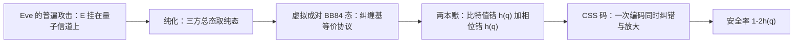

# $\rm Chapter \, 2$ QKD 安全证明：把「没人能听」写成定理

> **本章假设你已经会**
>
> 1. BB84 的逐轮流程与筛选账：四个态、三次抽签、筛留比特，见《量子通信》§2.2。
> 2. 窃听指纹与安全率：QBER $q=s/4$、纠错与隐私放大各花一个 $h(q)$、渐近安全率 ${r=1-2h(q)}$、阈值 ${q\approx 0.11}$，见《量子通信》§2.3、§2.6。
> 3. 一次性密码本与完美保密、计算安全的分界，见《密码学》§1.3、§1.5。
> 4. 线性码与 syndrome 译码：校验矩阵是错误位置的指纹，公布 syndrome 等于公布一批线性方程，见《编码理论》§2.2、§2.3。
> 5. 第 1 章的威胁谱：密钥分发层要防的不是「算法被破」，而是「物理被听」。

全册的心智模型是：密码学的 trust 从假设变成物理，但物理设备本身又成了新的假设。《量子通信》§2.6 的蒸馏小账末行写着 ${r=1-2h(q)}$，并注明出自 Shor–Preskill 定理（2000）；该册 §2.7 又留了一句「$1-2h(q)$ 的证明不假设攻击方式」。这句话是本章要兑现的支票：为什么对一个能做任何事、把杀招存到最后再动手的 Eve，安全率还是这一个数？支票兑清之后还有第二件事——《量子通信》册从头到尾在「块长 $n\to\infty$」的渐近世界里记账，而真实系统一条密钥块只有几万到几十亿比特。渐近公式在有限块长下撒多大的谎、往哪个方向撒，是安全证明里工程上最值钱的一段。学完本章，你能讲清普遍攻击如何被模型化、两本 $h(q)$ 的账如何被 CSS 码一次收拢，以及有限码长如何把 ${42.7\%}$ 的纸上富裕吃成不到 ${8\%}$ 的实测口粮。

## $\rm \S \, 2.1$ 问题：安全证明要证明的是「对所有攻击」

逐种攻击建模是打地鼠。《量子通信》§2.3 给截听-重发记了账，§2.7 又提到更聪明的个体攻击能把指纹从 $25\%$ 压到约 ${14.6\%}$；哪怕再记满一百种攻击，没记到的那一种依然没有安全声明。安全证明的对象必须是全部物理允许的攻击组成的集合，一个不漏。这一类不挑手法的攻击统称普遍攻击（general attack），它不假设 Eve 怎么动手，只假设她服从量子力学。

「安全」这个词也要先钉死成可检验的数学条件，否则证明无从谈起。口径沿用《密码学》§1.3 完美保密的思路往下放宽一档：理想情形是 Eve 对密钥一无所知，她手里的态是某个固定的 $\rho_0$；现实协议跑完后她手里的态记作 $\rho$。度量两个态差多远用迹距离（trace distance）：${D(\rho,\sigma)=\tfrac12\lVert\rho-\sigma\rVert_1}$，读法是任何测量下区分这两个态的成功概率之差都不超过 ${D}$。于是安全定义写成：对 Eve 能做的一切攻击，协议结束时都有

$$
D\bigl(\rho,\ \rho_0\bigr) \;\le\; \varepsilon
$$

$\varepsilon$ 是安全参数，由协议设计者指定（典型取 ${10^{-9}}$ 量级）。这个定义把「没人能听」从口号变成了可证伪的命题：只要某个攻击能让 ${D}$ 超标，证明就被推翻；而证明的任务是对攻击集合整体给出 ${D\le\varepsilon}$。有限码长效应（§2.5）说白了就是：$\varepsilon$ 要花在好几处开销上，块长越小，摊到每比特的富裕越薄。

Eve 在 BB84 里能做的事，按威胁模型（《量子通信》§2.1）展开其实大得吓人。量子信道整条归她，她可以在信道上挂一个任意大小的量子系统，让经过的态与它发生量子力学允许的任何相互作用；她可以测量，也可以测一半、存一半，把杀招留到听完 Alice 与 Bob 在公开信道上的全部对话之后再补刀；轮与轮之间她还可以做任何关联。唯一约束是物理定律本身。面对这样的对手，账居然还能记：渐近世界里每筛选比特的安全率是

$$
r_\infty = 1 - 2h(q),\qquad h(q) = -q\log_2 q - (1-q)\log_2(1-q)
$$

两笔 ${h(q)}$ 的账各有去处：一笔付给 Bob，是他手里的串相对 Alice 的串的不确定性，纠错必须泄漏的量（《量子通信》§2.6）；一笔付给 Eve，是她可能掌握的信息，隐私放大必须压掉的量。本章的任务就是回答两问：第一，为什么任意攻击最终仍然折算成这两笔账（§2.2、§2.4）；第二，这两笔账在有限块长下还要加收哪些费用（§2.5）。

> 本节小结：安全证明的对象是全部物理允许的攻击，不是逐种手法的清单；渐近安全率 ${1-2h(q)}$ 是两笔账的合计，本章给出它的来历与有限块长修正。

## $\rm \S \, 2.2$ 任意攻击的模型化：纯化与虚拟成对 BB84 态

直接分析「Eve 任意操作后的混合态」无从下手，因为她做了什么我们不知道。纯化（purification）是搬开这块石头的量子力学事实：任何混合态都可以看成某个更大系统的纯态的一部分。做法就是把 Eve 没有暴露的自由度全部并入系统：不论 Eve 的操作多复杂，Alice、Bob 与她的系统 E 合起来的总态总可以取成一个纯态。于是「不知道 Eve 干了什么」被改写成「总态是确定的，只是 E 那一半不归我们管」，账有了明确的记账对象。

第二步把总态改写成协议认识的样子。BB84 有两个等价描述。原始描述是制备-测量式：Alice 掷基、发 BB84 态、Bob 测量。纠缠基协议（entanglement-based protocol）是：Alice 先制备 EPR 对

$$
\lvert\Phi^{+}\rangle = \frac{\lvert00\rangle+\lvert11\rangle}{\sqrt2}
$$

然后掷基、测自己那一半得到比特 ${a}$、把另一半发给 Bob 测量。两个描述对 Alice 与 Bob 的一切统计完全相同：纠缠基描述里联合概率是

$$
\Pr(A=a,\ B=b) \;=\; \tfrac12\,\bigl\lvert\langle b\,\vert\,a\rangle\bigr\rvert^{2}
$$

而制备描述里 Alice 掷出 ${a}$ 的概率是 ${\tfrac12}$、Bob 对 $\lvert a\rangle$ 测得 ${b}$ 的概率是 ${\lvert\langle b\,\vert\,a\rangle\rvert^{2}}$，逐项相等；掷基的随机性在两个描述里同样进场。因为等价的是「统计」，Eve 在中间挂什么系统、做什么操作都不影响改写的合法性：不管总态多复杂，Alice 与 Bob 看到的数字和纠缠基描述逐位对得上。

真正起作用的是 EPR 对的对称账：$\lvert\Phi^{+}\rangle$ 两边同测 $Z$ 基，结果相同；两边同测 $X$ 基，结果也相同。于是「错误」被劈成两个方向：$Z$ 基上两边不一致是比特值错误，QBER 实测的就是它；$X$ 基上两边不一致是相位错误，它刻画 Eve 携带的信息，藏在共轭方向里、实测不直接看到。Shor–Preskill 证明的核心一步是：任意攻击后的总态，总能虚拟地改写成「Eve 准备了一大批成对的 BB84 态，分别投给 Alice 与 Bob，投得多坏随她」的形状——比特值错误率与相位错误率都被同一个 $q$ 控制（BB84 态的共轭结构保证）。这一步的严格论证在原文里，本节给的是能对账的骨架；要点是改写之后，任意攻击的问题变成了一对经典问题：把比特值错误纠掉、把相位方向（也就是 Eve 的信息）压掉。

改写还顺手封掉了一个漏洞：Eve 把量子系统存起来、听完公开对话再补刀的玩法。存着的系统就是纯化里的 E，它从一开始就在总态里，改写与后续的账对它照算不误；她后来听到的纠错与校验信息，本来就是要公开泄漏的那部分账，不会给出额外的东西。攻击可以推迟，账不能推迟——这正是 §2.1 把「测一半存一半」写进威胁模型的意义：模型不封杀这种攻击，而是让它被同一本账覆盖。



> 本节小结：纯化把「不知道 Eve 干了什么」变成确定的纯态记账；纠缠基改写把任意攻击折算成「成对 BB84 态」的制备错误，劈成比特值与相位两个方向。

## $\rm \S \, 2.3$ 经典侧两本书与 Steane 的串联想法

改写之后的两本账都是经典问题，各有成熟解法。先看纠错账：Bob 的串相对 Alice 的串有 $h(q)$ 比特的不确定性，这是信息论给的下限。取一个能纠 $q$ 比例比特翻转的线性码（按 GV 界，码率 ${1-h(q)}$ 的码存在，《编码理论》§3.4），公布它的校验方程就是公布 ${n\,h(q)}$ 个线性约束，用的是《编码理论》§2.3 的 syndrome 思想：syndrome 是错误位置的指纹，公布指纹不公布原文。实际系统的纠错协议（Cascade 类交互式，或单向的 LDPC）效率达不到下限，实际泄漏要乘一个效率因子 ${f>1}$，文献口径约 ${1.1\sim1.3}$；本章的账取 ${f=1}$，正好与渐近公式对齐。

再看隐私放大账。哪怕 Eve 的信息没被看清，只要她可能知道一点，就要把密钥压掉一部分。「知道多少」的度量币种是最小熵（min-entropy）：${H_\infty(X\,\vert\,E)=-\log_2 p_{\rm guess}}$，其中 ${p_{\rm guess}}$ 是 Eve 拿着她的系统 E 对原始串 ${X}$ 做最优测量的猜中概率。选这个币种而不是香农熵，是因为最终用途是《密码学》§1.3 的一次性密码本：保密性直接取决于 Eve 单次猜中密钥的概率，${H_\infty}$ 每多一比特，猜中概率就缩小一半，这正是密码学关心的量。

工具是两两独立哈希族（pairwise independent hash family）：一族从 ${n}$ 比特压到 ${n-t'}$ 比特的函数，任取两个不同输入、随机选一个函数，两输出相等的概率不超过 ${2^{-n+t'}}$，输出像均匀乱码，输入的信息被搅碎。剩余哈希引理（leftover hash lemma）接着给出定量结论：只要 Eve 对原始串仍保留至少 ${t}$ 比特的最小熵，用这族哈希压到 ${n-t'}$（${t'<t}$）比特，输出对 Eve 就逼近均匀，偏差随压缩余量 ${t-t'}$ 指数衰减。这条引理把「搅碎」变成了一件可计价的事：压缩余量就是买安全的花销，§2.5 常数项里的 $\varepsilon_{\rm PA}$ 正是为它付的钱。这里跟《密码学》第 3 章的哈希是两种需求：那边要的是抗碰撞，防的是有算力的对手猜出原文；这边要的是信息论的「搅碎」，不需要任何难度假设，只要把 Eve 的残余信息摊薄到整个输出空间。

Steane 的想法是把两本书装订成一册。经典编码里有把两层码摞起来纠错的老做法：内层码先纠一遍，纠不动的残余错误交给外层码清理。Steane 把这个思想搬进量子世界时遇到了量子的特殊性：量子错误有两个独立方向，$X$ 型（比特翻转）与 $Z$ 型（相位），每个方向各需要一套经典码，而两套校验还不能互相穿帮。两套码成对搭配的结果就是 CSS 码，成品示例是《编码理论》§6.3 的 Steane 码 ${[[7,1,3]]}$——同一张 Hamming 校验表身兼 $X$、$Z$ 两职（§6.3 的实算 ${HH^{\mathsf T}=0}$ 验证了两套校验互不打架）。

> 本节小结：纠错账按 syndrome 公布 ${n\,h(q)}$ 个线性方程；隐私放大用两两独立哈希族把 Eve 的残余信息压掉；Steane 的串联思想把两套经典码配成一对，这就是 CSS。

## $\rm \S \, 2.4$ Shor–Preskill 骨架：CSS 码一鱼两吃

现在把 §2.2 的两个方向与 §2.3 的两本书接上。记账沿用《编码理论》§6.3 对 Steane 码的参数账法：量子码编码

$$
k \;=\; n-\mathrm{rank}(H_X)-\mathrm{rank}(H_Z)
$$

个量子比特，$H_X$ 与 $H_Z$ 是两套校验矩阵。QKD 的 Shor–Preskill 读法给两套矩阵派了不同的差事：$H_X$ 公布 syndrome，用来纠比特值方向的错误，秩为 ${n\,h(q)}$，这就是纠错账；$H_Z$ 一共 ${n\,h(q)}$ 行，一条也不公布，Alice 与 Bob 直接把它当作隐私放大要压掉的方向：投影到与 $H_Z$ 无关的子空间里，这就是放大账。一个符号重载要提醒：《编码理论》册用一对经典码 ${\mathcal{C}_1\subset\mathcal{C}_2}$ 记 CSS 码，QKD 文献则习惯把「纠比特值的那套」记作 ${\mathcal{C}_1}$，两处记号不互逆，读文献时先看清楚哪套校验被公布。

两套校验要能同时开工，靠的是 CSS 的交换条件 ${H_XH_Z^{\mathsf T}=0 \pmod 2}$（《编码理论》§6.3）：纠比特值的测量不破坏相位方向的信息，两本账才能分开结清而不互相穿帮。维度账把三个数收拢成一行：

$$
k \;=\; n-\mathrm{rank}(H_X)-\mathrm{rank}(H_Z) \;=\; n-n\,h(q)-n\,h(q) \;=\; n(1-2h(q))
$$

剩下的 ${k=n(1-2h(q))}$ 个自由度，比特值方向被 $H_X$ 的公布账吃掉、相位方向被压缩账吃掉，Eve 两头都盲——这就是《量子通信》§2.6 那个公式的来历。连阈值也有骨架级的解释：两套校验都要能扛住 $q$ 的错误率，按 GV 界各自至少吃掉 ${n\,h(q)}$ 个自由度（《编码理论》§3.4），两套吃满 ${n}$ 个之处密钥率归零，解 ${2h(q)=1}$ 得 ${q\approx 0.11}$，与《量子通信》§2.6 实算的 ${0.1100}$ 对上。

郑重声明边界：本节是骨架不是证明。完整的定理还要补三件事。其一，§2.2 的改写要逐步做到位，每一步改写都不增加 Eve 的信息，这要用到「测量统计等价」的严格论证；其二，剩余哈希引理要换成量子版，因为 Eve 手里拿的是量子系统 E，不是经典副本；其三，各环节的失败概率要层层合成（composition）：参数估计可能失手、纠错可能失手、放大可能失手，任何一处失手都可能让 Eve 看见不该看的，总失败概率不超过各环节之和

$$
\varepsilon_{\rm tot} \;\le\; \varepsilon_{\rm PE}+\varepsilon_{\rm PA}+\varepsilon_{\rm COR}+\cdots
$$

所以每个 $\varepsilon$ 都要按 §2.1 的安全定义压到 ${\varepsilon_{\rm tot}\le\varepsilon}$ 以内。合成的代价直接进了 §2.5 的账：$\varepsilon$ 越小，余量 $\delta$ 越大、常数项 $\lambda$ 越厚，有限块长下这些都是真金白银。这些在原文与后续文献里都有完整答案，骨架的价值在于每一笔账最后都对着同一个数 ${n(1-2h(q))}$。

还有一个「为什么要绕 CSS」的直白答案。经典世界里想知道相位方向的错误率，直接测就行了；量子世界里这一步是自杀——测量会破坏叠加态（《量子力学》§6.3 的坍缩），把相位信息当场毁掉，密钥也跟着毁掉。隐私放大的妙处正在这里：它不测量相位方向，只按 $H_Z$ 指定的方向做投影压缩，被压掉的那部分自由度承载了 Eve 的信息，留下的那部分与相位无关。压缩在效果上等同于「扔掉 Eve 可能知道的那一半」，却从头到尾没有碰过要保留的量子态。

> 本节小结：$H_X$ 公布账纠比特值，$H_Z$ 压缩账吃掉相位，维度账一行给出 ${n(1-2h(q))}$；交换条件保证两本账分开结清；阈值 ${q\approx 0.11}$ 是两套校验吃满 ${n}$ 个自由度之处。

## $\rm \S \, 2.5$ 有限码长效应：三笔账合成一条曲线

渐近公式默认块长无穷大，真实系统一条密钥块只有有限个比特，这笔账要加收三种费用。其一，$q$ 不是测出来的，是估出来的：双方只敢抽 ${k}$ 个筛留比特做参数估计（抽测，牺牲掉），样本比例 $\hat q$ 有涨落，必须留出余量。Hoeffding 不等式给出余量：若 ${X_1,\dots,X_k}$ 独立同分布、取值于 ${[0,1]}$、均值为 ${q}$，则样本均值 $\hat q$ 满足

$$
\Pr\!\left(\hat q - q \ge \delta\right) \;\le\; \exp\!\left(-2k\delta^{2}\right) \;=\; \varepsilon_{\rm PE}
\qquad\Longrightarrow\qquad
\delta \;=\; \sqrt{\frac{\ln(1/\varepsilon_{\rm PE})}{2k}}
$$

把失败概率压到 $\varepsilon_{\rm PE}$ 以下，就按右式留余量：真 ${q}$ 超过 $\hat q+\delta$ 的可能性被压到 $\varepsilon_{\rm PE}$ 之下，后续全部账按 $\hat q+\delta$ 这个保守值来记。其二，剩余哈希引理与纠错失败概率各要扣掉一笔与 ${n}$ 无关的常数比特。三笔费用合成每筛留比特的安全率：

$$
r_n \;=\; \frac{m}{n}\Bigl[1-h(\hat q+\delta)-h(\hat q)\Bigr]\;-\;\frac{\lambda}{n},
\qquad \lambda=\log_2\frac{1}{\varepsilon_{\rm PA}}+\log_2\frac{2}{\varepsilon_{\rm COR}}
$$

$m=n-k$ 是抽测后剩余的比特数，方括号内是按保守 QBER 记的两本账；$\lambda$ 是常数项，由隐私放大的失败概率 $\varepsilon_{\rm PA}$ 与纠错失败概率 $\varepsilon_{\rm COR}$ 给出（口径为教学简化版，文献的精确口径把常数项记得更细）。$r_n\le 0$ 时协议中止：不是密钥打折扣，而是一个比特也不发。

$\varepsilon$ 怎么分家是设计自由度：总预算 $\varepsilon_{\rm tot}$（比如 ${10^{-9}}$）劈成 $\varepsilon_{\rm PE}$、$\varepsilon_{\rm PA}$、$\varepsilon_{\rm COR}$ 各一份，只要合成后不超标即可。分法有讲究：$\varepsilon_{\rm PE}$ 调小，$\delta$ 变大、安全率直接掉（$\ln(1/\varepsilon_{\rm PE})$ 进了平方根）；$\varepsilon_{\rm PA}$ 调小，$\lambda$ 按对数变厚，块长小时这笔更疼。脚本的口径取 $\varepsilon_{\rm PE}=10^{-9}$、$\varepsilon_{\rm PA}=10^{-10}$、$\varepsilon_{\rm COR}=10^{-15}$，属于文献常见的量级，数字换一换曲线形状不变、位置平移。

> **经验规则**：抽测比例不是越大越稳。抽 ${10\%}$ 抽走的是产量：${m/n=0.9}$ 那笔账直接少一成；抽 ${1\%}$ 省了产量，但 ${k}$ 变小十倍，$\delta$ 放大 $\sqrt{10}$ 倍，安全率反而更疼。两边权衡的甜点区在几个百分点到百分之十几，块长越小越往大取——小块长涨落凶，得买更多保险。

> **常见错误**：把 $\hat q$ 直接当真值、不加 $\delta$ 就套渐近公式。证据就在下面的表里：${n=1000}$ 时 $\hat q$ 来自区区 ${100}$ 个样本，余量 $\delta$ 高达 ${0.32}$，渐近公式承诺的 ${42.7\%}$ 直接变成负数、协议中止。反过来，工程上看到小块长频繁中止就怀疑探测器故障也是错——中止是安全声明的一部分，不是仪器坏了。

下面用实测把这条曲线跑出来。环境是 WSL（Linux 子系统）加 Python 的 numpy；脚本与输出存放在 `_uni5_work/expQX02/`，复现命令如下：

```bash
# Bash（WSL），前置条件：装有 python3 与 numpy，脚本已在上述目录
cd /mnt/c/Users/20811/Desktop/26Fall/_uni5_work/expQX02
python3 exp1.py > result.txt        # 固定种子 20261111，重跑逐位一致（幂等）
wc -c result.txt                    # 成功验证：非零字节；为 0 说明运行报错，看 stderr
```

脚本对真实 QBER ${q=0.05}$（渐近安全率 ${42.7\%}$）扫块长，每档重复抽样给出均值、${5\%}$ 分位与中止率。抽样次数按块长自适应：小块长多试（${4000}$ 次）把中止率估准，大块长少试（${40}$ 次）控制耗时，总运行约 1.3 秒；${5\%}$ 分位读的是「运气不好时的安全率」，比均值更贴近工程判断：

| 块长 ${n}$ | 抽测样本 ${k}$ | 余量 $\delta$ | 安全率（均值） | 安全率（${5\%}$ 分位） | 中止率 |
| --- | --- | --- | --- | --- | --- |
| ${100}$ | ${20}$ | ${0.720}$ | 中止 | 中止 | ${100\%}$ |
| ${1000}$ | ${100}$ | ${0.322}$ | 中止 | 中止 | ${99.6\%}$ |
| ${10^{4}}$ | ${10^{3}}$ | ${0.102}$ | ${0.0767}$ | ${0.0052}$ | ${3.5\%}$ |
| ${10^{5}}$ | ${10^{4}}$ | ${0.032}$ | ${0.2675}$ | ${0.2344}$ | ${0}$ |
| ${10^{6}}$ | ${10^{5}}$ | ${0.010}$ | ${0.3463}$ | ${0.3403}$ | ${0}$ |
| ${10^{7}}$ | ${10^{6}}$ | ${0.003}$ | ${0.3723}$ | ${0.3697}$ | ${0}$ |

曲线从下方逼近渐近值 ${0.4272}$，逼近速度由余量 $\delta\pro 1/\sqrt{k}$ 主导，比常数项的 ${1/n}$ 慢一个量级，涨落账是有限码长里收得最慢的一笔。${n=10^{6}}$ 处的逐项分解把三笔费用摆开：${0.4272}$ 先被抽测牺牲（${m/n=0.9}$）压到 ${0.3845}$，再被涨落余量 ${(m/n)\,[h(q+\delta)-h(q)]\approx 0.038}$ 压到 ${0.3469}$，常数项 ${\lambda\approx 84}$ 比特摊到 ${10^{6}}$ 个比特上只剩 ${0.0001}$，最终 ${0.3468}$。三笔账里，牺牲与常数随 ${n}$ 摊薄，涨落余量随 ${\sqrt{n}}$ 收敛，这就是为什么 ${10^{4}}$ 块长下实测安全率只有渐近值的不到两成。

有限码长还把「能产密钥的 QBER 上限」往下压。对 ${r_n=0}$ 解块长相关的阈值（固定 $\hat q=q$、只算确定性余量）：

| 块长 ${n}$ | ${\to\infty}$ | ${10^{4}}$ | ${10^{5}}$ | ${10^{6}}$ | ${10^{7}}$ |
| --- | --- | --- | --- | --- | --- |
| 阈值 ${q^{*}}$ | ${0.1099}$ | ${0.0639}$ | ${0.0944}$ | ${0.1050}$ | ${0.1084}$ |

渐近阈值 ${q^{*}\approx 0.11}$（《量子通信》§2.6）在 ${n=10^{4}}$ 时跌到 ${0.064}$：同样的线路，噪声账稍有波动，小块长系统先死。工程红线因此定得比理论阈值低得多，这条曲线就是定量依据。

> 本节小结：有限码长加收三笔——抽测牺牲、涨落余量 $\delta\pro 1/\sqrt k$、常数项 $\lambda/n$；安全率从下方逼近渐近值，阈值 ${0.11}$ 在小块长下跌到 ${0.064}$；中止是安全声明的一部分。

## $\rm \S \, 2.6$ 适用条件与限制

证明的价值不在它成立时，而在它失效时：前提清单就是失效点的地图。本章账目的前提逐条摆开如下。

1. 单向后处理口径。${1-2h(q)}$ 与本章的 $r_n$ 都按单向纠错（syndrome 只走一遍）记账；双向交互式纠错与更积极的蒸馏可以把阈值推过 ${11\%}$（文献定性约 ${20\%}$，代价是交互轮数与复杂度）。账不同，结论不可混用。
2. 设备可信是整个证明的隐藏假设。纯化与改写只约束「信道上发生的事」，光源确实发单光子、探测器不朝外漏光，这些设备侧的前提一条都没证明。这正是全册心智模型的落点：trust 从算法假设变成物理假设，而物理设备本身成了新的假设。第 3 章的探测器致盲攻击史与 MDI-QKD 就从这条缝里进场。
3. 有限码长公式是简化口径。Hoeffding 余量偏保守，精确口径用熵不等式直接对密钥率记账，同样块长下能多挤几个百分点；安全参数 $\varepsilon$ 的合成在本节只扣了常数项的简化版。方向性结论（曲线形状、阈值下压）不受口径影响。
4. 认证信道仍要预共享少量密钥。与《量子通信》§2.7 相同：没有认证，Eve 两头冒充，任何证明都作废；QKD 输出的是「把少量预共享秘密增殖成大量共享密钥」。
5. ${q}$ 涨落与设备缺陷要分开记账。本章的 $\delta$ 只吸收统计涨落；光源多光子、探测器效率不匹配这类设备缺陷改变的是 $q$ 本身的构成，归第 3 章与第 6 章的账。

把本章的账目收成一张可以逐项核对的检查表。拿到任何一份 QKD 安全率申报（论文、产品手册或自家工程报告）时，逐条问：

1. 渐近公式还是有限码长公式？找 ${r_n}$ 的表达式；只出现 ${1-2h(q)}$ 而没有 $\delta$ 与常数项的，默认是渐近口径，块长小时不可信。
2. 块长 ${n}$ 与抽测样本 ${k}$ 各是多少？代入 $\delta=\sqrt{\ln(1/\varepsilon_{\rm PE})/(2k)}$，核对 ${5\%}$ 分位安全率还有多少余量。
3. 安全参数 $\varepsilon$ 怎么分配的？问 $\varepsilon_{\rm PE}$、$\varepsilon_{\rm PA}$、$\varepsilon_{\rm COR}$ 的取值与合成口径，缺失时按 §2.4 的合成式扣账。
4. 中止如何处理？合格的协议把 ${r_n\le 0}$ 写成中止而不是降级输出；把中止率当故障率的申报可以直接退回。
5. 设备前提在哪一章兑现？本章证明只覆盖信道；光源与探测器侧的假设要有下文（第 3 章）。
6. 回到第 1 章的威胁谱对账：这份申报把哪些威胁变成了定理（本章）、哪些还停在物理层假设（第 3、4 章）、哪些要靠组合策略兜底（第 6 章）？三栏分清，申报才算完整。

> **本章总结**：安全证明把逐种攻击的打地鼠换成一次性覆盖——纯化让 Eve 的任意操作有了确定的记账对象，纠缠基改写把任意攻击折算成成对 BB84 态的制备错误，比特值与相位两个方向各领一本 ${h(q)}$ 的账；CSS 码用两套正交校验把两本账装进一次编码，维度账一行收拢出 ${n(1-2h(q))}$，阈值 ${q\approx 0.11}$ 就是两套校验吃满 ${n}$ 个自由度之处。有限块长加收三笔：抽测牺牲、涨落余量 $\delta\pro 1/\sqrt k$、常数项 $\lambda/n$，实测曲线在 ${n=10^{4}}$ 处只剩渐近值的不到两成，阈值跌到 ${0.064}$。证明覆盖的只有信道，光源与探测器仍是假设——这条缝正是下一章的入口。

## $\rm \S \, 2.7$ 关键概念回顾

1. 逐种攻击建模（截听-重发、最优个体攻击各记一本账）为什么不能构成安全证明？证明的对象必须是什么集合？
2. 纯化把什么改写成什么？纠缠基协议与制备-测量描述的等价为什么对「Eve 挂任意系统」也成立？
3. 纠错账与放大账各付给谁？各为什么恰好是一个 $h(q)$？CSS 的交换条件在两本账之间起什么作用？
4. 有限码长的三笔费用分别随 ${n}$ 怎样收敛？哪一笔收得最慢，为什么？
5. ${q\approx 0.11}$ 这个阈值是「哪个口径」下的数字？什么手段可以把它推高，代价是什么？

## $\rm \S \, 2.8$ 应用与辨析

1. 一套系统 ${q=0.05}$、块长 ${n=10^{4}}$。工程报告按渐近公式申报安全率 ${42.7\%}$，实测账（均值口径）是多少？高估了几倍？
2. 想把涨落余量压到 $\delta\le 0.01$（$\varepsilon_{\rm PE}=10^{-9}$ 不变），抽测样本 ${k}$ 至少要多少？对应的块长量级是多少？
3. 同事主张「纠错效率因子 ${f=1.2}$ 与有限码长涨落是一回事，反正都让安全率变小」。算出 ${f=1.2}$ 时的渐近率并与 ${n=10^{7}}$ 的实测均值比较，指出两者在 ${n\to\infty}$ 时行为上的本质区别。

## $\rm \S \, 2.9$ 本章自测答案

概念回顾答案：

1. 逐种建模永远可能漏掉一种攻击，漏掉的那种没有安全声明，而且新攻击出现就要重写账本。证明的对象必须是全部物理允许的攻击的集合：Eve 挂任意量子系统、做任意量子操作、跨轮任意关联，只受量子力学约束（§2.1）。
2. 纯化把「Eve 手中的混合态」改写成「Alice、Bob、Eve 三方总体的纯态」，做法是把 Eve 未暴露的自由度并入系统。等价性是统计层面的：Alice 测自己那半个 EPR 对得到的局面，与她直接制备并发送 BB84 态后 Bob 看到的局面逐位相同，所以不管 Eve 在中间做了什么、总态多复杂，改写后 Alice 与 Bob 的可观察数字不变（§2.2）。
3. 纠错账付给 Bob：他的串相对 Alice 有 $h(q)$ 比特不确定性，公布 syndrome 恰好泄漏这么多；放大账付给 Eve：她可能掌握的信息编在相位方向里，压缩量也是 $h(q)$。一笔是 Bob 缺的、一笔是 Eve 可能有的，来源不同，合并会把泄漏算少。交换条件 ${H_XH_Z^{\mathsf T}=0}$ 保证纠比特值的测量不破坏相位方向的信息，两本账才互不打架（§2.3、§2.4）。
4. 抽测牺牲按 ${m/n}$ 记、随 ${n}$ 摊薄到 1；常数项按 $\lambda/n$ 记、按 ${1/n}$ 收敛；涨落余量 $\delta\pro 1/\sqrt{k}$，进入 $h(\hat q+\delta)$ 后按 ${1/\sqrt n}$ 收敛。收得最慢的是涨落余量，因为样本均值的涨落本身就按 ${1/\sqrt k}$ 降（§2.5）。
5. 它是单向纠错加单次放大口径下的数字：两套校验各付一个 $h(q)$，吃满 ${n}$ 个自由度处归零（§2.4）。双向交互式纠错与更积极的蒸馏能纠得更狠、把阈值推到约 ${20\%}$（文献定性），代价是交互轮数与实现复杂度，账要另记（§2.6 第 1 条）。

应用与辨析答案：

1. 实测均值 ${0.0767}$（${5\%}$ 分位 ${0.0052}$，中止率 ${3.5\%}$）。${42.7\%}\div{7.67\%}\approx{5.6}$，高估约 ${5.6}$ 倍。根源是 ${k=10^{3}}$ 个样本的余量 $\delta\approx 0.102$ 与 ${10\%}$ 的抽测牺牲（§2.5 表）。
2. 由 ${2k\delta^{2}\ge\ln(1/\varepsilon_{\rm PE})}$，${k\ge 20.72/(2\times 10^{-4})\approx 103600}$，即约 ${10.4}$ 万个抽测样本；按 ${10\%}$ 抽测比例，块长 ${n}$ 要到百万量级——这正是 ${n=10^{6}}$ 档余量 $\delta={0.010}$ 的出处（§2.5）。
3. ${f=1.2}$ 时渐近率为 ${1-h(q)-1.2h(q)=1-2.2\times 0.2864\approx 0.370}$；${n=10^{7}}$、${f=1}$ 的实测均值是 ${0.3723}$，两者数值相近但行为不同：${f}$ 造成的损失是常数偏移，${n\to\infty}$ 时一分不少地留在账上；涨落损失随 ${n}$ 收敛到零。把两者混为一谈，会错判「加大块长能不能救回产量」（§2.5、§2.6 第 3 条）。

**你现在能做什么**：给定 ${q=0.05}$、${n=10^{6}}$、${k=10^{5}}$、$\varepsilon_{\rm PE}=10^{-9}$，手算 $\delta\approx 0.010$ 与确定性安全率 ${r_n\approx 0.347}$，并说出它比渐近值 ${0.4272}$ 少的那约 ${8}$ 个百分点分别花在抽测牺牲（约 ${4.3}$ 点）与涨落余量（约 ${3.8}$ 点）上。

安全证明到此把「信道上没人能听」写成定理，但定理开头的假设清单里躺着一条：设备老实。下一章从探测器致盲攻击的案卷出发，看这条假设怎样被现实击穿，以及 MDI-QKD 如何干脆把探测器从信任域里整体开除。

