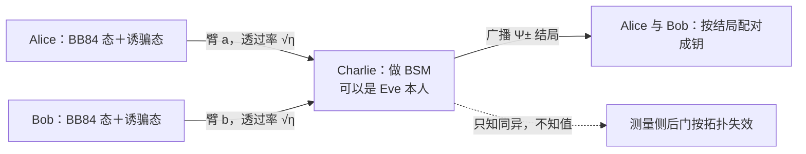

# $\rm Chapter \, 3$ MDI 与双场 QKD：把测量设备开除出信任域

> **本章假设你已经会**
>
> 1. BB84 的逐轮流程与窃听指纹：QBER 是 Eve 留下的账面扰动，见《量子通信》§2.2、§2.3。
> 2. 渐近安全率 ${r=1-2h(q)}$ 与阈值 ${q\approx 0.11}$，以及它的 CSS 码骨架，见《量子通信》§2.6、本册 §2.4。
> 3. 有限码长的三笔费用与「中止是安全声明的一部分」，见本册 §2.5。
> 4. 诱骗态怎么把光源侧的二次方定律救回一次方，密率-距离的模型账怎么记，见《量子通信》§6.3、§6.4。
> 5. 纠缠交换与贝尔态测量（BSM）：四个 Bell 态线性光学最多分辨两个，成功上限 ${1/2}$，见《量子通信》§7.2、§4.5。

全册的心智模型是：密码学的 trust 从假设变成物理，但物理设备本身又成了新的假设。第 2 章把「信道上没人能听」写成定理时，§2.6 的前提清单里躺着一条没兑现的支票：设备老实，即光源确实发单光子，探测器不朝外漏光。这一章先看这条假设怎样在现实里被击穿：一串案卷记录在先的攻击全都不碰量子态，专碰替你观察量子态的仪器。然后是两步反击。第一步，MDI-QKD 干脆把测量设备从信任域里整体开除，让中间那个可能是 Eve 的站点替双方做贝尔态测量；第二步，TF-QKD 在保住这份安全的同时，用单光子干涉加相位跟踪把距离推过 PLOB 界。学完本章，你能讲清致盲攻击绕过的是哪一层防御、MDI 的结局为什么只泄露「同异」不泄露「值」、BSM 的接受率为什么卡在 ${1/2}$、PLOB 界管着谁，以及 $\sqrt{\eta}$ 这个标度从哪里来、相位跟踪为此付了什么税。

## $\rm \S \, 3.1$ 案卷：探测器侧信道的攻击史

先看攻击者怎么动手。第 1 章威胁谱的第四级是「控制设备的对手」：绕过物理定律的正面，从实现缺陷下手（本册 §1.5）。这一级的案卷在 2010 年前后集中归档，主角几乎都是探测器。

头号案卷是探测器致盲攻击（detector blinding attack）。雪崩光电二极管工作在 Geiger 模式：偏置电压压在击穿阈值附近，一颗光子就能触发一次雪崩，输出一个标准脉冲，这是单光子探测器（SPD）的干活姿势。致盲攻击用强连续光把二极管推出 Geiger 模式：雪崩被持续压制，探测器退化成一个普通的光电二极管，对光的响应变成线性的、可控的。此后 Eve 再送上精心调制的亮脉冲，想让 Bob 在哪个时刻报「点击」就在哪个时刻喂一口亮光，探测器从「替量子力学作证」变成了「听 Eve 指挥的应声虫」。这套手法在 2010 年被公开演示，对象是市售商用 QKD 系统（Lydersen 等人，Nature Photonics，文献定性；本册不声称任何实测）。

第二号案卷是时间平移攻击（time-shift attack，文献 2007 至 2008 年口径）。两个探测器做不到完全一致：响应效率、时间响应各有偏差。Eve 不碰任何光子，只在事后按「哪个探测器在哪个时刻更容易响应」挪动筛选的时间窗，就能把自己想留的结果留下、想丢的结果丢掉。统计上毫无声息，账面上看不出指纹。

这两份案卷的共同点比它们的差异重要：攻击全程没有触碰量子态本身。不可克隆定理、测量扰动、《量子通信》§2.3 的窃听指纹，防的全是「直接听量子态」这条路；而致盲攻击是让仪器说谎，量子态层面可能干净得连 QBER 都不涨。安全证明管不到它，因为证明的前提清单里写着「探测器老实」，攻击者恰好只动了这一行前提。类比是验钞：BB84 防的是假钞混进钱箱，致盲攻击是收编验钞员。类比失效的地方也要说清：验钞员被收编后可以指鹿为马，而物理层面的扰动并没有消失：Eve 仍要往信道里送光，这些光在理想账本上会留痕；只是现实设备把这些痕迹处理掉了。攻击之所以成立，靠的是设备假设的缝，不是物理定律的缝。

> **经验规则**：审一份 QKD 系统的安全声明，先问测量设备在信任域里还是信任域外。在域内，侧信道案卷（致盲、效率失配、后门，均文献定性）每一条都要单独防御；在域外，这一整类攻击按拓扑直接失效，这正是下一节的设计。

白话：Eve 从正面撬保险柜失败之后，转行去收编替你看柜子的保安；量子力学管不了保安的人品，所以要么换保安的岗位描述，要么干脆雇一个你信不过的人来干这个岗位、再让流程保证他使不了坏。

> 本节小结：致盲与时间平移攻击不碰量子态、专攻设备假设；安全证明的前提清单里「探测器老实」这一行就是它们的入口；出路不是逐个堵洞，是把测量设备整体移出信任域。

## $\rm \S \, 3.2$ MDI-QKD：让不可信的一方替你测量

测量设备无关（measurement-device-independent，MDI）QKD（Lo、Curty、Qi，2012）把 §3.1 的教训写成拓扑：Alice 与 Bob 各自制备 BB84 态（连同《量子通信》§6.3 的诱骗态档位），各自把态发给中间站 Charlie；Charlie 对两颗到达的光子做贝尔态测量（Bell-state measurement，BSM，《量子通信》§7.2），只广播测量结局。Charlie 可以就是 Eve 本人，协议照常安全。

两性质撑起整个安全声明。其一，结局只泄露「同异」，不泄露「值」。Charlie 测得 $\lvert\Psi^{-}\rangle$ 结局，他只能推出两侧发的是一对基内不同（或相同，取决于结局与基约定）的比特，绝对值是 0 还是 1，他无从知晓——这与《量子通信》§7.2 纠缠交换的账同一笔：BSM 结局是两比特经典信息，只够 Alice 与 Bob 决定谁套哪顶修正帽，不够 Charlie 读原值。其二，测量侧后门按拓扑失效。致盲攻击要收编的是「替你判定密钥的探测器」；MDI 里判定密钥的逻辑全部搬回了 Alice 与 Bob 的数据后处理，Charlie 的探测器无论被致盲、被失配还是被换掉，他能操纵的只有「哪些轮次通过、结局是什么」，而这些轮次与结局连同 QBER 一起进了本册 §2.2 的账：任意攻击折算成虚拟成对 BB84 态的制备错误，两本 $h(q)$ 的账照收。测量设备从「需要假设老实的部件」变成了「账本里允许使坏的任意一环」。



换个角度看，MDI 是纠缠交换（《量子通信》§7.2）的时间反演。纠缠交换先分发两段纠缠、再做 BSM 把远端两颗粒子连成一对；MDI 反过来，先发态、中间站测 BSM，成功事件在效果上等价于 Alice 与 Bob 之间凭空建立纠缠关联，文献里叫虚拟纠缠。于是本册 §2.2 的证明一步到位地适用：把「成功事件」读成「Eve 准备的成对 BB84 态终于对上了账」，CSS 的两本账原封不动。中继站的设备清单却短得多：不需要量子存储，不需要预分发纠缠，连量子中继（quantum repeater）的复杂机械都省了（《量子通信》§7.3 的中继要的是存储加纯化）。

代价立刻浮出来，两条。其一，线性光学的 BSM 认不全四个 Bell 态：最多分辨两个，单轮成功上限 ${1/2}$（《量子通信》§4.5 第 5 条、§7.2），失败轮直接丢弃。其二，事件率里进了两条臂的损耗：Alice 与 Bob 的光子要各自幸存到 Charlie，成功事件率正比于两臂透过率之积 $\eta_{a}\eta_{b}$；这本账的形状与《量子通信》§6.4 无诱骗时的二次方定律同族，只是这次是拓扑带来的，诱骗态救不掉。两条代价的定量形状在 §3.3 与 §3.6 展开。

白话：MDI 不是给保安做背景审查，而是把岗位改成「报数员」：他只负责念「这一对是同号还是异号」，念错、漏念、故意漏念都行，但报数流程决定了他从逻辑上碰不到号码本身。

> 本节小结：MDI 的安全靠两性质：结局只泄露同异、测量侧后门按拓扑失效；它是纠缠交换的时间反演，成功事件等价于虚拟纠缠对，本册 §2.2 的证明原样适用；代价是 BSM 成功上限 ${1/2}$ 与两臂损耗相乘。

## $\rm \S \, 3.3$ 实测：BSM 的账（接受率、拒绝比与误码）

现在把 BSM 的账跑出来。模型口径逐条声明：Z 基筛留轮里，Alice 与 Bob 各发 $\lvert0\rangle$ 或 $\lvert1\rvert$；两颗光子在 Charlie 处的时空模式重叠度记作可见度（visibility）$\gamma$，$\gamma=1$ 是完全不可区分、$\gamma=0$ 是完全可区分；线性光学 BSM 只认 $\lvert\Psi^{\pm}\rangle$ 两个结局，$\lvert\Phi^{\pm}\rangle$ 分量聚束（bunching）失败。干涉只作用于同模式分量，分裂（两侧各响一个，有效结局）的概率是

$$
P_{\rm split}^{\rm same}=\frac{1-\gamma}{2},\qquad
P_{\rm split}^{\rm diff}=\frac{1+\gamma}{2}
$$

读法：same 指两侧发同比特（联合态是 $\lvert\Phi^{\pm}\rangle$），diff 指异比特（联合态摊开是两个 $\lvert\Psi^{\pm}\rangle$ 各一半）。$\gamma=1$ 时同比特必聚束、异比特必分裂；$\gamma=0$ 时干涉项消失，两种情形都退化成 ${1/2}$ 的随机。两式各占一半轮次，平均之后得到一个先反直觉的结论：

$$
P_{\rm acc}=\frac{1}{2}\cdot\frac{1-\gamma}{2}+\frac{1}{2}\cdot\frac{1+\gamma}{2}=\frac{1}{2}
$$

读法：接受率与 $\gamma$ 无关，恒为 ${1/2}$——这正是线性光学 BSM 的上限（《量子通信》§4.5），拒绝与接受之比恒为 1。可见度改变的不是「接受多少」，是「接受的是谁」：$\gamma$ 越低，接受的轮次里「同比特轮的偶然分裂」越多，而偶然分裂宣布的比特关系是错的，全部计为误码。接受轮里的 QBER 解析值为

$$
q_{\rm BSM}=\frac{1-\gamma}{2}
$$

再套本册 §2.4 的阈值账 ${r=1-2h(q)}$：$\gamma=1$ 时 ${q=0}$、${r=1}$；$\gamma=0$ 时 ${q=1/2}$、${r=0}$：完全可区分的两路光子之间没有干涉，接受的全是废票，密钥率为零。下面的表是脚本实跑结果（蒙特卡洛，每档 ${N=4\times10^{5}}$ 轮，固定种子 20261111，WSL 环境复现命令在本节末）：

| 可见度 $\gamma$ | 接受率 | rejected/accepted | QBER（实测） | QBER（解析） | ${r=1-2h(q)}$ |
| --- | --- | --- | --- | --- | --- |
| ${1.00}$ | ${0.4996}$ | ${0.5004}$ | ${0.0000}$ | ${0.0000}$ | ${+1.000}$ |
| ${0.90}$ | ${0.4993}$ | ${0.5007}$ | ${0.0499}$ | ${0.0500}$ | ${+0.428}$ |
| ${0.70}$ | ${0.5009}$ | ${0.4991}$ | ${0.1484}$ | ${0.1500}$ | ${-0.212}$ |
| ${0.50}$ | ${0.4995}$ | ${0.5005}$ | ${0.2504}$ | ${0.2500}$ | ${-0.624}$ |
| ${0.30}$ | ${0.4993}$ | ${0.5007}$ | ${0.3517}$ | ${0.3500}$ | ${-0.871}$ |
| ${0.00}$ | ${0.4995}$ | ${0.5005}$ | ${0.5003}$ | ${0.5000}$ | ${-1.000}$ |

三点读法。一，接受率六档全部落在 ${0.4993}$ 至 ${0.5009}$，是 ${1/2}$ 上限加蒙特卡洛涨落；$\gamma=1$ 档的有效结局 $\lvert\Psi^{+}\rangle$ 与 $\lvert\Psi^{-}\rangle$ 计数比 ${0.9961}$，两结局确实各半。二，QBER 实测与解析 ${(1-\gamma)/2}$ 逐档对上，安全率在 $\gamma\approx0.9$ 与 $\gamma\approx0.7$ 之间穿零。可见度是硬指标，干涉质量差一点，密钥直接归零。三，「接受率恒 ${1/2}$」是本章第一个反直觉点：高接受率不等于好数据，$\gamma=0$ 时接受率照样是 ${1/2}$，但每一张接受票都是废票。

第二条账是距离。$\gamma=1$ 时剩下的敌人只有暗计数：两颗光子各以臂透过率 $\eta_{\rm arm}$ 幸存，真事件率按 $\eta_{\rm arm}^{2}/2$ 掉价（两臂都幸存、且恰逢异比特轮，占一半）；「一颗光子加另一侧暗计数」与「双侧暗计数」构成偶然符合，各记一半误码。解析模型逐档算（每侧 2 个探测器，单个探测器每门暗计数 ${p_{d}=10^{-6}}$，$\alpha=0.2$ dB/km）：

| 臂透过率 $\eta_{\rm arm}$ | 全程 ${L}$（km） | 接受率/轮 | QBER | ${r=1-2h(q)}$ | 判定 |
| --- | --- | --- | --- | --- | --- |
| ${10^{-2}}$ | ${200}$ | ${5.00\times10^{-5}}$ | ${0.0004}$ | ${+0.990}$ | 可用 |
| ${10^{-3}}$ | ${300}$ | ${5.04\times10^{-7}}$ | ${0.0040}$ | ${+0.925}$ | 可用 |
| ${10^{-4}}$ | ${400}$ | ${5.40\times10^{-9}}$ | ${0.0374}$ | ${+0.540}$ | 可用 |
| ${5\times10^{-5}}$ | ${430}$ | ${1.45\times10^{-9}}$ | ${0.0701}$ | ${+0.267}$ | 可用 |
| ${2\times10^{-5}}$ | ${470}$ | ${2.84\times10^{-10}}$ | ${0.1479}$ | ${-0.209}$ | 中止 |

真事件按 $\eta_{\rm arm}^{2}$ 掉、偶然事件只按 $\eta_{\rm arm}$ 掉，两条曲线必有一交：模型口径下 QBER 顶穿 ${0.11}$ 阈值的截止距离约 ${453}$ km（理想探测效率）。文献实验纪录口径为 404 km（超低损光纤，${1.16}$ bit/hour，Lucamarini 等人 2018 年论文引述；文献定性，量级与本模型一致）。这就是 MDI 的距离天花板：拓扑把两臂损耗相乘，暗计数地板就顶得更早。

白话：第一张表看票的真伪，第二张表看票的产量；真事件按臂透过率的平方掉价，暗计数偶然只按一次方掉，一快一慢两线必相交，交点之后误码占大头，协议自动关门。

复现命令（环境 WSL，脚本与输出在 `_uni5_work/expQX03/`）：

```bash
# Bash（WSL），前置条件：装有 python3 与 numpy
cd /mnt/c/Users/20811/Desktop/26Fall/_uni5_work/expQX03
python3 exp1.py > result.txt        # 固定种子 20261111，重跑逐位一致
wc -c result.txt                    # 成功验证：非零字节；为 0 说明运行报错
```

> **常见错误**：把「接受率 ${1/2}$ 恒定」读成「可见度不重要」。接受率是票数，可见度是票的真伪；决定密钥率的是 ${r=1-2h(q)}$ 里的 $q$，不是票堆的大小。反过来，看到 MDI 系统在长距离频繁中止就断定探测器坏了也一样错：中止可能是暗计数地板的正常判决（本册 §2.5 的口径在此同样适用）。

> 本节小结：BSM 接受率恒 ${1/2}$、拒绝比恒 1，与可见度无关；可见度 ${(1-\gamma)/2}$ 进 QBER，${\gamma\approx0.8}$ 以下密钥归零；暗计数偶然按 $\eta_{\rm arm}$ 掉、真事件按 $\eta_{\rm arm}^{2}$ 掉，截止约 ${453}$ km（模型口径）。

## $\rm \S \, 3.4$ PLOB 界：无中继协议的天花板

MDI 买到了安全，率却压得很低。要评估「压得多低、还能不能救」，需要一个不偏袒任何方案的参照系。这个参照系是秘密钥容量（secret-key capacity）：一条透过率 $\eta$ 的损耗信道，任何不借助量子中继的协议，每轮能蒸馏的安全比特至多是

$$
K(\eta)=-\log_{2}(1-\eta)
$$

这就是 PLOB 界（Pirandola、Laurenza、Ottaviani、Banchi，2017）。它是信息论层面的上界：Eve 的能力按最坏情形记，协议与设备随便设计，只要拓扑是「点对点、无中继」，就在它的管辖之内：《量子通信》§6.4 的诱骗直连、上一节的 MDI，全在管辖范围里。

真实系统工作在小 $\eta$ 区，把 ${-\log_{2}(1-\eta)}$ 按级数展开：

$$
-\log_{2}(1-\eta)=\frac{1}{\ln 2}\left(\eta+\frac{\eta^{2}}{2}+\frac{\eta^{3}}{3}+\cdots\right)\approx 1.443\,\eta\qquad(\eta\ll1)
$$

读法：级数首项 $\eta/\ln 2$ 给出线性区系数 ${1.443}$；$\eta=10^{-2}$（约 ${20}$ dB 损耗）时后续项合计只占约 ${0.7\%}$，线性近似几乎分毫不差。所以 PLOB 界的形状是一根斜率为 1 的直线：链路每多 3 dB 损耗（信号掉一半），容量恰好掉一半。《量子通信》§6.4 的直连账为什么号称「一次方定律」却远够不着天花板，答案就在前置系数上——账的形状相同，系数不同。

边界要说清。PLOB 界约束的是「量子信息要一次性穿过同一条链路」的拓扑；可信中继网络（《量子通信》§7.3 的口径）把链路切成段、段间信息落回经典，每段各自记账，整条线的等效斜率虽被砍半，代价是信息在每个中继节点以明文形态停留，那是另一种信任结构，不受本界管辖。TF-QKD 的故事之所以值得讲，正因为它要同时做到两件「按理互相矛盾」的事：拓扑像中继（斜率砍半），信任面又像 MDI（中间站不可信）。

白话：PLOB 界是无中继QKD 的官方牌价上限，$\eta$ 是只跌不涨的汇率；想拿到比牌价更高的率，要么在链路里放自己人（中继），要么换一种让中间人帮不上忙的发牌方式（下一节）。

> 本节小结：PLOB 界 ${K(\eta)=-\log_{2}(1-\eta)\approx1.443\eta}$ 是一切无中继协议的信息论天花板，线性区斜率 1；它管点对点拓扑，不管可信中继；MDI 与诱骗直连的差距在前置系数，不在斜率。

## $\rm \S \, 3.5$ TF-QKD：单光子干涉与相位跟踪

双场（twin-field，TF）QKD（Lucamarini、Yuan、Dynes、Shields，2018）改动的地方只有一处，改动后的后果却直达 PLOB 界之上：把 MDI 的双光子符合测量换成单光子干涉。设备清单与 MDI 几乎重合，Alice 与 Bob 还是各发一束相位随机的弱脉冲到中间站，Charlie 还是那个可以变 Eve 的站点。

先看单光子干涉改变了账的哪一项。MDI 的成功事件要两颗光子分别穿过两条臂、同时到达做符合；TF 的探测事件只要一颗光子到达就能成立：两路脉冲在分束器上相干叠加，至少一颗幸存即可能触发一次点击，点击率按每臂透过率 $\hat{\eta}$ 记账（文献补充材料口径：联合单光子产额 ${y_{1}=\hat{\eta}}$），而

$$
\hat{\eta}=10^{-\alpha L/20}=\sqrt{\eta}
$$

读法：$L$ 是 Alice 到 Bob 的全程，$\alpha=0.2$ dB/km 是每公里损耗；每臂长 ${L/2}$，臂透过率 $\hat{\eta}$ 写成全程透过率 $\eta$ 的平方根——$\sqrt{\eta}$ 这个标度就是从这里来的。代价同样清楚：单颗光子的到达带不上任何相位信息（两侧探测器响应之和与相对相位无关，文献口径），真正携带密钥的是相位组合正确的轮次，而相位要从设备侧稳定地跟踪。

相位跟踪（phase tracking）由此登场，一套机制干三件事。第一，工程上补偿光纤的相位漂移：两臂的光程随温度与应力抖动，不跟踪则干涉条纹糊掉。第二，协议上把「孪生」挑出来：Alice 与 Bob 各自给脉冲随机赋相位，把 ${[0,2\pi)}$ 切成 ${M}$ 个相位切片（原文 ${M=16}$），事后公布切片号、只保留两侧切片相同的轮次，「双场」的名字由此而来：被赋了相同随机相位的一对脉冲互为孪生（twin）。切片匹配的概率是 ${1/M}$，相当于付 ${1/M}$ 的占空比税；切片「接近而不全等」还带来本征误码 ${E_{M}}$，原文口径 ${M=16}$ 时 ${E_{M}\approx1.275\%}$。第三，安全上充当虚拟基选择：切片号公开后，单光子干涉的统计可以按《量子通信》§3.2 的纠缠基思路读成虚拟的成对制备，安全证明的账才能落回本册 §2.2 的骨架。Charlie 看到的东西与 MDI 相同：哪个探测器响了，推得出两侧比特的同异，推不出值，MDI 的安全特征原封保留。

理想口径下的密钥率（原文补充材料公式，符号照搬）：

$$
R_{\rm TF}^{\rm ideal}=\frac{u}{M}\,\hat{\eta}\,\Bigl\{e^{-u}\bigl[1-h(E_{M})\bigr]-h(E_{M})\Bigr\},\qquad \hat{\eta}=\sqrt{\eta}
$$

读法：$u$ 是信号档光强（原文数值最优 ${u=0.765}$），$M$ 是切片数（占空比税 ${1/M}$），$E_{M}$ 是切片本征误码；花括号内是单光子档的成账减去误码账，与本册 §2.5 的两本账结构同源。代入 ${u=0.765}$、${M=16}$、${E_{M}=1.275\%}$（实测于 §3.6 脚本），前置系数为 ${0.0154}$：

$$
R_{\rm TF}^{\rm ideal}\approx 0.0154\,\sqrt{\eta}
$$

斜率由此砍半：链路每多 3 dB，直连与 MDI 的率掉一半，TF 只掉 $\sqrt{2}$ 分之一；换算成指数，斜率从 $-\alpha/10$ 变成 $-\alpha/20$，与《量子通信》§7.3 单个量子中继的斜率完全同款。差别在信任面：中继需要可信的量子存储与量子操作，TF 的中间站不可信、无存储，但相位同步成了新的工程假设——两站的时钟与参考系必须对齐，这行假设就是 trust 搬家后的新住址。

白话：MDI 是两张彩票必须同时刮中才算数，TF 是刮中一张就开奖，但开奖前双方要先对好暗号（相位切片），对不上暗号的场次全部作废，本征误码就是暗号只对了一半的场次混进来的。

> 本节小结：TF 把双光子符合换成单光子干涉，点击率按每臂 $\sqrt{\eta}$ 记，斜率砍半、与量子中继同款；相位切片付 ${1/M}$ 占空比税与本征误码 ${E_{M}\approx1.275\%}$（${M=16}$）；中间站不可信的 MDI 特征保留，相位同步是新假设。

## $\rm \S \, 3.6$ 实测：PLOB 界与 TF 标度的模型账

四条曲线放进同一张双对数表。口径郑重声明：这是模型推演，公式全部取自 Lucamarini 等人 2018 年论文补充材料的理想界（与其 Fig. 1a 的线 I、线 III、线 IV 对应），参数 $\alpha=0.2$ dB/km 标准光纤，不对应任何一台具体仪器。四条线：PLOB 界 ${K(\eta)=-\log_{2}(1-\eta)}$；单光子直连理想界 ${R=\eta}$；诱骗态 MDI 理想界 ${R=\eta/(2e^{2})}$，来历是双单光子增益 $\eta_{a}\eta_{b}\,(\mu e^{-\mu})^{2}/2$，光强最优 $\mu=1$、两臂各付一个 $e^{-1}$ 折扣、BSM 再付 ${1/2}$；理想 TF ${R=0.0154\sqrt{\eta}}$（§3.5 的公式实算）。

| ${L}$（km） | 损耗（dB） | PLOB 界 | 单光子直连 | 诱骗 MDI 界 | 理想 TF |
| --- | --- | --- | --- | --- | --- |
| ${50}$ | ${10}$ | ${1.52\times10^{-1}}$ | ${1.00\times10^{-1}}$ | ${6.77\times10^{-3}}$ | ${4.85\times10^{-3}}$ |
| ${100}$ | ${20}$ | ${1.45\times10^{-2}}$ | ${1.00\times10^{-2}}$ | ${6.77\times10^{-4}}$ | ${1.53\times10^{-3}}$ |
| ${150}$ | ${30}$ | ${1.44\times10^{-3}}$ | ${1.00\times10^{-3}}$ | ${6.77\times10^{-5}}$ | ${4.85\times10^{-4}}$ |
| ${200}$ | ${40}$ | ${1.44\times10^{-4}}$ | ${1.00\times10^{-4}}$ | ${6.77\times10^{-6}}$ | ${1.53\times10^{-4}}$ |
| ${300}$ | ${60}$ | ${1.44\times10^{-6}}$ | ${1.00\times10^{-6}}$ | ${6.77\times10^{-8}}$ | ${1.53\times10^{-5}}$ |
| ${400}$ | ${80}$ | ${1.44\times10^{-8}}$ | ${1.00\times10^{-8}}$ | ${6.77\times10^{-10}}$ | ${1.53\times10^{-6}}$ |
| ${500}$ | ${100}$ | ${1.44\times10^{-10}}$ | ${1.00\times10^{-10}}$ | ${6.77\times10^{-12}}$ | ${1.53\times10^{-7}}$ |

斜率核对（相邻档每 10 dB 掉几个十进量级，逐档实算）：PLOB、直连、MDI 三条全部是 ${-1.00}$，TF 恰为 ${-0.50}$。这张表把本章的论证链收成四个数：MDI 与直连斜率相同，差距全在前置系数（${0.0677}$ 对 ${1}$，理想口径差约 15 倍）——MDI 买的是信任面，不是率；TF 的斜率独一份地是 ${-0.50}$，前置系数虽小，距离一长就反超。交叉点实算：TF 过 MDI 界约 ${64}$ km，过单光子直连约 ${181}$ km，过 PLOB 界约 ${197}$ km。原文口径定性引用：理想 TF 在约 ${200}$ km 外越过 repeaterless 界，带入现实探测效率与暗计数后约 ${340}$ km，与本表 ${197}$ km 对上。${400}$ km 处的读数最能说明问题：单光子直连只剩 ${10^{-8}}$ 每脉冲，TF 还有 ${1.5\times10^{-6}}$，两个数量级的差距全由斜率那一半贡献。

复现命令（与 §3.3 同目录、同输出文件）：

```bash
# Bash（WSL），前置条件：装有 python3 与 numpy
cd /mnt/c/Users/20811/Desktop/26Fall/_uni5_work/expQX03
python3 exp1.py > result.txt && python3 exp2.py >> result.txt   # 两个实验一次跑全
wc -c result.txt                                                # 成功验证：非零字节
```

白话：四条线在双对数图上是三根平行线加一根越走越平的线；平行线之间的距离是「系数的账」，越走越平的那根迟早穿过所有平行线——穿过的地点（约 ${200}$ km）就是 TF 的主场开始的地方。

> 本节小结：MDI 与直连同斜率、差系数（理想口径 ${\eta/(2e^{2})\approx0.0677\eta}$）；TF ${0.0154\sqrt{\eta}}$ 斜率减半，约 ${64}$ km 过 MDI、约 ${181}$ km 过直连、约 ${197}$ km 过 PLOB（模型推演；原文口径理想 ${200}$ km、现实 ${340}$ km）。

## $\rm \S \, 3.7$ 适用条件与限制

本章两步反击各撕掉了前提清单里的一行，但清单没有清空。逐条摆开。

1. MDI 开除的只是测量设备。光源侧的多光子与分光漏洞仍要靠诱骗态堵（《量子通信》§6.2、§6.3），本章两节实验里「双方发单比特态」的假设在真实系统里就是诱骗态的活。源和测量一起开除是设备无关（device-independent，DI）QKD 的功课，接口已在《量子通信》§3.7 立好，第 4 章展开。
2. MDI 与 TF 的安全证明仍有自己的口径。态制备的随机性、「宣布结局后数据按规则配对」的流程合法性，都是证明的前提；TF 的相位切片付的是协议内生的税：占空比 ${1/M}$ 与本征误码 ${E_{M}}$，${M}$ 调大误码更小但产率同比例掉，$\S3.5$ 的公式里两者乘在一起，最优 ${M}$ 是权衡出来的。本册给的是账目骨架，定理级证明在原文与后续文献。
3. 攻击史与实验纪录都是文献定性。致盲、时间平移攻击的演示，MDI 的 ${404}$ km、TF 推进到 ${800}$ km 量级（2022 年文献口径），本册一律不声称实测；本章所有数字的口径是模型推演，脚本与输出在 `_uni5_work/expQX03/`。
4. 模型口径的简化要记在账上。§3.3 第二条账取理想探测效率、单光子对近似，真实账还要叠失准率与纠错效率 ${f}$（本册 §2.3 的 ${f>1}$）；截止距离的量级不受影响，具体公里数会动。
5. PLOB 界管点对点。可信中继网络、卫星链路不受它约束（见《量子通信》§7.3、§8 的口径）；工程上选哪条路，是第 6 章组合策略的账。
6. 认证信道的预共享密钥一分没少。与《量子通信》§2.7、本册 §2.6 第 4 条同口径：QKD 增殖密钥，不无中生有。

白话：本章从前提清单里撕掉了「测量设备老实」这一行，剩下的清单没有消失，只是改了身份：从「要假设的」变成「要审核的」。

把本章的账收成一张审核表，逐条对着任何一份 MDI/TF 系统的申报问：

1. BSM 接受率与 QBER 分开报了吗？接受率恒 ${1/2}$ 是拓扑，QBER 才进安全率；把两者混成一句「成功率高」的申报退回。
2. 斜率报的是哪个口径？${-1.00}$ 还是 ${-0.50}$（每 10 dB 每十进量级）；TF 的申报若按直连斜率外推远距离率，直接判错。
3. 相位跟踪的假设在哪一行？时钟与参考系同步的实现方式、漂移补偿的带宽，是 TF 的新信任面，申报里缺席即缺口。
4. 对照 PLOB 界的位置：报出的率在界下多远？若声称过界，距离是否落在理想口径 ${200}$ km、现实口径 ${340}$ km 之外的合理区间？
5. 回到本册 §2.6 的检查表第 6 条：哪些威胁进了定理、哪些停在设备假设、哪些靠组合兜底？本章把「测量设备」从第二栏搬进了第一栏，源侧与相位同步还留在第二栏。

> **本章总结**：探测器侧信道攻击史（致盲、时间平移，文献定性）证明「设备老实」这行前提会被现实击穿；MDI-QKD 用拓扑回应：双方发态、不可信中间站做 BSM，结局只泄露同异，测量侧后门整体失效，代价是 BSM 上限 ${1/2}$ 与两臂损耗相乘（实测：接受率与可见度无关恒 ${1/2}$，QBER ${(1-\gamma)/2}$，暗计数截止约 ${453}$ km 模型口径）；PLOB 界 ${-\log_{2}(1-\eta)\approx1.443\eta}$ 是无中继的天花板；TF-QKD 以单光子干涉加相位切片把点击率改记到每臂 $\sqrt{\eta}$，斜率砍半，理想口径约 ${197}$ km 过界、原文现实口径约 ${340}$ km。trust 从测量设备搬到了相位同步。

## $\rm \S \, 3.8$ 关键概念回顾

1. 探测器致盲攻击绕过的是哪一层防御？为什么《量子通信》§2.3 的窃听指纹在本册 §2.2 的证明里都看不见它？
2. MDI-QKD 为什么不需要信任 Charlie？他的 BSM 结局泄露什么、不泄露什么？测量侧后门是怎样「按拓扑失效」的？
3. BSM 的接受率为什么与可见度 $\gamma$ 无关、恒为 ${1/2}$？$\gamma$ 决定的是什么量？${r=1-2h(q)}$ 在 $\gamma$ 多大时穿零？
4. PLOB 界约束哪一类拓扑？可信中继为什么不在管辖范围内？诱骗直连与 MDI 同在界下，两者差距的性质是什么？
5. TF-QKD 的 $\sqrt{\eta}$ 标度从哪一步来？相位切片为此付出哪两笔税？TF 与量子中继斜率相同，信任面的差别在哪一行？

## $\rm \S \, 3.9$ 应用与辨析

1. 一套 MDI 系统的干涉可见度从 ${\gamma=1}$ 退化到 ${\gamma=0.9}$。接受率变了多少？QBER 变了多少？分别用 §3.3 的两个公式算，并指出哪个量决定了密钥率从 ${1}$ 掉到 ${0.428}$。
2. 团队要在 ${80}$ km 城域链路上部署 QKD，争论选诱骗直连还是 MDI：理想口径直连系数是 ${1}$、MDI 是 ${0.0677}$，相差约 15 倍。按「率」与「信任面」两个维度分别给出选择依据，并说明什么时候率维度应该让位。
3. 一份产品手册申报「密钥率已达到 PLOB 界的 ${90\%}$，工作距离 ${500}$ km」。结合 §3.6 的表与本册 §2.6 的检查表，列出至少三条需要对方补充的证据。

## $\rm \S \, 3.10$ 本章自测答案

概念回顾答案：

1. 绕过的是设备假设，不是量子态防护。窃听指纹与 §2.2 的证明管的是信道上的量子操作；致盲攻击让探测器说谎，量子态层面可以干净到 QBER 不涨，而「探测器不朝外漏光、不响应外来亮光」正是证明前提清单里没被证明的那一行（§3.1）。
2. Charlie 的 BSM 结局只泄露两侧比特的同异，绝对值在他的信息集之外；他再怎么操纵探测器，能改变的只是哪些轮次通过、结局是什么，这些连同 QBER 一起进 §2.2 的成对 BB84 态账。所谓按拓扑失效：判定密钥的逻辑全部在 Alice 与 Bob 的数据后处理里，测量设备没有可被欺骗的密钥功能（§3.2）。
3. 同比特轮与异比特轮各占一半，分裂概率 ${(1-\gamma)/2}$ 与 ${(1+\gamma)/2}$ 相加恒为 1，故接受率恒 ${1/2}$、拒绝比恒 1。$\gamma$ 决定接受轮里真干涉与偶然分裂的构成，进的是 QBER ${(1-\gamma)/2}$。令 ${1-2h\bigl((1-\gamma)/2\bigr)=0}$ 解得 $\gamma\approx0.8$：实测表里 $\gamma=0.7$ 档 ${r=-0.212}$ 已穿零（§3.3）。
4. 约束「量子信息一次性穿过同一条链路」的点对点无中继拓扑。可信中继把链路切段、段间信息落回经典，每段各自记账，等效斜率另算，所以不在管辖内。诱骗直连与 MDI 同斜率 ${-1.00}$，差距全在前置系数（理想口径 ${1}$ 对 ${0.0677}$），MDI 用率换信任面（§3.4、§3.6）。
5. 从「探测事件只需一颗光子到达」这一步来：点击率按每臂透过率 $\hat{\eta}=\sqrt{\eta}$ 记。两笔税：切片匹配的占空比 ${1/M}$ 与切片本征误码 ${E_{M}\approx1.275\%}$（${M=16}$）。中继要可信量子存储与量子操作；TF 中间站不可信、无存储，新假设是两站时钟与参考系的相位同步（§3.5）。

应用与辨析答案：

1. 接受率：两档都是 ${1/2}$，一分未变（${0.4996}$ 对 ${0.4993}$，差在涨落内）。QBER：${0}$ 变 ${(1-0.9)/2=0.05}$。掉的那 ${57}$ 个百分点的安全率全部来自 QBER 一项：${1-2h(0.05)=0.428}$，票数没变、票的真伪变了（§3.3 第一表）。
2. 率维度：${80}$ km 处直连与 MDI 都远在各自截止之内，直连率约高一个数量级，产量敏感的场景选直连。信任面维度：MDI 把 §3.1 的整类探测器攻击按拓扑排除，对侧信道威胁敏感的场景（对手有物理接触能力、设备供应链不可控）选 MDI。率让位的时机：威胁模型里出现「对手可接触终端设备」这一行时，率的 15 倍差距买的是这一行的清零，值得让位（§3.1、§3.6）。
3. 至少补三条。其一，${500}$ km 处 PLOB 界是 ${1.44\times10^{-10}}$ 每脉冲，${90\%}$ 即 ${1.3\times10^{-10}}$。但按 §3.6，理想 TF 在 ${500}$ km 也只有 ${1.53\times10^{-7}}$，低于界两个量级，申报数字与任何已知协议的标度矛盾，须给出公式与口径。其二，过界只可能是 TF 类协议，须报斜率（应为每 10 dB 掉半个量级）与相位同步方案，按 §3.7 第 3 条核对假设清单。其三，按本册 §2.6 检查表：块长、有限码长口径、安全参数分配、中止处理逐项要齐；缺一项按简化口径扣账（§3.4、§3.6、本册 §2.6）。

**你现在能做什么**：给定 ${\eta=10^{-4}}$（${40}$ dB，${200}$ km），30 秒内算出四个数：PLOB 界 ${1.44\times10^{-4}}$、单光子直连 ${10^{-4}}$、诱骗 MDI ${6.8\times10^{-6}}$、理想 TF ${1.5\times10^{-4}}$（已过界），并说出 TF 过界的公里数（理想口径约 ${197}$ km）。

MDI 把探测器从信任域里开除了，TF 又把距离推过了天花板，但两者仍有一行没撕掉的前提：设备的「内部行为」要符合申报，源发的态、探测器响应的模型都得老实。下一章把这最后一行也撕掉：不审计设备造得对不对，只审计它测出来的统计越没越线，贝尔不等式的 ${S}$ 值从物理想不通的怪事变成安全证书，CHSH 值直接折算成随机性下界。
