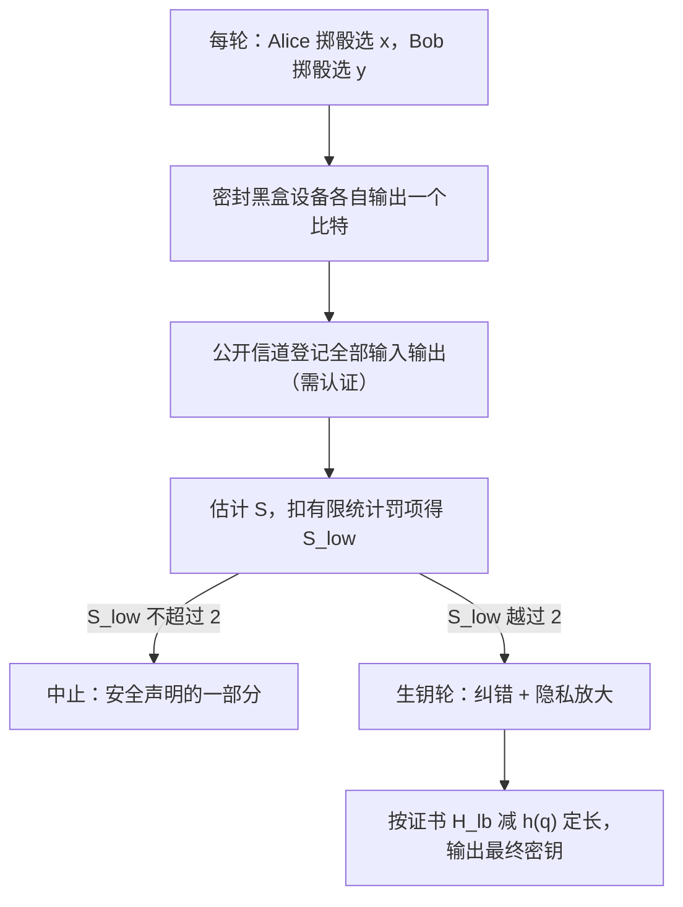

# $\rm Chapter \, 4$ DI-QKD 与自检测：信任清单压到只剩公理

> **本章假设你已经会**（先勾选，做不到就先回读）
>
> 1. CHSH 量的定义 ${S = E_{00} + E_{01} + E_{10} - E_{11}}$、经典上界 ${\lvert S\rvert\le2}$、量子天花板 ${2\sqrt2}$ 与 Tsirelson 界：[《量子力学》§11.2、§11.3.3、§11.3.4](../14-量子力学/11-边界与QCS路口.md)；
> 2. E91 的验货用法与 Eve 在场时 $S$ 掉回 ${\sqrt2}$ 的实测：[《量子通信》§3.2、§3.6](../85-量子通信/03-E91与纠缠.md)；
> 3. 最小熵 ${H_{\min}(X\,\vert\,E) = -\log_2 p_{\rm guess}}$ 与剩余哈希引理（隐私放大按最小熵计价）：第 2 章 §2.4；
> 4. 迹距离与安全参数 $\varepsilon$：第 2 章 §2.1；
> 5. 第 1 章威胁谱的第 4 档「控制设备的对手」：§1.5。

《量子通信》§3.7 立 DI 安全的接口时留了一张支票：「贝尔测试本身可以反过来担当随机性认证，这是后话」。本章兑现它：把「贝尔违背有多强」换算成「每轮能承诺多少随机性」，再把这个换算装进一条完整的密钥分发协议。全册心智模型（trust 从假设变成物理，但物理设备本身又成了新的假设）在本章被推到两头都是极限的位置：前半句推到尽头，信任清单上不再有任何一台设备；后半句也推到尽头，剩下的假设不再是设备，而是量子力学、无信号与自由选择这三条公理。学完本章，你能读出一份 DI 协议申报里「证书值 $S$、每轮熵下界、密钥率」三个数字之间的账目关系，并解释为什么这类系统的密钥率低到令人发笑仍然值得造。

## $\rm \S \, 4.1$ 问题：信任清单上还剩哪几行

前三章的路线可以读成一张不断变短的信任清单。第 2 章的 Shor–Preskill 证明覆盖了信道，但光源与探测器整个躺在假设里；第 3 章的探测器致盲案卷说明这条假设会被现实击穿，MDI-QKD 的回应是把探测器整体开除出信任域，双方把测量外包给不可信中间站。可清单没清空：MDI 的证明仍然要求光源发出的态符合申报的强度与相位，随机数发生器仍然要求是真随机的。每开除一批设备，清单短一行，但行数始终不为零。设备无关（device-independent，DI）安全是这条路线的尽头：协议不再接受任何一台设备的任何内部申报，安全声明只从双方观察到的输入输出统计里长出来。

三代协议放在一起，收缩的轨迹一目了然。对照第 1 章 §1.5 的威胁谱看会更清楚：BB84 的证明只覆盖前两档（被动窃听、主动截听）；第 3 档「有量子存储的对手」由第 2 章的普遍攻击证明接管；第 4 档「控制设备的对手」在前三章里始终停在物理层假设上，正是本章的靶心。DI 的价值在于把第 4 档也变成有定理的地方：设备被谁控制都行，统计说了算。

| 协议代际 | 信任域里还剩谁 | 担保来自哪里 |
| --- | --- | --- |
| BB84（第 2 章） | 光源、探测器、随机性 | 设备表征 + 信道安全证明 |
| E91（量子通信册第 3 章） | 测量设备、随机性 | 源可以不可信，验货靠 CHSH 越线 |
| MDI-QKD（第 3 章） | 光源、随机性 | 探测器侧信道整体免疫 |
| DI-QKD（本章） | 三条公理（§4.5） | 一切设备都可以当成 Eve 造的 |

白话：DI 的态度是「我不管你们盒子里面是什么电路，也不听你们申报任何参数，我只出题、收答案，答案对得上量子力学的说法才继续」。这句态度能成立，靠的是一条单向的逻辑链：统计得分高会**强制**盒子背后藏着的东西长成某种样子。第 2 章证明的次序是「假设态分布好，推出 Eve 学不到」；DI 把次序整个倒过来，先量得分，再谈有什么态。得分高到接近 ${2\sqrt2}$ 时，态与测量被强制成近似单态加最优测量（文献里叫自测试，self-testing，定性），于是随机性、密钥、设备的诚实程度全部可以从同一个得分里读出来。

### $\rm \S \, 4.1.1$ 心智模型的最后一格

把全册心智模型在本章落成最后一格：信任没有消失，它被压成公理。清单清空之后，承诺的地基变成三条「不是设备、也无法是设备」的陈述：量子力学在实验尺度上成立；无信号约束成立；测量设置的选择真随机且与对手独立（自由选择假设）。前三章开除掉的每一批设备，其罪名都是「可能被 Eve 控制」，而这三条公理不存在「被 Eve 控制」的问题，因为它们不是装置，是自然规律与实验设计的属性。代价同样明确：公理一旦被动摇，DI 的全部承诺随之失效。这是整套量子密码能下探到的最深处，第 5 章会看到这个最深处的第一个租户：设备无关随机数发生器。

> 本节小结：信任清单从 BB84 的三行设备压到 MDI 的一行、再压到 DI 的零行；记账次序倒置，先量统计得分、再谈有什么态；清空的清单换来一叠新地基：量子力学、无信号、自由选择，三条全是公理级假设。

## $\rm \S \, 4.2$ CHSH 违背作为熵证书

### $\rm \S \, 4.2.1$ 两端先算死

证书要回答的问题是：观测到 CHSH 得分 $S$（取绝对值，下同）的一轮实验里，Eve 对输出的猜中概率最大是多少。按第 2 章 §2.4 的币种，猜中概率换成最小熵：${H_{\min} = -\log_2 p_{\rm guess}}$。先把两个端点用手工账算死，公式必须在两端站得住才有资格谈中间。

端点一，${S = 2}$：经典确定性答案单（量子通信册 §3.4 的十万张模型里一抓一把）可以让双方输出完全确定，此时 $p_{\rm guess} = 1$、熵为零。证书在 ${S = 2}$ 处必须承诺零：这一点上「不违背 ⇒ 没有随机性承诺」是硬的，注意方向是单向的，$S = 2$ 不代表被窃听，只代表证书闭嘴。

端点二，${S = 2\sqrt2}$：量子最优实现是单态加最优测量（量子力学册 §11.3.3），此时生钥设置对 ${(\text{a}_0, \text{b}_0)}$ 下的联合输出只取两个值、各占一半，而纯态不附带任何 Eve 侧信息，${p_{\rm guess} = \tfrac12}$，恰一比特随机。证书在 ${2\sqrt2}$ 处必须承诺至少一比特。

两端钉死之后，全段曲线由文献定理接管：Pironio 等 2010 年在 Nature 上把「给定贝尔违背、最坏情形量子实现下的猜中概率」写成优化问题并解出，CHSH 情形有封闭解（Acín–Massar–Pironio 2011）。按本章通用的标准归一化（经典上界 $2$、量子最大 ${2\sqrt2}$）书写，单轮随机性证书是

$$
H_{\min}(A_0, B_0 \,\vert\, E) \;\ge\; 1 - \log_2\!\left(1 + \sqrt{2 - S^2/4}\right),
\qquad 2 \le S \le 2\sqrt{2}.
$$

读法：右边是每个生钥轮能承诺的最小熵下界，单位比特。$S$ 从 $2$ 涨到 ${2\sqrt2}$，下界从 $0$ 连续涨到 $1$；猜中概率上界从 $1$ 压到 ${\tfrac12}$。口径提醒：部分文献把 CHSH 量归一到量子最大值为 $4$（记作 ${S' = \sqrt2\,S}$），同一公式在那里写成 ${1 - \log_2\bigl(1 + \sqrt{2 - S'^2/8}\bigr)}$，代入 ${S' = \sqrt2 S}$ 逐点相等，读文献时先看清归一化。证书的条件对象是联合输出 ${(A_0, B_0)}$：对单比特它偏保守（联合的熵不会超过单边的熵，用它给单比特记账只会少算不会多算）。

### $\rm \S \, 4.2.2$ 纯态族：把公式的中间段亲手验一遍

文献定理给了整条曲线，本节在一个能全手推的态族上把它逐点验掉，验的不是「定理对不对」，而是「这公式长什么样、松紧在哪里」。取单态，测量方向设成一个单参数族

$$
\theta_{a_0} = 0,\quad \theta_{a_1} = 2\theta,\quad \theta_{b_0} = \theta,\quad \theta_{b_1} = -\theta .
$$

单态关联公式 ${E = -\cos(\theta_A - \theta_B)}$（量子通信册 §3.3 已实测核对）给出四个关联：${E_{00} = -\cos\theta}$、${E_{01} = -\cos\theta}$、${E_{10} = -\cos\theta}$、${E_{11} = -\cos 3\theta}$，拼出

$$
S(\theta) = -3\cos\theta + \cos 3\theta,\qquad
\lvert S\rvert = 3\cos\theta - \cos 3\theta,\qquad \theta \in [0^\circ,\ 45^\circ].
$$

$\theta = 0$ 时 ${\lvert S\rvert = 2}$（贴着经典天花板），$\theta = 45^\circ$ 时 ${\lvert S\rvert = 2\sqrt2}$（顶到 Tsirelson 界）：一个参数扫过证书的整个量程。再看这一族在生钥设置对上的联合分布。对 ±1 观测量的投影测量，Born 规则给 ${P(a,b) = \tfrac14\bigl(1 + a\langle A\rangle + b\langle B\rangle + ab\,E_{ab}\bigr)}$；单态的单边边缘为零，只剩关联项，在 ${(\text{a}_0,\text{b}_0)}$ 处角差为 $\theta$：

$$
P(a, b \,\vert\, \text{a}_0, \text{b}_0) = \tfrac14\bigl(1 - ab\cos\theta\bigr)
\;\;\Longrightarrow\;\;
p_{\rm guess} = \max_{a,b} P = \frac{1 + \cos\theta}{4}.
$$

这里用了一个纯态特权：单态是纯态，Eve 手里没有额外的量子系统可测，她的最优策略就是知道分布后押最大的那格，所以 ${p_{\rm guess}}$ 恰是联合分布的最大格值。把这族的 ${\lvert S\rvert}$ 与 ${p_{\rm guess}}$ 代进证书式逐点核对（$\theta$ 从 $0^\circ$ 到 $45^\circ$ 取 13 个点），全部成立，松紧结构也清楚：两端贴得紧，中段证书偏保守。例如 $\theta = 30^\circ$ 时实际 ${p_{\rm guess} = 0.4665}$、实际熵 ${1.1000}$ 比特，证书只敢承诺 ${p \le 0.7795}$、熵不低于 ${0.3594}$；$\theta = 45^\circ$ 时实际熵 ${1.2284}$ 比特，证书承诺 ${1.0000}$。证书是保底承诺，不是实际产量，这个差别在 §4.3 的协议账里还会再见到。

### $\rm \S \, 4.2.3$ 刚性的一瞥：得分如何锁死设备

证书公式先收租，本节看它凭什么敢收。从 CHSH 的拼法 ${S = E_{00} + E_{01} + E_{10} - E_{11}}$ 与每个关联落在 ${[-1, 1]}$ 出发，移项得

$$
E_{00} + E_{01} \;=\; S - E_{10} + E_{11} \;\le\; S + 2 .
$$

在单态约定（$S$ 为负）下，这读作 ${\lvert E_{00} + E_{01}\rvert \ge \lvert S\rvert - 2}$：得分 ${2.8284}$ 时，共享提问 $\text{a}_0$ 的两个关联之和至少 ${0.8284}$，也就是说 $\text{a}_0$ 的回答被 $\text{b}_0$ 与 $\text{b}_1$ 两个提问同时锁住。确定性答案单是常量表，一次只能对齐一种提问；要两个提问都被强对齐，输出必须带着「对每个提问都对齐、彼此又不打架」的结构，这种结构经典供不起，纠缠恰好供得起。这就是刚性（rigidity）的初等味道：得分是约束的汇率，越接近 ${2\sqrt2}$，与观测统计相容的态与测量的集合越小，小到统计上只剩一种实现（自测试定理，文献定性；鲁棒版本量化「得分差一点，集合放宽多少」）。证书与刚性是同一枚硬币的两面：刚性说「得分高的盒子里没多少自由度」，证书说「剩下自由度里 Eve 能染指的更少」。白话：满分考卷把考生的复习范围压到只剩一页，监考人（证书）再从这页里把偷看的机会划掉。

### $\rm \S \, 4.2.4$ 一般情形：把优化交给线性规划

纯态族只验了一个角落。完整的声明要覆盖「任何量子实现、Eve 拿着任何侧信息」：给定观测统计（含 CHSH 得分），对全部与观测相容的量子实现取最坏情形，最大化 Eve 的猜中概率。Pironio 等 2010 把这个最坏化写成优化问题（对侧信息做优化的半定规划），数值可解，CHSH 情形的解有封闭形式，就是 §4.2.1 的公式。优化的结构是标准的原问题对偶问题对仗：原问题在所有相容实现里挑 Eve 赢面最大的一个；对偶问题给每个观测统计配一张「得分到熵的兑换表」，兑换表的最优值就是证书，CHSH 情形的对偶恰好能手解，才有了可以写进协议文档的一行公式。多轮重复时，熵累积定理把单轮下界逐轮累加成整段密钥的下界（文献定理级，此处只立接口）。白话：证书是一台自动柜员机，你存进去一个统计得分，它吐出一个「最坏情况下 Eve 最多知道多少」的数字，而它敢这么吐，是因为它替你把所有可能的盒子都想了一遍。

> 本节小结：熵证书把 CHSH 得分换算成每轮最小熵下界，两端手工可算（$S=2$ 给 $0$、${2\sqrt2}$ 给 $1$），中间由优化定（CHSH 有封闭解）；纯态族逐点验证成立且中段偏保守；证书的对象是统计得分本身，与盒子内部构造无关。

## $\rm \S \, 4.3$ 实测：熵证书与玩具协议账

实验脚本 `exp1.py`（python3 加 numpy，WSL 运行，种子 20261112，总耗时约 4 秒）做四件事：A 段按证书公式对 $S$ 打表并自检两端点与单调性；B 段跑 §4.2.2 的纯态族逐点对账，其中 ${p_{\rm guess}}$ 用闭式与显式四元概率数组两条独立来源互查；C 段蒙特卡洛跑一条 DI 玩具协议，${N = 10^6}$ 轮，统计 ${\hat S}$ 与有限统计罚项，并把蒙特卡洛账与不抽样的纯模型账对账；D 段对比量子证书与放宽到无信号对手后的证书强度。本节引用的数字全部出自该脚本输出。

A 段的证书曲线抽样值：

| $S$ | ${2.0}$ | ${2.4}$ | ${2.6}$ | ${2.8}$ | ${2\sqrt2 \approx 2.8284}$ |
| --- | --- | --- | --- | --- | --- |
| ${H_{\min}}$ 下界（比特） | ${0.0000}$ | ${0.1940}$ | ${0.3614}$ | ${0.7370}$ | ${1.0000}$ |

自检全过：${S = 2}$ 端点给 $0$、${2\sqrt2}$ 端点给 $1$、曲线单调不减。曲线形状值得多看一眼：得分要过 ${2.7}$ 才开始大方（${2.7}$ 处 ${0.4928}$），在 ${2.7}$ 到 ${2.8284}$ 这最后 $0.13$ 的窄带里，熵下界从半比特跳到整比特。违背的回报是高度非线性的，越接近 Tsirelson 界越值钱。

B 段对 §4.2.2 的纯态族逐点验证：13 个角度全部满足 ${p_{\rm guess} \le p_{\rm bound}}$，两条独立来源算出的 ${p_{\rm guess}}$ 逐点一致；证书中段偏保守的读数如前节所述。

C 段把证书装进玩具协议看整体经济账。协议设定：双方每轮各掷骰选设置 ${x, y \in \{0, 1\}}$，设备按带噪声的单态（可见度 $v$，理想关联按 $v$ 缩水）输出 ${\pm 1}$；全部轮次用于估计 ${\hat S}$，有限统计罚项取 ${3\sigma}$ 高斯口径（$\varepsilon$ 量级约 ${10^{-3}}$，玩具口径，正式分析用有限统计优化与熵累积）；保守得分 ${S_{\rm low} = \lvert\hat S\rvert - 3\hat\sigma}$，跌破 $2$ 即中止。生钥轮取 ${(x,y) = (0,0)}$，密钥用 Alice 的读数 ${a_0}$；纠错账是 Bob 翻面对齐后的错误率，从生钥轮角差 ${45^\circ}$ 与可见度推：关联 ${E_{00} = -v\cos 45^\circ}$，翻面对齐后错误率

$$
q = \frac{1 + E_{00}}{2} = \frac{1 - v/\sqrt2}{2},
\qquad
r = \tfrac14\Bigl[H_{\rm lb}(S_{\rm low}) - h(q)\Bigr].
$$

读法：$v$ 是器件质量；$q$ 是纠错泄漏的单价（二值熵 $h$）；四分之一是生钥轮占比（四个设置组合只留一个生钥）。蒙特卡洛与模型两条独立来源的账逐可见度对齐如下：

| $v$ | ${\lvert\hat S\rvert}$ | ${S_{\rm low}}$ | ${H_{\rm lb}}$ | $q$ | ${r_{\rm MC}}$（比特/轮） | ${r_{\rm 模型}}$ | 对账差 |
| --- | --- | --- | --- | --- | --- | --- | --- |
| ${1.00}$ | ${2.8285}$ | ${2.8200}$ | ${0.8504}$ | ${0.1472}$ | ${0.0619}$ | ${0.0623}$ | ${0.0004}$ |
| ${0.97}$ | ${2.7410}$ | ${2.7323}$ | ${0.5505}$ | ${0.1575}$ | ${-0.0194}$ | ${-0.0179}$ | ${0.0015}$ |
| ${0.95}$ | ${2.6870}$ | ${2.6782}$ | ${0.4591}$ | ${0.1639}$ | ${-0.0461}$ | ${-0.0462}$ | ${0.0001}$ |
| ${0.92}$ | ${2.6027}$ | ${2.5935}$ | ${0.3545}$ | ${0.1747}$ | ${-0.0784}$ | ${-0.0786}$ | ${0.0002}$ |
| ${0.90}$ | ${2.5473}$ | ${2.5381}$ | ${0.3003}$ | ${0.1813}$ | ${-0.0957}$ | ${-0.0963}$ | ${0.0006}$ |
| ${0.85}$ | ${2.4095}$ | ${2.3999}$ | ${0.1940}$ | ${0.1979}$ | ${-0.1309}$ | ${-0.1326}$ | ${0.0017}$ |

模型账细扫给出转负点：${v^* \approx 0.9775}$（该处 ${S_{\rm low} = 2.7563}$、${H_{\rm lb} = 0.6024}$，恰好被纠错账 $h(q)$ 吃平）。这行数字是全章最扎眼的一句：器件做到理想，每千轮也只兑现 ${62.3}$ 比特密钥；器件可见度跌 $2.25\%$，整条链路一粒密钥都产不出。脆在哪里，脚本的分账把理想情形（${v = 1}$）每生钥轮的 ${0.8501}$ 比特逐笔拆开：先扣纠错税 ${h(q = 0.1464) = 0.6009}$，剩 ${0.2493}$；再扣审计税（生钥轮占比四分之一），落到 ${0.0623}$ 比特每总轮，与蒙特卡洛账的 ${0.0619}$ 对齐。三笔税点名如下。1. **审计税**：四分之三的轮次在陪跑验货，只有四分之一生钥。2. **纠错税**：生钥轮角差 ${45^\circ}$ 的反关联在理想时也只有 ${85.4\%}$ 对齐率，$h(q) \approx 0.60$，吃掉证书的七成。3. **保守税**：证书承诺的是最坏情形，理想单态实际给 ${1.2284}$ 比特（B 段 ${\theta = 45^\circ}$ 行），账上只敢记 ${0.8501}$。真实 DI-QKD 协议用非对称设置压第二笔税（让生钥轮接近完全关联、把违背的重担挪给验货轮，文献定性），这是玩具账与真实协议之间的主要口径差。

D 段提醒证书的强度是「对手模型」的函数。把对手放宽到只受无信号约束（允许 PR 盒，量子力学册 §11.3.4），同样的得分换不来同样的随机性。各向同性 NS 盒是 PR 盒混均匀噪声：得分 ${S = 4v}$，单比特猜中率 ${p = \tfrac12 + S/8}$。两套账并排：

| $S$ | 量子证书 ${H_{\rm lb}}$（比特/轮） | 各向同性 NS 盒单比特实际熵（比特） |
| --- | --- | --- |
| ${2.0}$ | ${0.0000}$ | ${0.4150}$ |
| ${2.4}$ | ${0.1940}$ | ${0.3219}$ |
| ${2.8}$ | ${0.7370}$ | ${0.2345}$ |
| ${2\sqrt2}$ | ${1.0000}$ | ${0.2284}$ |

读法：两列反向而行。量子证书随得分上升（分越高越确定有纠缠）；NS 盒的实际熵随得分上升而下降（PR 盒掺的噪声越少，得分越高，单比特反而越确定）。两列不可直接比大小，度量的对象不同：量子列是「最坏量子实现下的保证」，NS 列是「一个具体 NS 盒的实际值」。要点不在数字本身，而在方向：同样的统计得分，承诺的强度取决于你相信对手受什么理论约束。量子力学这条公理不是免责声明，它是证书的承重墙。

> 本节小结：证书曲线在 ${2.7}$ 以上才大方；玩具协议理想器件 ${62.3}$ 比特每千轮、可见度阈值 ${v^* \approx 0.9775}$；三笔税（审计、纠错、保守）里纠错税可用非对称设置压缩；对手模型放宽到无信号，证书强度掉到四分之一以下。

## $\rm \S \, 4.4$ 协议逐轮与认证格

### $\rm \S \, 4.4.1$ DI-QKD 逐轮

把 §4.3 的玩具账补上工程件，就是一条完整的 DI-QKD 协议。逐轮走：

1. 每轮 Alice 与 Bob 各自用本地随机源选设置 ${x, y \in \{0, 1\}}$，两个选择相互独立、且与 Eve 独立（自由选择假设在这里进场，§4.5 会回头查它的岗）；
2. 双方设备被提问后各自输出一个比特；设备可以是供应商交付的密封黑盒，协议不读它的任何内部参数；
3. 全部输入输出经公开信道登记，这条信道要认证（第 2 章 §2.6 第 4 条的老规矩）；
4. 估计 ${\hat S}$、扣有限统计罚项得 ${S_{\rm low}}$，低于 $2$ 则中止：中止是安全声明的一部分，不是故障；
5. 生钥轮上跑纠错与隐私放大：按证书承诺的 ${H_{\rm lb}}$ 与纠错泄漏 $h(q)$ 定压缩长度，剩余哈希引理（第 2 章 §2.4）保证压出来的密钥对 Eve 逼近均匀。

五步的数据流画在一起，中止分支的位置值得单独看一眼：它挂在得分估计之后、密钥产出之前，任何一次不达标都是干净利落地整段放弃。

与 BB84 最深的区别藏在第 2 步。BB84 的账本里，Eve 学多少取决于她怎么动，协议靠扰动指纹抓她；DI 的账本里，Eve 连「怎么动」的权限都没有，因为设备整体就是她的嫌疑人，而证书直接从她无法伪造的统计里收租。她想混进高得分，就必须真的造出（或允许双方造出）接近单态的纠缠，而这恰是随机性所在；她想压低得分，协议中止，她一无所获。

### $\rm \S \, 4.4.2$ 认证格：magic 方块

第 3 步的「认证」在 DI 语境里有了新解法。经典认证（预共享密钥加消息认证码）验的是消息没被篡改，验不了设备没被调包；DI 需要的是后者。magic 方块（Mermin–Peres magic square，1990）这类认证格把它变成一场有标准答案的考题。游戏规则：裁判给 Alice 一个行号 $r$、给 Bob 一个列号 $c$（各从 ${1,2,3}$ 均匀抽、互相不知晓）；Alice 交出行 $r$ 的三个 ${\pm 1}$，Bob 交出列 $c$ 的三个 ${\pm 1}$；判赢条件有三：交叉格 ${(r,c)}$ 两边答案相等，行 $r$ 三数乘积为 ${+1}$，列 $c$ 三数乘积为 ${-1}$。

经典策略拿不到满分。反证：若有满分策略，把双方对全部九格的应答拼成一张 ${3\times3}$ 的表，这张表必须行行乘积为 ${+1}$、列列乘积为 ${-1}$。全表九个数连乘，按行算是 ${(+1)^3 = +1}$，按列算是 ${(-1)^3 = -1}$，每个格子恰被计入一次，两个结果必须相等，矛盾。所以经典最优止步于八胜九负（${8/9}$，文献口径）。量子侧，双方共享两比特最大纠缠态、按 Mermin–Peres 方格取 Pauli 型观测量，可以九战九胜：算符乘法的对易关系替经典表付不起的那笔账付了钱。满分本身就是声明：能持续答满分的设备必然共享了指定的纠缠与测量（自测试性质，鲁棒版本见文献定性）。

用在 DI-QKD 里，认证格是每个会话开场的资格考试：抽若干轮考 magic 方块，赢率掉下来就认定设备被动过手脚、中止会话。设备是不是真量子，不再靠审计内部，靠的是答题；这正是心智模型在认证处的落点，物理设备的假设被物理考题本身替换。但替换没有消灭假设：考题必须不可预测，出题的随机性从哪来？这个口子通向第 5 章。

> 本节小结：DI 协议逐轮五步，中止是安全声明的一部分；Eve 的权限被压到「提供设备」，连攻击方式都由证书代管；magic 方块用经典不可能满分、量子满分的一局游戏当设备资格考试，认证的信任根顺延成考题的随机性。

## $\rm \S \, 4.5$ 适用条件与限制

1. 假设栈一共四条，缺一崩。1. 量子力学在实验尺度上成立（证书的承重墙，D 段已量化放宽的代价）；2. 无信号约束；3. 自由选择（设置选择与 Eve 独立；若 Eve 能预测你的选择，她可以只在会暴露的轮次放真纠缠，量子通信册 §3.7 已给过这个攻击的形状）；4. 公开信道认证。注意第 1、3 条不是设备属性，是自然规律与实验设计属性：这正是「信任清单压到只剩公理」的字面含义，也是新的失效面：有人质疑量子力学或自由意志时，DI 没有备用地基。
2. 实验漏洞必须关死。探测漏洞：探测器效率不够时，Eve 把没触发的轮次按她的意图解释；对称 CHSH 口径下要求探测效率超过 ${2/(1+\sqrt2) \approx 82.8\%}$（Garg–Mermin 文献口径），非对称设置可压到约 ${66.7\%}$（Eberhard 文献口径）。局域性漏洞：两边距离要拉开到类空间隔，否则串供。2015 年三个实验组（代尔夫特、NIST、维也纳）首次同时关死两类漏洞，贝尔实验自此才算真正闭合。
3. 记忆攻击与多轮记账。设备跨轮保留信息时，单轮证书不能直接逐轮相加，需要熵累积定理级的处理（文献定性）；设备可被远程改写固件时，认证格要每会话重考。
4. 速率现实（文献定性标注）。2022 年，离子阱与光子平台先后在 Nature 报出 DI-QKD 的首次实验演示；速率与距离都还在原理演示量级，比同等条件的 MDI-QKD 低多个数量级。§4.3 的玩具账解释了为什么：证书只在逼近 Tsirelson 时才大方，而真实器件的可见度、探测效率与距离损耗同时压三个因子，玩具账里 ${v^* \approx 0.9775}$ 的红线在真实链路上只会更苛刻。
5. 玩具口径与正式口径的差距清单：${3\sigma}$ 罚项是高斯近似（正式用有限统计优化加平滑最小熵）；密钥记 Alice 单比特而证书按联合对（偏保守）；对称设置非最优（非对称设置是文献标准做法）；纠错效率按理想 ${f = 1}$ 记。方向性结论（阈值形状、三笔税、对手模型敏感性）不受口径影响，具体数字不可直接外推到工程申报。

> 本节小结：假设栈四条（量子力学、无信号、自由选择、认证）全是公理级或实验设计级；漏洞两窟（探测、局域）2015 年起可关死；速率比 MDI 低多个数量级且原因能从证书曲线上读出来；玩具账的五条口径差在动真格申报时逐条要换正式算法。

## $\rm \S \, 4.6$ 关键概念回顾

1. 「设备无关」把信任清单压到了哪几行？它与「设备不重要」差在哪里？
2. 熵证书在 ${S = 2}$ 与 ${S = 2\sqrt2}$ 两端各承诺多少？两端的手工推导分别用了什么？
3. 玩具协议账里的三笔税各是什么？哪一笔是非对称设置主要压缩的对象？
4. magic 方块的经典不可能性证明核心是哪两行算术？量子满分策略对设备构成了什么级别的声明？
5. 把对手模型从「量子力学」放宽到「仅无信号」，同一得分下证书会发生什么变化？

## $\rm \S \, 4.7$ 应用与辨析

1. 某供应商申报：「我们的 QKD 是设备无关的，所以系统里不需要高质量真随机数发生器。」请逐条指出这个申报错在哪里，并说明 DI 恰恰对随机性提出了什么新要求。
2. 一条 DI 链路的保守得分 ${S_{\rm low} = 2.75}$。用证书公式手算每轮熵下界，并与 §4.3 的表对账；再问：若块长有限使 ${S_{\rm low}}$ 的不确定度达 ${0.05}$，这份申报还剩多少随机性可承诺？
3. 同事主张：「DI 用了 magic 方块认证，所以连认证信道的预共享密钥都省了。」辨析：认证格考的是什么、付账的随机性从哪来、与第 2 章 §2.6 第 4 条的预共享密钥各管哪一段。

## $\rm \S \, 4.8$ 本章自测答案

概念回顾答案：

1. 压到三条公理加一条工程前提：量子力学成立、无信号、自由选择，外加公开信道认证。「设备不重要」是误读：设备极其重要，重要到它们的统计表现是唯一的安全证据源，只是它们的内部构造与申报不再进入信任域（§4.1、§4.5 第 1 条）。
2. ${S = 2}$ 处承诺 $0$：经典确定性答案单可以恰好贴着 $2$，此时输出完全可预测。${2\sqrt2}$ 处承诺 $1$：量子最优实现（单态加最优测量）在生钥设置对上的联合输出只有两值各半，纯态又不含 Eve 侧信息，${p_{\rm guess} = \tfrac12}$（§4.2.1）。
3. 审计税：四分之三的轮次只验货不生钥；纠错税：生钥轮 ${45^\circ}$ 角差使理想对齐率也只有 ${85.4\%}$，$h(q)\approx 0.60$ 几乎吃光证书；保守税：证书按最坏情形记账。非对称设置主要压纠错税，把生钥轮挪向近完全关联（§4.3）。
4. 全表连乘按行算得 ${+1}$、按列算得 ${-1}$，矛盾。量子满分是自测试级声明：持续满分强制设备共享指定的纠缠态与 Pauli 型测量（§4.4.2）。
5. 证书缩水：同一 ${S = 2\sqrt2}$，量子证书承诺每轮 $1$ 比特，允许各向同性 NS 盒后单比特实际只剩 ${0.2284}$ 比特；D 段表格里两列反向而行，说明两列度量的对象不同，不能比大小。得分给定时，证书强度是「对手服从什么理论」的函数，不是得分的单变量函数（§4.3 D 段、§4.5 第 1 条）。

应用与辨析答案：

1. 错在两处。其一，自由选择假设要求设置选择与 Eve 独立，这恰恰消费高质量随机性：随机源被预测，证书的地基（假设栈第 3 条）就塌了，量子通信册 §3.7 已给过「预测设置后选择性放纠缠」的攻击。其二，设备无关不动摇「密钥要用真随机」的老账（第 1 章 §1.4）。DI 对随机性的新要求是：随机源从「可以事后审计的设备」升级为「必须当场成立且不可预测的信任根」，第 5 章的设备无关随机数发生器正是把这条要求闭环的方案（§4.4.1 第 1 步、§4.5 第 1 条）。
2. 代入公式：${2.75^2/4 = 1.8906}$，${\sqrt{2 - 1.8906} = 0.3307}$，${1 - \log_2(1 + 0.3307) \approx 0.5878}$ 比特每轮，与 §4.3 的 A 段表在 ${S = 2.75}$ 处的 ${0.5878}$ 对上。不确定度 ${0.05}$ 意味着 ${S_{\rm low}}$ 要按 ${2.70}$ 记账，证书掉到 ${0.4928}$，缩水约 ${0.095}$ 比特每生钥轮，块长一百万轮（生钥轮 ${25}$ 万）就是约 ${2.4}$ 万比特的账面损失：得分在 ${2.7}$ 以上的陡峭段里，每一分不确定度都按放大的汇率扣钱（§4.3 A 段）。
3. 认证格考的是设备的量子性（答对 Mermin–Peres 考题），不是消息的完整性；它付账用的考题随机性与判定的公开信道仍需认证保护，预共享密钥管的是这一段。两者不重复：预共享密钥验「信道上的话没被改」，认证格验「交答案的盒子没被换」，一段管消息、一段管设备，合起来 DI 的认证才是完整的（§4.4.2、第 2 章 §2.6 第 4 条）。

**你现在能做什么**：给定任何一份写有 CHSH 得分的 DI 申报，手算 ${H_{\min}}$ 下界并复述三笔税，判断其密钥率申报与证书是否自洽。

本章把信任清单清到了只剩公理，也把「随机性」推上了信任根的位置：设置选择的随机性决定证书是否生效，证书产出的随机性又是最干净的产品。下一章正面处理这个被推上位的角色：量子随机数发生器怎么造、怎么估它的熵，设备相关与设备无关两档各信到哪一层，顺带把量子数字签名与量子秘密共享补进版图。

> **实验复现说明**：本章 §4.3 全部实测数字来自脚本 `exp1.py`（证书曲线打表与端点自检、纯单态族 13 角度逐点对账含双来源互查、${N = 10^6}$ 轮的 DI 玩具协议蒙特卡洛与模型账对账、可见度阈值细扫、量子与各向同性 NS 盒证书强度对比；python3 加 numpy 2.5.4，WSL 运行，种子 20261112，总耗时约 4 秒），原始输出存于写作工作目录 `26Fall/_uni5_work/expQX04/result.txt`，重跑可逐位复现表中数字。
