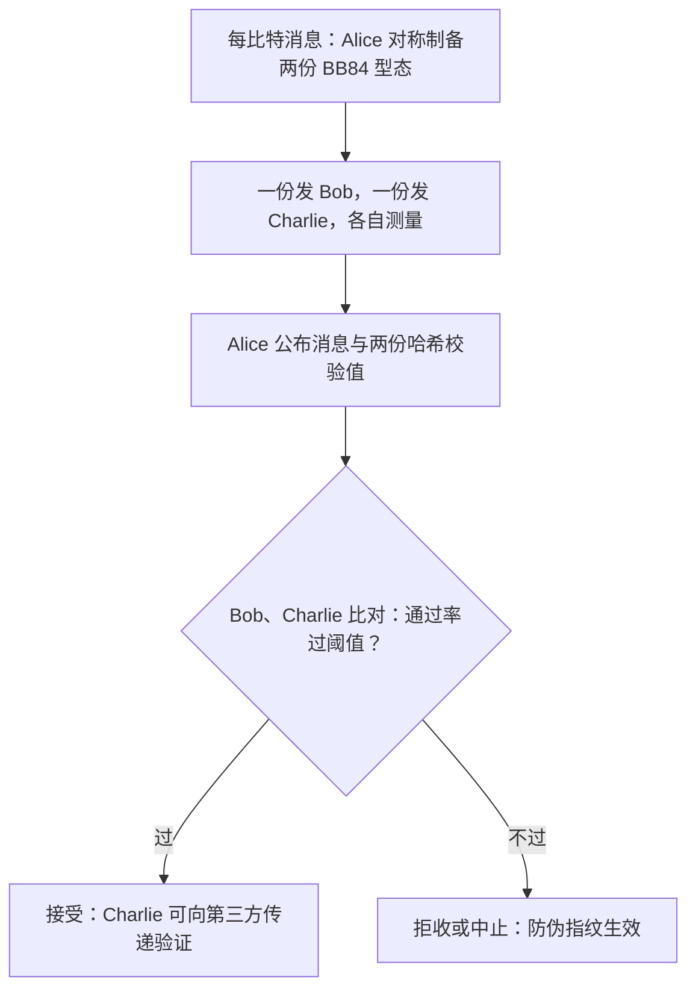

# $\rm Chapter \, 5$ 量子随机数与量子签名：随机性与真实性也入账

> **本章假设你已经会**（先勾选，做不到就先回读）
>
> 1. 最小熵 ${H_{\min} = -\log_2 p_{\rm guess}}$ 与剩余哈希引理（隐私放大按最小熵计价）：第 2 章 §2.4；
> 2. CHSH 熵证书公式与两端点推导：§4.2；
> 3. 熵与条件熵的记号：[《信息论》§1.1](../47-信息论/01-熵与编码下界.md)；互信息三副面孔：[§2.1](../47-信息论/02-互信息与数据处理不等式.md)；
> 4. 签名与 MAC 的分野、公开可验证性：[《密码学》§6.4](../24-密码学/06-RSA与签名.md)；
> 5. Shamir 秘密分享的插值拆分：[《密码学》§9.3](../24-密码学/09-零知识与秘密分享.md)；
> 6. 第 1 章 §1.4.1 埋下的生成层伏笔与 §4.4.2 结尾留的口子。

前四章把保密做成了物理：密钥分发的信任从假设压到公理。但一条密码学纵深上还站着两位没被物理接管的角色。一位是随机性：§4.4.2 的认证格出题要真随机，§4.5 的自由选择假设要真随机，第 1 章 §1.4.1 的生成层更是整条密钥流水线的地基，而「真随机」三个字到本章为止只是一句口号。另一位是真实性：签名（digital signature）在经典世界里靠陷门单向函数与 PKI 支撑（密码学册第 6 章），Shor 之后的算力曲线让这套假设值得重新问一次本章的总问题：trust 能不能也变成物理？物理设备本身又会不会成为新的假设？本章把两位角色一起入账：量子随机数发生器（quantum random number generator，QRNG）的熵从造出来到算出来，量子数字签名（quantum digital signature，QDS）与量子秘密共享（quantum secret sharing，QSS）把真实性与拆分也交给量子态。学完本章，你能对一段随机数输出流挑出合适的熵估计器、说出它的保守性从哪来，并能讲清 QDS 与经典签名各把信任押在哪张牌上。

## $\rm \S \, 5.1$ 问题：信任根的两位候选人

随机性在本书里一直是被消费而非被审查的角色。第 2 章的安全证明假设设置选择均匀，第 4 章的证书把这个假设升格为公理，但公理不负责生产：总得有一台设备真的吐出不可预测的比特。这件事的难点不在产生而在担保，物理学里满地都是随机过程（热噪声、真空涨落、光子过分束器），难的是回答「我怎么知道它没有后门」。一台被动手脚的发生器照样在飞快地吐比特，§1.5 威胁谱的第 4 档对手恰好就住在设备里。所以 QRNG 的核心问题不是怎么造，而是怎么估：给一段输出流，给出一个**有保证的**随机性下界，保证的形式在第 2 章 §2.4 已经定好，就是最小熵。

真实性那边，经典签名的信任清单有两行：陷门单向函数（Shor 之后对 RSA 与 ECC 这两行都要重新计时，第 1 章 §1.2 的口径）与 PKI 的分发链。量子侧的答卷思路与 QKD 一脉相承：把「只有本人能产生」从数学难题换成物理事实，用不可克隆定理与测量扰动当防伪标记。代价照例是同一条：物理设备自己成了新的假设。本章对三个主角都用同一套问题审查：信任清单上写了谁、担保从哪来、清单又添了什么新假设。

> 本节小结：随机性缺的是担保不是产生，担保的币种是最小熵；真实性缺的是不依赖算力曲线的防伪；三个主角（QRNG、QDS、QSS）各自把一行经典信任清单换成物理，再各自添上新设备假设。

## $\rm \S \, 5.2$ QRNG 两档：熵是造出来的，更是算出来的

### $\rm \S \, 5.2.1$ 两档信任清单

QRNG 分两档，分界线就是第 4 章那条信任清单。设备相关（device-dependent，DD）档信任设备：光源、探测器、后处理电路都在清单上，协议只审计输出流的统计。设备无关（device-independent，DI）档把设备整体开除，只信 §4.5 那三条公理，随机性从贝尔测试的得分里领证书，设备的内部申报一概不看，得分够高本身就构成自测试（self-testing，§4.2.3 的刚性）。两档回答的问题不同，先把问题钉死：DD 档问「设备诚实的前提下，这段输出有多可预测」；DI 档问「设备就算是我敌人造的，得分能强制它吐出多少随机」。两个问题的答案都记在 ${H_{\min}}$ 的账上，因为剩余哈希引理按它计价（第 2 章 §2.4）。

| 档位 | 信任清单上还剩谁 | 审计对象 | 担保形式 |
| --- | --- | --- | --- |
| DD | 光源、探测器、后处理、无侧信道 | 输出流的边缘分布 | 统计区间（覆盖 ${1-\varepsilon}$） |
| DI | 三条公理（§4.5） | 贝尔得分 | 熵证书（最坏情形优化） |

清单短一行，价签贵一截：DI 档要为贝尔测试牺牲四分之三以上的轮次（§4.3 的审计税），DD 档的代价换成了第 1 章 §1.5 第 4 档对手的开口。

### $\rm \S \, 5.2.2$ DD 档三台估计器：同一本账，三种放大镜

设输出流长 $N$，符号 ${0, 1}$ 各出现 ${n_0, n_1}$ 次。三台 DD 估计器读同一本账，差别在统计量与修正方式。

第一台：频率估计（plug-in）。直接把最频符号频率代入定义：

$$
\hat p = \frac{\max(n_0, n_1)}{N},
\qquad
\hat H = -\log_2 \hat p .
$$

读法：$\hat p$ 是「闭着眼猜最频符号」的命中率估计。这台估计器的毛病是**它根本不是下界**。$\hat p$ 是 $p$ 的无偏估计，但 ${-\log_2}$ 是凸函数，Jensen 不等式给出 ${\mathbb{E}[\hat H] \ge -\log_2 p}$：这台表的读数**平均偏高**，当它当下界用，超真值的概率接近一半。§5.3 的 B 段会用 400 次重抽样的覆盖率把这个毛病钉在数字上。

第二台：检验-估计（test inversion）。先立假设检验再反解：拿候选概率 $p$ 算出最频计数的预测分布，凡预测明显低于观测的候选都被拒（数据比它偏得多），与观测相容的最小 $p$ 就是 ${p_{\rm up}}$。用中心极限定理的正态近似（玩具口径；精确版对二项分布直接反演，即 Clopper–Pearson 区间）：

$$
p_{\rm up} = \hat p + z_{\varepsilon}\sqrt{\frac{\hat p(1-\hat p)}{N}},
\qquad
H_{\rm lb} = -\log_2 p_{\rm up},
$$

读法：$z_{\varepsilon}$ 是单侧 $\varepsilon$ 水平的正态分位数（${\varepsilon = 0.01}$ 时 ${z \approx 2.33}$）；罚项宽度按 ${1/\sqrt{N}}$ 收缩，样本越长区间越窄，熵下界越逼近真值。这台机器的保守性是**买来的**：罚项就是买 ${1-\varepsilon}$ 覆盖率的价格。

第三台：最频值分块估计器（most-common-value，MAV）。把流切成 $M$ 块、每块 $b$ 比特，记第 $i$ 块中多数符号出现的次数 ${s_i = 8 + \lvert k_i - 8\rvert}$（$b = 16$、$k_i$ 为该块中 $1$ 的个数），统计量取总和 $T = \sum_i s_i$。假设最频概率为 $p$ 时 $k$ 服从二项分布，$s$ 的分布由它精确枚举：

$$
P(s = m) = \binom{16}{m} p^m (1-p)^{16-m} + \binom{16}{16-m} p^{16-m} (1-p)^m,
\qquad m = 9, \dots, 16,
$$

读法：块内多数符号出现 $m$ 次，等价于 $1$ 出现 $m$ 次或 $0$ 出现 $m$ 次，两支概率相加；${m = 8}$ 时两支重合，概率恰是中间那格 ${\binom{16}{8} p^8 (1-p)^8}$。由这 17 格直接算出 ${\mathbb{E}[s]}$ 与 ${\sigma_s^2}$（$M$ 块求和后按独立近似给 ${\sigma_T = \sqrt{M}\,\sigma_s}$，块间独立在本节源假设下精确成立），再对 $T$ 重复第二台的思路：找最小的 $p$，使 ${\mathbb{E}[T] - z_{\varepsilon}\sigma_T \ge T_{\rm obs}}$，那个 $p$ 就是 ${p_{\rm up}}$。数值先钉两个锚：本节参数下 ${\mathbb{E}[s]}$ 在 ${p = 1/2}$ 处为 ${9.5710}$，在 ${p = 0.52}$ 处为 ${9.5911}$，挪动量 ${0.0201 \approx 50\,(0.02)^2}$。这台机器藏着一件值得单独看的事：它的敏感度在均匀点附近是**二阶的**。求导（对二项分布逐项求 ${\partial P(k)/\partial p}$ 后加权求和）：

$$
\frac{\partial\, \mathbb{E}\lvert k-8\rvert}{\partial p}
= \frac{\mathbb{E}\bigl[\lvert k-8\rvert\,(k-16p)\bigr]}{p(1-p)}
\;\xrightarrow{\;p \to 1/2\;}\;
\frac{\mathbb{E}\bigl[\lvert k-8\rvert\,(k-8)\bigr]}{1/4}
= 0,
$$

读法：$p = 1/2$ 附近二项分布关于 $8$ 对称，${(k-8)\lvert k-8\rvert}$ 是奇函数，期望逐项相消；把 $p$ 从 $1/2$ 推开，${\mathbb{E}\lvert k-8\rvert}$ 只按 ${(p - 1/2)^2}$ 的速度挪动（本节实验参数下系数约 $50$）。白话：这台放大镜量的是「波动幅度」，而波动幅度在均匀点两侧长得一样，它分不清偏向哪边，只好用更宽的区间赔这笔失明。§5.3 的 A 段会看到后果：近均匀区它保守得吓人，偏置上来之后反而追平直接计数。

> 本节小结：plug-in 平均偏高、无下界资格；检验-估计按 ${1/\sqrt{N}}$ 买覆盖率；最频值分块的敏感度在均匀点是二阶的，近均匀区显著更保守。三台都只审计输出流的边缘分布，设备本身躺在信任清单上。

### $\rm \S \, 5.2.3$ DI 档第四台：熵证书

第四台估计器换了一本账。它不读输出流，读的是同一台设备跑贝尔测试的得分 $\hat S$，扣有限统计罚项得 ${S_{\rm low}}$，再套第 4 章 §4.2 的证书公式：

$$
H_{\min}(A_0, B_0 \,\vert\, E) \;\ge\; 1 - \log_2\!\left(1 + \sqrt{2 - S_{\rm low}^2/4}\right).
$$

读法：右边是每个生钥轮的熵下界，输入端**只有得分**。这正是它与前三台的本质差别：证书按 §4.2.4 的最坏情形优化覆盖一切与得分相容的量子实现，输出的边缘偏不偏、设备内部怎么选，都是被覆盖的「内部选择」之一，只有得分这个总闸门进账。一台边缘偏置严重但贝尔得分漂亮的设备，前三台会吓得狠扣熵，证书却照常发证。自举的口子也要如实记下：证书出题用的设置选择随机性本身得有来源，现实方案常用低档 DD 源出题、DI 证书产随机数，信任逐级抬升（文献定性，工程口径见 §5.6）。

> 本节小结：DI 档把「估熵」换成「用得分买熵」，偏置不进输入端；出题随机性的自举是它的新假设。

## $\rm \S \, 5.3$ 实测：四台估计器对账与后选择漏洞

实验脚本 `exp1.py`（WSL 的 python3 加 numpy 2.5.4，种子 20261112，总耗时约 3 秒）做四件事。A 段造一条合成偏置源：独立同分布的伯努利流，最频概率 ${p = 0.5 + \delta}$，真值已知，三台 DD 估计器同台读账；D 段在 DI 轨道上跑 ${10^6}$ 轮贝尔测试，按 §4.2.2 的角族（${\theta = 45^\circ}$）生成带可见度 $v$ 的关联，算 $\hat S$、${S_{\rm low}}$ 与证书熵；B 段用 400 次重抽样检查各估计器的覆盖率；C 段单独加一个后选择漏洞的玩具。本节所有数字出自该脚本的输出。

**A、D 段：四台同台。** A 段对偏置 $\delta$ 扫描（${N = 10^6}$，${\varepsilon = 0.01}$），D 段固定角族扫可见度：

| $\delta$ | 真值 ${H_{\min}}$ | 频率 plug-in | 检验-估计 | 最频值（块） |
| --- | --- | --- | --- | --- |
| ${0.000}$ | ${1.0000}$ | ${0.9993}$ | ${0.9960}$ | ${0.9480}$ |
| ${0.005}$ | ${0.9856}$ | ${0.9838}$ | ${0.9804}$ | ${0.9504}$ |
| ${0.010}$ | ${0.9714}$ | ${0.9711}$ | ${0.9679}$ | ${0.9710}$ |
| ${0.020}$ | ${0.9434}$ | ${0.9432}$ | ${0.9399}$ | ${0.9280}$ |
| ${0.050}$ | ${0.8625}$ | ${0.8641}$ | ${0.8611}$ | ${0.8615}$ |

| $v$ | ${\lvert\hat S\rvert}$ | ${S_{\rm low}}$ | 证书 ${H_{\rm lb}}$（比特/轮） |
| --- | --- | --- | --- |
| ${1.00}$ | ${2.8272}$ | ${2.8187}$ | ${0.8402}$ |
| ${0.98}$ | ${2.7723}$ | ${2.7637}$ | ${0.6206}$ |
| ${0.97}$ | ${2.7430}$ | ${2.7342}$ | ${0.5543}$ |
| ${0.95}$ | ${2.6856}$ | ${2.6767}$ | ${0.4570}$ |

三行读数值得逐台点名。1. plug-in 在 ${\delta = 0.05}$ 行报出 ${0.8641}$，**超过真值** ${0.8625}$：这不是脚本写错，是 Jensen 偏高的现场演示，它当下界用的资格在 A 段就被吊销了。2. 检验-估计五行全部低于真值，${\delta = 0.02}$ 行的价签是 ${0.9434 - 0.9399 = 0.0035}$ 比特，恰约为罚项 ${z\sqrt{p(1-p)/N}}$ 换算成比特的宽度。3. 最频值分块印证二阶敏感的预言：${\delta = 0}$ 行只敢报 ${0.9480}$（区间宽到 ${p_{\rm up} = 0.518}$，而真偏置是零），${\delta \ge 0.01}$ 后导数恢复到可用量级，与直接计数几乎重合（${\delta = 0.05}$ 行 ${0.8615}$ 对 ${0.8611}$）。4. 证书一列对 $\delta$ 只字不提：D 段的模拟里偏置根本没放进 DI 轨道，这不是省事，是 §5.2.3 那句话的字面兑现，证书的输入端没有边缘分布这个插槽。两档口径的差在同一台设备上看得最清楚：${v = 0.98}$、${\delta = 0.02}$ 的设备，DD 档敢说 ${0.9399}$ 比特（条件：设备诚实），DI 证书只敢说 ${0.6206}$ 比特（条件：三条公理）。两列不可比大小，条件对象不同，贵的不是数字是担保强度。

**B 段：覆盖率的证据式排查。** 估计器的资格要用覆盖率查：重抽 400 条流（${\delta = 0.02}$，${N = 10^5}$），数每台读数低于真值的比例：

| 估计器 | 覆盖率 | 平均（真值-估计）差 |
| --- | --- | --- |
| 频率 plug-in | ${0.512}$ | ${+0.00019}$ 比特 |
| 检验-估计 | ${1.000}$ | ${+0.01035}$ 比特 |
| 最频值（块） | ${0.993}$ | ${+0.03747}$ 比特 |

plug-in 的读数平均贴着真值、哪边都敢去，像一枚硬币：当它当下界用，约一半的申报是错的，而错误的方向永远是**多报熵**，正合对手的胃口。检验-估计覆盖率 ${1.000}$ 高于标称 ${0.99}$，是正态近似在小样本端偏保守的余量（精确反演会把 ${1.000}$ 收回 ${0.99}$ 附近）；最频值 ${0.993}$ 同样达标，代价是平均多让出 ${0.037}$ 比特。

**C 段：后选择漏洞，估计器的集体盲区。** 玩具设定：底层源公平（${p = 0.5}$），设备只保留「本轮比特与上一轮比特相等」的事务（接受率 ${0.5}$），把保留下的比特当输出流。三态马尔可夫链能把它精确算死。记当前保留值为 $s$；下一轮底层比特不变（概率 ${1/2}$）则立即保留且值仍为 $s$，翻转（概率 ${1/2}$）则进入「未保留、值为 ${1-s}$」的状态。设 $q_A$、$q_B$、$q_C$ 为三个状态下「下一个保留值等于 $s$」的概率，状态 $A$（刚保留值 $s$）、$B$（未保留值 ${1-s}$）、$C$（未保留值 $s$）的转移方程：

$$
q_A = \tfrac12 + \tfrac12 q_B, \qquad
q_B = \tfrac12 q_C, \qquad
q_C = \tfrac12 + \tfrac12 q_B .
$$

从后两式解出 ${q_C = 2/3}$、${q_B = 1/3}$，代回得 ${q_A = 2/3}$：给定当前保留比特，下一保留比特有 ${2/3}$ 的概率与它相等，条件最小熵 ${-\log_2(2/3) \approx 0.5850}$ 比特。实测：保留率 ${0.5001}$；保留流的边缘完全均匀，频率估计报出 ${p = 0.50083}$、${H = 0.9976}$ 比特；转移实测 ${P(\text{next} = \text{cur}) = 0.6670}$，条件熵 ${0.5831}$；相邻保留比特对的互信息实测 ${0.0820}$ 比特（理论 ${0.0817}$，按信息论册 §2.1 的口径逐格计算）。三组数并列就是本节最扎眼的一行：**频率估计报满 ${1}$ 比特，真实条件熵只有 ${0.5831}$**。

漏洞的机理比数字更重要。后选择把熵从边缘挪进了两个频率估计器不看的通道：转移结构（相邻保留比特相关）与保留模式本身（哪些轮被留下）。这正是一类真实事故的形状：保留判据与底层比特相关时，筛选后的流可以边缘完美而系统性地带记忆，只审计输出的送检流程对它全盲（工程惯例：送检对象必须是含保留标志与时间戳的完整事务记录，文献与标准口径定性）。机场统计弹孔的教训在密码学里换了个名字：你只看见被放行的轮次，被丢弃的轮次才是信息去的地方。

> 竞赛生迁移提示：本章的仿真不含量子态级模拟。三台 DD 估计器只消费伯努利随机数与二项分布枚举，后选择玩具只消费 ±1 比特流的切片，DI 轨道也只消费关联抽样与四格计数，numpy 向量化就是终点。判断一层仿真该不该上态级工具，看账面上还剩不剩相干性：本节账面上只剩概率与计数，与量子通信册 §6.5 的判据同款。

**自检汇总。** 脚本收尾对五项做了通过/失败断言，全部通过，这几行也值得抄进正文，因为它们是数字可信的凭据。1. 三态链定点数值迭代收敛到 ${q_A = 2/3}$，与闭式一致；2. 证书公式两端点成立：${S = 2}$ 给 ${0}$、${S = 2\sqrt2}$ 给 ${1}$；3. 两台检验反演估计器的覆盖率都不低于标称（${1.000}$ 与 ${0.993}$），plug-in 如预期停在 ${0.512}$；4. 后选择玩具的保留率与转移概率都落在闭式的蒙特卡洛容差内；5. 四组 $v$ 下理论关联满足 ${\lvert S\rvert = 2\sqrt2\, v}$，与抽样账对齐。

> 本节小结：plug-in 一半概率多报熵（覆盖率 ${0.512}$），检验-估计按 ${1/\sqrt{N}}$ 买保证，最频值近均匀区保守、偏置上来后追平；证书只认得分、对偏置免疫；后选择能把 ${1}$ 比特的账面做成 ${0.5831}$ 比特的实货，估计器的盲区在保留判据，不在输出流。

## $\rm \S \, 5.4$ 量子数字签名：真实性也入账

### $\rm \S \, 5.4.1$ 缺口与目标

密码学册 §6.4 把签名的任务定义成「公开可验证的真实性」：任何人都验得了、只有持有人造得出。经典方案把「造不出」押在陷门单向函数上（RSA 与 ECC，密码学册第 6、7 章），把「验」押在 PKI 分发链上。量子侧的原始构想（Gottesman–Chuang 2001）走另一条路：签名本身就是量子态，伪造它要面对不可克隆定理。但原始方案的态要在验证间传递、又要求可靠的量子存储，工程上难落地；后来的一族改进方案把量子态的用途收缩成「把一份一次性密钥安全送到双方手里」，其余交给经典哈希（文献定性），才是实验追随的形态。

### $\rm \S \, 5.4.2$ 改进版逐轮：一式两份的挂号信

改进版 QDS 把签名拆成「分发」与「认证」两段。分发段对每比特消息，Alice 向 Bob 与 Charlie 各发一份 BB84 型量子态，两份的制备经对称化处理，使双方各自测得「半个签名」：任何一方单独的测量结果都带测量扰动的指纹，伪造者想同时满足两边几乎不可能（不可克隆与测量扰动，量子通信册 §1.3、§2.3 的同一笔账）。认证段是纯经典的：Alice 公布每比特消息的两份哈希校验值，Bob、Charlie 各拿自己的测量结果比对，通过率过阈值才接受。数据流如下：

担保的性质要记三条（密码学册 §6.4 口径在量子语境的对应）。1. **不可伪造**（unforgeability）：没有态的第三方造不出能过双方校验的签名，防伪标记是测量扰动；2. **可传递**（transferability）：Bob 验过之后能把签名转交 Charlie，Charlie 独立校验仍通过，这要求 Bob 转交的不能是他自己的测量记录（记录无法复现另一方的校验），而是态或密钥材料本身；3. **不可抵赖**（non-repudiation）：签名过校验后，Alice 无法抵赖，因为校验值绑定她公布的哈希。三条性质由同一个阈值参数捏在一起：放松阈值，伪造更难但传递更易失败或更易中止，收紧则反之，工程上按应用选点（文献口径）。

强度声明照例要配代价的账。安全声明是信息论级的：伪造者的处境不依赖任何计算难题，只依赖量子力学的两条老事实（不可克隆、测量扰动）加哈希的用量口径（哈希在这里按信息论口径使用，密码学册 §3 的计算性碰撞抗性只影响哈希的具体选择）。代价是**一次性**的：每比特消息烧一份态，签名不重用。这与第 1 章 §1.4.2 的 OTP 密钥消耗账同款，也和 §4.3 的三笔税同款：信任抬到信息论级，产量就按物理资源计价。工程现状（文献定性）：光纤多用户网络演示已实现，速率在千比特每秒量级以下、距离公里级，属原理演示阶段；与 QKD 的组合是现实折中，用 QKD 分发的密钥跑哈希认证段、用量子分发段保防伪，正是第 6 章组合策略的一块预铺。

## $\rm \S \, 5.5$ 量子秘密共享：把拆分交给纠缠

经典秘密分享（密码学册 §9.3 的 Shamir 方案）把秘密编进多项式的系数，$t$ 人合作才能插值还原，信任清单上有两行：分发者要诚实，分发信道要安全。QSS（Hillery–Bužek–Berthiaume 1999）把「拆分」本身交给纠缠态。三方共享一个 GHZ 态

$$
\lvert \mathrm{GHZ} \rangle = \frac{1}{\sqrt2}\bigl(\lvert000\rangle + \lvert111\rangle\bigr),
$$

约定三方都在横基（$X$ 基）测量。乘积恒正的凭据是一条本征态账：${\lvert000\rangle}$ 过 ${X\otimes X\otimes X}$ 得 ${\lvert111\rangle}$，${\lvert111\rangle}$ 过同一算符得 ${\lvert000\rangle}$（$X$ 翻转每个比特），于是

$$
X\otimes X\otimes X \,\lvert \mathrm{GHZ} \rangle = \lvert \mathrm{GHZ} \rangle ,
$$

读法：GHZ 态是 ${X\otimes X\otimes X}$ 本征值 ${+1}$ 的本征态，而算符的本征值等于三个测量结果的乘积，所以任一轮三方结果的乘积必为 ${+1}$。把 Alice 的份额记 $a$，就有一比特的拆分结构：${a = b \cdot c}$，Bob 与 Charlie 各自测量后把结果一乘，Alice 的比特无损还原。单看 Bob 自己，边缘一半 ${+1}$ 一半 ${-1}$、与 $a$ 独立，一人什么也得不到；拆分这件事不再靠分发者的算术，靠的是乘积恒正这条物理事实。防欺也顺路解决：抽部分轮次在对角基交叉校验，参与者单方面换基测量会破坏乘积规律而暴露（HBB99 原方案机制，文献定性）。工程现状（文献定性）：三方纠缠分发的损耗随参与者数增长，速率远低于点对点 QKD，现实里更常见的是折中形态，用 QKD 给每人发密钥再跑经典 Shamir，量子只保分发段，与 §5.4 的组合思路同一套。

> 本节小结：QSS 用 GHZ 的乘积关联把「$t$ 人合作才可读」物理化，单方独立、合作还原、换基暴露；工程上多与 QKD 加经典方案折中。

## $\rm \S \, 5.6$ 适用条件与限制

1. 估计器的口径先于数字。DD 三台都假设流是独立同分布的；带记忆的源要专门的估计器族（Markov 型、Lag 型，NIST SP 800-90B 口径，文献定性），本节的块统计量在独立源上未必是首选。置信水平 $\varepsilon$ 是申报的一部分：本章取 ${0.01}$ 是玩具口径，正式申报常用 ${2^{-32}}$ 量级，罚项相应变宽。侧信息不在覆盖范围：DD 估计器只对输出流负责，Eve 从设备物理侧（功耗、时序、光泄漏）学到的不进账，第 1 章 §1.5 第 4 档对手的开口在 DD 档始终存在。
2. 后处理要计入总账。估出的 ${H_{\min}}$ 是原料，按剩余哈希引理压缩提取时还要扣提取器参数，最终密钥率低于估计值；「估计器报多少」与「能发多少密钥」是两行账（第 2 章 §2.4 口径）。
3. DI 档的现实（文献定性）。速率比 DD 档低多个数量级，原因承接 §4.5：得分要逼近 Tsirelson 界才大方，真实器件的可见度同时压三笔税。出题随机性的自举靠组合抬升，组合的威胁覆盖账第 6 章收束。
4. QDS 的边界。一次性消耗随消息长度线性增长，长消息按块处理；两方分发结构（Bob、Charlie 各持一份）是标准形态，多方推广与可重用签名是活跃方向（文献定性）。哈希校验段的密钥用量与碰撞概率的口径要分开记，混在一起会把信息论声明稀释成计算声明。
5. QSS 的边界。GHZ 分发在损耗信道上随参与方数放大，防欺轮次的牺牲率是阈值参数的另一笔税；经典折中（QKD 密钥加 Shamir）的信息论担保与纯 QSS 并不等价，前者信任清单上多一行「分发段」。

## $\rm \S \, 5.7$ 关键概念回顾

1. DD 档与 DI 档估计器回答的问题差在哪一个字上？两档的数字为什么不可直接比大小？
2. 频率 plug-in 为什么没有当下界的资格？Jensen 不等式在这件事里给出的是偏哪边的系统性偏差？
3. 最频值分块估计器的敏感度为什么在 ${p = 1/2}$ 处是二阶的？这一性质如何表现为近均匀区的保守性？
4. 熵证书的输入端有哪几个量？偏置为什么不进证书？出题随机性的自举是怎么安排的？
5. 后选择漏洞把熵从哪个通道挪到了哪个通道？频率估计器为什么对它全盲？

## $\rm \S \, 5.8$ 应用与辨析

1. 某供应商申报：「我们的 QRNG 输出流做了频率检验，${N = 10^9}$ 的样本里最频符号占比 ${0.5000002}$，故输出携带 ${1.0000}$ 比特每比特的熵，满足 OTP 供钥需求。」逐条指出这份申报的口径问题，并写出一条能把它问住的追问。
2. 一台 QRNG 的运维记录显示保留率（输出轮次占产生轮次的比例）随时间漂移，输出流的频率检验始终通过。结合 §5.3 C 段说明该不该停机，停机判据该看哪个统计量。
3. 团队要在长消息文件上做 QDS。有人提议：「把文件哈希成 256 位再签，态的消耗从文件长度降到 256 比特。」这个提议动了哪笔账？哈希在这里按什么口径使用，安全声明会掉级吗？

## $\rm \S \, 5.9$ 本章自测答案

概念回顾答案：

1. 差在条件对象：DD 档条件是「设备诚实」，DI 档条件是「三条公理成立」（§5.2.1）。同一台设备上 DD 敢报 ${0.9399}$、DI 证书只报 ${0.6206}$（§5.3 A、D 段），后者贵在担保强度，两列度量的对象不同，比大小无意义。
2. $\hat p$ 无偏但 ${-\log_2}$ 是凸函数，Jensen 给出 ${\mathbb{E}[\hat H] \ge -\log_2 p}$：读数平均偏高（§5.2.2）。B 段覆盖率 ${0.512}$ 是它的实证，且出错的方向恒为多报熵。
3. $p = 1/2$ 附近二项分布关于块中心对称，${\mathbb{E}\lvert k-8\rvert}$ 的导数按对称性逐项相消，只能以 ${(p-1/2)^2}$ 挪动（§5.2.2）。于是同样的置信水平反演出宽得多的区间：${\delta = 0}$ 行只敢报 ${0.9480}$（§5.3 A 段）。
4. 输入端只有得分 ${S_{\rm low}}$ 与有限统计罚项；偏置属于「与得分相容的内部选择」，被最坏情形优化覆盖（§5.2.3）。自举：出题随机性用低档 DD 源供给，DI 证书产出的随机数更干净，信任逐级抬升。
5. 从边缘挪进转移结构与保留模式（§5.3 C 段）。频率估计器只读输出流的边缘分布，而后选择恰把偏置藏进「哪些轮被放行」，边缘完美而带记忆，故全盲。

应用与辨析答案：

1. 三处问题。其一，${N = 10^9}$ 的罚项宽度约 ${z\sqrt{0.25/10^9} \approx 3.7\times10^{-5}}$（$\varepsilon = 0.01$），${0.5000002}$ 的占比只值 ${1.0000}$ 的**下界**，报满值本身就错；其二，频率检验只覆盖边缘分布，C 段演示了边缘均匀而条件熵 ${0.5831}$ 的反例，须追问：送检的是输出流还是含保留标志的完整事务记录？保留判据与底层比特是否独立？其三，「满足 OTP 供钥需求」还差后处理账与侧信息账（§5.6 第 1、2 条），${H_{\min}}$ 是原料不是成品。
2. 该停机（或至少隔离检修）。保留率漂移说明保留判据与产生过程相关，正是 C 段漏洞的形状：频率检验对它盲，通过不能作为安全证据。判据看两个量：保留率本身是否稳定（漂移即异常），以及转移类统计量（相邻保留比特的相关、互信息）是否偏离 ${0.5}$ 与 ${0}$（C 段实测 ${0.6670}$ 与 ${0.0820}$ 是病态样本）。
3. 动了「一次性消耗随消息长度线性增长」这笔账，把态消耗从文件长度压到常数，代价是把文件的安全性改记到哈希上：哈希必须按抗碰撞口径使用（密码学册 §3.1 的链），而哈希本身是计算性原语，QDS 的信息论声明随之降为「量子分发段信息论、哈希段计算」的混合声明。是否接受降级取决于威胁模型要防的是第 1 章 §1.5 的哪几档：只防量子存储受限的当下对手，降级可以接受；要把算力曲线整个移出信任清单，就按块逐段签，账按 §5.6 第 4 条记。

**你现在能做什么**：拿到任何一份 QRNG 的熵申报，先问三句：估计器是哪台、置信水平是多少、送检的是输出流还是完整事务记录；答不上任何一句，申报的数字就先按没有担保处理。

随机性与真实性都入了账，量子密码的纵深还剩最后一块拼图：这些方案到了真实网络里是什么价钱、什么速率，标准化文件怎么写，以及「量子加经典」的组合策略到底该在哪个威胁档用哪一件。下一章把全部方案放上同一张工程现实的天平，收束全册。

> **实验复现说明**：本章 §5.3 全部实测数字来自脚本 `exp1.py`（三台 DD 估计器对合成偏置源的 δ 扫描、400 次重抽样的覆盖率核查、后选择漏洞的三态马尔可夫链闭式与模拟对账、DI 轨道 ${10^6}$ 轮贝尔测试的证书熵对 $v$ 扫描；python3 加 numpy 2.5.4，WSL 运行，种子 20261112，总耗时约 3 秒），原始输出存于写作工作目录 `26Fall/_uni5_work/expQX05/result.txt`，重跑可逐位复现表中数字。
