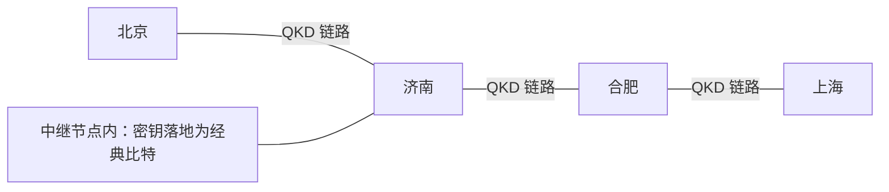

# $\rm Chapter \, 6$ 工程现实与收束：把信任清单拿到现网去审计

> **本章假设你已经会**（先勾选，做不到就先回读）
>
> 1. 威胁谱的二维坐标：算力轴一格、物理轴一格，以及全册心智模型「信任从假设变成物理，但物理设备本身又成了新的假设」：本册 §1.5；
> 2. QKD 的密钥率缺口账：一次一密的消耗速率与实际产率之间的 gap 模型：本册 §1.4；
> 3. 部署前检查表：块长、有限码长口径、中止处理逐项要齐：本册 §2.6；
> 4. 威胁建模五问与最弱环原则：[安全册 §1.5](../76-计算机安全/01-威胁模型与安全原则.md)、[§1.4](../76-计算机安全/01-威胁模型与安全原则.md)；
> 5. 后量子密码（post-quantum cryptography，PQC）的动机与 LWE 假设栈：[格与密码册 §6.1](../56-格与密码/06-LWE与后量子密码.md)。

前五章的账都算在协议里：口径、证明、拓扑、公理。这一章把账搬到协议外面去。任何一套量子密码方案最终都要回答三个协议之外的问题：装进现网是什么样（谁替它付机房钱、光纤钱、中继钱）；标准文档里是什么样（谁把「设备申报」变成可审计的条文）；和经典密码怎么搭配（两层密钥捏在一起，安全到底按谁的算）。回答完这三问，本章再做它的第二份工作：收官。全册六章拧成一张收束表，每一章解决哪个威胁、留下哪行假设，逐格对账；最后把四条接口接到 85 册、76 册、24 册与 56 册上，标清各自管哪一段。

## $\rm \S \, 6.1$ 从论文到现网：部署案例告诉我们的三件事

现网案例的数据一律取公开资料口径，定性标注，不做任何实测声称。最大的一个公开案例是京沪干线（公开资料：2017 年开通，全长约 2000 公里，公开报道口径）：它不是北京一根光纤直通上海，而是一串点到点量子链路，中间站着一批可信中继（trusted relay）节点。



> **常见错误**：把「京沪干线是量子网络」读成「量子态从北京一路飞到上海」。实际形态是逐段 QKD 加可信中继：量子态每段只跑百公里量级，跨段传送的是经典密文与落地密钥。纯粹的「全程量子」现网并不存在，这个事实就是 §6.5 收束表里「中继」这一行的来历。

第一件事：**可信中继是信任清单上新的一行**。量子态跑不满 2000 公里（损耗按指数掉，量子通信册 §6.4 的账），密钥必须在每个中继节点落地成经典比特、存进保险柜、再往下一程送。这与第 1 章 §1.5 的威胁谱对上：链路被听这一档，物理定律管得住；中继被控这一档，管得住的只剩机房门禁。心智模型在这里完成一次闭环：把信任从假设搬到物理，物理链路又把「中继的保险柜」这行新假设搬了回来。卫星方案（「墨子号」2016 年发射、星地千公里量级链路，公开资料，定性）把中继搬到天上，信任清单同样不为零：瞄准、时钟、星载设备，每一行都要单独审。

### $\rm \S \, 6.1.1$ 可信中继的接力账

中继怎么接力，值得用最小模型走一遍，因为它决定了信任清单的形状。把链路切成两段：Alice 与中继 R 之间跑 QKD 建立密钥 $K_1$，R 与 Bob 之间跑 QKD 建立密钥 $K_2$。要把报文 $m$ 从 Alice 送到 Bob，Alice 发 ${c_1 = m \oplus K_1}$；R 收到后解出 $m$，再发 ${c_2 = m \oplus K_2}$；Bob 用 $K_2$ 解出 $m$。每一段上的中间量都是一次一密：$c_1$ 对 Eve 均匀（$K_1$ 均匀且只用一次），$c_2$ 同理，两段各自动用第 1 章 §1.2.1 的两行证明。代价有两条。其一，R 必须同时握有 $K_1$ 与 $K_2$，密钥在 R 的内存里短暂聚头，R 被控则这一段报文连同两把密钥一起失守：全程「信息论安全」的前提是 R 老实，这是清单上明码标价的一行。其二，接力吞吐量由两段密钥率中较弱的一段决定：R 要等两边的密钥都攒够才能转发。写成式子：设两段密钥率各为 $R_1$ 与 $R_2$，则全程接力吞吐量

$$
R = \min(R_1,\, R_2)
$$

读法：$R_1$、$R_2$ 是两段 QKD 各自的安全密钥率（单位比特每秒，第 1 章 §1.4 的产出口径），R 每转发一比特要同时烧掉左右两段各一比特，攒钥速度按较慢一侧计。这是安全册 §1.4 最弱环原则在流量维度的重演：链路加得再长，速度永远是最慢一段的速度。

第二件事：**现网的 QKD 密钥大多没有直接拿去一次一密**。本册 §1.4 的 gap 模型账算过：一次一密按比特烧密钥，QKD 的产率跟不上加密的流速，于是现网的标准做法是 QKD 密钥喂给 AES 这类对称算法，定期换钥。读清这笔账的后果很重要：现网方案的保密强度瓶颈又落回计算安全一侧，密钥分发是信息论的，加密层是计算的。这不是失败，是 §1.4 那笔经济账的正常解，但它把「量子＝信息论安全」这句宣传话拆穿了：全信息论的那条腿（OTP 覆盖全部流量）现网还没长齐。

第三件事：**成本不是线性，是台阶**。链路越远密钥率越低，顶穿阈值就得立中继站，每级台阶是一座机房的设备加运维钱（公开报道口径，量级高出普通电信设备一档以上，定性）。成本台阶与 §3.4 的 PLOB 界是同一件事的两面：物理定律先定天花板，会计再按天花板报价。

> **竞赛生迁移提示**：把部署案例当「输入规模」读。竞赛题里 n 变大算法才换；工程里距离变长、密钥率变低、威胁变重，方案才会换代。看懂一张部署图的第一问永远是：信任域的边界画在哪，边界上站着谁。

## $\rm \S \, 6.2$ 标准化：把设备申报变成台账

两套体系正在并行立规矩（以下均为公开资料，定性）。量子一侧：ETSI（European Telecommunications Standards Institute，欧洲电信标准协会）的 ISG-QKD 工作组自 2019 年起发布 QKD 模块与部署系列规范；ITU-T 的 Y.3800 系列建议书给出 QKD 网络的架构与密钥管理接口；ISO/IEC 23837 给出 QKD 产品的安全要求与测试评估框架。经典一侧：NIST 的后量子标准于 2024 年定稿（FIPS 203/204/205，对应格与密码册 §6 的 LWE 一线与哈希签名一线），各国的迁移时间表也以 PQC 为主线（公开资料，定性）。

标准化在心智模型里的位置值得单独说一句：它不消灭假设，它把假设写成白纸黑字。第 2 章 §2.6 的检查表要求「设备申报老实」，标准文档把「老实」拆成可送审的条文：光源强度允差多少、探测器暗计数上限多少、随机数发生器过哪些测试。信任清单从口头变成台账，审的人才有地方下笔。认证这一行同样进了条文：QKD 的经典后处理信道（基协商、纠错）必须认证，否则第 2 章 §2.1 的中间人攻击原样适用，标准框架要求认证密钥的建立与更新有明确规程（定性）。这与 §2.6 第 4 条的预共享密钥是同一件事的条文版：QKD 也要一小撮经典密钥来点火，信任清单的第一行不是量子给的。

也因此要防一个读法上的坑：**过了标准认证不等于覆盖了所有威胁格**。认证管的是申报与实现一致（设备申报那几行），端点失守、密钥管理失误这些格，标准给不了免死金牌（安全册 §1.4 的最弱环原则在这里照常生效）。

标准化版图上还有一条值得知道的路线分歧（公开资料，定性）：美国 NSA 的 CNSA 2.0 路线图只采用 PQC、不采信 QKD，理由是 QKD 的实现安全与成本证据尚不充分；中国的骨干网建设则把 QKD 当作高价值链路的实体工程来推。两条路线的分歧不在量子物理，在工程证据的充分性怎么判，这正是 §6.4 口径声明的现实版：同一张矩阵，参数与证据门槛不同，结论就不同。读任何一方的申报，先问一句它把哪些格记成了零、依据是什么。

## $\rm \S \, 6.3$ 组合策略：双保险的准确说法

### $\rm \S \, 6.3.1$ 双保险在概率上是什么

组合策略（hybrid，组合密钥）最常见的实现是把两层密钥逐比特捏在一起：

$$
K = K_{\rm pqc} \oplus K_{\rm qkd}
$$

读法：$K_{\rm pqc}$ 是 PQC 密钥协商的产出，$K_{\rm qkd}$ 是 QKD 链路的产出，$\oplus$ 是逐比特异或，合成会话密钥 $K$ 交给对称加密。这句话的保密语义可以先写一行：固定 $K_{\rm pqc}$ 的取值为任意 $k$，映射 ${K_{\rm qkd} \mapsto k \oplus K_{\rm qkd}}$ 是 $\{0,1\}^n$ 上的双射，所以只要 $K_{\rm qkd}$ 均匀，$K$ 必均匀，与 $K_{\rm pqc}$ 的取值乃至是否泄密都无关；反过来对称成立。双保险不是「两道锁」，是「任意一道锁是真的就够」：攻击者必须同时打穿两层才能见到 $K$ 的半个比特。完整的熵账（连不均匀的情形一起）在 §6.4 C 段证。

两层各自怕什么，放进一张表：

| 层 | 安全建立在哪 | 最怕什么 | 失效的样子 |
| --- | --- | --- | --- |
| PQC 层 | 数学假设（LWE 等） | 数学进步、先存后解 | 假设被破，存量密文回炉 |
| QKD 层 | 物理定律＋证明假设栈 | 设备申报不实、距离与产率 | 误码穿顶，协议自动中止 |

表格读法：两层的失效事件天然接近独立，一个活在数学里，一个活在物理里。§6.3.2 的乘法规则用的正是这个独立性，而它只在「两源分家」时成立，本节末尾会说它何时破产。为什么不是二选一？因为二选一是在两层各自的风险上下注，组合是买「至少一层成立」：PQC 怕的那几格，QKD 层信息论托底；QKD 怕的那几格，PQC 层不经量子设备。

但双保险不是万能药，它有一个明确的失效格：两层密钥最终要在一个端点里合成。端点被控，两把钥匙一起被抄走，叠加救不了，这一格留给 §6.4 的账来算清。

「什么时候用哪个」，按业务形态给出基于约束的建议（行业讨论的定性共识，非定理）：

| 业务形态 | 建议起点 | 理由（用 §6.3.2 的格说话） |
| --- | --- | --- |
| 普通商业数据，寿命短，无专线 | 纯 PQC | T4 由 PQC 假设栈承担且寿命短；QKD 的机房与中继钱付不起 |
| 长寿命高价值数据，有专线与机房 | 组合 | T1/T4 由 QKD 层托底，T3b 由组合覆盖，只剩 T3a 要端点加固 |
| 数学假设一分都不能押 | QKD＋OTP | 全信息论，但产率与端点代价照付（§1.4 的账） |

### $\rm \S \, 6.3.2$ 威胁覆盖矩阵的推导

把威胁钉成四格：T1 算法被破（数学难题塌了）、T2 链路被听（信道上的被动与主动窃听）、T3 设备被控（端点与量子设备的物理失守）、T4 存量被收（今天的密文等未来的解法）。三方案对照：纯 PQC、纯 QKD（口径：高价值流一次一密，其余按 §1.4 的 gap 账退化为 QKD 密钥加对称算法）、组合方案。每一格的覆盖与否不由宣传语决定，由一条记账规则决定：

$$
p_{\rm 组合}(t)=
\begin{cases}
p_{\rm pqc}(t)\cdot p_{\rm qkd}(t), & \text{两层失效事件独立}\\[4pt]
p_{\rm 共享}(t), & \text{同一端点上的同一事件}
\end{cases}
$$

读法：$p_{\rm 组合}(t)$ 是威胁 $t$ 之下组合方案的泄密概率。独立事件按概率乘法合并（两层要同时坏才漏）；同一端点失守是一次失守读走两层密钥，就是同一个事件，取它本身的概率：**不许乘**。这条规则的第二分支是整个矩阵里最容易算错的地方，也是本册心智模型的最后一次收口：组合策略买来「算法层与物理层互为备份」，但共享的端点又成了两层共同的假设。

## $\rm \S \, 6.4$ 实测：覆盖矩阵合成小账与 XOR 混合熵账

现在把 §6.3 的两条账跑出来。先钉口径：**所有威胁概率均为合成演示参数**（十年视野、年度化量级，${p_1 = 0.05}$、${p_{3a} = 0.06}$、${p_{3b} = 0.08}$），目的是演示覆盖如何从组合规则推导出来，不声称任何真实威胁率；真实部署的威胁率属于风险评估范畴，公开资料只有定性讨论。矩阵与规则本身是账法，账法可以实跑；参数是演示口径，逐字标在这里。环境：WSL 的 Bash，python3 加 numpy 2.5.4，固定种子 20261112，重跑逐位一致；复现命令在本节末。

### $\rm \S \, 6.4.1$ 覆盖矩阵

| 威胁 | 纯 PQC | 纯 QKD | 组合 | 组合规则 | 判读 |
| --- | --- | --- | --- | --- | --- |
| T1 算法被破 | ${0.05}$ | ${0.00}$ | ${0.00}$ | 独立层相乘：${p_1 \times 0 = 0}$，PQC 层坏，QKD 层信息论托底 | QKD 覆盖 |
| T2 链路被听 | ${0.00}$ | ${0.00}$ | ${0.00}$ | 两层各自覆盖：PQC 靠密码学，QKD 靠指纹中止 | 双层覆盖 |
| T3a 端点被控 | ${0.06}$ | ${0.06}$ | ${0.06}$ | 同一端点失守＝同一事件，取 ${p_{3a}}$，不用乘法 | 三层同病 |
| T3b QKD 设备失守 | ${0.00}$ | ${0.08}$ | ${0.00}$ | 独立层相乘：${0 \times p_{3b} = 0}$，$K$ 仍均匀未知 | 组合覆盖 |
| T4 存量被收 | ${0.05}$ | ${0.00}$ | ${0.00}$ | 先存后解＝P（寿命内 T1）；独立层相乘归零 | QKD 覆盖 |

三点读法。一，组合列每一格都不超过两层中较强的一层（自检项逐行通过）：组合在概率上不可能更糟，但收益是逐格的、有名字的，不是一句「绝对安全」。二，T3a 是唯一组合无能为力的格：三层共用一个端点，同病同源。三，T1 与 T4 在账上合并：先存后解的全部风险就是「数学假设在数据寿命内被破」，这也是迁移时间表按数据寿命算而不是按量子机到货日算的原因（本册 §1.5）。

### $\rm \S \, 6.4.2$ 共享端点的独立性审计

T3a 那一格值得单独算两遍，因为它是实战里最常被算错的格。两层各端点失守概率 ${p_{3a} = 0.06}$：误用独立乘法得 ${1 - (1 - 0.06)^2 = 0.1164}$？不对，同一台服务器、同一个密钥管理进程、同一份内存，两层密钥的失守是同一个事件，正确读数是 ${0.06}$。乘法给出的 ${0.1164}$ 比单层还差，方向完全反了：错把共享风险当独立风险，账面凭空「虚降」了 ${0.0564}$，实际风险一分没少。独立性不是免费的，它要按工程代价买回来：两层密钥放在物理隔离的硬件里、不同的进程与权限域里，事件才真正独立，乘法才获得使用资格。审计独立性有个三问清单：两把密钥在不在同一物理机上？在不在同一进程或同一权限域里？熵源与派生路径有没有共享？三问有一答「是」，乘法就用不得。这是安全册 §1.4 最弱环原则的一次定量现身：最弱环不是两层里弱的那层，是两层共同站的那块地板。

### C. XOR 混合的熵不减小证明

§6.3.1 用了「与独立均匀源异或必均匀」，现在把这条补成完整的定理。设 $X$ 与 $Y$ 是取值 $\{0,1\}^n$ 的独立随机变量，${Z = X \oplus Y}$。三条事实：其一，条件熵不增，${H(W) \ge H(W \mid V)}$ 对任意随机变量成立，因为 ${H(W)}$ 是各 ${V = v}$ 条件下分布按权重平均后的熵，而香农熵对分布的混合是上凸的；其二，独立性直接读出 ${H(X \mid Y) = H(X)}$；其三，固定 ${Y = y}$ 后映射 ${X \mapsto X \oplus y}$ 是双射，双射只重排标签不改熵（第 1 章 §1.2.1 用过同一招）。三步接起来：

$$
H(Z) \;\ge\; H(Z \mid Y) \;=\; H(X \mid Y) \;=\; H(X)
$$

读法：第一步用事实一（取 ${W = Z}$、${V = Y}$）；第二步用事实三（知道 $Y$ 后，$Z$ 与 $X$ 只差一个已知双射）；第三步用事实二。把 ${V}$ 换成 ${X}$ 对称地走一遍，得 ${H(Z) \ge H(Y)}$。合起来 ${H(Z) \ge \max(H(X), H(Y))}$。猜中概率口径（min-entropy）同样两行：对任意 $z$，

$$
\Pr[Z = z] = \sum_y \Pr[Y = y]\,\Pr[X = z \oplus y] \;\le\; \sum_y \Pr[Y = y] \cdot p_{\rm guess}(X) = p_{\rm guess}(X)
$$

于是 ${H_{\min}(Z) \ge H_{\min}(X)}$，对称得 ${H_{\min}(Z) \ge \max(H_{\min}(X), H_{\min}(Y))}$。**双保险的数学内核就这两行：合成密钥至少继承两层里较强的一层。**

数值核验（脚本 C 段）：在 ${2^{6}}$ 大小的分布池上抽 200000 对独立随机分布，逐对验证两条不等式，违反 0 例，最小裕量分别 ${9.8 \times 10^{-2}}$ 与 ${4.8 \times 10^{-1}}$，说明不等式不仅成立还有正的余量。三个边界案例把定理的两端和前提各演一遍：$Y$ 均匀时 ${H(Z) = 6.0000}$，恰为等号情形（强源托底，弱源白搭）；两个同型偏置源相异或，${H_{\min}}$ 从 ${0.3219}$ 升到 ${0.6424}$，严格增强接近翻倍（双保险真的变强）；而 $Y$ 恒等于 $X$ 时 $Z$ 恒为 $0$，${H_{\min}(Z) = 0}$，**低于任何一个单源**。第三例是工程上的红牌：两源独立是承重墙，墙塌了混合不但不保平安，还把仅有的随机性亲手清零。这套熵估计的语言与第 5 章 QRNG 的 min-entropy 估计器是同一套账：合成密钥两源的质量验收，用的就是那里造的工具。

### D. 开关账：钱该花在哪

D 段的并集公式先补两行推导。设方案在各威胁 $t$ 下的泄密事件相互独立、概率各为 $p(t)$：所有威胁都不发生的概率是各「不发生」的乘积 ${\prod_t (1 - p(t))}$，取补集就是十年内至少泄一次的概率

$$
P = 1 - \prod_t \bigl(1 - p(t)\bigr)
$$

把 T1 的概率 ${p_1}$ 当旋钮，四威胁并集下的十年残余泄密率 $P$ 随旋钮转动：

| ${p_1}$（PQC 被破） | 纯 PQC | 纯 QKD | 组合 |
| --- | --- | --- | --- |
| ${0.01}$ | ${0.0694}$ | ${0.1352}$ | ${0.0600}$ |
| ${0.05}$ | ${0.1070}$ | ${0.1352}$ | ${0.0600}$ |
| ${0.20}$ | ${0.2480}$ | ${0.1352}$ | ${0.0600}$ |
| ${0.50}$ | ${0.5300}$ | ${0.1352}$ | ${0.0600}$ |

三条曲线三种性格：纯 PQC 随 ${p_1}$ 直线上升（它把全部身家押在数学假设上）；纯 QKD 水平于 ${0.1352}$，这条水平线的高度由设备侧的 ${p_{3a}}$ 与 ${p_{3b}}$ 决定，与算法无关；组合方案停在 ${0.0600}$，恰是共享端点那一格的读数，对 ${p_1}$ 完全不敏感。这就是「钱该花在哪」的答案：组合方案把算法层的赌注清空之后，残余风险全部集中在端点与两源独立性上，再买第三层算法一分钱收益都没有；预算应该流向端点加固与密钥的隔离交付。

复现命令（环境 WSL，脚本与输出在 `_uni5_work/expQX06/`）：

```bash
# Bash（WSL），前置条件：装有 python3 与 numpy
cd /mnt/c/Users/20811/Desktop/26Fall/_uni5_work/expQX06
python3 exp1.py > result.txt        # 固定种子 20261112，重跑逐位一致
wc -c result.txt                    # 成功验证：非零字节；为 0 说明运行报错
```

> **常见错误**：把「组合方案对 ${p_1}$ 不敏感」读成「组合方案绝对安全」。D 段的水平线是残余风险的水平线，不是零线；它在 ${0.0600}$ 处水平，这 ${0.06}$ 就是端点格的价签。反过来，看到 T3a 一格就断定「组合无用」也是同一个错误：矩阵是逐格记账的，一格失守不改其余格的判读。

> 本节小结：覆盖逐格推导，不逐格宣传；组合规则两条，独立相乘、共享同事件取自身；XOR 混合至少继承较强层，前提是两源独立；残余风险的水平线高度等于共享端点那一格，预算该流向端点与隔离交付。

## $\rm \S \, 6.5$ 全册收束：一张表与四个接口

六章各解决一维，留下的假设逐章换位。先收束，再开接口。

| 章 | 解决什么 | 关键结果 | 信任清单留下的行 |
| --- | --- | --- | --- |
| 第 1 章 | 两种「破不动」的口径与威胁谱 | 信息论/计算安全的代价表；威胁谱二维化 | 物理设备成为新攻击面 |
| 第 2 章 | 「对所有攻击」的证明怎么写 | Shor–Preskill 骨架；有限码长三笔账 | 设备申报、真随机、认证信道 |
| 第 3 章 | 探测器被控怎么办 | MDI 免疫探测器侧信道；TF 推过 PLOB 界 | 光源申报、随机性、相位同步 |
| 第 4 章 | 设备整体不可信怎么办 | CHSH 得分折算熵下界 | 三条公理 |
| 第 5 章 | 随机性与签名的量子供给 | QRNG 两档熵估计；QDS 与秘密共享 | 设备模型或公理（随两档走） |
| 第 6 章（本章） | 协议之外：现网、标准、组合 | 覆盖矩阵与组合规则；XOR 熵不减小 | 端点与两源独立性 |

读这张表要竖着读最后一列：从「设备申报」一路压到「公理」，再在本章落回「端点」。信任没有消失，它只是在清单上搬座位，搬到哪里，哪里的机房与流程就要接住它。这正是全册心智模型的完整形状：trust 从假设变成物理，但物理设备本身又成了新的假设，而新假设最终落进具体的水泥、电源与人手里。

四个接口各管一段，互引不重复：

1. **85 册（量子通信，物理层）**：怎么把密钥安全地**送出来**，不可克隆、BB84/E91、诱骗态、PLOB 界与中继（[85 册 §6.4](../85-量子通信/06-QKD现实实现.md)）。本册接住它的下游：送出来之后安全证明怎么写、设备不可信怎么办。要算距离与产率的账去 85 册；要算证明与假设的账回本册。
2. **76 册（计算机安全）**：威胁建模五问与最弱环原则（[安全册 §1.5](../76-计算机安全/01-威胁模型与安全原则.md)）是本章覆盖矩阵的方法论母体：「攻击者是谁」二维化之后，矩阵就是五问的答卷格式；QKD 系统的端点失守与密钥管理失误，归安全册的框架管，不因「量子」二字豁免。
3. **24 册（密码学册）**：完美保密与 OTP 的两行证明（[密码学册 §1.3](../24-密码学/01-完美保密.md)）是本册第 1 章的地基；组合密钥 $K$ 最终仍要进对称加密与认证的框架（AEAD 口径见[密码学册 §4](../24-密码学/04-MAC与AEAD.md)），QKD 替换的是**密钥分发层**，不是加密与认证本身。
4. **56 册（格与密码）**：组合方案里 PQC 那一层的假设栈在[格与密码册 §6](../56-格与密码/06-LWE与后量子密码.md) 展开（LWE 定义与归约）。要评估「${p_1 = 0.05}$ 这个参数敢不敢信」，那里是起点。

全册带走的三句话：其一，安全永远相对攻击模型而言，量子密码把模型从算力轴扩到物理轴；其二，信任不会消失只会搬家，搬到哪一层的设备，哪一层就要有审计与门禁；其三，组合不是口号，是逐格记账的乘法与同一事件，账本在 §6.4。

## $\rm \S \, 6.6$ 关键概念回顾

1. 组合策略的「双保险」在概率上的准确含义是什么？它在哪个威胁格上失效，为什么独立乘法在那里不适用？
2. 写出两独立源 XOR 的熵不减小证明（熵口径三步、猜中概率口径两行），并指出每步用的是哪条事实。
3. 覆盖矩阵里「组合覆盖 T3b」的代数机制是什么？为什么纯 QKD 方案在 T3b 上反而不占优？
4. 标准化在全册心智模型里扮演什么角色？「通过认证」与「覆盖所有威胁格」的边界在哪？

## $\rm \S \, 6.7$ 应用与辨析

1. 某供应商宣传页写道：「我们采用 QKD＋PQC 双保险，信息论安全加抗量子算法，因此系统绝对安全，无需端点加固。」请逐条指出错处，并用 §6.4 的矩阵给出正确的覆盖说法。
2. 一条业务线数据寿命 15 年，端点预算有限，密钥率只够覆盖 5% 的高价值流量。用 §6.4 的组合规则说明：哪些威胁格决定了必须上组合方案，哪一笔预算的边际收益最大。
3. 某团队为省成本，让 $K_{\rm pqc}$ 与 $K_{\rm qkd}$ 由同一台服务器上的同一个进程派生。这踩坏了 §6.4 的哪条前提？后果对应哪个边界案例？

## $\rm \S \, 6.8$ 本章自测答案

概念回顾答案：

1. 含义：两层失效事件独立的格按概率相乘，泄密要两层同时坏（§6.3.2 的规则式）；失效格是 T3a 共享端点：两层密钥在同一端点合成，一次失守读走两层，是同一事件而非独立事件，乘法会把 ${0.06}$ 虚算成 ${0.1164}$，比单层还差（§6.4 B 段）。
2. 熵口径：${H(Z) \ge H(Z \mid Y)}$（条件熵不增，分布混合的凸性）${= H(X \mid Y)}$（固定 $Y$ 后差一个已知双射，双射不改熵）${= H(X)}$（独立性），对称得 ${\ge H(Y)}$（§6.4 C 段第一式）。猜中概率口径：${\Pr[Z = z]}$ 是 $\Pr[X = x]$ 按权重加出的混合，混合概率不超过最大分量，故 ${p_{\rm guess}(Z) \le p_{\rm guess}(X)}$，对称得 $H_{\min}$ 至少继承较强层（§6.4 C 段第二式）。
3. 机制：T3b 之下 PQC 层不经量子设备、失效概率为 ${0}$，组合按独立相乘 ${0 \times p_{3b} = 0}$：$K_{\rm qkd}$ 哪怕已被 Eve 揣走，$K_{\rm pqc}$ 仍独立均匀，$K$ 照样均匀（§6.4 A 段第 4 行）。纯 QKD 在 T3b 上裸奔：那层失守直接等于密钥失守（§6.4 D 段，纯 QKD 的 ${0.1352}$ 正是 T3a 与 T3b 并出来的）。
4. 角色是把设备申报变成可审计的台账：ETSI/ITU-T 管量子侧的模块与网络接口，NIST 管经典侧的算法迁移（§6.2）。边界：认证管「申报与实现一致」这几行，端点失守、密钥管理失误不在免死金牌的覆盖范围，最弱环原则照常生效。

应用与辨析答案：

1. 三处错。其一，「绝对安全」违反逐格记账：T3a 共享端点格组合也无能为力（§6.4 A 段第 3 行），不加固端点恰把唯一无解的格敞开着。其二，「信息论安全」要看加密层：现网 QKD 密钥大多喂给对称算法，保密瓶颈落回计算安全（§6.1 第二件事）。其三，双保险的正确表述是「任意一层成立即安全」，这要求两源独立且隔离交付，宣传页没给这个前提，而这是承重墙（§6.4 C 段案例 3）。
2. 决定格：T4 存量被收。15 年寿命意味着今天的密文要扛住 15 年内的数学进步，纯 PQC 把身家全押在这格（§6.4 D 段第一列随 ${p_1}$ 上升），所以即使密钥率只够 5% 流量，也该让 QKD 层优先覆盖寿命最长的那批数据。边际收益最大的一笔是端点加固：组合方案残余风险停在共享端点格（水平线 ${0.0600}$），算法层再投一分钱都落在对 ${p_1}$ 不敏感的水平线上（§6.4 D 段读法）。
3. 踩坏「两源独立」前提：同一进程派生的两把密钥共享熵源与状态，事件级相关，不是两个独立源。后果对应案例 3 的反噬：极端情形下合成密钥的熵可被清零，低于任一单源（§6.4 C 段）。修法是 B 段的答案：物理隔离的密钥交付路径，把独立性当工程代价买回来，而不是当免费假设用过去。

**你现在能做什么**：拿到任何一份「QKD＋PQC」宣传材料，30 秒内说出它该按四个威胁格逐格记账，并指出哪一格（共享端点）是叠加也无能为力的。

全册到本章收束：从两种「破不动」的口径出发，走过证明、拓扑、公理，最后落回现网的机房与台账。信任清单上没有一行被真正删除，只有一行行换了座位、换了守门人。下一站不是新知识：册末的复习总结（R1）会把这六章拧成一份闭卷提取清单，读完就合上书，看收束表里每一格你能不能自己填出来。

> **实验复现说明**：本章 §6.4 全部实测数字来自脚本 `exp1.py`（覆盖矩阵逐行推导与自检、共享端点独立性审计、${2^{6}}$ 分布池 200000 对独立配对的 XOR 熵不等式全量核验加三个边界案例、${p_1}$ 敏感性开关账；python3 加 numpy 2.5.4，WSL 运行，种子 20261112，总耗时约 9 秒），原始输出存于写作工作目录 `26Fall/_uni5_work/expQX06/result.txt`，重跑可逐位复现表中数字。
