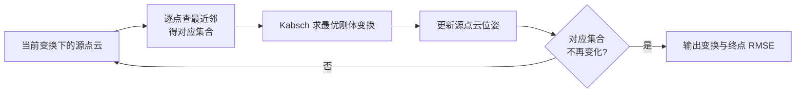

# $\rm Chapter \, 3$ ICP 与点云配准

> **本章假设你已经会**
>
> 1. SVD 的定义与几何读法：奇异值分解、最小奇异向量是「单位范数下违反最小」的解，见《线性代数》§6.1 到 §6.4。本章的 Kabsch 算法核心就是一次 ${3\times3}$ 的 SVD。
> 2. 最小二乘：方程比未知数多时的标准姿势，见《线性代数》§3.6。
> 3. 优化的初值问题：LM 只在初值落进正确盆地时是加速器，初值出盆地它无能为力，见本册 §2.3 与 §2.5（扰动 ${0.8}$ 档卡死的实测）。本章把这件事推到更极端的形态：连「谁对应谁」都要现场找。
> 4. 三角测量如何产出带身份的三维点：哪条观测来自哪个点是流水线自己记下的，见本册 §1.4。本章面对的正是丢掉这份身份记录之后的点集。
> 5. kd 树用空间划分加速近邻查询的思想，见《计算几何》§6.2。本章实验先用暴力最近邻把算法本身跑透，§3.7 的计时账会说明大规模时为什么必须换 kd 树。

第 2 章的光束法平差把「每个点投到每个像素」的总账一起调平，但每条观测都带着身份标签：这条观测来自第 $j$ 个点。深度相机与激光雷达交出的不是这种数据：一次扫描回来一团稠密的点集，每个点只有坐标，没有名字。要把两团这样的点集对齐，比如相邻两帧激光、或两台不同机位的深度相机各扫一次，连「谁对应谁」都得现场寻找，这就是点云配准（point cloud registration）问题。本章的主角是迭代最近邻（Iterative Closest Point，ICP）：在「按当前站位猜对应」与「按猜测调刚体变换」两个半步之间交替推进，直到不再变化。全册心智模型在这里换了一副面孔：假设从「全部相机位姿加全部点坐标」缩成一个刚体变换（rigid transform），观测从「像素位置」换成「点与点的距离」，不变的是那句老规矩，每个假设都要能回答「用哪个观测验证」。本章先证明两个半步各自的最优性（§3.2），再证明交替推进的单调性（§3.4），然后用三组实验量出收敛曲线、初值敏感度与密度代价（§3.5 到 §3.7）。

## $\rm \S \, 3.1$ 问题：两团没有名字的点

先看数据长什么样。一团点云（point cloud）是 $N$ 个三维坐标的集合，来自深度相机的像素级深度反投影，或激光雷达的测距采样，或本册第 1、2 章流水线重建出的稀疏点。配准的任务陈述如下：给源点云（source，要挪的那团）$\{\mathbf p_i\}$ 与目标点云（target，不动的参照团）$\{\mathbf q_j\}$，找一个旋转 $R\in SO(3)$ 与平移 $\mathbf t\in\mathbb R^3$，使源点云整体贴到目标点云上。$SO(3)$ 表示行列式为 ${+1}$ 的正交阵全体，加上平移后的 $(R,\mathbf t)$ 叫刚体变换：它保持任意两点的距离不变，恰好是「同一件刚体物体被挪动了」的数学形状。

验证观测是什么？配得对不对，可以用「源点变换之后到目标云里最近点的距离」来量。定义配准目标函数：

$$
J(R,\mathbf t)=\frac{1}{N}\sum_{i=1}^{N}\ \min_{j}\ \big\|R\,\mathbf p_i+\mathbf t-\mathbf q_j\big\|^2
$$

每个源点独立地找目标云里离它最近的那个点，距离平方求平均。$J$ 越小说明两团点云贴得越紧，$(R,\mathbf t)$ 的假设由这批距离观测来验证。这里出现了本章的关键困难：第 $i$ 个源点的最近邻是哪个 $\mathbf q_j$，取决于 $(R,\mathbf t)$ 本身，而 $(R,\mathbf t)$ 又要在给定对应之后才能解。点与点的配对关系称为对应（correspondence），它是隐变量：观测里看不到它，它又决定着目标函数的形状。第 2 章的 BA 没有这个问题，因为对应在特征匹配阶段就定死了；这里对应必须与变换一起求解。

把困难拆成两个半步，每个半步都有干净的最优解，这正是 ICP 的全部结构：

1. 变换已知：每个源点的最近邻独立可查，对应集合确定。
2. 对应已知：$(R,\mathbf t)$ 是一个纯最小二乘问题，有闭式解。

两个半步各解各的，交替进行。先解第二个：对应已知时，闭式解长什么样、为什么是那个形状，是下一节的内容。

**本节小结**：点云没有身份，配准要把对应当作隐变量与刚体变换一起求解；验证观测是源点到目标云的最近邻距离；ICP 把问题拆成「固定变换找对应」与「固定对应求变换」两个可解的半步。

## $\rm \S \, 3.2$ 对应已知时：Kabsch 算法的完整证明

设对应已经给定：$\mathbf p_i$ 配 $\mathbf q_i$（下标已按对应重排）。求最优刚体变换的问题叫 Kabsch 算法（Kabsch algorithm），目标函数：

$$
\min_{R\in SO(3),\ \mathbf t\in\mathbb R^3}\ \ E(R,\mathbf t)=\sum_{i=1}^{N}\big\|R\,\mathbf p_i+\mathbf t-\mathbf q_i\big\|^2
$$

**第一步：消掉平移。** 固定 $R$，$E$ 对 $\mathbf t$ 求梯度置零，梯度里的求和恰好是「残差总和」，于是最优平移把两团点云的质心对齐：

$$
\frac{\partial E}{\partial \mathbf t}=2\sum_{i=1}^{N}\big(R\,\mathbf p_i+\mathbf t-\mathbf q_i\big)=\mathbf 0
\quad\Longrightarrow\quad
\mathbf t=\bar{\mathbf q}-R\,\bar{\mathbf p}
$$

其中 $\bar{\mathbf p}=\tfrac1N\sum_i\mathbf p_i$、$\bar{\mathbf q}=\tfrac1N\sum_i\mathbf q_i$ 是两团点云各自的质心。代入回目标函数：$R\,\mathbf p_i+\mathbf t-\mathbf q_i=R\,\tilde{\mathbf p}_i-\tilde{\mathbf q}_i$，其中 $\tilde{\mathbf p}_i=\mathbf p_i-\bar{\mathbf p}$、$\tilde{\mathbf q}_i=\mathbf q_i-\bar{\mathbf q}$ 是去质心坐标。平移从此消失，只剩旋转：

$$
E(R)=\sum_{i=1}^{N}\big\|R\,\tilde{\mathbf p}_i-\tilde{\mathbf q}_i\big\|^2
=\sum_{i=1}^{N}\Big(\big\|\tilde{\mathbf p}_i\big\|^2+\big\|\tilde{\mathbf q}_i\big\|^2\Big)-2\,\mathrm{trace}\big(R\,H\big)
$$

第二个等号的展开逐项写清：$\|R\tilde{\mathbf p}_i-\tilde{\mathbf q}_i\|^2=\|\tilde{\mathbf p}_i\|^2+\|\tilde{\mathbf q}_i\|^2-2\,\tilde{\mathbf q}_i^{\top}R\,\tilde{\mathbf p}_i$，交叉项用了 $\|R\tilde{\mathbf p}\|^2=\|\tilde{\mathbf p}\|^2$（正交阵保范数）；而标量 $\tilde{\mathbf q}^{\top}R\,\tilde{\mathbf p}$ 可写成迹 $\mathrm{trace}\big(R\,\tilde{\mathbf p}\,\tilde{\mathbf q}^{\top}\big)$（$\mathrm{trace}(AB)=\mathrm{trace}(BA)$ 对标量情形的直接应用），对 $i$ 求和后得到 $3\times3$ 矩阵

$$
H=\sum_{i=1}^{N}\tilde{\mathbf p}_i\,\tilde{\mathbf q}_i^{\top}
$$

前两项与 $R$ 无关，所以问题归结为：在 $R\in SO(3)$ 上最大化 $\mathrm{trace}\big(R\,H\big)$。

**第二步：SVD 代换。** 对 $H$ 做奇异值分解 $H=U\Sigma V^{\top}$，奇异值排序 $\sigma_1\ge\sigma_2\ge\sigma_3\ge0$。定义 $M=V^{\top}R\,U$，它是正交阵（三个正交阵的乘积），且 $\det M=\det(V^{\top}U)$（$\det R=1$）：

$$
\mathrm{trace}\big(R\,H\big)=\mathrm{trace}\big(V^{\top}R\,U\,\Sigma\big)=\mathrm{trace}\big(M\,\Sigma\big)=\sum_{k=1}^{3}m_{kk}\,\sigma_k
$$

末步因为 $\Sigma$ 是对角阵，迹里只剩 $M$ 的对角元。正交阵每行范数为 ${1}$，所以 $\big|m_{kk}\big|\le1$，立得上界 $\sum_k m_{kk}\sigma_k\le\sum_k\sigma_k$，且 $M=I$ 时取等。

**第三步：行列式约束的分类。** 记 $d=\det(V^{\top}U)$。

1. $d={+1}$：$M=I$ 可行（$\det M=+1$），最优 $R^{*}=VU^{\top}$，达到 $\sigma_1+\sigma_2+\sigma_3$。
2. $d={-1}$：任何可行 $R$ 给出的 $M$ 都满足 $\det M=-1$，而 $M=I$ 不再可行（它会逼出 $\det R=-1$，是镜像不是旋转）。最优值掉到 $\sigma_1+\sigma_2-\sigma_3$，由下面的引理给出。

**引理**：$M$ 为行列式 ${-1}$ 的正交阵、$\Sigma=\mathrm{diag}(\sigma_1,\sigma_2,\sigma_3)$ 按 $\sigma_1\ge\sigma_2\ge\sigma_3\ge0$ 排序，则 $\mathrm{trace}\big(M\,\Sigma\big)\le\sigma_1+\sigma_2-\sigma_3$，且 $M=\mathrm{diag}(1,1,-1)$ 时取等。证明四步。

1. $M$ 必有特征值 ${-1}$：实正交阵的特征值模长为 1，非实的成共轭对出现（每对贡献乘积 1），实特征值只能是 $\pm1$；三个特征值之积等于 $\det M=-1$，无论非实对出现与否，都至少有一个实特征值 ${-1}$。
2. 取单位特征向量 $\mathbf u$ 使 $M\mathbf u=-\mathbf u$。$M$ 把与 $\mathbf u$ 垂直的平面映回自身：若 $\mathbf w\perp\mathbf u$，则 $\big(M\mathbf u\big)\cdot\big(M\mathbf w\big)=\mathbf u\cdot\mathbf w=0$。取该平面的正交基 $\{\mathbf v,\mathbf w\}$ 拼成 $Q=[\mathbf v\ \ \mathbf w\ \ \mathbf u]$，则 $Q^{\top}MQ=\mathrm{diag}(K,-1)$；由 $\det M=-1$ 得 $\det K=+1$，即 $K$ 是转角 $\theta$ 的旋转。
3. 算迹。记 $S$ 为 $\Sigma$ 在 $\{\mathbf v,\mathbf w\}$ 平面上的 ${2\times2}$ 块（仍对称），$s=\mathbf u^{\top}\Sigma\mathbf u$，则

$$
\mathrm{trace}\big(M\,\Sigma\big)=\mathrm{trace}\Big(\big(Q^{\top}MQ\big)\big(Q^{\top}\Sigma Q\big)\Big)=\mathrm{trace}\big(K\,S\big)-s=\cos\theta\cdot\mathrm{trace}\big(S\big)-s
$$

第一处等号把两个相似变换用 $\mathrm{trace}(AB)=\mathrm{trace}(BA)$ 合回一处；末处代入 $K$ 的旋转形状，交叉项 $\sin\theta\big(S_{12}-S_{21}\big)$ 因 $S$ 对称而为零。
4. 放缩。$s=\mathbf u^{\top}\Sigma\mathbf u=\sum_k\sigma_k u_k^2$，而 $\sum_k u_k^2=1$，故 $\sigma_3\le s\le\sigma_1$。于是 $\mathrm{trace}\big(S\big)=\sigma_1+\sigma_2+\sigma_3-s\ge\sigma_2+\sigma_3\ge0$，用它除一下就知道 $\cos\theta\le1$ 给出 $\mathrm{trace}\big(KS\big)\le\mathrm{trace}\big(S\big)$，进而

$$
\mathrm{trace}\big(M\,\Sigma\big)\le\big(\sigma_1+\sigma_2+\sigma_3-s\big)-s\le\sigma_1+\sigma_2+\sigma_3-2\sigma_3=\sigma_1+\sigma_2-\sigma_3
$$

取等需要 $\cos\theta=1$ 且 $s=\sigma_3$，即 $K=I$ 且 $\mathbf u$ 落在 $\sigma_3$ 的特征方向上，此时 $M=\mathrm{diag}(1,1,-1)$。引理证毕。

两个合起来，Kabsch 的最终答案是一次 SVD 加一次行列式检查：

$$
H=U\Sigma V^{\top},\qquad
R^{*}=V\,\mathrm{diag}\big(1,\ 1,\ d\big)\,U^{\top},\qquad
\mathbf t^{*}=\bar{\mathbf q}-R^{*}\bar{\mathbf p},\qquad
d=\det\big(V^{\top}U\big)
$$

$d={-1}$ 时的形状值得看懂：最优旋转在「散布最弱」的方向上接受一次 ${180^{\circ}}$ 的翻转，只付 $\sigma_3$ 的代价，而在两个主方向上照常对齐，这就是 $\sigma_1+\sigma_2-\sigma_3$ 的含义。若 $\sigma_2=\sigma_3$ 退化，$\mathbf u$ 可在二维特征空间内任取，最优解不唯一；真实扫描极少退化，而一旦退化，症状就是配准结果绕某个轴打转不定（§3.9 的排障清单会用到）。本节全部推导的唯一实测对账：对同一团点的精确拷贝施加已知变换，Kabsch 反解的误差在 ${2.2\times10^{-16}}$（§3.5 的 A0 项）。

白话：$H$ 是两团点云之间「散布方向的相关账本」：源点往哪个方向摊开、目标点是否也往同一方向摊开，账本记着。最优旋转就是把两本摊开的方向对齐；镜像解像照镜子，三个方向的散布都对得上，唯独左右手互换，所以要在最弱的方向上付一次翻转的代价把它按回去。

> **竞赛生迁移提示**：你在 OJ 上写过二维的旋转卡壳或最小圆覆盖，知道「先质心对齐再谈几何」是常用起手。Kabsch 就是它的三维标准件：去质心、一次 ${3\times3}$ SVD、行列式修正，复杂度 $O(N)$ 加常数。最容易踩的坑是跳过 $\mathrm{diag}(1,1,d)$：numpy 给出的「最优正交阵」可能是镜像，RMSE 甚至更低，几何却是翻面的（§3.9 第一条）。

**本节小结**：质心对齐消掉平移；目标函数化成最大化 $\mathrm{trace}\big(R\,H\big)$；SVD 给出 $R^{*}=V\,\mathrm{diag}(1,1,d)\,U^{\top}$，$d=\det(V^{\top}U)$；行列式为 ${-1}$ 时最优解在最小奇异方向翻号，完整证明由「正交阵必有 ${-1}$ 特征值」加两步放缩给出。

## $\rm \S \, 3.3$ 对应未知时：最近邻与交替推进

另一半步是找对应。ICP 的选择是最朴素的贪心：把当前变换下的每个源点，配到目标云里离它最近的点，即最近邻（nearest neighbor）查询。这一步把 §3.1 目标函数里的 $\min_j$ 逐点兑现：对固定变换，逐点取最近邻恰好是让 $J$ 最小的对应分配，没有比它更好的选择。

最近邻怎么查？暴力法把所有源点与所有目标点的距离算一遍，$O\big(N_sN_t\big)$；kd 树按空间递归划分把单次查询压到 $O\big(\log N_t\big)$（《计算几何》§6.2），代价是建树与高维退化。本章实验点数最多 ${2000}$，暴力法直接可跑，同时把暴力的账记下来（§3.7 的 C2 项）作为换 kd 树的依据。

ICP 的完整循环由此定型：

1. 对应步：对当前变换后的每个源点，在目标云中查最近邻，得到对应集合。
2. 变换步：把对应当作真配对，用 §3.2 的 Kabsch 求最优 $(R,\mathbf t)$ 并应用到源点云。
3. 停机检查：对应集合不再变化，或 $J$ 的单轮改进量低于阈值，则停止；否则回到第 1 步。

白话：ICP 像拼两片透明胶片上的星图。先按当前的重叠情况猜「哪颗星是哪颗星」（对应），再按猜测转动胶片（Kabsch），转完重叠情况变了，星的身份又要重猜。猜与转互相喂着往前走，猜不动转不动时就停。

**本节小结**：对应步用逐点最近邻兑现 $\min_j$；变换步用 Kabsch 闭式求解；两者交替，停机条件是对应集合稳定。

## $\rm \S \, 3.4$ 收敛性：RMSE 单调不增的证明与它的边界

ICP 的每一步都是「另一方的答案给定下的最优」，这件事可以直接推出单调性。设第 $k$ 轮的变换为 $T_k$，由对应步得到的对应为 $\{j_i^k\}$（$\mathbf q_{j_i^k}$ 是当前变换下 $\mathbf p_i$ 的最近邻）。一轮之后：

$$
J\big(T_{k+1}\big)=\sum_i\ \min_j\big\|T_{k+1}\mathbf p_i-\mathbf q_j\big\|^2
\ \le\ \sum_i\big\|T_{k+1}\mathbf p_i-\mathbf q_{j_i^k}\big\|^2
\ \le\ \sum_i\big\|T_k\mathbf p_i-\mathbf q_{j_i^k}\big\|^2
\ =\ J\big(T_k\big)
$$

三个记号逐个读：第一个不等号是 $\min$ 的定义，逐点任选对应都不会比逐点取最近邻更小；第二个不等号是 Kabsch 的最优性，固定对应集合时 $T_{k+1}$ 是全局最优（§3.2 整节就是它的证明），任何别的变换，包括 $T_k$，都不会更小；两个等号分别是最小化后的取等与 $j_i^k$ 的定义。所以 $J$ 沿迭代单调不增。

单调有界（$J\ge0$）则必收敛，但「收敛」二字要拆开说清楚，这正是 ICP 的全部边界所在：

1. 收敛的是目标函数值，不自动是变换本身。点云退化时（比如全部共线），绕那条线怎么转 $J$ 都不变，变换序列可以在零测度的方向上漂。
2. 收敛点是局部极小（local minimum），不是全局极小。两步都只保证「对方给定下最优」，这是坐标交替的通病：与 k-means 的「分配-更新」两步完全同构，那里也是单调不增、也只收敛到局部极小。初值落在哪个盆地里，就收敛到哪个盆地。
3. 停机条件「对应集合不再变化」与单调性等价地提供终点：对应不变则变换步的输入不变，输出也不再变，迭代到达不动点。

于是 ICP 的工程形象定了型：一个收敛性有理论保证、但收敛位置由初值决定的算法。它把第 2 章 §2.5 的教训重复了一遍并加重：BA 的初值错 ${0.8}$ 扰动会卡死，ICP 的初值由平移加旋转共同决定，错得多时连对应都全错。初值从哪来，§3.6 用实验给出敏感度的量化，§3.8 给出工程上的解法。

白话：单调性像下山时永远不往回走：保证你能走到一个谷底，但不保证是最低的那个谷。山有没有多个谷，取决于点云的形状，与你的出发位置无关；走哪个谷，全看出发点。

**本节小结**：两步各自的最优性直接给出 $J$ 单调不增；单调有界保证收敛，但收敛值未必是变换、收敛点只是局部极小；初值决定盆地，这是 ICP 与一切交替优化的共同边界。

## $\rm \S \, 3.5$ 实测一：收敛曲线与单调性验证

实验环境与口径：WSL 的 Python 3.12.3（numpy 2.5.4），随机种子 ${20261112}$，全部实验由单个幂等脚本一次生成，总耗时 ${77.3}$ 秒；复现方法沿用本册 §1.5 教过的命令形状（WSL 内 `cd` 进实验目录后 `python3 expTV03.py > result.txt 2>&1`），脚本与完整输出在配套实验目录 `26Fall/_uni5_work/expTV03/` 的 `expTV03.py` 与 `result.txt`，不依赖任何优化库，ICP、Kabsch、最近邻全部手写；Kabsch 的解析正确性先对账（A0 项：精确对应下反解已知变换，$R$ 与 $\mathbf t$ 的最大偏差 ${2.2\times10^{-16}}$ 与 ${1.9\times10^{-15}}$，机器精度级）。场景：目标点云为长方体表面采样 ${800}$ 点（盒子 ${2.0\times1.0\times0.5}$ 米，按表面积加权选面、面上均匀采样），加标准差 ${\sigma=0.01}$ 米的高斯噪声；源点云为独立采样 ${600}$ 点，施加已知扰动（绕竖直轴转 ${15^{\circ}}$、平移 ${(0.12,\ -0.08,\ 0.05)}$ 米）再加同强度噪声。度量 RMSE 取源点到目标云最近邻距离的均方根，正是 $J$ 的平方根形态。

主收敛曲线（每轮的 RMSE，完整 ${31}$ 行见 `result.txt`）：

1. 迭代 0：${0.13405}$
2. 迭代 1：${0.10148}$
3. 迭代 2：${0.08610}$
4. 迭代 3：${0.07786}$
5. 迭代 4：${0.06941}$
6. 迭代 5：${0.06186}$
7. 迭代 6：${0.05783}$
8. 迭代 8：${0.05393}$
9. 迭代 10：${0.05137}$
10. 迭代 14：${0.04875}$
11. 迭代 18：${0.04850}$
12. 迭代 22：${0.04832}$
13. 迭代 30：${0.04831}$

${31}$ 轮收敛，终点 RMSE ${0.04831}$。曲线的形状是「前 ${6}$ 轮大刀砍一半，后 ${25}$ 轮拖长尾」：对应集合在前几轮大幅换血，尾部每轮只微调几个边界点的归属，RMSE 每轮下降千分之几米。与第 2 章 LM-BA 的两轮进噪声底对照，ICP 的线性收敛尾巴是算法性格的一部分，调不来。终点几何精度：恢复的旋转与真值差 ${0.2954^{\circ}}$，平移差 ${9.8}$ 毫米。

单调性验证是本实验的理论验收点。主曲线相邻两轮的最大增量为 ${-1.9\times10^{-16}}$（负号即从未上升）；把 §3.6 与 §3.7 全部 ${130}$ 余次配准的曲线合起来检查，全程最大单轮增量 ${6.6\times10^{-16}}$，浮点舍入级。§3.4 的证明预言「单调不增」，实测没有一次反例。

终点 RMSE ${0.04831}$ 不为 ${0}$ 也不是失败，它压在采样底（floor）上。对照运行：不施加任何扰动（${\theta=0}$、$\mathbf t=\mathbf 0$），两团独立采样的点云直接配准，终点 RMSE ${0.04501}$。这笔底的来历：两团独立采样的点即使完美对齐，每个源点最近的那个目标点也是隔了一段采样间距的，间距由面密度决定；再加双方各 $\sigma=0.01$ 的噪声。主运行的终点比底高出的 ${0.0033}$，对应那 ${0.2954^{\circ}}$ 的残余旋转误差。这也给了实践一条判据：**ICP 的成功不是 RMSE 变小，而是 RMSE 压到采样底附近**。

**本节小结**：${31}$ 轮从 ${0.134}$ 压到采样底 ${0.0483}$（底 ${0.0450}$，由独立采样与噪声决定）；全程单调性零反例（最大增量 ${6.6\times10^{-16}}$）；旋转恢复 ${0.2954^{\circ}}$、平移 ${9.8}$ 毫米。

## $\rm \S \, 3.6$ 实测二：初值敏感度、真局部极小与对称陷阱

初值敏感度实验把初始扰动绕竖直轴的转角从 ${0^{\circ}}$ 扫到 ${90^{\circ}}$（平移扰动固定模长 ${0.15}$ 米、方向随机），每档 ${10}$ 次独立试验（点重新采样、噪声重抽）。成功有两条判据：RMSE 判据是终点 RMSE 低于 ${0.100}$（采样底 ${0.0450}$ 的两倍余，而错误盆地的终点在 ${0.28}$ 量级，中间隔着空档）；旋转判据是恢复的旋转与真值差小于 ${5^{\circ}}$。两条判据分开报，原因马上看到（完整 ${10}$ 档在 `result.txt`，此处选列 ${7}$ 档）：

| 初值转角 | RMSE 判据 | 旋转判据 | 平均迭代数 | 平均终点 RMSE | 平均旋转误差 |
| --- | --- | --- | --- | --- | --- |
| ${0^{\circ}}$ | ${10/10}$ | ${10/10}$ | ${27.0}$ | ${0.0480}$ | ${0.54^{\circ}}$ |
| ${15^{\circ}}$ | ${10/10}$ | ${10/10}$ | ${33.2}$ | ${0.0476}$ | ${0.67^{\circ}}$ |
| ${30^{\circ}}$ | ${10/10}$ | ${10/10}$ | ${43.0}$ | ${0.0475}$ | ${0.54^{\circ}}$ |
| ${45^{\circ}}$ | ${10/10}$ | ${10/10}$ | ${46.0}$ | ${0.0470}$ | ${0.46^{\circ}}$ |
| ${60^{\circ}}$ | ${10/10}$ | ${10/10}$ | ${51.2}$ | ${0.0470}$ | ${0.46^{\circ}}$ |
| ${75^{\circ}}$ | ${9/10}$ | ${8/10}$ | ${69.4}$ | ${0.0517}$ | ${0.52^{\circ}}$ |
| ${90^{\circ}}$ | ${10/10}$ | ${7/10}$ | ${78.9}$ | ${0.0552}$ | ${0.46^{\circ}}$ |

三条读数。第一，平均迭代数随初值转角近似线性上涨（从 ${27.0}$ 涨到 ${78.9}$，倍数 ${2.9}$），收敛域在收缩：转角越大，对应集合要换血的轮数越多，尾巴越长。第二，${75^{\circ}}$ 档出现一次真正的局部极小：终点 RMSE 卡在 ${0.279}$（采样底的 ${6.2}$ 倍），恢复的旋转与真值差 ${83.1^{\circ}}$。它的轨迹（`result.txt` B2 项，隔 ${4}$ 轮采样一次）：

1. 迭代 0：${0.610}$
2. 迭代 4：${0.290}$
3. 迭代 8：${0.281}$
4. 迭代 12：${0.279}$
5. 迭代 21：${0.279}$（停机）

前 ${4}$ 轮正常下降，随后被卡死在高位：源点云的长轴被就近吸到目标云的短轴上，每个点都找到了「离自己最近」的点，§3.4 的两步最优性一个都没违背，但全局位置错了。这就是局部极小的标准长相：单调不增、正常停机、答案错误。第三，${90^{\circ}}$ 档暴露更隐蔽的失败模式：RMSE 判据 ${10/10}$ 全过，旋转判据只有 ${7/10}$。有 ${3}$ 次运行收敛到了「绕竖直轴 ${180^{\circ}}$ 翻转」的位置：盒子 ${2.0\times1.0\times0.5}$ 绕过中心竖直轴转 ${180^{\circ}}$ 与自身重合，翻转后的点云落在同一组表面上，密度相同、噪声相同，终点 RMSE 照样压到采样底附近。RMSE 这个验证观测对这种对称翻转天然失明，只有对照真值才现形。这给「用哪个观测验证」的老规矩补了半条：验证观测本身也有失明区，对称场景要换观测（法向、描述子，或加一个非对称的视角）。

**本节小结**：迭代数随初值转角近线性上涨（${27.0}$ 到 ${78.9}$）；${75^{\circ}}$ 抓到真局部极小（RMSE 卡 ${0.279}$、旋转差 ${83.1^{\circ}}$）；${90^{\circ}}$ 抓到对称翻转（RMSE 全过、旋转 ${3/10}$ 错）；RMSE 判据要配几何判据才完整。

## $\rm \S \, 3.7$ 实测三：点云密度对精度与代价的影响

固定初值扰动（${15^{\circ}}$ 加平移），把目标点云从 ${100}$ 点扫到 ${2000}$ 点（源点云取 ${70\%}$ 独立采样），每档 ${5}$ 次试验。采样底 floor 由每档的零扰动对照运行单独标定（同 §3.5 的口径）：

| 目标点数 | 成功 | 平均迭代数 | 平均终点 RMSE | 采样底 | 平均旋转误差 |
| --- | --- | --- | --- | --- | --- |
| ${100}$ | ${5/5}$ | ${13.4}$ | ${0.1326}$ | ${0.1265}$ | ${4.33^{\circ}}$ |
| ${200}$ | ${5/5}$ | ${13.8}$ | ${0.0906}$ | ${0.0922}$ | ${4.07^{\circ}}$ |
| ${500}$ | ${5/5}$ | ${29.2}$ | ${0.0592}$ | ${0.0621}$ | ${1.14^{\circ}}$ |
| ${1000}$ | ${5/5}$ | ${30.8}$ | ${0.0416}$ | ${0.0438}$ | ${0.46^{\circ}}$ |
| ${2000}$ | ${5/5}$ | ${37.8}$ | ${0.0317}$ | ${0.0319}$ | ${0.36^{\circ}}$ |

三条读数。第一，终点精度由密度决定，不由传感器噪声单独决定：噪声 $\sigma=0.01$ 米全程不变，旋转误差却从 ${4.33^{\circ}}$ 降到 ${0.36^{\circ}}$，差 ${12}$ 倍。机理在采样底里：稀疏点云的对应「隔得远」，最近邻位置被采样涨落支配，Kabsch 从这些抖动的对应里估出的几何自然糙；点云加密，对应间距缩小，同样的噪声摊在更近的配对上。第二，采样底随面密度按平方根标度下降：盒子表面积 ${7.0}$ 平方米，面密度 $\rho=N/7.0$，平面随机采样下最近邻均方根距离约 $1/\sqrt{\pi\rho}$，${N=100}$ 应为 ${0.149}$、${N=2000}$ 应为 ${0.033}$，实测 ${0.1265}$ 与 ${0.0319}$，同量级吻合；${20}$ 倍密度把底压低 ${4.0}$ 倍，接近 $\sqrt{20}\approx4.5$ 的理想标度。第三，在 ${15^{\circ}}$ 的扰动下密度影响的是精度而非成败（${5/5}$ 全过）；成败的杀手在初值与对称（§3.6），密度不够时连「谁对应谁」都歧义，那是另一条失败路径，真实扫描里两者常一起发作。

代价的账：暴力最近邻在 ${1400\times2000}$ 规模实测 ${53.9}$ 毫秒每次调用，一次完整配准 ${1.5}$ 秒。点数线性涨、配准轮数也在涨（${13.4}$ 到 ${37.8}$ 轮），两者相乘，密度的计算代价按超线性走。工业点云动辄百万点：暴力单轮要分钟级，$O\big(N_s\log N_t\big)$ 的 kd 树（《计算几何》§6.2）把单次查询从「扫全场」压成「走树」，是大规模配准的必选项而非优化项。

**本节小结**：旋转误差随密度降 ${12}$ 倍（${4.33^{\circ}}$ 到 ${0.36^{\circ}}$），采样底按 $1/\sqrt{\rho}$ 标度；${15^{\circ}}$ 扰动下密度伤精度不伤成败；暴力 NN ${53.9}$ 毫秒每查、百万点必须 kd 树。

## $\rm \S \, 3.8$ 点云特征与全局配准一瞥

§3.6 的两条失败路径（局部极小、对称翻转）共享一个根源：最近邻对应假设「两点靠近才配对」，于是初值必须在收敛域之内。全局配准（global registration）要的是完全不给初值也能建立对应的能力，思路是把「空间最近邻」换成「指纹最近邻」：给每个点算一个只依赖局部几何、不依赖全局位姿的描述子，描述子相似的点才配对。指纹不看位置看地形，点云整体怎么转，指纹不变。

最常用的一族是快速点特征直方图（Fast Point Feature Histograms，FPFH），分四步，本章只建直觉不实现：

1. 法向量（surface normal）：对每个点取其 $k$ 近邻做一次小 PCA，最小特征向量就是局部曲面的法向，依据是「局部近似平坦，散布最薄的方向即法向」。
2. SPFH：对点 $\mathbf p$ 与它的每个邻点，算出三个描述相对几何的角度量（法向夹角、平面角、距离角的组合），投进直方图。直方图是 $\mathbf p$ 的「局部地形指纹」。
3. FPFH：把 $\mathbf p$ 自身的 SPFH 与它的 $k$ 个邻居的 SPFH 按权重 $1/k$ 加权平均，让指纹吸收更大范围的几何，又不用真的对远点两两算角。
4. 配对与裁决：描述子最近邻给出一批候选对应，再用几何一致性检验筛掉自相矛盾的：随机抽小撮对应算刚体变换，数有多少候选支持它（《计算机视觉》§2.6 的 RANSAC，同一个工具换了个战场）。以最好的一致集做初值，交回 ICP 精修。

边界要说明白：FPFH 的直方图参数（邻域半径、角度分箱）依赖点云密度与噪声，稀疏或噪声大的点云指纹发糊；对称物体的指纹也对称（盒子的角与角长得一样），描述子救不了 §3.6 那种对称翻转，对称场景要么靠额外的非对称观测，要么接受多解再靠别的信息裁决。

**本节小结**：全局配准把「空间最近邻」换成「指纹最近邻」扩大收敛域；FPFH = 法向量、邻域角度直方图、邻居聚合、RANSAC 一致性裁决；对称物体是指纹的失明区。

## $\rm \S \, 3.9$ 常见错误与证据式排查

1. 跳过行列式修正。症状：RMSE 表现正常甚至更低，配准结果在渲染里「翻面」，法向量内向。验证：打印 $\det R$，不为 ${+1}$ 即中招；numpy 的 SVD 给的最优正交阵在 $d={-1}$ 时是镜像（§3.2 第三步）。处方：$R\leftarrow V\,\mathrm{diag}(1,1,d)\,U^{\top}$，一行修复。
2. 部分重叠硬配。两团点云只有部分重叠（两帧激光视场错开）时，非重叠的源点也会被强行配上一个最近邻，Kabsch 被这些假对应拉偏。症状：对应距离直方图双峰，重叠点聚在采样底附近，非重叠点拖出长尾。验证：画直方图或直接数距离超过 ${3}$ 倍底的对应占比。处方是截断 ICP（trimmed ICP）：每轮只让距离最近的固定比例的对应参与 Kabsch，把「不该有对应」的点排除在优化外；注意此时 §3.4 的单调性论证不再严格成立（对应选择不再等价于逐点取最小），停机要靠 RMSE 阈值卡。
3. 把「收敛了」当「配对了」。ICP 必然正常停机（§3.4 单调有界），但停机点可能是局部极小或对称翻转（§3.6 实测：RMSE 判据 ${10/10}$、旋转判据 ${7/10}$）。验证：终点 RMSE 对照采样底（本实验口径是两倍底以内算贴住）；有真值时对照变换误差；没真值时检查对应距离直方图与法向量一致性。处方：换初值多跑几次、或上 §3.8 的全局配准。

## $\rm \S \, 3.10$ 关键概念回顾

1. 对应已知时，Kabsch 分哪三步把 $(R,\mathbf t)$ 解出来？每一步分别用到「梯度置零」「迹的循环性质」「SVD」中的哪一条？
2. 行列式修正解决什么问题？$d={-1}$ 时最优旋转在几何上做了什么取舍？给出 $\sigma_1+\sigma_2-\sigma_3$ 中每一项的含义。
3. 写出 ICP 一轮的两步，并说明单调性证明的三个不等式与等号各自来自哪条性质。
4. 单调不增保证了什么、没保证什么？「对应集合不再变化」为什么等价于到达不动点？

## $\rm \S \, 3.11$ 应用与辨析

1. 两台深度相机各扫同一房间一次，视场只有 ${40\%}$ 重叠。直接跑 ICP 会发生什么？用截断 ICP 的思想给出工程处方，并指出它的哪条理论保证会松动。
2. 对称物体（如本实验的盒子）上 RMSE 判据失效。给出两个不依赖真值的验证动作，说明各自能查出哪类错误、查不出哪类错误。
3. 实验规模 ${1400\times2000}$ 时暴力最近邻每次 ${53.9}$ 毫秒、完整配准 ${1.5}$ 秒。点云涨到 ${100}$ 万点，单轮与整轮的代价各怎么变？给出数据结构层面的处方。

## $\rm \S \, 3.12$ 本章自测答案

1. 第一步对 $\mathbf t$ 求梯度置零得平移 = 两质心之差（梯度置零）；第二步代入去质心坐标，交叉项用 $\mathrm{trace}(AB)=\mathrm{trace}(BA)$ 收进 $H=\sum\tilde{\mathbf p}_i\tilde{\mathbf q}_i^{\top}$（迹的循环性质）；第三步对 $H$ 做 SVD，最大化 $\mathrm{trace}\big(M\,\Sigma\big)$ 取 $M=\mathrm{diag}(1,1,d)$（SVD 与正交阵行范数为 ${1}$ 的界）（来源：§3.2）。
2. 它排除镜像解：不带行列式约束的最优正交阵在 $\det(V^{\top}U)=-1$ 时是旋转加反射。$d={-1}$ 时最优旋转在最小奇异方向接受一次 ${180^{\circ}}$ 翻转：$\sigma_1+\sigma_2$ 是两个主方向照常对齐的收益，$-\sigma_3$ 是在最弱方向上付的代价（来源：§3.2 引理）。
3. 两步是「逐点最近邻找对应」与「Kabsch 求变换」。链式不等式里：第一个 $\le$ 来自 $\min$ 的定义（最近邻是逐点最优对应），第二个 $\le$ 来自 Kabsch 的全局最优性，最后一个等号是 $j_i^k$ 的定义（来源：§3.4）。
4. 保证目标函数值单调不增且有下界，故收敛；没保证收敛到全局极小、也没保证变换序列本身收敛（退化方向上可漂）。对应集合不变则变换步输入不变、输出不变，迭代到达不动点；实际实现中它与「$J$ 改进量低于阈值」二选一当停机条件（来源：§3.4）。
5. 应用题（§3.11 第 1 题）参考：${60\%}$ 的非重叠点全被硬配上假对应，Kabsch 被拉偏，终点 RMSE 停在远高于采样底的位置（§3.9 第 2 条的症状）。处方：每轮只取最近 ${40\%}$ 到 ${50\%}$ 的对应参与 Kabsch，并按对应距离直方图定比例；松动的是单调性论证，因为「逐点取最近邻」不再是全体上的最优分配，停机改靠阈值。
6. 应用题（§3.11 第 2 题）参考：动作一，对应距离直方图与采样底对照，能查出局部极小（双峰、高位平台），查不出对称翻转（翻转后照样单峰贴底，§3.6 实测）；动作二，法向量一致性检验（对应点的法向在变换后应同向），能查出翻面与局部极小，但对称物体的法向场也对称，纯自旋转的翻转仍查不出，需要非对称观测兜底（来源：§3.6、§3.8）。
7. 应用题（§3.11 第 3 题）参考：单轮暴力 NN 是 $O\big(N_sN_t\big)$，点数涨 ${500}$ 倍则单轮涨约 ${2.5\times10^{5}}$ 倍到分钟至小时级；整轮还要乘上涨了的迭代数（密度越高尾巴越长，§3.7 的 ${13.4}$ 到 ${37.8}$ 轮趋势）。处方：kd 树把单次查询压到 $O\big(\log N_t\big)$（《计算几何》§6.2），建树一次、配准全程复用；再加最近邻缓存（对应集合轮间变化很小）。

**你现在能做什么**：给定两团无标签点云与一个粗糙初值，你能写出并跑通「最近邻对应加 Kabsch」的完整 ICP，知道终点 RMSE 该对照采样底来判断成功，知道哪三种失败模式（镜像、假对应、局部极小）各用什么证据排查。

SLAM 的前端在连续帧之间做的正是本章这件事：扫描到扫描的配准给出相邻位姿的相对约束。但 SLAM 的真正困难在下一层：位姿是沿着时间陆续估出来的，每一步的小误差顺着配准链累积成漂移；而且地图不是两团点云，是一边建一边用的活数据。第 4 章把「单次配准」扩展成「位姿序列与地图的联合估计」，前端管对应与匹配、后端管全局一致性（滤波与图优化两条路线，接口在《具身智能》的贝叶斯滤波）；本章的 ICP 会作为前端的主力零件在那里重新上岗。
