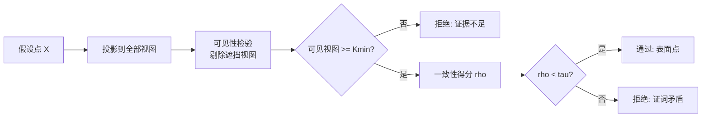

# $\rm Chapter \, 5$ 深度估计：把骨架补成稠密深度

> **本章假设你已经会**
>
> 1. 针孔投影与视差公式：三维点怎么算出像素坐标，见《计算机视觉》§3.2；平行双目怎么用视差 $d=f_xB/Z$ 换出深度、深度误差为什么随距离放大，见 §3.8。本章把这两件工具用到每一个像素上。
> 2. 三角测量与尺度歧义：本册 §1.4 用两条视线联立解三维点；§1.1 与 §1.3 证明单目重建的深度永远差一个未知倍数。本章把这个结论从「整幅重建」下放到「每一个像素」。
> 3. 重投影误差与光束法平差的目标函数：本册 §2.2。稀疏特征点的深度假设靠它验证；本章要为稠密像素寻找各自的验证观测。
> 4. 本册 §4.6 留下的缺口：SLAM 与 BA 的地图是稀疏骨架，「每个像素的深度账」正是本章要补的题目。

第 2 章与第 4 章的产出有同一个形状：三维坐标只长在特征点上。一张百万像素的照片，增量式 SfM 通常只在几千个特征位置有三维账，其余像素在地图里是空的。把每个像素到首个可见表面的距离填成一张图，就是深度图（depth map）——它是点云（第 3 章的原料）、稠密重建与避障规划的共同中间品。全册心智模型在这一章被压到最细的粒度：假设从「每个特征一个」涨到「每个像素一个」，但每个假设依然要能回答「用哪个观测验证」。答案分两路：有多个视图时，验证观测是其他照片，这是多视图立体（§5.2、§5.3）；只有一个视图时，图像内部不存在任何能验证深度的观测，验证只能借世界本身的统计规律，这是单目深度（§5.4）。两路各有一个绕不开的坑，§5.5 把它们合并进深度补全。所有机制都在合成场景上实测对账（§5.6），每个数字先跑后写。

## $\rm \S \, 5.1$ 问题：每个像素的深度，谁来验证

先看特征点是怎么被验证的。第 2 章里，一个三维点的假设由重投影误差裁决：把它投回拍到它的相机，与观测像素比对（§2.2）。验证观测是「拍摄本身」。现在把任务换成每个像素：对图像里的像素 ${(u,v)}$，假设「沿这条视线距离 ${D(u,v)}$ 处有一个表面点」，这个假设的验证观测在哪？

多视图场景下答案是现成的：同一物理点被多台相机拍到，它的假设深度 $D$ 对不对，可以拿其他照片来审。单视图场景下答案是残酷的：图像内部没有任何观感能区分「近而小」与「远而大」，验证只能来自图像之外的知识。这给出本章的路线图：

1. 多视图立体：用「其他视图的长相」验证每个空间假设点，核心机制是光度一致性投票（§5.2），以及它的三个失效漏洞（§5.3）。
2. 单目深度：用「世界的统计规律」补上图像缺失的尺度，代价是尺度永远带着先验的不确定性（§5.4）。
3. 深度补全：稀疏但有硬观测背书的深度点，与稠密但靠先验的深度预测融合，融合结果再过一遍多视图一致性（§5.5）。

白话：特征点的深度像有发票的报销单，拍摄记录可以查账；像素的深度像没有发票的报销单——多视图是找几位同事核对同一笔账，单目是按「一般人都这么报销」的行业惯例填数，惯例错了数就跟着错。

**本节小结**：特征点由重投影误差验证，像素级深度假设的验证观测要么是其他视图（多视图），要么是图像外的先验（单视图）；本章三条路线分别对应这两种验证来源与其融合。

## $\rm \S \, 5.2$ 多视图立体：给空间假设点做光度一致性投票

第 1 章的流水线是自底向上的：先在像素之间找对应（匹配），再用对应三角化出三维点（§1.4）；一对错配会把错误带进三角化。多视图立体（Multi-View Stereo，MVS）把方向倒过来，自顶向下：先假设空间里有一个点 $X$，把它投影到每台相机（《计算机视觉》§3.2 的投影 $\pi_k$），读取落点像素的强度，再问一句：这些强度像不像「同一个物理点被不同机位拍到」？像，就给 $X$ 投一票。这个判据叫光度一致性（photo-consistency）。

白话：这是陪审团合议。单个视图的证词（一个像素的颜色）说明不了什么；同一个假设点必须在多个视图里给出互相吻合的证词，才配成为表面点。

形式化。记 $V(X)$ 为 $X$ 可见的视图集合，${I_k(\mathbf u)}$ 为第 $k$ 张图像在像素 ${\mathbf u}$ 处的强度。一致性得分定义为可见视图间强度值的标准差：

$$
\rho(X)=\sqrt{\frac{1}{|V|}\sum_{k\in V(X)}\Big(I_k\big(\pi_k(X)\big)-\bar I\Big)^{2}},\qquad
\bar I=\frac{1}{|V|}\sum_{k\in V(X)}I_k\big(\pi_k(X)\big)
$$

读法：$\rho$ 量的是「各机位看到的 $X$ 长得有多不一样」。真表面点在各视图里被拍到的是同一块物理表面，强度只差噪声与采样量化，$\rho$ 小；错误深度的 $X$ 在各视图里采样到的是不同的物理点，强度差被纹理拉开，$\rho$ 大。投票判据两条：${|V(X)|\ge K_{\min}}$（证词太少不立案）且 $\rho(X)<\tau$（证词互相吻合）。

投票前有一个前提要处理：$X$ 投到第 $k$ 视图的那个像素，其光线的首命中面在 $X$ 之前还是之后？$X$ 被更近的表面挡住叫遮挡（occlusion），挡住时该像素采到的颜色属于别的物理点，是假证词。$X$ 不被挡叫可见（visibility），判据是沿该像素光线比较首命中距离 $t_{\text{hit}}$ 与相机到 $X$ 的距离：

$$
\big\|X-c_k\big\|\ \le\ t_{\text{hit}}\big(\pi_k(X)\big)+\varepsilon
$$

$\varepsilon$ 是与假设点尺度同级的公差（§5.6 取假设点间距的一半）。真实系统用逐视图的深度缓存（z-buffer）做同一件事。

剩下的问题是核心：为什么错误深度会被拆穿？看几何。过 $X$ 的每条视线像一支从各机位伸来的矛：真表面点处，所有矛尖扎在几乎同一块表面；深度错了，矛尖就散开，扎到纹理不同的位置。设真表面在 $X$ 附近近似为平面，法向沿两视线的角平分线；两视线夹角 $\beta$；$X$ 到平面的带符号距离记 $\delta$（$\delta=0$ 即假设深度恰好正确）。视线从 $X$ 延伸到平面的长度是 $\delta/\cos(\beta/2)$，落点在平面内偏离垂足 $\delta\tan(\beta/2)$；两支矛对称地偏向两侧，矛尖落点相距

$$
s=2\,\delta\tan\frac{\beta}{2}\ \approx\ \delta\,\beta\qquad(\beta\ \text{为小角})
$$

跨视图采样到的强度差约为纹理梯度乘落点距离，${|I_k-I_j|\approx|\nabla t|\cdot s}$。要在「最能拆穿你」的那对视图（张角 $\beta$ 最大）面前蒙混过关，需要 ${|\nabla t|\,\delta\,\beta\lesssim\tau}$ 对全部可见视图对成立，于是可分辨的最小深度偏差是

$$
\delta_{\min}\ \approx\ \frac{\tau}{\beta\cdot|\nabla t|}
$$

读法：分母两个因子，视图间张角 $\beta$ 与表面纹理梯度 ${|\nabla t|}$；任一因子趋零，深度分辨力崩塌。§5.3 的漏洞清单与 §5.6 的实测表都是这条公式的展开。



工程实现常不摆空间点阵，而是平面扫描（plane sweep）：沿深度方向扫一组等深平面，每个像素在每块平面上算光度一致性，取最一致的那个深度当作该像素的深度。检验本体与投票完全相同，只是把全空间搜索压成逐像素的一维搜索。

**本节小结**：MVS 自顶向下验证空间假设点，判据为可见视图数与光度一致性双门槛；矛尖几何给出深度分辨力 ${\delta_{\min}\approx\tau/(\beta|\nabla t|)}$，多视图的基线收益与纹理的作用都写在这条公式里。

## $\rm \S \, 5.3$ 三个漏洞：无纹理、遮挡、非朗伯

$\delta_{\min}$ 的分母两项加上「证词从哪来」，漏洞一共三个，逐个看机制、症状与缓解。

1. 无纹理：${|\nabla t|=0}$ 使 $\delta_{\min}\to\infty$，白墙前的所有深度都「长得一样对」。这类局部无从分辨的困境有通名，孔径问题（aperture problem）——特征匹配里它表现为角点才可跟踪（《计算机视觉》§2.2 的 Harris 响应只在角点处为正），深度上它表现为无纹理区不可分辨。加大基线救不了它（分母另一项是零）；实际系统靠邻域传播：表面拟合与正则化把无纹理区的深度交给有纹理的邻居决定。§5.6 实测：平纹带误报率对纹理区的分账是 0.869 对 0.512。
2. 遮挡：遮挡视图的采样不是「$X$ 长什么样」而是「挡住 $X$ 的东西长什么样」。不剔除时假证词两头捣乱：既冤枉真表面点（检出下降），也可能放过错误深度（误报上升）。§5.2 的可见性判据就是解药；§5.6 里球体不透明，全部表面背后的假设点因遮挡出局，这恰好是正确行为。代价是多维护一份逐视图深度缓存。
3. 非朗伯：朗伯表面（Lambertian surface）指外观只由反照率与光照决定、不随观察方向变化；镜面反射、高光、透明都不满足。同一物理点在不同视图里长得不像，$\rho$ 被虚推高，真表面点被冤枉，检出下降。缓解：把强度换成对视角较稳的量（局部归一化互相关、梯度方向），或退回几何一致性（跨视图深度对齐、法向连续）。本章合成世界刻意把反照率固定为纯方向函数，绕开此漏洞、让前两个照常发作，这个范围限制先说清。

视图数量的作用也在这张清单里：视图越多，最大张角 $\beta$ 越大，$\delta_{\min}$ 越小，同时单个视图的坏证词（遮挡、噪声）越难单独裁决。陪审团越大，误判越少，代价是计算与存储随视图数线性增长。§5.6 的 K 扫描实测把这笔账摆出来。

白话：无纹理是「证词内容全一样，听不出矛盾」，遮挡是「证人没见到本人，转述的是别人」，非朗伯是「证人每次见到的穿着都不一样」；第一种只能请邻居作证，第二种要先剔除冒名顶替者，第三种要换一种问法。

**本节小结**：无纹理杀分辨力（$\delta_{\min}\to\infty$）、遮挡造假证词（需可见性剔除）、非朗伯虚增不一致（需换度量或几何判据）；加视图同时改善分辨力与容错，代价线性。

## $\rm \S \, 5.4$ 单目深度：尺度歧义是单张图像的固有病

单目深度估计（monocular depth estimation）从一张照片预测整幅深度图，现代方案是神经网络。要判断它「能做什么」，先把「不可能的那部分」推干净，再看「可能的那部分」靠什么。

不可能的部分是尺度。单视图投影（《计算机视觉》§3.2）把三维点 ${(X,Y,Z)}$ 映到像素横坐标

$$
u=f_x\frac{X}{Z}+c_x
$$

把整个场景沿视线方向缩放 $s$ 倍，深度与横坐标同乘 $s$，再投影：

$$
\begin{aligned}
u'&=f_x\frac{sX}{sZ}+c_x\\
&=f_x\frac{X}{Z}+c_x=u
\end{aligned}
$$

每个像素对 $s$ 完全不敏感：一张照片只是「一整族互为缩放的三维场景」的共同投影，图像本身不携带区分它们的任何信息。这不是算法不够好，是观测不含这个自由度；§1.3 在本质矩阵层面见过同一件事，这里它在单视图层面重现。§5.6 的实测：$R=1$、$D=4$ 与 $R=3$、$D=12$ 两个世界的渲染图逐像素最大差 $5.1\times10^{-12}$ 灰度，纯浮点零头；给两图各加独立噪声后差值均值 3.36，与单图噪声水平相同。噪声加在观测上而不是解释上，加噪声也分辨不了。

可能的部分靠先验。图像对 $s$ 缄默，单目深度的一切尺度信息都来自模型对世界的假设。产品因此分两种：相对深度（relative depth）只输出比值与排序（「A 比 B 近，约 2 倍」），无单位，天然免疫尺度歧义；度量深度（metric depth）以米为单位，必须外挂先验。先验的典型来源与失效方式：

1. 物体典型尺寸：球的张角 $\theta$ 只定比值 $R/Z$（$\sin(\theta/2)=R/Z$）。先验半径给 $R$，深度由 $\theta$ 解出；先验差几倍，深度整幅差几倍。§5.6 实测：先验半径 0.30 m 对真实 0.90 m，深度估计 1.20 m 对真实 3.60 m，恰差 3 倍。
2. 地面与相机几何：地面大致平坦、相机高度大致已知，地面像素的深度可以由几何解出；失效于悬空目标与起伏地形。
3. 训练数据的尺度分布：网络学到的「典型尺度」是训练集的分布。室内数据喂出的模型看街景，整幅尺度系统性漂移，画面却毫无破绽。

多视图为什么能钉死尺度：视差 $d=f_xB/Z$（《计算机视觉》§3.8）里基线 $B$ 有单位且已知，深度随带有单位；等价地说，缩放使 ${d\to d/s}$，实测 $d$ 直接裁决 $s$。§5.6 实测：真实世界 $s=1$ 中五点实测视差 55.6 到 56.6 像素，$s=3$ 假设预言 18.5 到 18.9 像素，恰为实测的 0.333，观测一票否决。

白话：照片不知道自己是微缩模型还是真实城市；你以为照片里的「球」有多大，世界就被迫离你多远。双目或多视图的基线是带刻度的尺子，它一出手，缩放的自由度就没了。

适用条件收拢成两句：相对深度可靠的前提是场景与训练分布同族；度量深度再叠加一条「先验正确」。两条破任何一条，输出仍然「看起来合理」但数值不可信。不报错、只是错，是单目深度最危险的失效模式，也是它必须与稀疏硬测量融合的原因（§5.5）。

**本节小结**：单视图对整体缩放严格不敏感（逐像素差 $10^{-12}$ 量级），单目深度只能从先验取尺度，先验错几倍整幅错几倍；基线已知的第二个视图用视差一票否决错误尺度。

## $\rm \S \, 5.5$ 深度补全：稀疏可靠与稠密猜想之间

深度补全（depth completion）的输入是两种互补的信号。稀疏深度（sparse depth）：LiDAR 回波点或 SfM/MVS 特征点的三角化结果，只覆盖百分之一量级的像素，但每个点都有观测背书；稠密单目预测：每个像素都有值，但尺度靠先验、边界发糊（§5.4）。补全的任务是输出一张稠密、且在稀疏锚点处与硬测量相容的深度图。融合原则一句话：稀疏点说了算，稠密预测负责在点与点之间插值、在点之外外推，图像梯度引导插值走哪条路（深度边界通常与颜色边界重合）。

白话：稀疏点是打了桩的地面，稠密预测是整片地的粗略草图，补全就是把草图抹平到与桩齐平：桩说了算，草图负责填空，图像纹理负责告诉抹子往哪走。

补全的输出依然要过验证关，观测还是老三样：

1. 跨视图一致性：把补全后的深度图投回其他视图比对光度，§5.2 的检验原样复用。
2. 锚点核对：输出在稀疏锚点处应与输入一致，偏了说明融合步骤出错。
3. 下游核对：把补全深度当作 §2 光束法平差的初值再优化，看重投影误差是否下降。

与全册的接口：深度图加相机位姿立刻得到点云，第 3 章的配准负责把多次重建拼起来；地图表示回到 §4.6 的清单，稠密深度补上的正是那张清单里「骨架」与「占据」之间的空档。

**本节小结**：补全 = 稀疏硬测量定锚 + 稠密预测填空 + 图像引导边界；融合结果仍需跨视图一致性、锚点核对与 BA 精化三道验证。

## $\rm \S \, 5.6$ 实验：一致性投票的检出与误报，尺度歧义三笔账

两笔账都在合成世界上算，numpy 手写全部环节，固定种子 ${20261112}$，脚本与输出在 `_uni5_work/expTV05/` 的 `expTV05.py` 与 `result.txt`，总耗时约 ${5}$ 秒。A 账的场景是一个半径 ${1}$ 的球面：反照率只随球面方向变化，赤道带 $|n_z|<0.35$ 无纹理（常数 ${128}$ 灰度），极区有三组正弦条纹；球不透明。${8}$ 台相机方位角均分、仰角交替 $\pm25^{\circ}$，距离 ${D=4}$，图像 ${64\times64}$、$f_x=55$；位姿真值已知（本章只考「深度假设的验证」，位姿估计是第 1、2 章的题）。假设点是 ${[-1.6,1.6]^3}$ 步长 ${0.05}$ 的体素（voxel）格，共 ${274{,}625}$ 个；真表面点取 $|r-1|\le0.05$（共 ${10{,}135}$ 个），非表面点取 $r>1.05$。判据 $\tau=12$ 灰度、$K_{\min}=3$。投票主循环在代码里的样子：

```python
# expTV05.py 节选：光度一致性投票（WSL python3 + numpy）
for k, (C, fwd, right, up) in enumerate(cams):
    v = X - C
    u = f * (v @ right) / (v @ fwd) + (IMG - 1) / 2.0    # 投影 pi_k
    w = f * (v @ up)    / (v @ fwd) + (IMG - 1) / 2.0
    tv = np.linalg.norm(v, axis=1)                       # 假设点到相机距离
    vis = inb & valid[wi, ui] & (tv <= t[wi, ui] + 0.06) # 可见性: 首命中面之前
    samples[k, sel] = I[wi[sel], ui[sel]] + rng.normal(0.0, sigma, sel.size)
# 跨可见视图求强度标准差 sd, 可见视图数 viscnt
voted = (viscnt >= KMIN) & (sd < TAU)                    # 双门槛投票
```

复跑方法：在 Windows 侧用 Git Bash 调 WSL，命令 `wsl -e bash -c "cd /mnt/c/Users/20811/Desktop/26Fall/_uni5_work/expTV05 && python3 expTV05.py > result.txt 2>&1"`。程序自建场景并渲染，写出 `result.txt`。成功验证：末行是 `done.`，`[A0]` 的投影直径理论与实测对上、`[B0]` 的像素差在 ${10^{-12}}$ 量级；若报 `ModuleNotFoundError: numpy`，先在 WSL 装好 python3 与 numpy。改种子会得到不同但同量级的数字，种子写死是为了正文数字可对上。

### $\rm \S \, 5.6.1$ A 账：检出率与误报率

先做健全性检查（`[A0]`）：球的投影直径理论 ${27.8}$ 像素、实测 ${28}$；${5}$ 个真表面点在各可见视图中的采样极差 ${0.0}$ 到 ${13.1}$ 灰度，来源是最近邻像素取整的量化底噪（$\tau=12$ 正是拿这份底噪与噪声水平一起定标的）。真表面点的可见视图数分布：${471}$ 个点 ${0}$ 个视图、${2{,}558}$ 个 ${1}$ 个、${4{,}390}$ 个 ${2}$ 个、${2{,}716}$ 个 ${3}$ 个及以上（共 ${10{,}135}$）——单圈 ${8}$ 机下平均只有 ${1.92}$ 个视图可见，可见性是第一道闸门。然后是三张表。

噪声扫描（`[A1]`，${K=8}$；检出按「可评估=可见视图 $\ge3$」计，「检出全体」对全部真表面点计）：

| 噪声 $\sigma$（灰度） | 覆盖 | 检出（可评估） | 检出（全体） | 误报 |
| --- | --- | --- | --- | --- |
| ${0}$ | ${0.268}$ | ${0.953}$ | ${0.255}$ | ${0.778}$ |
| ${3}$ | ${0.268}$ | ${0.945}$ | ${0.253}$ | ${0.786}$ |
| ${8}$ | ${0.268}$ | ${0.888}$ | ${0.238}$ | ${0.730}$ |

读数一：噪声压检出（${0.953\to0.888}$）但误报几乎不动（${0.778\to0.730}$）。误报的主犯不是噪声，是纹理结构，下一张表实锤。

读数二：矛尖落区分账（`[A2]`，$\sigma=3$，误报率以各自可评估的非表面点为分母），附机制账（$\sigma=0$ 时跨视图标准差中位数）：

| 矛尖落区 | 可评估非表面点 | 误报率 | 表面点 $\sigma$ 中位数 |
| --- | --- | --- | --- |
| 平纹带 | ${719}$ | ${0.869}$ | ${0.00}$ |
| 纹理极区 | ${213}$ | ${0.512}$ | ${3.39}$ |

机制账再下探一层：偏移 ${|r-1|\in(0.05,0.15]}$ 的假设点，矛尖在平纹带的标准差中位数 ${0.00}$，在纹理极区 ${11.50}$——后者贴着门槛 $\tau=12$，一半在门槛下、一半在上，误报率 ${0.512}$ 恰好卡在中间。$\delta_{\min}$ 公式的账对上了：无纹理处 ${|\nabla t|=0}$，多偏都一致；纹理区 ${|\nabla t|\,\delta\,\beta}$ 把偏移点的标准差顶到门槛附近。

纹理极区的误报按径向偏移分带（`[A3]`，$\sigma=3$，${K=8}$）：

| $|r-1|$ 偏移带 | 纹理极区：可评估 / 误报率 | 平纹带：可评估 / 误报率 |
| --- | --- | --- |
| ${(0.05,0.15]}$ | ${213}$ / ${0.512}$ | ${695}$ / ${0.875}$ |
| ${(0.15,0.30]}$ 与更远 | ${0}$ / 无可评估 | ${24}$ / ${0.708}$ |

读数三：纹理极区可评估的假设点全部挤在 $|r-1|\le0.15$ 内——偏移再大，张角大的视图矛尖直接脱靶（射线不再与球相交或出画面），证据自动消失，这就是 $\delta_{\min}$ 的另一面：分辨力边界之外连受审资格都没有。平纹带则相反：偏到 ${0.15}$ 以外仍有 ${24}$ 个可评估、误报率 ${0.708}$，无纹理区连「偏多深」都无所谓。两张表合读：深度分辨力等于纹理乘张角，缺一即崩。

视图数扫描（`[A4]`，$\sigma=3$）：

| ${K}$ | 覆盖 | 检出（可评估） | 检出（全体） | 误报 |
| --- | --- | --- | --- | --- |
| ${4}$ | ${0.000}$ | ${0.000}$ | ${0.000}$ | ${0.000}$ |
| ${8}$ | ${0.268}$ | ${0.948}$ | ${0.254}$ | ${0.788}$ |
| ${16}$ | ${0.836}$ | ${0.953}$ | ${0.797}$ | ${0.716}$ |

读数四：${K=4}$ 时覆盖为 ${0}$——四台相机方位间隔 ${90^{\circ}}$，任何表面点最多拿到 ${2}$ 个非掠射视图，$K_{\min}=3$ 一个假设都立不了案，投票根本没开工。从 ${8}$ 到 ${16}$，可评估集内的检出几乎不变（${0.948\to0.953}$），涨的是覆盖（${0.268\to0.836}$）与检出全体（${0.254\to0.797}$）：加视图改变的不是单个假设的审判质量，而是有多少假设够格上法庭。用户真正拿到的指标是检出全体，白话：相机阵列买的不是精度，是出勤率。

**本节小结**：实测检出 ${0.95}$ 级、误报由纹理结构决定（平纹带 ${0.869}$ 对纹理区 ${0.512}$，机制账标准差 ${0.00}$ 对 ${11.50}$）、可见性把 ${K=4}$ 的覆盖压到 ${0}$ 而 ${K=16}$ 升到 ${0.836}$；三张表逐条兑现 $\delta_{\min}$ 公式。

### $\rm \S \, 5.6.2$ B 账：尺度歧义的三个事实

事实一：单张图像对缩放缄默（`[B0]`）。相机在原点，世界 $s=1$（$R=1$、$D=4$）与 $s=3$（$R=3$、$D=12$）各渲染一张 ${96\times96}$ 图，纹理同为方向的函数，逐像素最大差 ${5.059\times10^{-12}}$ 灰度。给两图各加独立 $\sigma=3$ 噪声后，像素差均值 ${3.36}$，与单图噪声水平相同：差异全在解释里，观测里没有。

事实二：第二个视图一票否决（`[B1]`）。平行双目 $B=0.5$ 米、$f_x=500$ 像素，真实世界 $s=1$（球心 $Z=3.6$ 米、$R=0.9$ 米）：

| 点 | $Z$（米） | 实测视差（像素） | $s=3$ 假设预言（像素） | 视差恢复 $Z$（米） |
| --- | --- | --- | --- | --- |
| ${0}$ | ${4.462}$ | ${56.03}$ | ${18.68}$ | ${4.4622}$ |
| ${1}$ | ${4.500}$ | ${55.56}$ | ${18.52}$ | ${4.5000}$ |
| ${2}$ | ${4.456}$ | ${56.11}$ | ${18.70}$ | ${4.4555}$ |
| ${3}$ | ${4.419}$ | ${56.57}$ | ${18.86}$ | ${4.4192}$ |
| ${4}$ | ${4.436}$ | ${56.36}$ | ${18.79}$ | ${4.4359}$ |

$s=3$ 假设预言的视差恰为实测的 ${0.333}$（缩放使 ${d\to d/s}$ 的实测版），按 $Z=f_xB/d$ 恢复深度的最大相对误差 ${2.01\times10^{-16}}$。一张图分不清 $s$，一台双目一次裁决。

事实三：先验错几倍，度量深度整幅错几倍（`[B2]`）。真实球 $R=0.9$ 米、球心 $Z=3.6$ 米，张角 $\theta=28.96^{\circ}$（$\sin(\theta/2)=R/Z$）；单目系统量到 $\theta$ 后按先验半径换算深度：

| 先验半径（米） | 深度估计（米） | 偏差倍数 |
| --- | --- | --- |
| ${0.15}$ | ${0.60}$ | ${\times0.17}$ |
| ${0.30}$ | ${1.20}$ | ${\times0.33}$ |
| ${0.90}$ | ${3.60}$ | ${\times1.00}$ |

先验半径 0.30 对真实 0.90，深度估计 1.20 对真实 3.60，比值分毫不差地继承先验的错。单目度量深度是先验的搬运工，画面上毫无破绽，这正是 §5.4 说的「不报错、只是错」。

**本节小结**：三笔实测账钉死 §5.4 的推导——单图对缩放逐像素盲（差 $10^{-12}$）、双目视差 3 倍否决错误尺度、单目度量深度精确继承先验倍数。

## $\rm \S \, 5.7$ 常见错误与证据式排查

1. 跳过遮挡剔除。症状：误报集中在表面背后与前景遮挡区，且随基线增大恶化。验证动作：打印每个假设点的可见视图数分布；把可见性判据关掉重跑，照 §5.6 的矛尖落区分账对比两份误报，若遮挡区误报暴涨即坐实。
2. 一致性阈值低于量化底噪。症状：检出暴跌而误报也低，看似「严格」，实际大量真表面点被冤枉。验证动作：先量无噪声下真表面点跨视图标准差的分布（§5.6 机制账的做法），$\tau$ 至少要盖过它的上沿再谈收紧。
3. 把非朗伯表面当朗伯处理。症状：高光与镜面区域检出异常低，错误随视图间光照角差增大而加重。验证动作：把高光像素掩掉重跑，检出回升即坐实；长期解是换对视角稳的匹配度量或几何一致性判据。
4. 单目度量深度不与任何硬测量对账。症状：整幅深度差一个固定倍数，视觉毫无异常（§5.6 事实三的 $\times0.33$）。验证动作：拿任何一份稀疏硬测量（LiDAR 点、已知尺寸的物体、SfM 特征点）核对单个像素；对不上倍数即先验错误，先修先验再谈精度。

## $\rm \S \, 5.8$ 关键概念回顾

1. 光度一致性得分 $\rho(X)$ 为什么必须在多个可见视图之间比较？只有一个可见视图时，它算出来的数还量「一致性」吗？
2. 推导 ${\delta_{\min}\approx\tau/(\beta\cdot|\nabla t|)}$ 用了哪两步近似？$\beta$ 与 ${|\nabla t|}$ 各自受什么限制，哪个能靠加相机改善？
3. 相对深度与度量深度的差别是什么？单目网络输出度量深度时，「尺度」实际来自哪里，错时会怎么错？
4. 深度补全为什么不能只靠单目预测？稀疏锚点在验证环节扮演什么角色？

## $\rm \S \, 5.9$ 应用与辨析

1. 无人机用 ${8}$ 台环布相机做 MVS，重建的物体表面完整，但凸凹过渡区出现「海绵状假厚度」。结合 §5.3 的漏洞清单与 §5.6 的分账方法，诊断最可能的原因并给出验证动作。
2. 车载系统有一个单目深度网络和一台扫描线极稀疏的 LiDAR。设计补全与验证方案：说明输出深度图的每一层假设（锚点、插值、尺度）各用什么观测验证。
3. 排障：双目系统在 ${30}$ 米外的物体上视差只有两三个像素，深度抖动剧烈。结合《计算机视觉》§3.8 的视差误差账与本章 B 账的裁决机制，给两条工程缓解并说明各自代价。

## $\rm \S \, 5.10$ 答案

1. 只有一个视图时，$|V|=1$ 的「标准差」恒为零（分母自由度耗尽），什么也量不了，这正是判据里 ${|V|\ge K_{\min}}$ 的来历：一致性是「多份证词互相吻合」的性质，单份证词无所谓吻合（§5.2）。
2. 两步近似：矛尖落点距离 $s=2\delta\tan(\beta/2)\approx\delta\beta$（小角近似，$\beta$ 不大时成立）与强度差 ${\approx|\nabla t|\,s}$（表面局部平面近似成立）。${|\nabla t|}$ 由场景纹理决定，算法改不了；$\beta$ 能靠增加视图或拉长基线改善，但有遮挡与画面覆盖的上限（§5.2、§5.3）。
3. 相对深度无单位、只给比值与排序，对尺度歧义免疫；度量深度以米为单位，尺度全部来自先验（物体典型尺寸、地面几何、训练集分布）。错的方式是整幅差同一个倍数且画面无异常，因为观测本身不含尺度信息（§5.4、§5.6 事实三）。
4. 单目预测的尺度与边界靠先验，锚点用硬观测把先验钉在真实场景上；验证环节里锚点既是融合的约束（输出必须与它相容），也是事后核对的标准，跨视图一致性再补上「其他照片」这道观测（§5.5）。
5. 应用题（§5.9 第 1 题）参考：假厚度是错误深度假设通过了投票，最可能是过渡区纹理弱或曲面法向与视线夹角大导致 ${|\nabla t|\,\beta}$ 小，$\delta_{\min}$ 变大，偏移表面被误收。验证动作：按矛尖落区与径向偏移对假厚度区做误报分账（§5.6 A2/A3 的做法），并检查该区的可见视图数；缓解是加密该区视角或提高该区纹理（主动投影）。
6. 应用题（§5.9 第 2 题）参考：锚点层，LiDAR 回波点是硬观测，输出须与之相容；插值层，验证观测是图像边界与跨视图光度一致性（§5.5）；尺度层，LiDAR 提供绝对尺度，单目预测的尺度自由度被锚点吸收。整幅输出的终检是投回其他传感器视图比对（§5.6 B1 的机制）。
7. 排障题（§5.9 第 3 题）参考：视差小意味着 ${|\Delta d|/d}$ 大，《计算机视觉》§3.8 的账给出深度相对误差正比于距离。缓解一：加基线或焦距让视差变大，代价是近处视差爆炸、视场变窄；缓解二：多帧时间基线累积视差并做时序滤波，代价是动态物体与运动模糊引入新的失效模式（§5.6 B1：视差是裁决尺度的唯一带刻度的观测，量小则裁决弱）。

你现在能做什么：给定若干已知位姿的视图，你能说清一个空间点假设要经过哪几道检验才能成为表面点（可见性、视图数门槛、光度一致性），并算出无纹理区为什么根本无法分辨深度、单目预测的尺度错了几倍该找谁对账。

下一章把「表面」这个假设本身扔掉：深度图默认每个视线上只有一个答案，世界是一层皮。神经辐射场（NeRF）让空间每一点自带体积（不透明度）与颜色，观测由沿光线的体渲染积分出来，「用哪个观测验证」升级为「整条光线的颜色预测对不对」。体渲染方程怎么推、透射率从哪来、位置编码为什么必要，见第 6 章。
