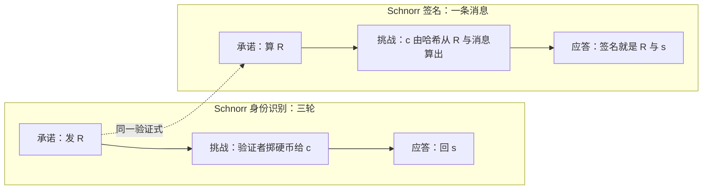

# $\rm Chapter \, 2$ Sigma 协议与知识证明

第 1 章立起了零知识的范式：验证者确信，却什么也没看到，而让这两句话同时成立的凭证是模拟器。本章把这套范式落到第一个具体协议上，围绕它做完整三件事：Schnorr 协议的逐步推导；知识可靠性，也就是「从通过的对话里能把私钥本身抽出来」的证明；Fiat–Shamir 变换，把多轮对话折叠成一条消息（签名），并诚实交代这条捷径会在哪里塌。中间插入图同构的零知识协议：它是零知识概念最早期的经典之一，也让我们看到同一副骨架换到数论之外的用法。

> **开始前自检**：本章假设你已经会：
>
> 1. □ 交互证明的完备性与可靠性两条定义（28-计算理论册 §8.1）；
> 2. □ 零知识的模拟器范式与完美、统计、计算三层定义（91 册第 1 章）；
> 3. □ 离散对数问题 DLP、快速幂、原根与阶（24-密码学册 §5.2、§5.3）；
> 4. □ Schnorr 身份识别的速览版，承诺、挑战、应答三步骨架（24-密码学册 §9.2）；
> 5. □ 承诺方案的绑定性、隐藏性（91 册第 1 章）。

## $\rm \S \, 2.1$ Schnorr 协议：给私钥蒙上一次性掩码

白话：想让验证者相信「我知道 $x$」又不把 $x$ 送出去，办法是每轮对话都给 $x$ 蒙一层全新的一次性掩码：验证者能验出掩码底下确实是 $x$ 在起作用，却算不回 $x$。

场景是身份识别：服务器存着你的公钥，登录时你要证明自己持有对应的私钥。直接发私钥等于把秘密送人；只发公钥又证明不了什么，任何人都能复制一段公钥。所以服务器得考你一道「只有知道私钥的人才答得出」的题，而最省事的考法恰恰最不安全：验证者发随机数 $c$，证明者回 ${s = c \cdot x \bmod q\}$，验证者算 ${g^s \equiv y^c \pmod p\}$ 即可。缺口一戳就破：$c$ 是验证者自己挑的，取 $c = 1$，回来的 $s$ 就是 $x$ 本尊；哪怕 $c \neq 1$，$c$ 与 $q$ 互素，${x = s \cdot c^{-1} \bmod q\}$，一步模逆把私钥拿走。毛病写在明面上：应答里只有 $x$ 一个未知数，而 $c$ 对验证者已知。

药方是让证明者先混进一个只有自己知道的随机数。全章统一参数：素数 $p$、整除 ${p - 1\}$ 的素数 $q$、阶恰为 $q$ 的生成元 $g$（模 $p$ 原根的平方，见 24-密码学册 §5.2）；私钥 ${x \in \{0, 1, \dots, q-1\}\}$，公钥 ${y = g^x \bmod p\}$。DLP 保证从 $y$ 反推 $x$ 目前没有多项式时间算法（24-密码学册 §5.3），于是「持有 $y$」与「知道 $x$」是两件事，协议要验的正是后者。流程四步：

1. **承诺**：证明者取均匀随机的 $v$，发送 ${R = g^v \bmod p\}$；
2. **挑战**：验证者回均匀随机的 ${c \in \{0, 1, \dots, q-1\}\}$；
3. **应答**：证明者回 ${s = v + c \cdot x \bmod q\}$；
4. **验证**：验证者检查 ${g^s \equiv R \cdot y^c \pmod p\}$。

验证式不是外加的规则，它是应答定义的必然推论：

$$
\begin{aligned}
g^s &= g^{v + c x} \\
    &= g^v \cdot \left(g^x\right)^c \\
    &= R \cdot y^c \pmod p
\end{aligned}
$$

读法：第一行代响应答定义；第二行拆指数，幂运算把加法搬进指数；第三行认出承诺与公钥。验证者全程没见过 $v$ 与 $x$，手里只有 $R$、$c$、$s$ 三个对话量和公开的 $y$。

数值走一遍（沿用 §2.2 实测的 toy 域 ${P = 10007\}$、${Q = 5003\}$、$g = 25$）：私钥 $x = 4748$，公钥 ${y = 25^{4748} \bmod p = 6561\}$。证明者取 $v = 3121$，承诺 ${R = 25^{3121} \bmod p = 2529\}$；验证者发挑战 $c = 17$；应答 ${s = 3121 + 17 \times 4748 \equiv 3789 \pmod q\}$。验证者两边各算一次：${g^s = 25^{3789} \bmod p = 1595\}$，${R \cdot y^c = 2529 \times 6561^{17} \bmod p = 1595\}$，相等，通过。注意 $R$、$s$、$1595$ 三个量没有一个能单独反推 $x$，能反推的公式要等 §2.2 凑齐两条同承诺记录。

单条应答为何不泄密：$s$ 是 ${v + c x \bmod q\}$，其中 $c$ 公开而 $v$ 均匀未知。模 $q$ 加上一个均匀未知数，和也均匀，与 $x$ 取什么值无关，所以对不知道 $v$ 的人，$s$ 在 ${\{0, 1, \dots, q-1\}\}$ 上均匀分布，不携带 $x$ 的任何比特。掩码「一次性」也不是修辞：$v$ 若重用，本节稍后的抽取公式就被窃听者直接捡走，§2.2 与 §2.4 各演示一次这条红线。多轮对话的叠加也一样：每轮的 $s_i$ 各自被新鲜的 $v_i$ 掩护，验证者攒下一堆应答仍然算不出 $x$，模拟器论证覆盖任意多轮。

单条不泄密不等于整场不泄密，零知识的论证要覆盖整条对话记录。用第 1 章的模拟器范式：不知道 $x$ 的一方按下面三步造 transcript：

1. 任取 ${c \in \{0, 1, \dots, q-1\}\}$ 与 ${s \in \{0, 1, \dots, q-1\}\}$；
2. 令 ${R = g^s \cdot y^{-c} \bmod p\}$；
3. 输出三元组 ${(R, c, s)\}$。

验证式自动成立：$R$ 本来就是按 ${R \cdot y^c = g^s}$ 反解出来的。分布对齐的账目如下。诚实对话里 ${R = g^v}$，$v$ 均匀，而 $g$ 的阶恰是 $q$，幂映射在子群 $\langle g \rangle$ 上是双射，所以 $R$ 在子群里均匀，且与 $c$（后掷的均匀硬币）独立。模拟器这边，$g^s$ 均匀，乘上固定的子群元素 $y^{-c}$ 只是子群到自身的一个置换，$R$ 同样均匀且与 $c$ 独立。两边 ${(R, c)\}$ 的联合分布完全相同，$s$ 又都均匀：诚实 transcript 与模拟 transcript 逐点同分布，这是第 1 章三层定义里最强的「完美」级。模拟器不知道 $x$，却能造出验证者亲自参与才拿得到的记录，于是记录里除「断言为真」之外的信息量是零。数值上也可以亲手造一份：任取挑战 ${c = 2668\}$、应答 ${s = 2026\}$，反解承诺 ${R = 25^{2026} \cdot 6561^{-2668} \bmod p = 6079\}$，验证式 ${25^{2026} \equiv 6079 \times 6561^{2668} \pmod p\}$ 成立，全程无人碰过 $x$。

一个要说清楚的边界：以上论证默认验证者老老实实掷硬币，这个版本叫诚实验证者零知识（honest-verifier zero knowledge，HVZK）。验证者若见了 $R$ 再挑剔的 $c$（专门挑能帮它破译的值），论证不直接覆盖，缺口由 §2.2 的倒带技术补上。最后交代名字的来历：承诺、挑战、应答三次消息的形状像希腊字母 $\Sigma$，这一族协议统称 Sigma 协议（Sigma protocol）；本节的 Schnorr、下一节的图同构、第 1 章的 Pedersen 相关证明，都是同一副骨架。

参数里「$g$ 的阶恰为 $q$」也不是洁癖。阶若退化成更小的 $d$，挑战名义上在 ${\{0, 1, \dots, q-1\}\}$ 里取，起作用的只有模 $d$ 的那一部分，作弊者猜中的概率放大到 $1/d$，知识误差跟着变差；抽取公式里 ${c_1 - c_2\}$ 的可逆性也要重新检查，因为 $d$ 未必是素数。同时 $R$ 只会在 $d$ 个值里转圈，承诺本身的信息量缩水。生成元取模 $p$ 原根的平方，正是把阶钉死在素数 $q$ 上的操作办法（24-密码学册 §5.2 的原根验证脚本照用）。

**本节小结**：Schnorr 用一次性掩码 $v$ 把私钥藏进应答，验证式 $g^s \equiv R y^c$ 是应答定义的直接推论；模拟器反着造 $R$ 就能得到同分布的 transcript，HVZK 成立，边界留给「验证者不诚实」的情形，由下一节接手。

## $\rm \S \, 2.2$ 知识可靠性：从对话记录里抽出私钥

白话：可靠性只保证「假断言骗不过」，可这里的断言是「我知道 $x$」；知识可靠性把这句话做实：谁能稳定通过协议，我们就能从它的对话记录里把 $x$ 本身挖出来。

工具是特殊可靠性（special soundness）：若有人对同一个承诺 $R$ 交出两份都通过验证、挑战却不同的 transcript ${(R, c_1, s_1)\}$ 与 ${(R, c_2, s_2)\}$，其中 ${c_1 \neq c_2 \bmod q\}$，则私钥可以拼出来。推导三步，每步都用到了「同一承诺」这个前提：

$$
\begin{aligned}
s_1 &\equiv v + c_1 x \pmod q \\
s_2 &\equiv v + c_2 x \pmod q \\
s_1 - s_2 &\equiv (c_1 - c_2)\, x \pmod q
\end{aligned}
$$

两式相减杀掉了 $v$，这一步合法的前提是两次的 $v$ 相同。而 $v$ 相同由承诺相同保证：${g^{v_1} = g^{v_2}\}$ 意味着 ${g^{v_1 - v_2} = 1\}$，$g$ 的阶恰为 $q$，指数又只在模 $q$ 下有意义，于是 ${v_1 \equiv v_2 \pmod q\}$。最后 $q$ 是素数且 ${c_1 \neq c_2\}$，${c_1 - c_2\}$ 可逆，私钥到手：

$$
x \equiv (s_1 - s_2)\,(c_1 - c_2)^{-1} \pmod q
$$

读法：分子是两条应答之差，分母是两条挑战之差，前提「同承诺、异挑战」分别保证分子里 $v$ 已被减干净、分母可逆。这套「倒带再问一次」的操作叫倒带（rewinding）：让证明者回到承诺刚发完的那一刻，挑战重掷一次。

把特殊可靠性升级成定义需要面对真正的作弊者：它不是诚实证明者被倒带，而是从一开始就没有 $x$。它唯一的活路是猜：先猜一个挑战 $c$，取随机 $s$，按 ${R = g^s \cdot y^{-c}\}$ 反造承诺，赌验证者真的发这个 $c$；验证式按构造成立，猜错则满盘皆输，单轮通过概率 $1/q$。知识可靠性（knowledge soundness）由此定义：存在抽取器（extractor），能在期望多项式时间内，从任何以概率 $\varepsilon$ 通过协议的证明者（哪怕它算力无限）那里输出满足 ${g^x = y\}$ 的 $x$；单轮通过概率的下界 $1/q$ 叫知识误差。抽取器先收一份 transcript，再倒带换挑战重收，期望重试轮数与 ${1/\varepsilon\}$ 同阶，对正常证明者（$\varepsilon$ 接近 1）这就是常数轮。$q$ 的尺寸直接决定安全裕量：toy 域 $q = 5003$ 时知识误差约万分之二，现实协议取 ${q \approx 2^{256}\}$，误差小到可忽略。三方各自的牌面摆在一起看：

| 角色 | 手里的牌 | 通过验证的途径 | 成功率 |
| --- | --- | --- | --- |
| 诚实证明者 | $x$ 与每轮新鲜的 $v$ | 按定义应答 | $1$ |
| 无 $x$ 的作弊者 | 只有公钥 $y$ | 先猜挑战、再反造承诺 | $1/q$ |
| 抽取器 | 只看公开的对话量 | 倒带收两份同承诺 transcript | 期望多项式时间拿到 $x$ |

实测锚点（WSL `python3`，toy 素数域 ${P = 10007\}$、${Q = 5003\}$、$g = 25$，脚本与输出在 `_uni5_work\expZK02\`）：取真实私钥 $x = 4748$、公钥 ${y = 6561\}$。抽取器不知道 $x$，只拿 ${(R, c_1, s_1, c_2, s_2)\}$ 五个公开量，按上式拼出 ${\hat{x}\}$，再程序化复核离散对数关系 ${g^{\hat{x}} = y\}$：

1. 诚实证明者被倒带 1000 次：拼出的 ${\hat{x}\}$ 通过 ${g^{\hat{x}} = y\}$ 复核 1000/1000 次，且与真实 $x$ 逐位相等 1000/1000 次；
2. 对照组（故意用两个不同的承诺各配一份 transcript）拼出的假私钥通过复核 0/1000 次，理论期望约 ${1000/q \approx 0.2\}$ 次。

最小可跑版本（完整幂等脚本见 `expZK02\zk02_experiments.py`，输出在 `result.txt`）：

```python
# WSL Bash：存成 schnorr_toy.py 后 python3 schnorr_toy.py
p, q, g = 10007, 5003, 25
x = 4748; y = pow(g, x, p)           # 抽取器实际只用下面的公开量
V = 3121; R = pow(g, V, p)           # 承诺，倒带前后不变
c1, c2 = 17, 4096                    # 两次不同挑战
s1 = (V + c1 * x) % q; s2 = (V + c2 * x) % q
xhat = (s1 - s2) * pow((c1 - c2) % q, -1, q) % q
print(xhat == x)                     # True：拼出的就是私钥
```

复现完整实测的路径（WSL 的 Bash，任意可写目录；脚本只读自己、只写标准输出）：把 `_uni5_work\expZK02\zk02_experiments.py` 拷进工作目录后运行：

```bash
# WSL Bash；当前目录下有 zk02_experiments.py
python3 zk02_experiments.py | tee result.txt
```

管道把输出同时打到屏幕与 `result.txt`；跑完确认 `result.txt` 非空，且 exp1 段落给出 1000/1000 与 0/1000，即复现成功。脚本固定了随机种子，重跑的数字应当逐位一致，总耗时约 3 秒。

第 1 章的模拟器与本章的抽取器是同一枚硬币的两面，方向相反。模拟器不碰 $x$，站在「验证者学到了什么」一侧，靠反造承诺把 transcript 的分布做平；抽取器盯着 $x$，站在「通过者到底知道什么」一侧，靠倒带让同一承诺多见几次挑战。两个角色各持一项特权：模拟器多拿「输出前就选定挑战」，抽取器多拿「让时间倒流重问一次」。安全性恰好卡在两项特权中间：诚实 transcript 能被前者伪造，说明它不含秘密；作弊 transcript 能被后者榨出秘密，说明蒙混的代价就是私钥本身。

这笔账有锋利的另一面：抽取公式不需要任何特殊许可，谁看到两条同承诺的 transcript 谁就能算。§2.4 会看到，FS 签名者若犯了「随机数重用」的错误，等于亲手把两条 transcript 递给攻击者，私钥当场泄尽；24-密码学册 §7.4 的 ECDSA nonce 重用惨案是同一公式的现实版本。特殊可靠性与攻击手段是同一个方程的两副面孔。

**本节小结**：特殊可靠性靠「同承诺保 $v$ 相同、异挑战保可逆」两步把 $x$ 拼出来；倒带把这份能力推广到任意作弊者，知识误差 $1/q$ 即猜挑战的赌博成功率。抽取方程是双刃剑，谁拿到同承诺的两条记录谁就拿走私钥。

## $\rm \S \, 2.3$ 图同构的零知识协议

白话：Schnorr 证明的是数论关系，这一节证明的是图关系：我知道两张图的顶点对应表 $\varphi$，但我一个映射都不给你。验证者每轮自己出题自己收卷，收到的答案恰好只够判「确有对应表」，不够把它还原。

记号：$G_1$ 与 $G_2$ 是同样多顶点的两张图，秘密是同构映射 $\varphi$，即把 $G_1$ 的顶点按 $\varphi$ 重命名后恰是 $G_2$。断言「${G_1 \cong G_2\}$」本身在 NP 里，证书就是 $\varphi$（28-计算理论册 §8.2 提过同构有证书）；麻烦在于证书即秘密，比如匿名化数据的图结构对应表一旦交出，脱敏就白做了。零知识协议要证明的是「我持有证书」，交付的却不是证书。流程三步：

1. **承诺**：证明者取 $n$ 个顶点上的均匀随机置换 $\pi$，发送重命名后的图 ${H = \pi(G_1)\}$；
2. **挑战**：验证者发随机比特 ${b \in \{1, 2\}\}$，指定「$H$ 与哪张图对上」；
3. **应答**：$b = 1$ 时证明者公开 $\pi$（它是 ${G_1 \to H\}$ 的同构）；$b = 2$ 时公开 ${\psi = \pi \circ \varphi^{-1}\}$（${G_2\}$ 先经 ${\varphi^{-1}\}$ 回到 $G_1$，再经 $\pi$ 到 $H$）。

完备性一目了然：两个方向的答案证明者随手就能构造，永远答得上。可靠性靠一个夹逼：若 ${G_1 \not\cong G_2\}$，作弊者刚发出的 $H$ 至多与两张图中的一张同构，否则沿 $H$ 拼接两个同构就得到 ${G_1 \cong G_2\}$，与前提矛盾。$H$ 只与一张图同构时，作弊者只能答对一个分支，单轮蒙混概率至多 $1/2$；重复 $t$ 轮全过的概率 ${2^{-t}\}$，40 轮即 ${2^{-40} \approx 9.1 \times 10^{-13}\}$，汇率表见 28-计算理论册 §8.2 的同款账目。夹逼里那步矛盾值得单独画出：$H$ 若同时与两图同构，两条路径接起来：

$$
G_2 \;\xrightarrow{\;\psi\;}\; H \;\xrightarrow{\;\pi^{-1}\;}\; G_1
$$

读法：沿 $\psi$ 从 $G_2$ 到 $H$，再沿 $\pi$ 的逆从 $H$ 回 $G_1$，拼接给出 ${G_2 \cong G_1\}$，与「两图不同构」的前提直接冲突，所以「两个分支都答得上」的作弊者在不同构的世界里不存在。

零知识的证明走模拟器，这里有一处比 Schnorr 巧妙的结构。模拟器先猜验证者的比特 ${\hat{b} \in \{1, 2\}\}$，取随机置换 $\hat{\pi}$，直接按应答反造承诺：发 ${H = \hat{\pi}(G_{\hat{b}})\}$。验证者的 $b$ 恰好猜中（概率 $1/2$）就交出 $\hat{\pi}$；猜错就倒带重来，期望两次。妙处在猜错也无妨：当 ${G_1 \cong G_2\}$ 时，$\{\pi(G_1)\}$ 与 $\{\pi(G_2)\}$ 作为带标号的图的集合是同一个集合，因为任一 ${\pi(G_2) = (\pi \circ \varphi^{-1})(G_1)\}$，而 ${\pi \circ \varphi^{-1}\}$ 随 $\pi$ 遍历全体置换。所以模拟器发出的 $H$ 与诚实证明者发出的 $H$ 落在同一批图上、均匀分布；对固定的 $H$ 与 $b$，双方交出的同构映射也都是均匀的。transcript 逐点同分布，完美零知识（第 1 章「完美」层）成立。直觉版一句话：验证者每轮收到的「随机重命名的图加上一个同构映射」，它自己闭着眼也能造一份，协议没给它任何新东西。

> **选读**：GI 协议每轮挑战只有 $2$ 个，看起来是个缺陷，其实是可调参数。Fiat 与 Shamir 1986 年那篇论文里的身份识别协议把挑战扩成 $k$ 比特（空间 $2^k$），轮数与挑战空间做显式交换；本章的 Schnorr 把这个参数直接拉满到素数 $q$，一轮顶几十轮，这也是它在现实身份识别与签名里胜出的原因之一。

这段协议的历史值得一句准确的注脚：零知识概念由 GMR（Goldwasser、Micali、Rackoff，1985）建立，配套的图非同构协议即 28-计算理论册 §8.2 那个；本节的图同构零知识版本通常归于 GMW（Goldreich、Micali、Wigderson，1986）。两个协议方向相反，恰好凑成一对：GNI 里验证者洗牌出题、考证明者辨认来源，因为非同构没有证书可用；GI 里证明者洗牌出题、自证持有证书，因为证书就是不想给的东西。随机性的来源从验证者一侧换到证明者一侧，「确信却什么也没看到」两头都成立。

Sigma 模板在这里原样复用，连知识可靠性都照搬：对同一 $H$ 交出两个分支的应答（$\pi$ 与 $\psi$），则 ${\varphi^{-1} = \pi^{-1} \circ \psi\}$，秘密同构被拼了回来（方向是 ${G_2 \to G_1\}$，取逆即得 $\varphi$）。区别只在挑战空间：GI 每轮只有 $2$ 个挑战，单轮蒙混 $1/2$，安全靠轮数堆；Schnorr 挑战空间是 $q$，单轮 $1/q$，一轮顶 GI 几百轮。

三个协议摆一张表收束，看「秘密」与「挑战空间」两列如何决定安全的计价方式：

| 协议 | 证明者持有的秘密 | 每轮挑战空间 | 抽取器拼出什么 | 安全计价 |
| --- | --- | --- | --- | --- |
| Schnorr 身份识别（§2.1） | 私钥 $x$ | $q$（素数，大） | $x$ | 单轮 $1/q$，一轮见分晓 |
| 图同构（本节） | 同构映射 $\varphi$ | $2$ | $\varphi$ 的逆（取逆还原） | 单轮 $1/2$，按轮数堆 |
| 图非同构（28-计算理论册 §8.2） | 无，靠算力优势 | $2$ | 无秘密可抽 | 单轮 $1/2$，按轮数堆 |

**本节小结**：图同构协议把「证明持有证书」与「交付证书」拆开：承诺 $H$ 封住秘密，验证者的比特决定拆哪扇门，猜错就倒带的模拟器借两图同构的事实造出同分布记录；特殊可靠性同样能把 $\varphi$ 拼回来，只是挑战空间小，安全按轮数计价。

## $\rm \S \, 2.4$ Fiat–Shamir 变换：把对话折叠成签名

白话：交互要占网络来回，签名只需一条消息。Fiat–Shamir 的主意是：验证者在协议里唯一干的活是掷一枚谁都骗不了的均匀硬币，那就用哈希函数充当这枚硬币，挑战不再是对方发的，而是从承诺里算出来的。

变换本身一步：把「验证者发随机 $c$」换成 ${c = H(R, m)\}$，其中 $m$ 是被签的消息、$H$ 是密码学哈希（如 SHA-256）。签名就是 ${(R, s)\}$ 两个数，$s$ 的定义不变；验证者收到后自己重算 $c$，检查 ${g^s \equiv R \cdot y^c \pmod p\}$。数值走一遍（同一 toy 域，私钥 $x = 4748$）：取 $v = 888$，承诺 ${R = 25^{888} \bmod p = 4802\}$，消息 `msg-1` 与 $R$ 过哈希得挑战 $c = 1147$，应答 ${s = 888 + 1147 \times 4748 \equiv 3580 \pmod q\}$；验证者重算哈希得同一个 $c$，检查 ${g^s = 25^{3580}\}$ 与 ${R \cdot y^c = 4802 \times 6561^{1147}\}$ 模 $p$ 相等，签名成立。诚实签名者的流程与 §2.1 逐字相同，只是挑战改由哈希给出，所以诚实 transcript 的分布论证原样照搬。要重新论证的是作弊者，它手里没有 $x$，路线只有两条：

1. **顺着走**：照诚实流程取 $v$、发 ${R = g^v\}$、算 ${c = H(R, m)\}$，然后要交 ${s = v + c x\}$，卡在 $x$ 上，死路；
2. **倒着走**：先取定 $c$ 与 $s$，按 ${R = g^s \cdot y^{-c}\}$ 反造承诺（验证式按构造成立），然后需要 ${H(R, m) = c\}$。随机预言机模型（random oracle model，ROM）把 $H$ 理想化为一枚真随机函数：$R$ 是攻击者现造的新输入，预言机在这个输入上的输出是均匀且独立的随机值，撞回指定 $c$ 的概率 $1/q$。

倒着走的账算完了安全性：盲伪造单次成功率 $1/q$，伪造一份签名的期望代价约 $q$ 次哈希。读法：攻击者不是在「猜私钥」，而是在解方程组——自由变量 $(c, s)$ 有两个，一个约束 ${R = g^s y^{-c}\}$ 被它自己反造时用掉，剩下 ${H(R, m) = c\}$ 这个约束由预言机的随机性把守。结构上看清变换到底换了什么：诚实流程里「先承诺、后见挑战」的顺序，交互版靠验证者当场的硬币强制，非交互版靠哈希的不可预测性强制；攻击者想先知道挑战再定承诺，就必须先定下 $R$ 再问预言机，而问出来的答案帮不了已经定死的 $R$。Schnorr 签名、第 3 章的 NIZK 都从这个折叠来，Fiat–Shamir 变换（Fiat–Shamir transform）1986 年提出，ROM 下的安全证明由 Pointcheval 与 Stern 在 1996 年补齐。



折叠后的账目也顺：签名就是 ${(R, s)\}$ 两个模 $q$ 的数，验证是两次模幂加一次哈希，通信与计算都是常数级，这正是它能进 TLS 握手一类高频场景的原因（24-密码学册 §8 的握手戏份里已有它的近亲 ECDSA）。代价则全部记在 ROM 这个假设头上，下面的攻击面就是这份假设的分期账单。

实测锚点（同 §2.2 的 toy 域，预言机用 SHA-256 把承诺映射到 ${[0, q)\}$，脚本与全部输出在 `expZK02\result.txt`）：

1. 诚实 FS 签名 500 份全部通过验证（500/500）；
2. 盲伪造（倒着走）跑 200000 次，成功 48 次，实测成功率 ${2.40 \times 10^{-4}\}$，理论值 ${1/q \approx 2.00 \times 10^{-4}\}$，48 对期望 40 次的偏离在二项分布约 1.3 个标准差内；
3. 连续伪造到首次成功的试探次数：200 次伪造平均 4697.2 次，与几何分布均值 ${q = 5003\}$ 相符（单次最少 6、最多 21982）；
4. 抽一份成功伪造的 transcript 用标准验证式复核：通过。可靠性从来不是「不可能伪造」，而是「伪造的期望代价是 $q$ 次哈希」，每一次撞大运成功的伪造都是一份如假包换的合法签名。

折叠省了交互，也把安全的承重结构从「验证者的硬币」挪到「哈希的随机性」，于是塌方点跟着搬家，三个攻击面各配一次实测：

1. **预言机不随机**：挑战源若退化（常数、可预测、跨会话重置），倒着走就不再是赌博。实测把预言机换成常数：盲伪造 100/100 全部通过验证，对比 ROM 下的 ${2.4 \times 10^{-4}\}$，塌得干干净净。SHA-256 本身没有标准模型下的证明，安全性是启发式置信，这正是 ROM 的边界。
2. **随机数重用**：签名者的随机数生成器出 bug、两次签名用了同一个 $v$，则两条签名承诺相同、挑战不同（消息不同则哈希不同），§2.2 的抽取公式原样生效。实测：两条同 $v$ 签名交给攻击者，恢复的私钥与真实 $x$ 相等（True）；用它给第三条消息伪造的签名通过标准验证式（True）。私钥泄尽的瞬间签名验证毫无异样，这条防线的执行者只有签名者自己，工程上的对策是把 $v$ 改成由私钥与消息共同确定性地导出（RFC 6979 的思路），从源头杜绝两次同 $v$。
3. **弱 Fiat–Shamir**：多轮协议里若哈希漏绑部分 transcript，攻击者可以对没被绑住的消息反复打磨（grinding）来偏置挑战，真实的 STARK 与 FRI 实现出过这类漏洞。单轮签名也有对应的低级错误：把挑战算成 ${c = H(R)\}$、漏掉消息 $m$，签名 ${(R, s)\}$ 就对所有消息通用，验证者对任何 ${m'}$ 都重算出同一个 $c$ 并放行，签名失去消息绑定、等于什么都没签。本册只立规矩：进哈希的必须是完整的 transcript，少绑一项就是留一扇没锁的门。

还有一处债要记账：非交互版的零知识论证同样要回到模拟器，而 ROM 里的模拟器多了一件交互版没有的武器——它可以「编程」预言机，先定挑战再补哈希值。这条线怎么走通、以及不用哈希的另一条非交互路线（公共参考串，代价是可信设置），第 3 章接手。

**本节小结**：Fiat–Shamir 把验证者的硬币换成哈希，诚实流程不变，作弊只剩「倒着走」一条路，ROM 下成功率 $1/q$；实测与理论吻合，而常数预言机 100% 塌方、随机数重用当场泄钥、弱哈希留打磨空间三个攻击面划定启发式的边界。

## $\rm \S \, 2.5$ 关键概念回顾

1. Sigma 协议的三步各交换什么消息？验证式 ${g^s \equiv R \cdot y^c\}$ 如何从应答的定义一步步推出？
2. 为什么单条应答 $s$ 不泄露 $x$？模拟器造 transcript 时为什么先取 $c$ 与 $s$、后造 $R$？
3. 特殊可靠性抽出 $x$ 用到哪两个前提、各保证推导中的哪一步？知识可靠性与普通可靠性的对象差在哪里，没有 $x$ 的作弊者单轮通过概率是多少？
4. 图同构协议的模拟器「猜错就倒带」，为什么猜错时已发出的 $H$ 也不破坏分布对齐？
5. Fiat–Shamir 变换把验证者的哪项职能换成了什么？随机预言机模型下盲伪造的成功率与代价各是多少？

## $\rm \S \, 2.6$ 应用与辨析

1. 排障：重放攻击与随机数重用都带「重」字，一个针对识别协议、一个针对 FS 签名，机理与症状有何不同？提示：一方的攻击素材是别人录下的完整对话，另一方是签名者自己产出的两条签名。
2. 比较：GI 协议 40 轮才到 ${2^{-40}\}$，Schnorr 一轮的知识误差就只有 $1/q$，差距的根源是什么？若把 GI 协议直接 Fiat–Shamir 化做成签名，会发生什么？
3. 应用：你的签名服务在高并发下复用了随机数池，攻击者收集到同一私钥的两条签名，请写出它恢复私钥的完整算式，并说明验证端为何毫无感知。

## $\rm \S \, 2.7$ 本章自测答案

1. 三步依次交换承诺 ${R = g^v\}$、挑战 $c$、应答 ${s = v + cx \bmod q\}$；验证式推导：${g^s = g^{v + cx} = g^v \cdot (g^x)^c = R \cdot y^c\}$，即拆指数、认承诺与公钥（§2.1）。
2. $s$ 中 $v$ 均匀未知，模 $q$ 加均匀未知数掩盖了 $x$；模拟器先取 $c$、$s$ 是因为 $R$ 必须反解自 ${R = g^s y^{-c}\}$，顺序反了就造不出通过验证的记录（§2.1）。
3. 前提是同一承诺与不同挑战；前者经 ${g^{v_1} = g^{v_2} \Rightarrow v_1 \equiv v_2\}$ 保证相减杀掉 $v$，后者保证 ${c_1 - c_2\}$ 模素数 $q$ 可逆。知识可靠性进一步要求「能从任何通过者身上抽出秘密」，作弊者先猜挑战 $c$、反造 ${R = g^s y^{-c}\}$，单轮通过概率 $1/q$（§2.2）。
4. 因为 ${G_1 \cong G_2\}$ 时 $\{\pi(G_1)\}$ 与 $\{\pi(G_2)\}$ 是同一批带标号的图，模拟器按 ${H = \hat{\pi}(G_{\hat{b}})\}$ 发出的 $H$ 与诚实发出的落在同一集合上且均匀（§2.3）。
5. 换掉的是「当场掷均匀硬币」这一职能，替换物是哈希 ${c = H(R, m)\}$；盲伪造单次成功率 $1/q$，一份伪造的期望代价约 $q$ 次哈希（§2.4）。

**你现在能**：在 toy 素数域上跑通 Schnorr 三步与验证式，用两条同承诺的 transcript 把私钥拼出来并程序化复核，再用 SHA-256 把协议折叠成单消息签名、实测盲伪造率落在 $1/q$ 附近。

下一章把「非交互」推到底：Fiat–Shamir 之外还有一条公共参考串（CRS）路线，Blum、Feldman 与 Micali 的三轮协议在共享随机串上把交互压到零；那里会重新遇到模拟器，也会第一次正面计算「可信设置」这笔新账。

