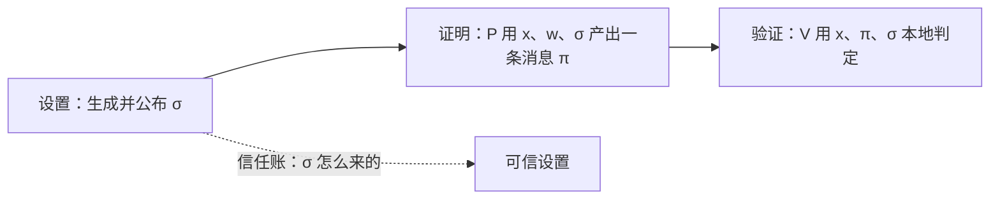

# $\rm Chapter \, 3$ 常数轮与 NIZK：把信任前置到一条公共串

第 2 章结尾留了一笔账：Fiat–Shamir 把交互折叠成一条消息，零知识的论证却只还了一半——ROM 里的模拟器靠「编程预言机」造记录（§2.4），而「哈希像掷硬币」本身只是启发式置信。本章走另一条路：给各方提前共享一条公共随机串，证明照样压到一条消息，却不借随机预言机。这条路是 Blum、Feldman 与 Micali 在 1986 年打通的，代价是一笔新账：那条公共串是谁生成的。本章围绕这笔账做四件事：CRS 模型的定义与它新增的信任问题；二次剩余的 Sigma 协议推导，这是 BFM 选取的原材料；把协议做成非交互的两种方式，配上模拟器分布与磨种子的实测；trapdoor 藏进 CRS 的后果演示。收尾把 NIZK 放回签名，为第 4 章「把任意语句写成电路」铺路。

> **开始前自检**：本章假设你已经会：
>
> 1. □ 零知识的三层定义与统计距离的两张面孔（91 册 §1.2）；
> 2. □ 模拟器范式的完整论证，「模拟器为何不是作弊」的三层拆解（91 册 §1.4）；
> 3. □ Schnorr 协议的推导、特殊可靠性与抽取器（91 册 §2.1、§2.2）；
> 4. □ Fiat–Shamir 变换、ROM 下盲伪造 $1/q$ 的账与三个攻击面（91 册 §2.4）；
> 5. □ 原根、群元素的阶与离散对数假设的口径（24-密码学册 §5.2、§5.3）。

## $\rm \S \, 3.1$ CRS 模型：把信任写成一条公共串

白话：Fiat–Shamir 的信任押在「哈希输出不可预测」上，这是一张没有实体的保单。CRS 路线换一种押法：先让所有人看到同一串真随机比特，挑战就从这串比特里来。随机性从「每次现场掷」变成「提前铸好、人人可查」，省掉交互，换来一笔设置账。

**公共参考串（common reference string，CRS）**：一条由**设置（setup）**阶段生成、向所有参与方公布的字符串 $\sigma$。CRS 模型下协议的完整账单是三步：

1. **设置**：$\mathrm{Setup}(1^\lambda) \to \sigma$，运行一次，结果公布给所有人；
2. **证明**：证明者输入公开语句 $x$、私有见证 $w$ 与 $\sigma$，输出证明 $\pi$，一条消息；
3. **验证**：验证者输入 $x$、$\pi$ 与 $\sigma$，本地判定，无来回。

「常数轮」指的就是这张账单：设置一次、证明一条消息、验证零次通信，全程没有逐轮问答。交互被压到零，但账单底部多了一行：$\sigma$ 怎么来的。这一行拆成两个具体问题。其一，$\sigma$ 的随机性是真的吗，生成者有没有往里塞只有自己能利用的结构；其二，生成者有没有私藏**陷阱门（trapdoor）**，也就是关于 $\sigma$ 的秘密信息，让它能做出别人做不出的事。两个问题合称**可信设置（trusted setup）**，是本章后半的主角。

两条非交互路线的账摆一张表，押注物与攻击面各在一列：

| 路线 | 挑战来自哪 | 信任押在哪 | 设置账 | 已知攻击面 |
| --- | --- | --- | --- | --- |
| Fiat–Shamir（§2.4） | $c = H(x, a)$ | 哈希像真随机函数（ROM 启发式） | 无 | 预言机退化、弱 FS、磨种子 |
| CRS（本章） | 从 $\sigma$ 来 | $\sigma$ 的生成过程 | 一次设置仪式 | trapdoor 残留、随机性造假 |



$\sigma$ 还有一条被低估的性质：它与语句无关。一条串铸好后可以服务任意多条、事先想象不到的证明，设置的一次性成本被摊薄到近乎为零；但也正因语句无关，串必须在见到任何语句之前铸好，模拟器因此必须在「语句到来之前」就备好全部作弊资源。这个时序约束是 §3.3 两件武器（磨种子与隐藏比特）共同的出发点。

BFM 1986 的贡献需要一个如实的范围声明：他们证明了在 CRS 模型里，NP 语句的零知识证明可以非交互，原型是二次剩余语句；完整构造走「隐藏比特模型」（§3.3 只给它一个准确的定位），细节超出本册。本章的做法是抓两条本质做 toy：模拟器允许自己生成 $\sigma$（这是 CRS 模型给模拟器的定义性自由），以及生成者手里的 trapdoor 能改写一切。两条本质恰好对应可信设置的两个问题。

**本节小结**：CRS 模型把验证者的硬币换成一条提前铸好的公共串，交互压到常数轮；新增的账是可信设置的两问，随机性真实性与 trapdoor 残留，它们分别由 §3.3 的模拟器自由与 §3.4 的演示接管。

## $\rm \S \, 3.2$ 二次剩余的 Sigma 协议：BFM 的原材料

白话：素数域上「是不是平方」人人一算便知，没什么可证的；两个素数乘起来的模数上，「是不是平方」没人会算，这才是零知识该出场的地方。BFM 选的语句正是它：断言 $x$ 是模 $N$ 的平方，见证人是那个平方根。

参数与语句：素数 $p \equiv q \equiv 3 \pmod 4$，$N = pq$（本章 toy 取 $p = 1019$、$q = 1031$，$N = 1050589$）。$\mathbb{Z}_N^*$ 是模 $N$ 的可逆元集合，$x$ 叫**二次剩余（quadratic residue）**，记 $x \in \mathrm{QR}_N$，当且仅当存在 $w$ 使 ${w^2 \equiv x \pmod N}$；那个 $w$ 是见证人。判定困难性由**二次剩余假设（quadratic residuosity assumption）**担保：不分解 $N$，没有已知的多项式时间算法判定 $\mathrm{QR}$ 成员。它与 24 册 §5.3 离散对数假设同列一张困难性价格表，也是 Goldwasser–Micali 加密方案的地基。

素数域上这件事为什么平凡，一句判据说清。**欧拉判据（Euler's criterion）**：模素数 $p$，$u$ 是平方当且仅当 ${u^{(p-1)/2} \equiv 1 \pmod p}$。推导只要两步，用的全是已知件：模 $p$ 乘群是循环群，取原根 $\gamma$（24 册 §5.2），写 $u \equiv \gamma^k$；于是

$$
u^{(p-1)/2} \equiv \bigl(\gamma^{(p-1)/2}\bigr)^{k} \equiv (-1)^{k} \pmod p
$$

中间一步是因为 $\gamma^{(p-1)/2} \equiv -1$：$\gamma$ 的阶是 $p-1$，它的 $(p-1)/2$ 次幂是阶为 $2$ 的元素，只能是 $-1$。所以指数 $k$ 偶则得 $1$（$u = \gamma^{2j}$ 是平方），$k$ 奇则得 $-1$。而模 $N$ 的非剩余可以直接从素数因子造出：若 ${u^{(p-1)/2} \equiv -1 \pmod p}$，则 $u$ 模 $N$ 必非剩余，因为 $u \equiv w^2 \pmod N$ 两边同取模 $p$ 会给出 $u \equiv (w \bmod p)^2 \pmod p$，与判据矛盾。本章实验的假语句就是这么造的（$u = 2$ 对 $p = 1019$ 判出非剩余）。

协议四步，骨架与 §2.1 的 Schnorr 同源：

1. **承诺**：证明者取均匀的 $r \in \mathbb{Z}_N^*$，发送 $a = r^2 \bmod N$；
2. **挑战**：验证者发均匀比特 $e \in \{0, 1\}$；
3. **应答**：证明者回 ${s = r \cdot w^e \bmod N}$；
4. **验证**：验证者检查所有量在 $\mathbb{Z}_N^*$ 内（互素），且 ${s^2 \equiv a \cdot x^e \pmod N}$。

完备性是一行代入：$s^2 = r^2 w^{2e} = a \cdot x^e$。第 4 步的互素检查不是洁癖：若放任 $a$ 取 $\mathbb{Z}_N^*$ 之外的值，作弊者发 $a = 0$、$s = 0$ 就能让验证式 $0^2 \equiv 0 \cdot x^e$ 对任何语句恒过，可靠性当场蒸发；把群量钉死在可逆元集合里，下面除法步骤里的 $s_0^{-1}$ 也才有定义。

可靠性赌在「先承诺、后见挑战」的时序上。设 $x$ 非剩余，作弊者先发一个 $a$，若它两个分支都答得上，则存在 $s_0, s_1 \in \mathbb{Z}_N^*$ 使 ${s_0^2 \equiv a}$ 且 ${s_1^2 \equiv a x \pmod N}$。两式一除，平方根当场拼出：

$$
x \equiv a x \cdot a^{-1} \equiv s_1^2 \cdot \bigl(s_0^2\bigr)^{-1} \equiv \bigl(s_1\, s_0^{-1}\bigr)^2 \pmod N
$$

读法：第一等号是恒等式，第二等号代入两个分支的应答，第三等号把平方的商收成商的平方（互素保证 $s_0^{-1}$ 存在）。结论与「$x$ 非剩余」矛盾，所以作弊者只能赌一个分支：先发平方形的 $a$ 赌 $e = 0$，或先发 $a = s^2 x^{-1}$ 形赌 $e = 1$，单轮蒙混 $1/2$，$t$ 轮全过 $2^{-t}$，计价方式与 §2.3 的图同构协议同款。

单轮 $1/2$ 的计价贵在轮数：压到 $2^{-40}$ 得堆 $40$ 个副本，每副本一条承诺加一条应答（§2.3 的汇率表）。挑战宽度想加宽也不能只改取值域：单个承诺 $a$ 只撑得住一次「先承诺、后见挑战」的时序，$e$ 个挑战比特需要 $e$ 个独立副本各自绑定后再并成一次验证。§3.3 的非交互版会把这笔账重记一遍，那里加宽的不再是副本数，而是哈希输出的宽度。

零知识走模拟器，而且这次是完美的。模拟器先选 $\hat{e} \in \{0, 1\}$ 与 $\hat{s} \in \mathbb{Z}_N^*$，反解承诺

$$
\hat{a} = \hat{s}^2 \cdot x^{-\hat{e}} \bmod N
$$

$x^{-1} \bmod N$ 用扩展欧几里得，不需要分解 $N$，模拟器全程不接触 $w$。分布对齐的账目：对固定的 $e$，真实侧映射 $r \mapsto (r^2,\ r w^e)$ 是 $\mathbb{Z}_N^*$ 到曲面 $\{(a, s) : s^2 = a x^e\}$ 的双射（第二分量已经单射）；模拟器侧映射 $\hat{s} \mapsto (\hat{s}^2 x^{-e},\ \hat{s})$ 也是同一曲面的双射。两侧的 $(a, s)$ 都在这条曲面上均匀，$\hat{e}$ 与真实验证者的硬币同为均匀比特，于是三元组 ${(a, e, s)}$ 逐点同分布：第 1 章三层定义里的「完美」层（§1.2）。

实测锚点（WSL `python3`，脚本与全部输出在 `26Fall/ucup_data/_uni5_work/expZK03/`，`expZK03.py` 与 `result.txt`，种子 `20261118`，总耗时 10 秒）：真实与模拟 transcript 各 $200000$ 份，模拟记录抽验 $20000$ 条全部通过验证式（$20000/20000$）；挑战比特均值真实 $0.5016$、模拟 $0.4975$。分布按 §1.3 与 §1.4 的口径检验：$a$ 与 $s$ 各按模 $20$ 分桶，与精确桶概率比统计距离，$a$ 桶分别为 $0.0041$（真实）与 $0.0037$（模拟），$s$ 桶为 $0.0061$ 与 $0.0032$；把 $a$ 的桶分布限定在 $e = 1$ 的子样本上再做一遍（检验「$a$ 是否随挑战分支偏移」的结构），得 $0.0065$ 与 $0.0037$。六个数全部落在 $20$ 桶、$20$ 万样本的双侧噪声尺度 $\sqrt{20 / (\pi N)} \approx 0.0056$ 附近。按 §1.4 立过的规矩说明：完美层的主张是分布严格相等，实验只排「构造写错导致分布带痕迹」的事故。

数值走查一轮（toy 域，见证人 $w = 1234$，语句 $x = 472167$）：证明者取 $r = 765$，承诺 $a = 765^2 \bmod N = 585225$；验证者发挑战 $e = 1$；应答 ${s = 765 \cdot 1234 \bmod N = 944010}$；验证端 $s^2$ 与 $a \cdot x$ 模 $N$ 相等，通过。模拟器的一轮：先选 $\hat{e} = 1$、$\hat{s} = 222$，反解 $\hat{a} = 222^2 \cdot x^{-1} \bmod N = 319284$（其中 $x^{-1} = 966180$），验证式同样成立，全程无人碰过 $w$。最小可跑版本（完整幂等脚本见 `expZK03\expZK03.py`，输出在 `result.txt`）：

```python
# WSL Bash：存成 qr_toy.py 后 python3 qr_toy.py
N = 1019 * 1031                     # Blum 整数 1050589
w = 1234; x = pow(w, 2, N)          # 语句 x = 472167，见证人 w
r = 765
a = pow(r, 2, N)                    # 承诺：585225
e = 1; s = r * pow(w, e, N) % N     # 应答：944010
print(pow(s, 2, N) == a * pow(x, e, N) % N)      # True：验证式通过
xi = pow(x, -1, N)                  # 966180，扩展欧几里得，无需分解 N
sh, seh = 222, 1                    # 模拟器先选挑战与应答
ah = pow(sh, 2, N) * pow(xi, seh, N) % N         # 反解承诺：319284
print(pow(sh, 2, N) == ah * pow(x, seh, N) % N)  # True：模拟记录同样合法
```

**本节小结**：二次剩余协议把 Schnorr 骨架搬到合数模上，可靠性靠「两分支应答一除即拼出平方根」的矛盾，模拟器靠反解 $\hat{a}$ 达到完美层；实测六个 TV 数全部落在噪声尺度，素材齐了，下面把它压成一条消息。

## $\rm \S \, 3.3$ 从交互到非交互：FS、种子与磨种子

白话：把验证者的那枚比特硬币换成机器可复现的东西，有两条路：换成哈希（FS，§2.4 的老路），或换成 CRS 里的种子。第二条路里模拟器多了一件合法武器，它拥有生成 $\sigma$ 的权力，但也背了一笔磨种子的工钱。

先立定义。**非交互零知识证明（non-interactive zero-knowledge proof，NIZK）**：证明 $\pi$ 是一条消息；零知识要求对每个多项式时间验证机存在多项式时间模拟器，模拟器只拿公开语句（与 $\sigma$），输出的记录与真实视图不可区分，口径仍取 §1.2 的三层。ROM 里的模拟器比交互版多一件工具：**编程预言机**。交互版的模拟器靠「先选挑战与应答、反解承诺」（§1.4）；非交互版先造好整条记录，再让预言机在相应输入上吐出配好的挑战值。§2.4 结尾欠的账在这里还清：FS 方案的零知识论证靠编程预言机走通，但其效力受限于 ROM 这个理想化假设。

CRS 路线的第一落点是个工程折中：$\sigma$ 里放一段真随机种子 $\mathrm{seed}$，挑战从哈希折叠，$c = H(\mathrm{seed},\, x,\, a)$。进哈希的仍是完整 transcript（§2.4 立过的规矩）。模拟器在 CRS 模型里有定义性自由：$\sigma$ 由它生成。于是它的流程是先选目标挑战 $\hat{c}$ 与应答 $\hat{s}$，反解 $\hat{a} = \hat{s}^2 x^{-\hat{c}}$，然后**磨种子（grinding）**：逐个试 $\mathrm{seed} = 0, 1, 2, \dots$，直到 $H(\mathrm{seed}, x, \hat{a})$ 恰好等于 $\hat{c}$，单次命中概率 $2^{-b}$（$b$ 为挑战比特数），期望 $2^b$ 次。作弊者磨的是同一台机器：它对假语句取分支 $0$ 的伪造式 $a = s^2$（这个式子对任何 $x$ 都成立），磨种子等挑战归零，期望同样是 $2^b$ 次。

数值走查一轮（$8$ 比特挑战）：诚实证明者取 $r = 765$，承诺 $a = 585225$，CRS 里的种子 $\mathrm{seed} = 4$ 给出 $c = 159$，应答 ${s = 765 \cdot w^{159} \bmod N = 494310}$，验证式通过。模拟器的一轮：先选 $\hat{c} = 137$、$\hat{s} = 222$，反解 $\hat{a} = 698009$，磨到 $\mathrm{seed} = 221$ 时哈希首次命中（试了 $222$ 次，$2^8 = 256$ 量级的正常抽样），验证式同样通过。最小可跑版本：

```python
# WSL Bash：toy NIZK（挑战 = H(seed, x, a) mod 256），承接 qr_toy.py 的 N、x、xi
import hashlib
def H(*v):
    return int(hashlib.sha256("|".join(str(t) for t in v).encode()).hexdigest(), 16)
def proof(seed, r):                      # 诚实证明者
    a = pow(r, 2, N)
    c = H(seed, x, a) % 256
    return a, r * pow(w, c, N) % N       # (a, s) 两个数就是全部证明
def sim():                               # 模拟器：生成 σ（自选 seed），先选 c、s 再磨
    c, s = 137, 222
    a = pow(s, 2, N) * pow(xi, c, N) % N
    seed = next(t for t in range(10**6) if H(t, x, a) % 256 == c)
    return seed, a, s
print(proof(4, 765))                     # (585225, 494310)
print(sim())                             # (221, 698009, 222)
```

读法：`proof` 与 `sim` 返回的记录形状完全一致，验证者拿到哪一份都无从分辨出处，这份「形状一致」正是磨种子买来的自由，而它的价格随挑战宽度指数上涨。

挑战宽度与安全余量的关系要写准：固定 $\sigma$ 不磨种子时，单条假证明的通过率是 $2^{-b}$；磨种子把它换成 $2^b$ 次哈希的期望代价。$b = 128$ 时两者都到 $2^{128}$ 量级，这笔账是 §2.4 里 $1/q$ 的非交互翻版，只是价格单位从模幂换成了哈希。

实测锚点（同 §3.2 的脚本与目录）：磨种子代价，$1$ 比特挑战下模拟器与作弊者均值都是 $2.0$ 次（理论 $2^1 = 2$）；$8$ 比特下模拟器 $260.9$ 次、作弊者 $255.2$ 次（理论 $2^8 = 256$，作弊者磨的是假语句 $x_0 = 2$）。分布对齐，$8$ 比特 NIZK 的真实与模拟记录各 $10000$ 份，$a$ 桶与 $s$ 桶（模 $20$）的经验分布之差分别为 $0.0229$ 与 $0.0272$，落在双侧噪声尺度 $\sqrt{20 / (\pi \cdot 10^4)} \approx 0.025$ 之内；真实记录的验证式抽验 $10000/10000$ 通过。

这组实测里藏着本章最要紧的一个观察：**折中方案里，模拟器与作弊者恰好同价**。磨种子是模拟器的合法工钱，也是作弊者的攻击成本，挑战宽度 $b$ 同时是两者的价格标签。现实系统把 $b$ 拉到 $128$ 以上，两侧的期望代价都涨到 $2^{128}$ 次哈希，作弊被压死的同时，模拟器也被压死了，而模拟器被压死等于零知识论证失效。真正的 CRS 路线要的就是打破这个对称：BFM 的隐藏比特模型（hidden bits model）把 $\sigma$ 造出一层「对所有人看起来随机、对持 trapdoor 的模拟器可解读」的结构，模拟器生成 $\sigma$ 时把隐藏比特排成对自己有利的形状，从而在多项式时间内完成模拟；作弊者看不出也用不上这层结构。FLS（Feige、Lapidot、Shamir，1990）用它把 NP 全类收进 CRS 模型的非交互零知识。构造细节超出本册，这里立住的接口是：模拟器的特权从「编程预言机」换成「生成带隐藏结构的 $\sigma$」，特权不对作弊者开放。还有一处要如实标注：本节的折中 toy 里，挑战仍走了哈希，它的零知识论证在 ROM 与 CRS 之间搭了桥，不是纯 CRS 构造。

**本节小结**：FS 与种子折叠都能把 QR 协议压成一条消息，ROM 里靠编程预言机模拟；折中 toy 的实测显示模拟器与作弊者的磨种子代价同为 $2^b$，对称的打破正是隐藏比特模型的动机，模拟器的特权换成生成 $\sigma$ 的权力，且不对作弊者开放。

## $\rm \S \, 3.4$ 可信设置的账：藏在 CRS 里的 trapdoor

白话：CRS 是一枚当众铸好的硬币，铸币人的模子却是私密的。演示一个最直接的后果：模子里留了 trapdoor 的可信方，可以给自己的谎话开出人人验证通过的合法证明。

toy 沿用第 1 章 §1.3 的 Pedersen 参数：$P = 10007$、$Q = 5003$、$g = 25$（阶恰为 $Q$），CRS 是一对群元素 $\sigma = (g,\ h)$，$h = g^\alpha$，$\alpha = 417$ 只在设置方手里。第 1 章 §1.6 留过一个问题：「$h$ 从哪来」，CRS 就是它的正式答案，而这一节展示答案出错时的样子。语句取「公开承诺 $C$ 承诺的值是 $m$」：由 $C = g^m h^r$ 知 ${T = C \cdot g^{-m} = h^r}$，所以语句等价于「$T$ 是以 $h$ 为底的幂」，见证人是 $r$。Sigma 骨架原样搬用，只是承诺换底：

1. 承诺：取均匀 $v \in \{0, \dots, Q-1\}$，发 $A = h^v \bmod P$；
2. 挑战：$c = H(C,\ m,\ A) \bmod Q$（FS 折叠，完整 transcript 进哈希）；
3. 应答：${s = v + c \cdot r \bmod Q}$；
4. 验证：${h^s \equiv A \cdot T^c \pmod P}$，其中 $T = C \cdot g^{-m} \bmod P$。

验证式是应答定义的推论：$h^s = h^{v + cr} = A \cdot (h^r)^c = A \cdot T^c$。第 4 行与 §2.1 逐字同构，底从 $g$ 换成 $h$ 而已。这里埋着一个真实踩过的坑：本节实验初版把承诺写成 $A = g^v$，$500$ 次验证全部失败（$0/500$）。换底不是记号游戏：$g^s = A \cdot T^c$ 要求左边两项同底同源，$A = g^v$ 时等式要成立只能改应答为 $s = v + c \cdot \alpha r$，而 $\alpha$ 恰是证明者不该有的量；改回 $A = h^v$ 后 $500/500$ 通过。排查方法是把验证式按离散对数的语言过一遍，底不同源的等式没有对应数值。

实测三组（同 §3.2 脚本）：真语句「$C$ 承诺 $45$」的证明 $500/500$ 通过。设置方留了 $\alpha$：同一承诺 $C = 5074$（如实打开 $(45,\ 62)$，复核 True）被它打开到假值 $18$，公式是 $r_2 = r_1 + \alpha^{-1}(45 - 18) \bmod Q = 386$，一步模逆，复核 True；以 $r_2$ 为见证人跑上面的 NIZK，假语句「$C$ 承诺 $18$」$500/500$ 通过验证。没有 trapdoor 的攻击者只能扫描：从 $r' = 0$ 起逐个试 $g^{18} h^{r'}$ 是否等于 $C$，实测第 $387$ 步才命中（$Q = 5003$ 的 toy 域扫得动；现实参数 $Q \approx 2^{254}$，同一套扫描是 §1.3 已算过的那笔 $2^{254}$ 账）。$r_2$ 与扫描命中的 ${r'}$ 是同一个值：打开到 $18$ 的随机数存在且唯一，trapdoor 把「找到它」的价格从指数级压到一次模逆。

假语句证明的一次具体走查：取 $v = 333$，承诺 $A = h^{333} \bmod P = 777$，FS 挑战 $c = 102$，应答 ${s = 333 + 102 \cdot 386 \equiv 4684 \pmod Q}$，目标值 $T = C \cdot g^{-18} \bmod P = 9543$；验证端 $h^s$ 与 $A \cdot T^c$ 模 $P$ 相等，通过。trapdoor 双开的最小可跑版本（$H$ 即 §3.3 代码里的 sha256 折叠）：

```python
# WSL Bash：trapdoor 双开与假语句 NIZK，参数承袭第 1 章
P2, Q2, g = 10007, 5003, 25
alpha = 417; h = pow(g, alpha, P2)          # CRS = (25, 6743)，α 只在设置方手里
r1 = 62; C = pow(g, 45, P2) * pow(h, r1, P2) % P2    # C = 5074，承诺的其实是 45
r2 = (r1 + pow(alpha, -1, Q2) * (45 - 18)) % Q2      # 386，一步模逆
print(pow(g, 18, P2) * pow(h, r2, P2) % P2 == C)     # True：同一承诺开到 18
v = 333; A = pow(h, v, P2)                           # 假语句的 NIZK
c = H(C, 18, A) % Q2; s = (v + c * r2) % Q2
T = C * pow(g, -18, P2) % P2
print(pow(h, s, P2) == A * pow(T, c, P2) % P2)       # True：500/500 之一
```

后果要说准，边界也要说准。演示里特意让设置方先承诺自己的值再反悔，而 trapdoor 并不让它偷看别人的承诺：给别人手里的 $C$ 配一个假打开需要 ${r'}$ 满足 $h^{r'} = C \cdot g^{-m'}$，这是一个以 $h$ 为底的离散对数实例，知道 $\alpha$ 不降低它的难度。$\alpha$ 抵押的是「设置方自己陈述」的绑定量，不是全世界的保密量。塌方本身则是 §1.1 两条性质里的**绑定量**。同一个 $C$ 开到两个不同消息且双双验证通过，承诺的内容从此不可信；而塌方是无声的，每一条假证明、假打开都通过标准验证式，验证端没有任何异样可查。演示里撒谎的是设置方自己（承诺 $45$ 却证明 $18$），这是有意选的场景：trapdoor 的危害不在于偷看别人的秘密（那仍要解离散对数），而在于它能给**自己的陈述**配上无懈可击的凭证。对策两支：一是公开仪式，多个互不信任的参与方联合运行设置、各自销毁自己那一缕随机性，单点凑不齐完整 trapdoor；二是干脆绕开可信设置，第 5 章的三类方案正好排成这条信任光谱——Groth16 的每电路设置与「有毒废料」（toxic waste）、Plonk 的通用设置、STARK 的透明设置。

**本节小结**：Pedersen CRS 里藏 $\alpha$ 等于把绑定量整体抵押给设置方：同一承诺双开、假语句合法化，全部通过标准验证；价格从指数级扫描压到一次模逆。对策是把设置拆成多人仪式或改用透明设置。

## $\rm \S \, 3.5$ 图的 NIZK 与签名里的 NIZK

白话：NIZK 的第一个实战位置是签名。签名本来就是一条非交互证明，只是它至今只证明一件事，「我持有这把私钥」；NIZK 把可证语句的范围从私钥扩到任意断言。

图的 NIZK 是历史上的第一站。§2.3 的图同构协议是完美 HVZK 的 Sigma 协议，Fiat–Shamir 化是机械操作：$t$ 轮的承诺 $H_1, \dots, H_t$ 一起发，挑战比特整体由 ${c = H(G_1, G_2, H_1, \dots, H_t)}$ 给出，应答随证明一起交付。两条本章立过的规矩原样适用：进哈希的必须是完整 transcript，少绑一项就给磨种子留门（§2.4 的弱 FS 与本节的磨种子是同一件事的两个名字）；GI 协议的模拟器靠猜错倒带（§2.3），FS 化后在 ROM 里仍是倒带式模拟，非交互不改变模拟器的这个形状。诚实证明者的账单也照旧：$t$ 轮各出一条承诺与一条应答，证明尺寸随 $t$ 线性增长；想省尺寸就得把挑战做厚，而单副本撑不住厚挑战（§3.2 的副本账），两条计价线在这里交汇。历史线一次对齐：GMR 1985 年立交互零知识（28 册 §8.3 的一句话定义），GMW 1986 年给图协议，BFM 1986 年通到非交互；三步走完，「确信却什么也没看到」从有来回的问答变成了可以印在纸上的文件。

签名里的 NIZK 给一个具体形状。匿名凭证（anonymous credential）：发证方对用户的属性（比如生日）做 Pedersen 承诺并签名背书；用户向服务方出示承诺，附一条 NIZK，语句是「存在一个发证方签名，验证通过，且承诺的生日换算年龄不低于 18」，生日本身不出示。服务方验证通过即放行，它确信语句为真，却没看到生日。这一类的直觉与全册的心智模型严丝合缝：验证者确信，却什么也没看到。环签名、合规证明是同族成员，差别只在语句模板。而这句「任意语句」很快会撞上工程墙：年龄比较还能手工写 Sigma 协议，语句一旦含哈希、查表、任意程序，手工协议就写不动了。出路是把语句本身翻译成统一的代数对象，电路与约束系统，这正是第 4 章的算术化。

**本节小结**：图同构协议 FS 化即得图的 NIZK，完整 transcript 与倒带式模拟两条规矩照旧；签名里的 NIZK 把「证明持有私钥」扩成「证明任意语句」，匿名凭证是样板；语句复杂化逼出统一的电路表示，通向第 4 章。

## $\rm \S \, 3.6$ 关键概念回顾

1. CRS 模型把哪些东西前置了？「常数轮」在这张账单上具体指什么？它与 Fiat–Shamir 路线的信任各押在哪件东西上？
2. 二次剩余协议的可靠性证明里，「同一 $a$ 两个分支都能答 ⟹ $x$ 是平方」的推导每一步用了什么结构？欧拉判据为什么让素数域上的这个协议失去存在意义？
3. 种子折叠的折中 toy 里，模拟器与作弊者为什么恰好同价？隐藏比特模型打破这个对称靠什么特权，这份特权为什么没有同时交给作弊者？
4. trapdoor 藏在 Pedersen CRS 里塌的是哪条性质？$r_2 = r_1 + \alpha^{-1}(m_1 - m_2) \bmod Q$ 这个公式里每一项的来历是什么？

## $\rm \S \, 3.7$ 应用与辨析

1. 排障：某 NIZK 实现把挑战算成 $c = H(\mathrm{seed},\, x)$，漏掉了承诺 $a$。它会塌在哪条性质上？作弊者获得了什么能力？与 §2.4 漏掉消息 $m$ 的弱 FS 错误对比，两者的共同病根是什么？
2. 比较：QR 协议单轮蒙混 $1/2$，Schnorr 单轮 $1/q$。若给 QR 协议配 $128$ 位挑战（$128$ 个副本并行、挑战拼成一个整体），作弊概率与证明尺寸各变成多少？这种「并行化压轮数」的做法在磨种子面前还剩多少安全余量？
3. 应用：你是审计方，某项目公示了一套 Groth16 的验证密钥（第 5 章讲它的验证式，这里只问设置）。列出你该向设置过程追问的三个问题，并把每个问题对应到本章的哪个概念。

## $\rm \S \, 3.8$ 本章自测答案

> 先闭卷作答 §3.6 与 §3.7，再核对。

### $\rm \S \, 3.8.1$ 关键概念回顾答案

1. 前置的是随机性本身：验证者现场掷的硬币换成一条提前铸好、人人可查的 $\sigma$。常数轮指设置一次、证明一条消息、验证零通信，全程无逐轮问答。FS 的信任押在「哈希输出像真随机」这个 ROM 启发式上，无设置账；CRS 的信任押在 $\sigma$ 的生成过程上，多出一笔可信设置，随机性真实与 trapdoor 残留两问。（§3.1）
2. 推导三步：两分支应答给出 $s_0^2 \equiv a$ 与 $s_1^2 \equiv ax$；两式相除（互素保证 $s_0^{-1}$ 存在，即所有量在 $\mathbb{Z}_N^*$ 内）把 $x$ 写成 $s_1^2 (s_0^2)^{-1}$；平方的商收成商的平方 $(s_1 s_0^{-1})^2$，与「$x$ 非剩余」矛盾。欧拉判据给素数模一个公开可算的 QR 判定（$u^{(p-1)/2} \equiv \pm 1$ 按指数奇偶分流），语句人人自证，零知识无事可做；合数模的判定困难性才由二次剩余假设担保。（§3.2）
3. 两者都在解同一件事：先反解出 $\hat{a}$（或 $a$），再让 $H(\mathrm{seed}, x, \hat{a})$ 命中目标挑战，单次命中 $2^{-b}$，期望 $2^b$ 次，实测 $1$ 比特下双方 $2.0$ 次、$8$ 比特下 $260.9$ 对 $255.2$。隐藏比特模型打破对称靠模拟器「生成 $\sigma$」的特权：它把 $\sigma$ 里的隐藏比特排成对自己有利的形状，多项式时间完成模拟；作弊者拿不到这层结构的解读，看不出也用不上，磨种子的高价对它原样生效。（§3.3）
4. 塌绑定量：同一承诺可开到两个不同消息且双双通过验证。公式来历：$r_1$ 是如实打开的随机数；想把 $C = g^{m_1} h^{r_1}$ 开到 $m_2$，需 $g^{m_2} h^{r_2} = C$，指数在模 $Q$ 下对齐得 $\alpha r_2 \equiv m_1 + \alpha r_1 - m_2$，解出 $r_2 = r_1 + \alpha^{-1}(m_1 - m_2)$；$\alpha^{-1} \bmod Q$ 存在因为 $Q$ 素且 $\alpha \neq 0$。实测 $r_2 = 386$，验证 True，与无 trapdoor 扫描的第 $387$ 步命中是同一个值。（§3.4）

### $\rm \S \, 3.8.2$ 应用与辨析答案

1. 塌的是可靠性而非零知识。挑战 $c = H(\mathrm{seed},\, x)$ 与承诺无关，作弊者先读出 $c$ 再配承诺：取任意 $s$，令 $a = s^2 x^{-c}$，验证式 $s^2 = a \cdot x^c$ 按构造成立，磨种子的 $2^b$ 代价一分不用付，假语句一条消息伪造成功（通过率 $100\%$ 而非 $2^{-b}$）。与 §2.4 漏掉消息 $m$ 的弱 FS 是同一个病根：进哈希的 transcript 不完整，没被绑住的量就可以被反复打磨；一个漏 $a$ 塌可靠性，一个漏 $m$ 塌消息绑定，grinding 是两个名字下的同一台机器。（§3.3、§2.4）
2. $128$ 个副本、挑战拼成整体：作弊概率 $2^{-128}$；证明尺寸是 $128$ 条承诺加 $128$ 条应答，随副本数线性增长。副本各自先出承诺、合并后才见挑战，磨种子要命中的是 $2^{-128}$ 的联合事件，期望 $2^{128}$ 次哈希，安全余量没有因为折叠而缩水；变的只是价格单位，从 §2.3 汇率表里的轮数换成本节的证明尺寸。（§3.2、§3.3）
3. 三问：其一，$\sigma$ 由谁生成、随机性能否公开复核（对应 §3.1 的随机性真实性，防的是往串里塞结构）；其二，生成方手里的 trapdoor 是否当场销毁、有无多方参与的公开仪式（对应 §3.4 的 trapdoor 残留，防的是绑定量被抵押）；其三，这套设置是每电路一次、通用还是透明（对应 §3.1 的摊销与信任光谱，第 5 章按 Groth16、Plonk、STARK 逐家对账）。（§3.1、§3.4）

**你现在能**：在 toy 合数模上跑通二次剩余协议并复核完美模拟器的分布（六个 TV 数落在噪声尺度），复述磨种子对称的实测数字（$2.0$ 对 $2.0$、$260.9$ 对 $255.2$），并用一步模逆演示 trapdoor CRS 下同一承诺的双开与假语句的合法证明。

下一章解决「任意语句」的表示：把程序翻译成电路，把电路压成秩-1 约束系统 R1CS，再用多项式编码把整套约束折叠成一个等式。 toy 例子现成：证明你知道 $x^3 + x + 5 = 35$ 的原像。

