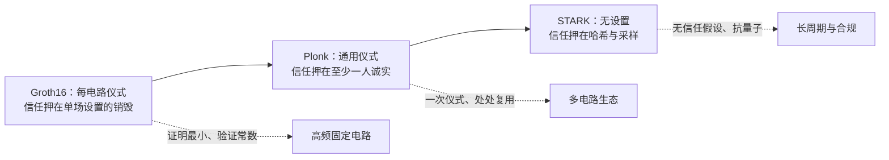

# $\rm Chapter \, 5$ SNARK 系谱：Groth16、Plonk 与 STARK

第 4 章把程序压成了一个多项式恒等式：R1CS 满足当且仅当 $Z \mid P$（§4.4），随机单点抽查的可靠性由 Schwartz–Zippel 定价。但这笔账只结了一半：验证者要查 $P(z)$，拿到的是证明者报出的数，报多少信多少等于没验；零知识更是从头到尾没有启动（§4.5 的第三笔欠账）。本章把两笔欠账一起结清，并在结清的路上展示三条技术路线对「信任押在哪」的三种回答：Groth16 把配对检查压到极致，代价是每个电路一场可信设置；Plonk 换上通用设置与 KZG 承诺；STARK 干脆不要设置，靠哈希与采样。第 3 章结尾点名的信任光谱（§3.4），本章逐家对账。

> **开始前自检**：本章假设你已经会：
>
> 1. □ R1CS 的矩阵形式、QAP 的 $Z \mid P$ 编码与商式、Schwartz–Zippel 单点抽查（91 册 §4.2、§4.4）；
> 2. □ CRS 模型、可信设置的两问、trapdoor 塌绑定量，「有毒废料」一词的来历（91 册 §3.1、§3.4）；
> 3. □ Fiat–Shamir 变换与「完整 transcript 进哈希」的规矩（91 册 §2.4）；
> 4. □ 零知识三层定义与模拟器范式（91 册 §1.2、§1.4）；
> 5. □ 离散对数问题与椭圆曲线群（24-密码学册 §5.3、§7），Merkle 树的指纹链（24-密码学册 §3.4）。

## $\rm \S \, 5.1$ 配对与 KZG：在盲点处验收多项式

白话：第 4 章的验证者只抽查一个点 $z$，可 $P(z)$ 是证明者报的数。缺一件工具：证明者交出「多项式在某个盲点 $\tau$ 处的取值」的密码学形态，验证者在不知道 $\tau$、看不见系数的前提下，只做一次小运算就能检查一个乘法关系。双线性配对就是这件工具。

**多项式承诺（polynomial commitment）**：证明者对多项式 $p$ 生成一个短承诺 $C$，之后对任何查询点 $z$ 给出打开 $(v, W)$：$v = p(z)$ 是声称取值，$W$ 是让验证者相信 $v$ 确实来自 $p$ 的见证。承诺绑定 $p$（打开值改不动），但 $C$ 本身不泄露 $p$。

**双线性配对（bilinear pairing）**：阶同为素数 $q$ 的三个群 $G_1, G_2, G_T$ 之间的映射 $e : G_1 \times G_2 \to G_T$，满足双线性

$$
e(u^a,\ v^b) = e(u, v)^{ab}
$$

「指数上的乘法」被搬进了输出群。比喻：两台各锁各的保险箱接到同一台秤上，秤读得出两箱内容的乘积，开箱的钥匙谁也没有。本章 toy 全程用**指数模拟**：取 $\mathbb{Z}_P^*$ 中阶为 $q$ 的子群（$P = 10007$、$q = 5003$、$g = 25$，与第 1 章 Pedersen 参数同源），令 $e(g^a, g^b) := g^{ab}$，由脚本里的全量离散对数表代劳。模拟口径如实说清：真实系统跑在椭圆曲线上（24 册 §7 的群），验证者既不知道 $\tau$ 也算不了离散对数；toy 脚本「全知」是模拟工具的特权，它复现的是验证等式的代数形状与「各方只拿群元素接口」这一协议边界，不模拟指数在真实大域里的不可读性。

KZG 承诺（Kate、Zaverucha、Goldberg，2010）的设置阶段铸一条**结构化参考串（structured reference string，SRS）**：

$$
\mathrm{SRS} = \bigl[\, g^{\tau^0},\ g^{\tau^1},\ \dots,\ g^{\tau^d} \,\bigr]
$$

$\tau$ 是只有设置方知道的随机数，用完即毁：它就是 §3.4 点名的有毒废料。协议三步：

1. **承诺**：$p(X) = \sum_{i=0}^{d} c_i X^i$ 的承诺 $C = g^{p(\tau)} = \prod_i \mathrm{SRS}[i]^{c_i}$。证明者不知道 $\tau$ 却能算出 $g^{p(\tau)}$：指数上的线性组合 $\sum_i c_i \tau^i$ 恰好把多项式求值做完了。SRS 是一把刻度藏在指数里的尺子，能沿它量出任何 $d$ 次多项式在 $\tau$ 处的值，读不出 $\tau$ 本身。
2. **打开**：对查询点 $z$ 声称 $v = p(z)$。$v$ 如实则 $p(X) - v$ 含因子 $(X - z)$，商式 $h(X) = (p(X) - v)/(X - z)$ 次数至多 $d - 1$，用 SRS 提交 $W = g^{h(\tau)}$，连同 $U = g^v$ 交付；$v \neq p(z)$ 时带余除法的余式是 $p(z) - v \neq 0$，商式根本造不出来。
3. **验证**：查

$$
e(C \cdot U^{-1},\ g) = e(W,\ g^{\tau - z})
$$

推导逐项可读：左边 $= g^{p(\tau) - v}$，因为 $e(\cdot,\ g)$ 只把指数原样搬进输出群（$g$ 自己的指数是 $1$）；右边 $= g^{h(\tau)(\tau - z)}$。$g$ 的阶是素数 $q$，两元素相等当且仅当指数模 $q$ 相等；而 $h(X)(X - z) = p(X) - v$ 是多项式恒等式，在 $\tau$ 处自然成立。验证者全程只见群元素：$g^{\tau - z}$ 由 $\mathrm{SRS}[1] \cdot g^{-z}$ 拼出，$\tau$ 从未以明数出现。

绑定性是这套设计的牙口，四类作弊的实测账（WSL `python3`，脚本与全部输出在 `26Fall/ucup_data/_uni5_work/expZK05/`，`expZK05.py` 与 `result.txt`，种子 `20261119`，总耗时 0.1 秒）：诚实侧随机多项式的承诺-打开-验证 1000 次，通过 $1000/1000$。作弊侧四类：错值加旧见证 500 次全失败，失败是确定性的，验证式成立会逼出 $v' = p(z)$；错值加随机见证 1000 次里意外命中 1 次，单次概率约 $1/q = 0.0002$，这个口径要读准：绑定是概率性的，把 $q$ 换成真实域的 $2^{254}$ 量级，瞎碰就是天文不可能；「聪明除法」想按 $h = (p - v')/(X - z)$ 构造商式，500 次全部除不尽（余式 $= p(z) - v' \neq 0$）；绕道走 $r = h + (X - z)\,s$ 的路需要 $s(\tau) = 0$，5000 个随机 $s$ 只命中 1 个，仍是 $1/q$ 的噪声。定向构造「在 $\tau$ 处消失的多项式」需要知道 $\tau$，这正是毒废料兑换出的绑定力。

数值走查一轮（toy 域，$\tau = 3942$，语句沿用第 4 章的 $p(X) = X^3 + X + 5$，查询 $z = 42$）：承诺 $C = 9089$；打开值 $v = p(42) \bmod q = 4093$，$U = 6155$；商式系数（低次在前）$(1765, 42, 1)$，见证 $W = 1395$；验证端 $e(C/U, g)$ 与 $e(W, g^{\tau - z})$ 相等，同为 $47$，通过。最小可跑版本（完整脚本见 `expZK05\expZK05.py`，输出在 `result.txt`）：

```python
# WSL Bash：python3 kzg_toy.py；P、Q、g 沿用第 1 章 (10007, 5003, 25)
P, Q, G = 10007, 5003, 25
tau, z = 3942, 42                       # tau 只有设置方知道
SRS = [pow(G, pow(tau, i, Q), P) for i in range(8)]      # g^(tau^i)
def commit(c):                          # 证明者只碰 SRS 元素
    C = 1
    for ci, si in zip(c, SRS):
        if ci: C = C * pow(si, ci, P) % P
    return C
p = [5, 1, 0, 1]                        # p(X) = X^3 + X + 5
v = (z**3 + z + 5) % Q                  # 4093
q = [(z*z + 1) % Q, z, 1]               # 商式 X^2 + zX + z^2 + 1 = [1765, 42, 1]
C, U, W = commit(p), pow(G, v, P), commit(q)
print(C, U, W)                          # 9089 6155 1395
dl = {}                                 # dlog 表：模拟配对的 toy 特权
cur = 1
for k in range(Q):
    dl[cur] = k; cur = cur * G % P
pair = lambda A, B: pow(A, dl[B], P)    # e(g^a, g^b) := g^(ab)
gtz = SRS[1] * pow(pow(G, z, P), -1, P) % P              # g^(tau-z)
print(pair(C * pow(U, -1, P) % P, G), pair(W, gtz))      # 47 47
```

**本节小结**：双线性配对把「指数上的乘法」搬进验证者够得着的地方；KZG 用一条 SRS 实现承诺-打开-验证，验证等式在盲点 $\tau$ 处闭合，绑定性由「除不尽、凑不出 $s(\tau) = 0$」实测撑住。toy 用指数模拟配对，接口与真实椭圆曲线配对同形。

## $\rm \S \, 5.2$ Groth16：每电路一场仪式，换来最小的证明

白话：把第 4 章的恒等式整体搬到盲点 $\tau$ 上。QAP 说 ${Z \mid P\}$（§4.4），等价于存在商式使 ${A(\tau) B(\tau) = C(\tau) + h(\tau) Z(\tau)\}$。记号先对齐：第 4 章把商式记作 $Q(t)$，本章 $Q$ 已被群阶占用，商式改记 $h$，同一个对象。

一个「裸检查」自然浮出。证明者用 SRS 把四个多项式盲提交成群元素：$A = g^{A(\tau)}$、$B = g^{B(\tau)}$、$C = g^{C(\tau)}$、$H = g^{h(\tau)}$（每个都是 §5.1 那把尺子量出来的）；设置方在每电路的验证密钥里放 $g^{Z(\tau)}$。验证者查

$$
e(A,\ B) = e(C \cdot H^{\,Z(\tau)},\ g)
$$

左边 $= g^{A(\tau)B(\tau)}$，右边 $= g^{C(\tau) + h(\tau)Z(\tau)}$，指数模 $q$ 相等正是恒等式在 $\tau$ 处的样子。诚实见证下这个检查实测 $100/100$ 通过。坏消息也实测到了：根本不知道见证、随手取两个随机多项式 ${a, b}$（次数至多 3），令 $c = ab \bmod Z$、$h = (ab - c)/Z$，四个承诺照样把同一检查蒙混过去，$100/100$ 全过。病根说穿了很清楚：配对只验「恒等式成立」，不验「${A, B, C}$ 来自见证的线性组合」。恒等式对随手拼的 ${a, b}$ 也成立，因为 $c$ 与 $h$ 本来就是按恒等式反拼出来的。

Groth16（Groth，2016；前身 GGPR 2013）的对策是给每个编码织进随机偏移。设置时取随机的 $\alpha, \beta$，把 SRS 造出带偏移的形态，使证明者手里的 $A$、$B$ 元素各自驮着一份「只能来自见证编码」的结构；真实的验证等式是

$$
e(A,\ B) = e(\alpha,\ \beta) \cdot e(L,\ \gamma) \cdot e(C,\ \delta)
$$

三项各司其职：$e(\alpha, \beta)$ 是设置时烧进密钥的固定锚，$e(L, \gamma)$ 把公开输入记进账，$e(C, \delta)$ 闭合主体。证明者想自由重组，就得凑出 $\alpha\beta$ 的乘积，而它手里只有单项，路被堵死。完整的偏移编码推导超出本册，但洞长什么样、堵的思路是什么，上面的反例已经实测在案。

代价账是理解 Groth16 地位的钥匙。设置按电路计价：每个电路一场仪式（§3.4 的多方仪式在这里兑现），产出该电路专属的证明密钥与验证密钥；换来的是全场最小的验证开销：证明只有三个群元素（$\pi_A, \pi_B, \pi_C$，BLS12-381 曲线口径约二百字节量级，文献定性），验证是三到四次配对加一次公开输入线性检查，与电路规模无关。这两条「证明最小、验证常数」把 Groth16 顶在了高频验证的位置（文献定性口径：Groth 2016，eprint 2016/260；GGPR，eprint 2013/279），第 6 章 zk-rollup 的账会回到这里。

**本节小结**：裸配对检查验住了恒等式却验不住见证来源（无见证伪造 $100/100$ 蒙混实测在案）；Groth16 用 $\alpha, \beta$ 偏移堵死自由重组，代价是每电路一场仪式，换来最小证明与常数验证。

## $\rm \S \, 5.3$ Plonk：通用设置与门方程

白话：Groth16 的仪式绑定电路，生态里每换一个电路就再开一场。Plonk（Gabizon、Williamson、Ciobotaru，2019，eprint 2019/953）把这笔账拆开：设置只铸一条与电路无关的 $\tau$ 幂串（就是 §5.1 的 SRS，业内叫 powers of tau），一次仪式、全体电路复用，且允许后来者轮流往里混入自己的随机性——只要有一名参与者诚实，$\tau$ 就不可知，信任假设从「仪式全员」放宽到「至少一人」（1-out-of-n，文献定性口径）。电路相关的账挪到证明侧，谁要用电路谁自己算。

算术化也换挡。R1CS 的约束是「线性形式乘线性形式」（§4.2），形状自由但打包粗放；Plonk 把电路切成整齐的门，每扇门一条**门方程（gate equation）**

$$
q_L\, a + q_R\, b + q_O\, c + q_M\, a \cdot b + q_C - s = 0
$$

$q_L, q_R, q_O, q_M, q_C$ 是门的系数：配成加法门、乘法门、常量门，全电路是一张门表加一串**拷贝约束（copy constraint）**，后者用置换论证把「同一根线的值在两处出现」钉成多项式恒等式（细节定性，本册不展开）。这一步与编译器把语法树压平成三地址码是同一个动作（77 册 §4.4）：门表是指令流，拷贝约束是寄存器分配。

验证形状则原封不动接 §5.1 与 §5.2 的件。把门方程看成多项式：$f(X) = q_L a(X) + q_R b(X) + q_O c(X) + q_M a(X) b(X) + q_C - s(X)$，门表满足当且仅当 $f$ 在全部门点上为零，即被门域上的消失多项式 $Z_H$ 整除，商式 $h = f / Z_H$ 用 KZG 提交。验证者在 Fiat–Shamir 折出的挑战点（§2.4，完整 transcript 进哈希的规矩照旧）用配对查 $f(\tau) = h(\tau) Z_H(\tau)$，形状与 §5.2 的检查同构，只是这里的 ${a, b, c, s}$ 先各自是多项式承诺。零知识由承诺的隐藏性与证明者侧的随机化补齐（模拟器的完整论证定性标注，超本册）。

代价账（文献定性口径）：证明尺寸数十个群元素（KZG 版数百字节到一 KB 量级），验证毫秒级、几次配对，证明者开销集中在多项式求值（FFT 一族）与大量群指数上。与 Groth16 比：单电路的证明与验证都略贵，换来的是设置一次、处处复用。

**本节小结**：Plonk 把「设置绑定电路」拆成「通用 SRS 加证明侧账单」，门方程加拷贝约束完成算术化换挡，验证形状回落到 §5.1 的 KZG 配对检查；信任假设降为 1-out-of-n 的仪式。

## $\rm \S \, 5.4$ STARK：透明设置与 FRI 低度测试

白话：前两家的信任都押在 $\tau$ 上，仪式再隆重也有一件无法全免的账：参与者得真的毁掉自己的那一缕随机性。STARK（Ben-Sasson 等，2018，eprint 2018/042）换掉整个押注物：不要 SRS，验证随机性全从 Fiat–Shamir 来（§2.4），这样的设置叫**透明设置（transparent setup）**。多项式不再承诺成群元素，而是承诺成一棵 Merkle 树的根（24 册 §3.4 的指纹链），验证靠采样，核心是一台**低度测试（low-degree test）**：FRI（Fast Reed–Solomon IOP of proximity，Ben-Sasson 等 2018）。

FRI 的机制是「对折」。证明者声称某多项式 ${\deg p < d\}$，先在一批点上把 $p$ 的取值用 Merkle 根承诺（toy 里用整条向量代替，只测代数，口径标注）。验证者发随机挑战 $\alpha$，证明者把多项式对折：

$$
p(x) = p_E(x^2) + x \cdot p_O(x^2), \qquad p_{\text{next}}(y) = p_E(y) + \alpha\, p_O(y)
$$

偶次系数与奇次系数各归各：$p_E, p_O$ 的次数都掉到 $d/2$ 以下，$p_{\text{next}}$ 在「上一域逐点平方」的半个域上提交，声称次数减半。折纸的比喻在这里严丝合缝：每对折一次，伪装的「活动空间」被迫砍半，对折 $\log d$ 次后多项式短到可以直接摊开检查。验证者的两件检查各有分工。其一，逐轮**一致性采样**：在上一域随机取 $x$，用 $p(x)$ 与 $p(-x)$ 复原 ${p_E(x^2) = (p(x) + p(-x))/2\}$ 与 ${p_O(x^2) = (p(x) - p(-x))/(2x)\}$，核对 $p_{\text{next}}(x^2) = p_E(x^2) + \alpha\, p_O(x^2)$；这抓的是「提交的向量不是某次折叠的产物」（向量被污染、与承诺不符）。其二，**终检**：最后那一小段取值必须恰好落在声称次数的多项式上；这抓的是「一路机械折叠、但起点根本不是低度」的伪装。两件合起来构成低度测试的采样验证。

实测锚点（同 §5.1 的脚本与目录，FRI 部分在 $\mathbb{F}_{7681}$，${7680 = 2^9 \cdot 3 \cdot 5\}$，域 $32 \to 16 \to 8$，声称 ${\deg < 8\}$，每轮采 $8$ 个点，$200$ 次试验）：诚实多项式 ${\deg = 7\}$，通过 $200/200$，无误杀。作弊三型：${\deg = 15\}$ 谎称 ${< 8\}$，折叠机械一致所以采样全过，终检把 $200/200$ 全部拒掉；${\deg = 9\}$ 只超一度，同样 $200/200$ 拒掉——「多超一度也不行」是低度测试的硬度；向量污染型（诚实起点，但第 1 轮提交的 $16$ 个取值里污染 $4$ 个），$200/200$ 拒，其中第 1 轮采样当场抓到 $180/200$，与理论检出 ${1 - (3/4)^8 = 0.900\}$ 对得上，剩余差额由终检补足。

数值走查一轮：$p_0$ 系数（低次在前）$(3632, 4791, 4252, 3166, 2405, 5888, 1744, 5827)$，$\alpha_1 = 1139$，采样 $x = 7584$：$p_0(x) = 4243$，$p_0(-x) = 5799$，复原 $p_E = 5021$、$p_O = 3413$，核对 $v_1(x^2) = p_E + \alpha_1 p_O$ 两侧同为 $5842$，通过；$\alpha_2 = 3420$ 折第二层，终检在 8 个点上拟合直线全对。最小可跑版本：

```python
# WSL Bash：python3 fri_toy.py；域 F_7681，32 阶单位根 w = 5235
Q2, w = 7681, 5235
assert pow(w, 16, Q2) == Q2 - 1 and pow(w, 32, Q2) == 1
D0 = [pow(w, i, Q2) for i in range(32)]
D1, D2 = D0[::2], D0[::4]               # 下一域 = 当前域的逐点平方
p0 = [3632, 4791, 4252, 3166, 2405, 5888, 1744, 5827]    # deg 7，声称 deg < 8
def peval(c, x, q):
    r = 0
    for a in reversed(c): r = (r * x + a) % q
    return r
v0 = [peval(p0, x, Q2) for x in D0]
def fold(v, Dd, alpha):                 # 对折：p_next(y) = pE(y) + alpha*pO(y)
    inv2 = pow(2, -1, Q2)
    out = []
    for i in range(len(v) // 2):
        x, xm = Dd[i], (-Dd[i]) % Q2
        vi, vim = v[i], v[Dd.index(xm)]
        pE = (vi + vim) * inv2 % Q2
        pO = (vi - vim) * pow(2 * x, -1, Q2) % Q2
        out.append((pE + alpha * pO) % Q2)
    return out
a1, a2 = 1139, 3420
v1, v2 = fold(v0, D0, a1), fold(fold(v0, D0, a1), D1, a2)
x = 7584
vi, vim = v0[D0.index(x)], v0[D0.index((-x) % Q2)]
inv2 = pow(2, -1, Q2)
pE = (vi + vim) * inv2 % Q2                             # 5021
pO = (vi - vim) * pow(2 * x, -1, Q2) % Q2               # 3413
print(v1[D1.index(x * x % Q2)] == (pE + a1 * pO) % Q2)  # True：采样一致
b = (v2[1] - v2[0]) * pow(D2[1] - D2[0], -1, Q2) % Q2
a = (v2[0] - b * D2[0]) % Q2
print(all((a + b * D2[i]) % Q2 == v2[i] for i in range(8)))   # True：终检
```

约束怎么接进来？STARK 用的算术化叫 AIR（代数中间表示），把约束写成「相邻两行状态满足的转移多项式」，与 QAP 同样归结为低度性检验（定性，本册不展开）。代价账（文献定性口径）：证明尺寸几十到上百 KB，比 Groth16 大两三个数量级；验证是对数级采样加少量哈希；证明者开销在哈希上，内存压力也最大。

抗量子要按假设的口径写准。Groth16 与 Plonk 的 KZG 依赖离散对数与配对，Shor 算法直接破（56 册 §6.1 的动机正来自此）；STARK 只依赖哈希与采样，Shor 无门，Grover 的平方加速靠把输出宽度加倍对冲。「抗量子」读作「不依赖已知量子算法能加速的困难问题」，是假设层面的陈述，不是证书。第 6 章收束时这是三类方案差异里最硬的一条。

**本节小结**：STARK 用 Merkle 根换掉群元素承诺、用 Fiat–Shamir 换掉 SRS，FRI 的对折把低度性验成采样加终检；实测诚实 $200/200$ 通过、三类作弊 $200/200$ 拒绝，检出率与 $1 - (3/4)^8$ 的采样账吻合；代价是证明尺寸大两个数量级，换来透明设置与抗量子的假设口径。

## $\rm \S \, 5.5$ 性能与信任：三类方案对照

三条路线的账摆一张表。数字全部取文献定性口径（具体毫秒与字节数随曲线、域与实现波动，不给伪精确值），信任一列是本章的主轴：

| 方案 | 设置信任 | 证明尺寸（定性） | 验证代价（定性） | 证明者开销（定性） | 已知量子威胁面 |
| --- | --- | --- | --- | --- | --- |
| Groth16 | 每电路一场仪式，有毒废料 | 最小，约二百字节量级 | 三四次配对，与电路规模无关 | 线性于电路规模，指数为主 | 依赖配对与离散对数，Shor 可破 |
| Plonk | 通用 SRS，一次仪式全员复用，1-out-of-n | 数十群元素，字节级到一 KB 量级 | 几次配对，毫秒级 | FFT 加大量群指数 | KZG 部分同上，Shor 可破 |
| STARK | 透明，无设置 | 几十到上百 KB | 对数级采样加哈希 | 哈希密集，内存压力最大 | 只依赖哈希，Grover 可对冲 |

信任光谱画成一张图，三章的账在这里收拢：



选型的三问由此自然长出：电路固定且验证频率极高吗？Groth16 的仪式成本被摊薄到接近零，证明与验证的常数优势独占。电路繁多、生态开放吗？Plonk 一次仪式通吃，验证器不用为每个新电路重开信任流程。对手是长周期、强对手或合规审查吗？STARK 没有「设置方毁掉随机性了吗」这一问可问，第 6 章的合规场景会用到这一点。三问都有答案时，答案落到表的不同列，这不是口味，是账目结构。

全册心智模型在此兑现下半句。第 4 章 §4.5 欠的那笔「witness 从头到尾不出场」：验证者最后验的是一个盲点上的代数恒等式或一批采样点的一致性，witness 以承诺与商式的形态存在于证明者的计算里，从未以明文出现在验证者的视野中。验证者确信，却什么也没看到。

**本节小结**：三类 SNARK 排成信任递减、证明递增的光谱；选型按电路固定性、生态开放度与信任/量子要求三问落位；第 4 章的零知识欠账由「witness 不出场」的验证形态兑现。

## $\rm \S \, 5.6$ 关键概念回顾

1. KZG 验证等式 $e(C \cdot U^{-1},\ g) = e(W,\ g^{\tau - z})$ 的推导每步用了什么结构？证明者不知道 $\tau$，为什么能算出 $g^{p(\tau)}$ 与 $W$？
2. 裸 QAP 配对检查实测防不住无见证伪造，伪造者在恒等式里用了什么自由度？$\alpha, \beta$ 偏移堵的是哪条重组的路？
3. Plonk 的通用设置把 Groth16 的哪笔账挪走了、挪到谁头上？门方程与 R1CS 的双线性约束在表达上差在哪？
4. FRI 的两件检查（逐轮一致性采样与终检）各抓哪类作弊？对应实测四案例里的哪两个数字？

## $\rm \S \, 5.7$ 应用与辨析

1. 排障：某 Plonk 实现把 Fiat–Shamir 挑战算成 $c = H(x)$，漏掉了证明者已提交的各承诺。它会塌在哪条性质上，攻击者的磨种子攻击面开在哪？与 §3.7 第 1 题的漏项对比，病根是不是同一个？
2. 比较：同一个 32 比特乘法器电路（§4.1 的账），分别用 Groth16、Plonk、STARK 交付，证明尺寸与验证代价的相对次序是什么？若验证端是一台算力极弱的链上虚拟机，次序变化吗？
3. 应用：你要审计一场 KZG 通用设置的仪式。列出三个该追问的问题，各对应本章与第 3 章的哪个概念；「后来者轮流混入随机性」为什么能把信任假设放宽到 1-out-of-n？

## $\rm \S \, 5.8$ 本章自测答案

> 先闭卷作答 §5.6 与 §5.7，再核对。

### $\rm \S \, 5.8.1$ 关键概念回顾答案

1. 三层结构：配对的双线性把左边搬成 $g^{p(\tau) - v}$、右边搬成 $g^{h(\tau)(\tau - z)}$；$g$ 的阶为素数 $q$，元素相等当且仅当指数模 $q$ 相等；$h(X)(X - z) = p(X) - v$ 是多项式恒等式，在 $\tau$ 处成立。证明者靠 SRS 这把「刻度藏在指数里的尺子」：$\prod_i \mathrm{SRS}[i]^{c_i} = g^{\sum c_i \tau^i}$，线性组合在指数上自动完成求值；商式的提交同法，全程不接触 $\tau$ 明数。（§5.1）
2. 伪造者的自由度是「按恒等式反拼多项式」：随手取 ${a, b}$，令 $c = ab \bmod Z$、$h = (ab - c)/Z$，恒等式 $a b = c + h Z$ 按构造成立，配对检查无法区分「多项式满足」与「见证知道」（实测 $100/100$ 蒙混）。$\alpha, \beta$ 偏移把见证编码的结构织进 SRS，证明者手里的元素各驮一份带偏移的形态，重组需要凑出 $\alpha\beta$ 乘积而各方只有单项；真实的验证式 $e(A, B) = e(\alpha, \beta) \cdot e(L, \gamma) \cdot e(C, \delta)$ 里固定锚把这条钉死。（§5.2）
3. 挪走的是「每电路一场仪式」：设置只铸与电路无关的 $\tau$ 幂串，一次仪式全体电路复用，账挪到证明侧（谁用电路谁自己算门表与商式）。表达差别：R1CS 的约束是「线性形式乘线性形式」，系数藏在矩阵里、形状自由；Plonk 的门方程 ${q_L a + q_R b + q_O c + q_M a b + q_C = s\}$ 把门种类写进系数，电路是整齐的门表加拷贝约束，拷贝约束由置换论证钉住。（§5.3）
4. 一致性采样抓「提交的向量不是某次折叠的产物」：用 $p(x)$ 与 $p(-x)$ 复原 $p_E, p_O$ 核对 $p_{\text{next}}(x^2)$，对应实测案例 4 的向量污染（4/16 污染、8 点采样，第 1 轮抓到 $180/200$，理论 $1 - (3/4)^8 = 0.900$）。终检抓「机械折叠但起点不是低度」：最后一段取值必须落在声称次数上，对应案例 2 与 3（$\deg 15$ 与 $\deg 9$ 各 $200/200$ 被拒，采样机械一致所以靠终检）。（§5.4）

### $\rm \S \, 5.8.2$ 应用与辨析答案

1. 塌可靠性。挑战与承诺无关，作弊者先读出 $c$ 再配承诺：把假语句的多项式按「验证式恒成立」反拼，磨种子等挑战归零即可，与 §3.7 第 1 题、§2.4 的弱 FS 是同一个病根：进哈希的 transcript 不完整，没被绑住的量就能反复打磨。修复是把全部已提交的 Merkle 根或群元素按顺序纳入哈希。（§5.3、§2.4、§3.3）
2. 相对次序（对照 §5.5 表）：证明尺寸 Groth16 最小、Plonk 居中、STARK 大两三个数量级；验证代价 Groth16 与 Plonk 都是常数次配对，STARK 是对数级采样加哈希。验证端算力极弱时次序不变但差距放大：配对是昂贵运算，链上虚拟机对 Groth16 的三个群元素比对 STARK 的几十 KB 采样友好得多；哈希便宜的机器才轮到 STARK 的账面好看。（§5.5）
3. 三问：$\tau$ 由谁生成、是否当场销毁、有无各方独立混入随机性（对应 §3.4 的 trapdoor 与多方仪式）；SRS 是否与电路无关、能否被后续参与者更新（对应本节 1-out-of-n）；验证密钥是否只含群元素、不残留 $\tau$ 的明数形态（对应 §5.1 的接口边界）。轮流混入随机性之所以放宽信任：仪式的最终 SRS 是所有参与者随机性的复合，只要有一人销毁了自己的那缕，复合出的 $\tau$ 对包括其他参与者在内的人都是未知的，作弊需要收买全体。（§5.3、§3.4）

**你现在能**：在 toy 域上跑通 KZG 的承诺-打开-验证并复核验证等式两侧同为 $47$，复述四类作弊的实测数字（$1000/1000$、$0/500$、$1/1000$、$500/500$、$1/5000$），用 FRI 对折两轮把 $\deg 15$ 与 $\deg 9$ 的伪装各 $200/200$ 拒掉，并按三问为给定场景在 Groth16、Plonk、STARK 之间落位。

下一章把这套机器放到真账上：zk-rollup 的 L1 验证成本与 L2 计算怎么对冲，Zcash 的 shielded 交易在 Groth16 上长什么样，以及全册与 28、24、56 三册的接口收束。
